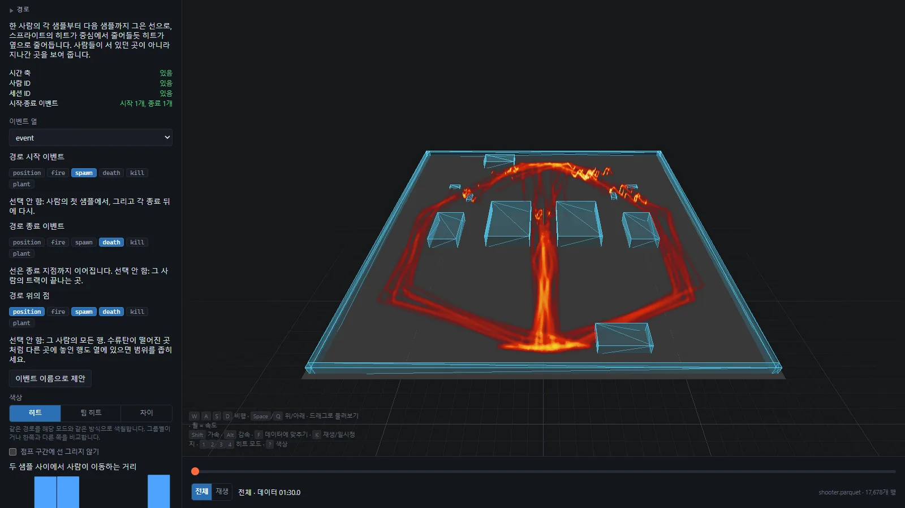

# 선 히트

히트는 사람들이 어디에 서 있었는지 보여 줍니다. 라인은 그들이 걸어간 길을 보여 줍니다.

**라인**(키 4)은 선 히트입니다. [사람](glossary.md)의 샘플마다 다음 샘플까지 선을 긋고, 그 선을 [스프라이트](glossary.md)가 가진 것과 같은 감쇠로 번지게 합니다. 점 둘레가 아니라 선을 가로질러 번지게 합니다. 이것은 사람들이 *서 있던* 곳이 아니라 *간* 곳을 보여 줍니다. 복도를 한 번 지나간 것도, 방에 오래 머문 것만큼 잘 보이고, 빠르게 움직인 플레이어의 듬성한 샘플은 점선 자국이 아니라 이어진 경로로 연결됩니다. 사람 열과 시간 열이 필요합니다.

## 사용 방법 {#how-to-use-it}

1. `4`를 누르세요(또는 모드 막대에서 **라인**을 고르세요).
2. **경로**를 열고 초록색 체크리스트를 확인하세요. 시간 축과 사람 ID가 있어야 합니다.
3. **이벤트 이름으로 제안**을 눌러 경로가 어디서 시작하고 끝나는지 채우세요.
4. 통계 줄을 읽으세요. "경로 N개, 그중 M개가 끝에 도달"이라고 나옵니다.
5. 선이 지도를 가로질러 튀면 **최대 이동 거리**를 조정하세요([점프 한계](#the-jump-limit)를 보세요).

선은 시작과 끝 사이에서만 의미가 있으므로, **경로** 패널은 무엇이 경로의 경계가 되는지 말해 줍니다. [경로의 규칙](#the-rules-of-a-route)부터 나오는 내용은 건너뛰어도 되는 세부 사항입니다.

## 경로 패널 {#the-routes-panel}

라인 모드에서는 히트 패널 위에 나타납니다.

### 데이터에 있는 것 {#what-the-data-has}

체크리스트입니다. 있으면 초록색, 없으면 주황색으로 나옵니다.

| 항목 | 상태 |
|---|---|
| **시간 축** | *있음* / *없음 - 필요함* |
| **사람 ID** | *있음* / *없음 - 필요함* |
| **세션 ID** | *있음* / *없음 - 모든 행이 한 세션* |
| **시작과 종료 이벤트** | *시작 N개, 종료 M개* / *고르지 않음 - 트랙 전체* (이벤트 열이 있고 시작과 종료가 각각 하나 이상일 때만 초록색) |

### 조작 {#controls}

| 조작 | 뜻 |
|---|---|
| **이벤트 열** | 값이 이벤트(스폰, 사망, 위치 등)인 범주 열입니다. *없음 - 트랙 전체*: 세션마다 사람의 트랙 하나가 경로 하나이며, 트랙에 틈이 있으면 거기서 끊깁니다. 불러올 때 필터용으로 남긴 열만 제시합니다. |
| **경로가 시작하는 곳** | 경로를 시작하게 하는 이벤트 값(스폰, 리스폰, 투하). 아무것도 고르지 않으면, 경로는 사람의 첫 샘플에서 시작하고 끝날 때마다 다시 시작합니다. |
| **경로가 끝나는 곳** | 경로를 끝내는 이벤트 값(사망, 탈출, 순간이동). 선은 끝 행 자체까지 그어집니다. 아무것도 고르지 않으면, 경로는 사람의 트랙이 끝나는 곳에서 끝납니다. |
| **경로 위의 점** | 행들이 경로를 따라 놓이는 이벤트 값. 아무것도 고르지 않으면, 사람의 모든 행을 씁니다. 같은 열에 다른 곳에 놓인 행(예: 수류탄이 떨어진 곳)도 들어 있다면 좁히세요. |
| **이벤트 이름으로 제안** | 아래 값의 이름으로 세 목록을 채웁니다. |
| **색상** | *히트*, *팀 히트* 또는 *차이*. 같은 경로를 그 모드의 색으로 칠합니다. 그룹마다 색조가 다르거나, 한쪽과 다른 쪽을 비교합니다. 그룹 목록, 분할, 색 띠는 그 모드에서처럼 작동합니다. 기본값은 *히트*입니다. 팀 히트와 차이는 그룹 열이 필요합니다. |
| **점프 구간에 선 그리지 않기** / **최대 이동 거리** | 사람의 다음 샘플이 이 거리보다 멀면, 그것은 그들이 간 곳이 아니라 리스폰, 순간이동, 낙하입니다. 그래서 둘을 잇는 선을 긋지 않습니다. 데이터에 뚜렷한 틈이 있으면 불러올 때 자동으로 채우고, 없으면 끕니다(아래를 보세요). 이벤트 열이 있든 없든 작동합니다. |
| 통계 줄 | `경로 N개, 그중 M개가 끝에 도달, 구간 K개`. 초에 몇 번씩 갱신됩니다. |

각 목록은 토글 칩의 줄입니다. 값마다 칩 하나이며, 자주 나오는 것이 앞에 옵니다. 칩에 마우스를 올리면 그 행 수가 보입니다. 값은 최대 120개까지 제시합니다(*값 N개 더 있음, 표시 안 함*).

다른 이벤트 열을 고르면, 제안이 그 같은 열을 고른 경우에만 제안을 적용합니다. 그 밖에는 빈 목록으로 시작합니다.

### 제안 {#the-suggestion}

불러올 때마다, 그리고 **이벤트 이름으로 제안**을 누르면([`suggestLineSettings`](https://github.com/Holdi601/3DHeat/blob/main/src/data/lines.ts)):

- **이벤트 열:** 유지된 범주 열 중 `event`, `eventname`, `eventtype`이라는 이름의 첫 열. 없으면 `kind`, `type`, `action`. 그것도 없으면 *event*, *kind*, *action*, *type*을 포함한 이름의 열.
- **시작:** *spawn, deploy, join, enter, start, begin, respawn, revive, land/landed/landing, drop*을 포함한 값. 다만 종료 단어와도 맞으면 제외합니다.
- **종료:** *death, died, dead, kill/killed, eliminat…, extract, evac, teleport, leave, left, disconnect, quit, exit, end, finish, downed*를 포함한 값. 다만 `kill`과 `kills` 값은 제외합니다(킬은 킬러가 하는 일이지, 그 사람의 경로가 끝나는 것이 아닙니다).
- **점:** 정확히 *position, location, player location, move, movement, tick, sample* 또는 *pos*인 값. 이런 값이 있으면 시작과 종료도 점에 추가합니다. 하나도 없으면 점은 비워 두고(모든 행), 그렇게 둡니다.

### 점프 한계 {#the-jump-limit}

사람들이 순간이동하는 곳에서는, 이동 거리가 두 묶음으로 나뉘며 그 사이에는 거의 아무것도 없습니다. 하나는 사람이 두 샘플 사이에서 가는 거리이고, 다른 하나는 지도의 폭입니다. 불러올 때([`suggestMaxJump`](https://github.com/Holdi601/3DHeat/blob/main/src/data/lines.ts)) 이동 거리는 제곱 길이가 두 배가 될 때마다 세며, 최대 1,600만 개까지 셉니다. 한계는 중앙값보다 위에 있는 첫 구간의 가운데에 둡니다. 그 구간은 길이가 적어도 두 배만큼 넓고, 구간마다 이동의 0.02% 미만이 들어가며, 그 너머에 이동이 있어야 합니다. 그런 구간이 없으면 자르지 않습니다. 점프와 빠른 자동차를 구별할 수 없기 때문입니다. 그때 손으로 한계를 켜면, 데이터 대각선의 10분의 1에서 시작합니다.

한계 위의 차트는 이동 거리가 실제로 얼마나 긴지 보여 주며, 한계에 선을 그립니다. 선 오른쪽의 막대는 그리지 않습니다. 두 축은 로그 눈금입니다. 점프는 이동의 100분의 1 정도이고, 그 길이는 천 배나 되기 때문입니다. 막대에 마우스를 올리면 그 구간과 비율이 나옵니다. 차트를 클릭하면 그곳으로 한계를 옮깁니다. 그 아래에는 한계를 넘는 이동의 비율이 나옵니다.

## 경로의 규칙 {#the-rules-of-a-route}

행은 사람마다 시간순으로 훑습니다([`buildLines`](https://github.com/Holdi601/3DHeat/blob/main/src/data/lines.ts)).

1. [공유 이름](sessions-persons-groups.md#names-worn-by-several-things-at-once)을 가진 행은 완전히 건너뜁니다.
2. 점을 골랐다면, 시작도 끝도 점도 아닌 행은 건너뜁니다.
3. 행은 사람별, 세션별로 따라갑니다. 그래서 세션이 시간순으로 뒤섞인 사람은 세션마다 경로가 하나씩 생깁니다. 이전 행에 다음 행이 없으면 경로를 닫습니다([수명](sessions-persons-groups.md#person)이 "없음"인 경우). 경로는 세션 경계나, 불러오기가 다음 샘플이 없다고 판단한 틈을 넘지 않습니다. 행이 어느 경로에 속하는지는 한 번 계산해서 보관하며, 행마다 4바이트입니다. 그래서 최대 이동 거리를 바꿔도 이 부분은 되풀이하지 않습니다.
4. **시작** 행은 열려 있던 경로를 모두 닫고, 그곳에서 새 경로를 엽니다.
5. 시작을 골랐다면, 경로 밖의 행은 무시합니다. 시작을 고르지 않았다면, 경로 밖의 끝이 아닌 행은 경로 하나를 엽니다.
6. 경로 안의 그 밖의 행은, 경로의 이전 행에서 이 행까지 **구간** 하나를 더합니다.
7. 경로를 늘이는 **종료** 행은 그 구간을 그은 뒤 경로를 닫습니다. 그 경로는 *끝에 도달*한 것으로 셉니다.
8. **최대 이동 거리**보다 긴 이동은 그 자리에서 경로를 닫고, 먼 쪽 끝에서 새 경로를 시작합니다. 다만 그 행이 종료라면 예외입니다. 그 사이에는 선을 긋지 않으며, 통계 줄은 그것을 셉니다.

각 구간은 *끝* 행에 저장합니다. 그래서 구간은 시간순을 유지하며, [타임라인](timeline.md) 창, 샘플러, [필터](filters.md), 그룹 보임 설정, 차이의 부호는 구간에도 점과 똑같이 작동합니다. 따라서 필터는 구간이 끝나는 행에 적용됩니다.

## 재생 {#playback}

**전체** 모드에서는 모든 경로를 통째로 그립니다. **재생** 모드에서는 사람마다 샘플 사이를 움직이는 점 하나가 되고, 그 뒤로 경로를 그립니다.

- 재생 헤드보다 뒤에서 시작하는 구간은 그리지 않습니다.
- 사람이 한가운데 있는 구간은, 그 사람의 보간된 위치까지 그리고, 머리 부분에 끝 마감을 붙입니다.
- 히트는 **꼬리**에서 흐려집니다. *누적* 기록에서는 꼬리에 제한이 없으므로 지금까지의 경로 전체가 남습니다. *창*에서는 *범위*(기본 30초)에 걸쳐 사라집니다. *수명*에서는 꼬리도 *범위*이며, 라인 모드의 타임라인은 그 기록에 대해 *범위* 상자를 보여 줍니다(선 히트는 쓰지 않는 *예비 수명*과 *페이드* 대신에).

재생 중에는 각 프레임을 누적하지 않고 통째로 그립니다. 머리가 프레임마다 움직이므로, 이동 평균을 쓰면 각각이 줄무늬로 번지기 때문입니다.

## 개발자용 {#for-developers}

### 메모리 {#memory}

경로는 라인 모드에 들어갈 때(또는 경로 설정이 바뀔 때) 메인 스레드에서 만들고, 나갈 때 해제합니다. 메모리에서는 행마다 5바이트이고, GPU에서는 행마다 8바이트입니다(구간의 시작 위치를 데이터의 경계 상자 안에서 축마다 16비트로 양자화한 값과 플래그).

### 선을 그리는 방법 {#how-a-line-is-drawn}

두 백엔드 모두 각 구간을 끝 행에서 **18개의 꼭짓점**으로 그립니다([`lineHeatVs`](https://github.com/Holdi601/3DHeat/blob/main/src/render/webgl2/shaders.ts)와 그 WGSL 쌍둥이).

- 각 끝의 반폭은 그 끝의 거리에서의 [스프라이트 반지름](sprite-shape.md#sprite-radius)입니다. 픽셀 한계를 적용합니다. 2.5 px보다 가는 선은 2.5 px 너비로 그리고, 그에 맞춰 히트를 낮춥니다. 그래서 가는 선은 사라지지도, 지나치게 밝아지지도 않습니다.
- 히트는 선을 **가로질러** 스프라이트와 같은 띠로 감쇠합니다. 감쇠나 곡선, 중심과 가장자리의 세기가 같습니다.
- 둥근 끝 마감은 경로가 시작하거나 끝나는 곳**에서만** 그립니다. 그래서 이어진 구간 사이의 이음새가 구슬 줄처럼 뭉치지 않습니다.
- 기하는 화면 공간에서 만들고 그곳에서 선형으로 보간합니다. 그래서 선이 깊이 속으로 들어가더라도 감쇠가 선의 중심에 맞춰 남습니다. 근거리 면을 가로지르는 구간은 버리지 않고 그 면에서 잘라 냅니다.

점 히트와 선 히트는 행마다 놓는 히트의 양이 아주 다릅니다. 그래서 둘 사이를 바꿀 때 포화도를 다시 측정합니다([색상과 노출](colour-and-exposure.md#auto-exposure)).
