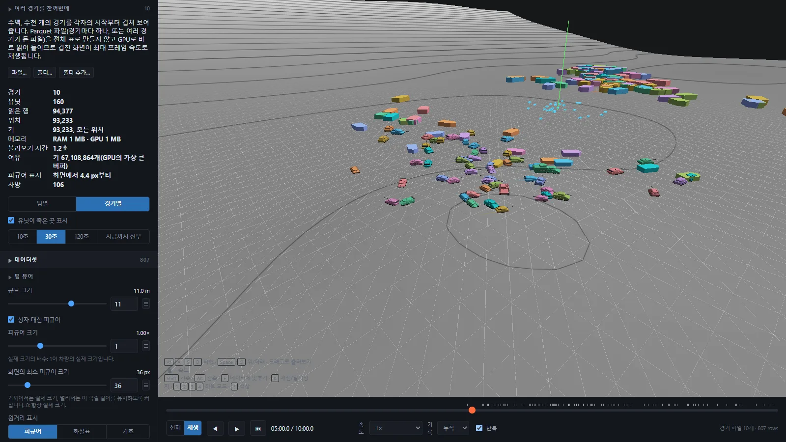

# 여러 경기를 한꺼번에

**여러 경기를 한꺼번에**는 많은 경기를 겹쳐서 재생하므로, 모든 경기의 플레이어가 보통 어디로 가는지 볼 수 있습니다. 수백, 수천 경기를 한 그림에서 비교할 때 쓰세요.

각 경기는 자기 시작점에서 출발하고, 유닛은 피규어로 움직입니다. 파일은 그래픽 카드로 바로 들어가며 전체 표를 만들지 않으므로, 보통 불러오면 메모리가 떨어질 곳에서도 부드럽게 재생됩니다.

## 사용 방법 {#how-to-use-it}

1. 히트맵 사이드바에서 **여러 경기를 한꺼번에**를 여세요.
2. **파일…** (파일 여러 개 고르기), **폴더…** (폴더와 하위 폴더), 또는 **폴더 추가…** (이미 불러온 것에 더하기)를 누르세요.
3. 뷰어는 피규어 오버레이로 바뀌고 처음 시점에서 시작합니다. **재생**을 누르세요.

파일 하나가 경기 하나입니다 (또는 여러 경기를 담을 수 있음). Parquet 파일과 [`.3dheat`](container.md) 컨테이너가 작동합니다. 파일에는 위치, 시간, 유닛 열이 있어야 합니다. 이름, 종류, 진영 열은 보존됩니다. 다른 파일과 변환기의 보조 파일(비행, 메시지, 이벤트, 채팅, 목표)은 건너뜁니다. 일반 표는 [데이터 가져오기](getting-data-in.md)를 보세요.

## 설정 {#settings}

| 설정 | 하는 일 |
|---|---|
| **팀별** / **경기별** | 진영별로 색을 입히거나, 경기마다 색을 하나씩 줍니다. |
| **유닛이 죽은 곳 표시** | 유닛이 죽은 곳에 표시를 남깁니다. 10초, 30초, 120초, 또는 지금까지 전부. |

패널은 읽은 경기, 유닛, 행, 위치의 수, 사용한 메모리, 불러오는 시간을 보여 줍니다. *Room for*는 그래픽 카드가 아직 더 받을 수 있는 위치의 수입니다. *Figures from*은 유닛이 피규어 대신 작은 화살로 그려지는, 화면상의 기준 크기입니다.

피규어의 모습은 [매치 재생](match-replay.md#figures)과 같은 컨트롤을 씁니다: **Figure size**, **Smallest figure on screen**, **At a distance**.

## 팁 {#tips}

- 모든 것이 메모리에 들어가지 않으면 위치를 솎아 냅니다 (몇 미터마다 위치 하나만 남김). 패널에 그렇게 나옵니다.
- 히트 모드도 오버레이의 데이터에서 작동합니다.
- 그리지 않고 수천 경기에 걸친 통계를 보려면 [대량 분석](mass-analysis.md)을 보세요.
