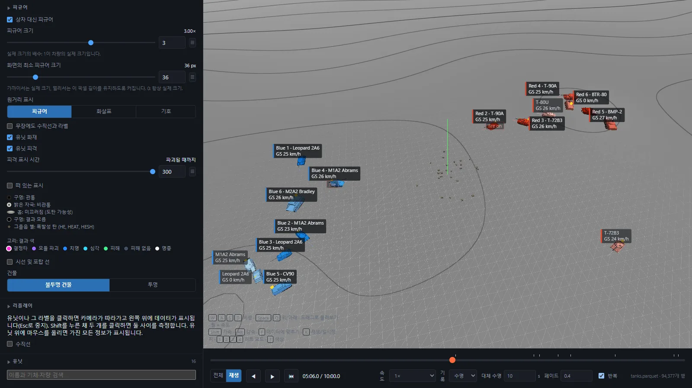
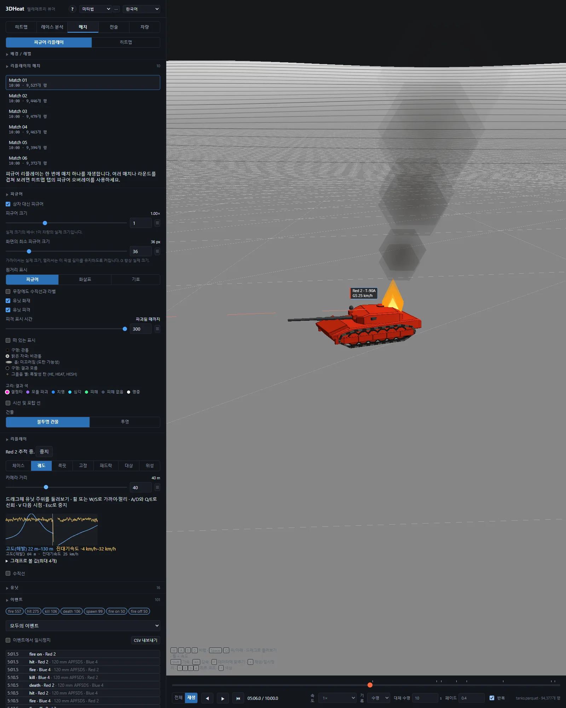
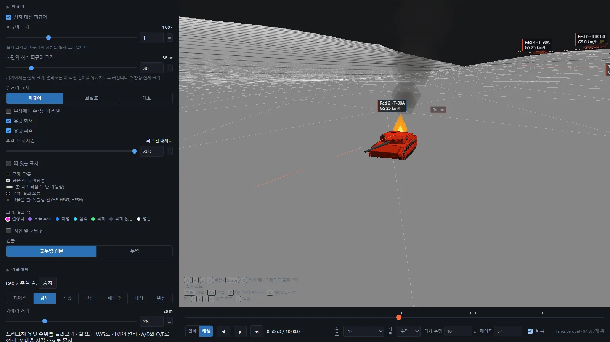
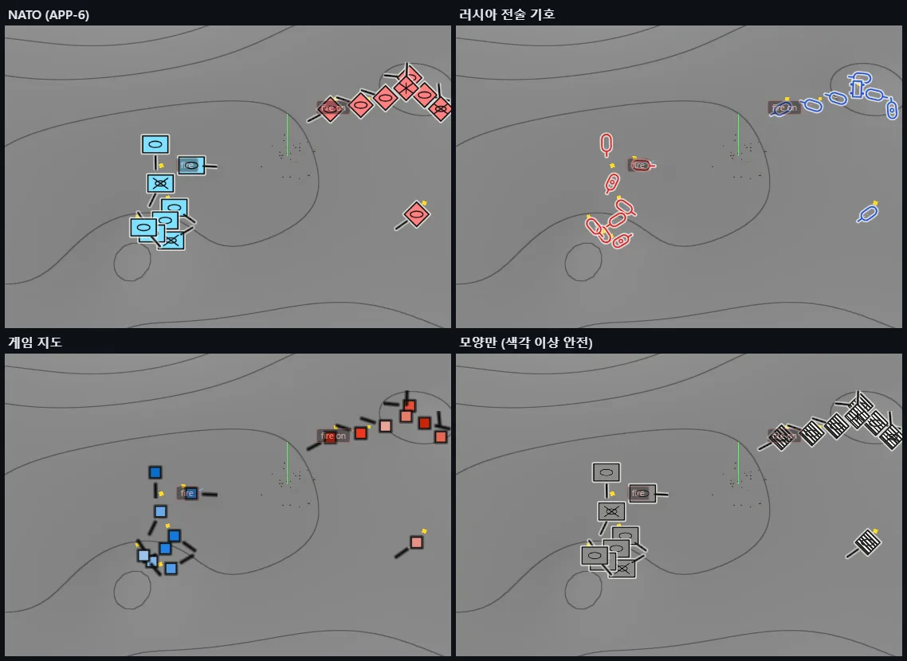
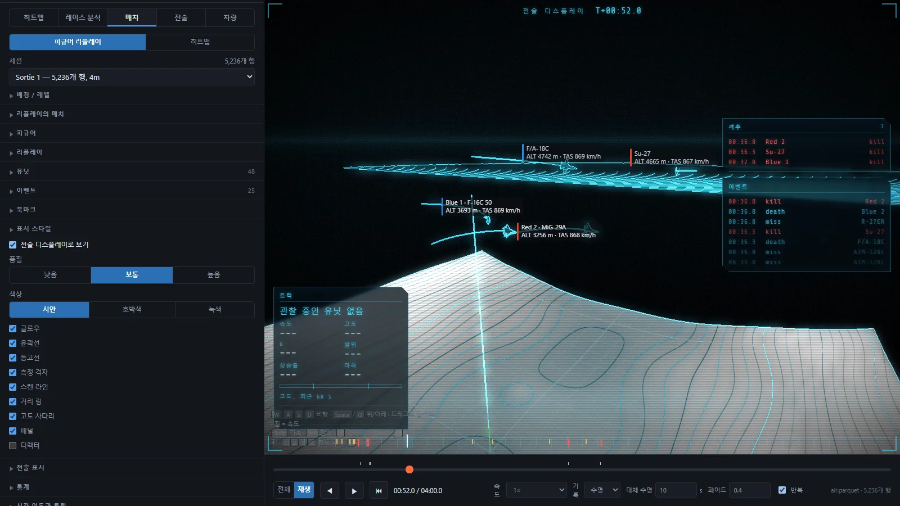
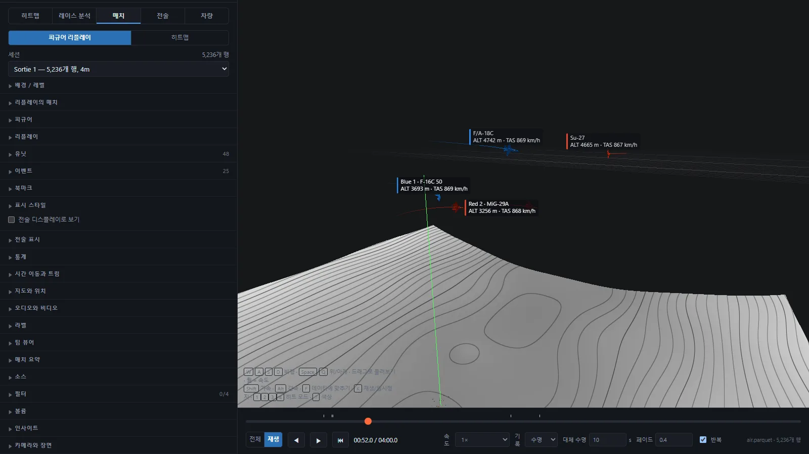

# 경기 리플레이

리플레이는 경기를 담은 영화입니다. 모든 플레이어가 몰았던 것으로 그려집니다. 전투를 다시 보고, 한 유닛을 따라가며, 누가 누구를 맞혔는지 보는 데 쓰십시오.

사격, 명중, 발사, 잔해는 레벨 위의 유닛과 목표물 위에 그려집니다. 카메라, 라벨, 전술 표시가 전투를 읽는 데 도움을 줍니다. Tacview를 아십니까? [Tacview 동등성](tacview-parity.md)은 그 도구들 각각이 어디에 있는지 보여 줍니다.

## 리플레이 시작하기 {#start-a-replay}

1. **원천 → 파일…**로 기록을 불러오거나, 원천 패널에 떨어뜨립니다(**사람** 열과 **시간** 열이 있는 표, Tacview 파일, 변환된 리플레이, [`.3dheat`](container.md) 경기 등 무엇이든). [데이터 가져오기](getting-data-in.md)를 보십시오.
2. **경기** 탭을 열고 **피규어 리플레이**를 고르거나, 히트 탭의 모드 막대에서 **피규어 오버레이**를 고릅니다.
3. **리플레이의 경기** 아래에서 경기 하나, 전부, 또는 여러 개를 고릅니다.
4. 타임라인에서 **재생**(또는 `K`)을 누릅니다. 타임라인을 끌면 그곳으로 뜁니다.

이름이나 유형이 알려진 모든 유닛은 상자 대신 피규어로 바뀝니다([피규어](figures.md)를 보십시오). 이름이나 유형 열이 없는 데이터는 병사로 그려집니다.

## 피규어 {#figures}

| 설정(**피규어** 섹션) | 기본값 | 하는 일 |
|---|---|---|
| **상자 대신 피규어** | 켜짐 | 끄면 평범한 상자를 그립니다. |
| **피규어 크기**(실제 크기의 배수) | 1 | 1은 실제 크기입니다. 0.25배에서 20배(로그 눈금). 먼 곳에서는 더 크게 하면 도움이 됩니다. |
| **화면의 최소 피규어 크기** | 36 px | 먼 피규어는 이 길이를 유지하도록 커집니다. 0에서 200 px. 0이면 실제 크기를 유지합니다. |
| **원거리 표시**: 피규어, 화살표, 기호 | 피규어 | 먼 유닛이 무엇이 되는지. |
| **기호 체계** | NATO(APP-6) | NATO(APP-6), 러시아 전술 기호, **게임 지도** 아이콘, 또는 **모양만(색각 이상 안전)**. |
| **기호 크기**, **내 진영**, **적 / 중립**, **진행 방향 표시** | 28 px(12-64), 자동, 적, 켜짐 | 기호가 어떻게 보이는지와 어느 쪽이 아군인지. |
| **수직선** | 켜짐 | 각 유닛에서 지면까지 곧게 내린 선. 3D에서 높이를 읽을 수 있게 합니다. |
| **무장에도 수직선과 라벨** | 꺼짐 | 미사일과 폭탄의 지면 선과 라벨. |
| **유닛 화재** | 켜짐 | 유닛에 불이 붙은 순간부터 꺼질 때까지의 불꽃. |
| **유닛 피격** | 켜짐 | 사격이 맞은 곳의 표시(아래). **피격 표시 시간**: 1에서 300초, 또는 **파괴될 때까지**. **떠 있는 표시**: 표면 위에 그려진 표시. |
| **시선 및 포탑 선** | 꺼짐 | 점선: 플레이어가 보는 곳. 실선: 포가 향하는 곳. |
| **건물** | 불투명 | 레벨이 그릴 때, 불투명하거나 투명한 건물. |

### 원거리의 기호 {#symbols-at-a-distance}

유닛이 **화면의 최소 피규어 크기**보다 작아지면, 계속 읽을 수 있는 기호가 될 수 있습니다. 모양은 종류를 말해 줍니다(예: 장갑에는 궤도 표시가 있는 둥근 상자). 색은 진영을 말해 줍니다. **기호** 메뉴를 열면 양식을 바꿀 수 있습니다.

### 명중 표시, 잔해, 화재 {#hit-marks-wrecks-and-fires}

- **명중 표시**는 사격이 닿은 표면에, 피규어의 크기에 맞춰 놓입니다. 모습은 무슨 일이 있었는지 말해 줍니다. 구멍(관통), 밝은 튐(관통 실패), 긁힌 자국(튕겨 나감), 그을음 별(폭발탄). 색깔 고리는 무엇을 했는지 말해 줍니다. 격추탄, 모듈 파괴, 치명타, 심각, 피해, 피해 없음, 명중입니다. 표시에 마우스를 올리면 그 발사의 이름이 나옵니다.
- 파괴된 유닛은 사망한 순간부터 다시 나타나거나 제거될 때까지 **그을린** 잔해로 그려집니다. 그 기호에는 X가 그어집니다.
- **화재**는 유닛에 불이 붙은 순간부터 꺼질 때까지 그 유닛에서 탑니다.
- **포탑**은 데이터가 포가 향한다고 말하는 곳으로 돕니다(그 정보가 없으면 플레이어가 보는 곳으로).

### 무기, 미끼, 예광탄 {#weapons-decoys-and-tracers}

**무장, 사격, 명중**(팀 뷰어 섹션)을 켜면, 미사일, 로켓, 폭탄, 어뢰는 연기 자국을 남기며 자기 피규어로 날아갑니다. 총알과 포탄은 예광탄입니다. 충돌과 폭발은 번쩍입니다. **점선**으로 그린 예광탄은 데이터에 사격이 없어서 명중으로부터 추정한 것입니다. 섬광탄과 채프는 미끼로 그려집니다. *미끼와 포탄*을 체크하지 않으면 유닛 목록에서 숨겨집니다.

## 카메라 {#cameras}

유닛이나 그 라벨을 클릭하면 그것을 **따라갑니다**. **리플레이** 섹션은 **체이스**, **궤도**, **콕핏**(헤드업 디스플레이, `H`), **고정**, **패드락**, **대상**, **위성**을 제공합니다. `V`는 이들을 순환하고, **카메라 거리**는 얼마나 멀리 있을지 정합니다. Esc는 멈춥니다.

- **두 유닛 보기**: **대상**을 고르거나(또는 Ctrl/Alt-클릭으로 유닛을 고르면), 따라가는 유닛에서 그것을 봅니다. **맞바꾸기**는 둘을 서로 바꿉니다.
- **측정**: 유닛 두 개를 Shift-클릭하면 그 사이의 방위, 거리, 고도 차이를 봅니다.
- **2D 지도**(`M`): 모서리 또는 전체 보기. 자취와 이름이 함께 나옵니다.
- **북마크**(`B`): 그 순간과 카메라를 저장합니다. 기록 자체의 격추, 사망, 표시도 함께 나열됩니다.
- **이벤트**: 시간순으로 모든 이벤트. 클릭하면 그곳으로 뜁니다. `Page Up` / `Page Down`은 이벤트 사이를 뜁니다. **이벤트에서 일시정지**를 켜면 각 이벤트에서 멈춥니다.

## 전술 표시 {#tactical-display}

**전술 표시** 섹션은 유닛이 없으면 선택한 것, 전부, 또는 한 종류(항공기, 지상, 함선, 무장)에 대해 그립니다. 속도 벡터와 앞의 경로, 기수와 양력 선, 레이더 원뿔, 잠금, 데이터 링크, 교전 구역과 선, 시선, 플레이어가 보는 곳(시야 원뿔), 포탑 조준, 그리고 기록된 카메라가 그 대상입니다.

### 표시 양식 {#display-style}

`T`(또는 **전술 디스플레이로 보기** 토글)는 모양을 레이더 화면 양식으로 바꿉니다. 빛남, 윤곽선, 등고선, 측정 격자, 주사선, 거리 고리, 고도 사다리, 격추와 이벤트가 있는 패널, 그리고 이벤트로 카메라를 스스로 옮기는 **디렉터**가 있습니다.

## 목표 {#objectives}

경기에 목표가 딸려 올 때, **목표** 섹션은 레벨 위에 목표를 그립니다. 점령 구역(소유자와 점령 진행률 포함), 출현 지점, 비행장, 구역, 폭격 목표입니다. 각 층은 켜고 끌 수 있고, 라벨도 있습니다. 목표는 지면 너머로도 보입니다. 게임 모드가 여럿 불러와지면, **모드**가 모드별로 경기를 거릅니다. 목표는 기록 옆의 변환기 경기 파일이나, [`.3dheat`](container.md) 컨테이너 안에서 옵니다.

## 라벨과 통계 {#labels-and-statistics}

- **라벨**: 종류별 규칙(**선택됨**, **항공기**, **지상**, **함선**, **무장**, **AI**). 보일지 말지, 어떤 값을 보일지, 라벨이 겹칠 때 누가 자리를 차지하는지 정하는 **우선순위**. **라벨 겹치지 않게**는 라벨이 다른 것을 가리면 라벨을 그 유닛 옆으로 옮기고, 자리가 없으면 뺍니다. **라벨 크기**는 60에서 250%입니다. **이름, 기체·차량, 고도, 속도로 되돌리기**는 규칙을 초기화합니다.
  - 지상 유닛은 이름, 차량, 속도로 시작합니다.
  - 항공기는 이름, 기체, 고도, 속도로 시작합니다.
  - 함선은 이름, 차량, 속도, 방향으로 시작합니다.
  - 유닛에 마우스를 올리면 가진 모든 값을 봅니다.
- **통계**: 팀과 유닛별 격추, 사망, 사격, 명중, 명중률, 이륙, 착륙, 공중 체류 시간, 최고 속도, 고도와 G, 거리. CSV로 내보내기.
- **차트**: 유닛의 값을 시간에 따라, 두 유닛을 비교, 또는 한 값을 다른 값에 대해 봅니다.

## 여러 경기를 한꺼번에 {#many-matches-at-once}

수백 또는 수천 경기를 겹쳐 놓으려면 [여러 경기를 한꺼번에](many-matches.md)를 보십시오. 피규어의 세부(연기, 화재, 그 밖의 시간이 정해진 효과)는 [피규어 오버레이의 피규어](figure-replay.md)에 있습니다. Tacview 기능 목록은 이 페이지의 하위 페이지인 [Tacview 동등성](tacview-parity.md)에 있습니다.
