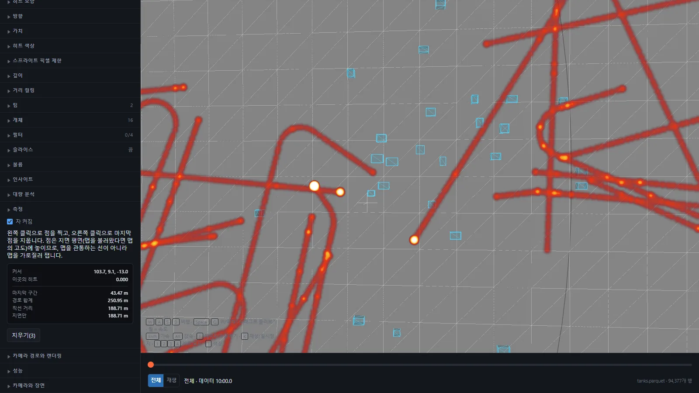

# 측정

**측정**은 마우스를 자로 바꾸고, 커서 아래 지점이 얼마나 붐비는지 알려 줍니다. 두 장소가 얼마나 떨어져 있는지, 또는 한 지점에 교통이 얼마나 몰리는지 알아볼 때 쓰세요.

## 해 보기 {#try-it}

1. 사이드바에서 **측정**을 열고 **자 켜짐**을 체크하세요.
2. 지도의 세 곳을 왼쪽 클릭하세요. 클릭할 때마다 점이 찍힙니다.
3. **경로 합계** (전체 경로의 길이)와 **마지막 구간** (마지막 구간)을 읽으세요.
4. 오른쪽 클릭으로 마지막 점을 지우거나, **Clear (3)**을 눌러 모두 지우세요.

| 동작 | 효과 |
|---|---|
| 왼쪽 클릭 | 커서가 지면 평면과 만나는 곳에 점을 찍습니다. 누른 뒤 놓을 때까지 4픽셀 넘게 움직인 클릭은 점이 아니라 카메라 끌기입니다. |
| 오른쪽 클릭 | 마지막 점을 지웁니다. |
| 움직임 | 커서 위치와 그 아래 히트가 실시간으로 바뀝니다. |

자가 켜져 있어도 카메라는 계속 작동합니다. 끌면 여전히 둘러보고, 키는 여전히 날립니다. 자가 켜져 있으면 모든 클릭을 가져가므로, [클릭으로 고르기](camera.md#click-to-pick)는 자를 끌 때까지 기다립니다.

**지면 평면**은 지도 이미지가 불러와져 있으면 [지도 이미지](map-images.md)의 고도이고, 없으면 데이터셋의 가장 낮은 Y입니다 (지도가 없으면 0). 점은 그 평면 위에 찍히므로, 자는 지도를 가로질러 재고, 지도를 관통하는 선을 따라 재지 않습니다. 3D 레벨이 있어도 평면은 여전히 데이터셋의 가장 낮은 Y이며, 레벨의 표면이 아닙니다. 실제 표면의 점이 필요하면 자를 끄고 그 점을 클릭하세요 ([클릭으로 고르기](camera.md#click-to-pick)). 이것은 레벨 자체의 삼각형에서 좌표를 읽습니다.

## 표시값 {#readouts}

| 줄 | 뜻 |
|---|---|
| **커서** | 평면 위, 커서 아래 점의 월드 X, Y, Z. |
| **이곳의 히트** | 커서 픽셀의 히트 양. 값이 클수록 그 지점에 교통이 많습니다. 포화점이 나누기 전에 색 램프에 들어가는 값이므로, [포화점](colour-and-exposure.md#saturation-point)과 비교할 수 있습니다. |
| **마지막 구간** | 마지막 점에서 커서까지의 거리 (또는 마지막 두 점 사이). |
| **경로 합계** | 모든 점과 커서를 지나는 꺾은선의 길이. |
| **직선 거리** | 첫 점에서 커서까지 (또는 마지막 점까지)의 3D 거리. |
| **지면만** | 같은 값, X와 Z만 사용. |
| **Clear (N)** | 모든 점을 지웁니다. |

거리는 1 단위 미만은 센티미터, 1,000 미만은 미터, 그 이상은 킬로미터로 보여 줍니다. 월드 단위 하나가 1미터라고 가정합니다 ([축, 단위와 시간](axes-units-and-time.md#unit-scale)). 좌표는 월드 좌표입니다. 축을 [표시용으로 뒤집었을 때](camera.md#invert-world-axis)도 마찬가지입니다.

점과 그 사이의 선은 뷰 위의 오버레이로 그려지며, 격자 간격에 맞춰 크기가 정해집니다. 자의 점은 뷰에 저장되지 않습니다. 다른 데이터를 불러와도 그대로 남습니다.

## 개발자용 {#for-developers}

**이곳의 히트**는 GPU에서 최대 120ms마다 한 번 읽습니다. 한 픽셀 읽기는 파이프라인을 멈추기 때문입니다. `engine.readHeatProbe()`와 같은 경로를 씁니다. 프레임을 쓸 때의 이득으로 나누므로, 반정밀도 누적 경로(`?heat=f16`)에서도 32비트 타깃과 같은 단위입니다 ([반정밀도 부동소수점 누적](half-float-accumulation.md)).
