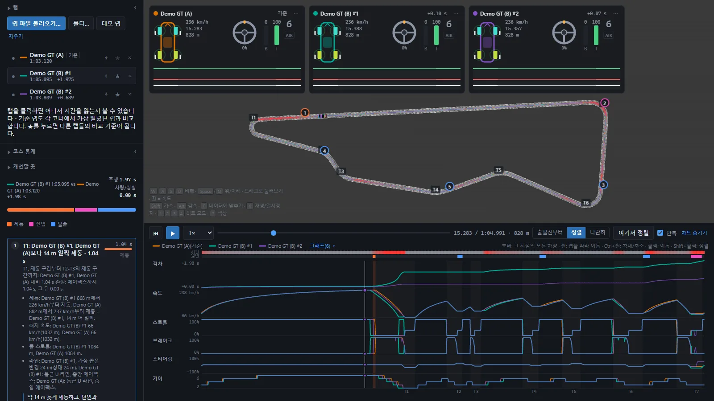

# 레이스 분석

같은 트랙을 두 번 달렸습니다. **레이스 분석** 탭은 두 주행을 함께 3D로 재생하고, 한 랩이 어디서 더 느렸는지 보여 주며, 그 이유를 말해 줍니다. 아직 랩이 없나요? **데모 랩**을 누르세요.

이 탭은 한 코스의 랩 둘 이상을 비교합니다. 캔버스, 카메라, 불러온 코스 모델(**배경 / 레벨**)은 히트맵과 함께 씁니다. 나머지는 모두 자기 것입니다. 자기 사이드바와 보기 아래의 자기 막대가 있습니다. *랩*, *기준*, *정점* 같은 단어는 [용어집](glossary.md)에 있습니다.

이 페이지는 탭의 지도입니다. 각 부분마다 자기 페이지가 있습니다.

| 페이지 | 다루는 내용 |
|---|---|
| [랩 불러오기](race-loading-laps.md) | 모든 파일 형식, 폴더와 코스, 차량 이름, 데모 랩, 랩 목록, 기준과 초점 |
| [리플레이와 3D 장면](race-replay-and-scene.md) | 재생 막대, 재생 모드 세 가지, 차량 줄 세우기, 추격 카메라, 선, 맵, 차량, 라벨, 거울상 월드 |
| [차트와 HUD](race-charts-and-hud.md) | 거리 차트, 그래프 고르기, 마우스 올리기와 확대, 차량 카드, 채널 표 |
| [차량 컨트롤 사건](race-control-events.md) | 잠김, 휠스핀, 오버스티어, 스핀, 언더스티어, 피격, 충돌, ABS/TC, 핸드브레이크, 공중. 각각 어떻게 감지하는지, 모든 임계값과 함께 |
| [코너별 분석](race-corner-analysis.md) | 거리에 따른 정렬, 코너와 구간, 코너의 시간 계산, 모든 원인과 시도하는 순서, 라인 모양과 조언 |
| [차량 프로필과 비교](race-car-profiles.md) | 각 차량이 할 수 있는 것을 그 랩에서 잰 값으로 보여 줌. *차량 비교*. 각 코너에서 차량이 결정하는 것 |
| [코스 통계](race-course-statistics.md) | 한 코스의 랩 여러 개: 코너별, 종류별 실수. 실수 지도, 히트맵 내보내기, 성능 한계 |
| [레이스 분석: 방법](race-analytics.md) | 규칙 뒤의 연구, 출처와 함께 |
| [다른 레이싱 게임](other-games.md) | 뷰어가 각 게임의 랩을 어떻게 다루는지. 게임이 보내지 않는 슬립과 드리프트를 계산하는 방법, 거울상 월드, 추가 채널 |

## 화면 {#the-screen}

**사이드바**, 위에서 아래로(섹션은 접을 수 있음):

1. **랩** - 불러오기, 목록, 보이기/숨기기, 기준, 초점, 추격.
   [랩 불러오기](race-loading-laps.md)를 보세요.
2. **코스 통계** - 랩을 세 개 이상 불러왔을 때부터 나타납니다.
   [코스 통계](race-course-statistics.md)를 보세요.
3. **개선할 곳** - 초점 랩의 발견 항목을 코너별로 보여 줍니다.
   [코너별 분석](race-corner-analysis.md)을 보세요.
4. **코너별**(또는 여러 등급일 때 *코너별 - X 등급*) - 각 코너를 가장 빨리 통과한 랩과 그 라인. 랩이 둘 이상일 때 나옵니다.
5. **차량 컨트롤** - 초점 랩의 잠김, 미끄럼, 밀림, 피격.
   [차량 컨트롤 사건](race-control-events.md)을 보세요.
6. **차량 비교**(차량이 하나면 **차량**) - [차량 프로필과 비교](race-car-profiles.md)를 보세요.
7. **보기** - 트랙에 어떤 맵을 칠할지, 무엇을 그릴지.
   [리플레이와 3D 장면](race-replay-and-scene.md)을 보세요.
8. 공유하는 **레벨**과 **카메라와 장면** 패널(코스 모델, 축 뒤집기, 카메라). 히트맵과 [카메라](camera.md)에 함께 설명되어 있습니다.

**보기 화면**은 코스, 주행 라인, 맵, 차량, 트랙에 고정된 라벨, 그리고 왼쪽 위의 차량 카드 최대 여섯 개를 보여 줍니다([차트와 HUD](race-charts-and-hud.md)를 보세요). 랩을 하나도 불러오지 않았다면 "랩이 없습니다 - 랩 파일을 두 개 이상 여기에 끌어다 놓거나, 사이드바에서 데모 랩을 불러오세요."라고 나옵니다.

**보기 아래의 막대**에는 리플레이 재생 조작과, 숨기지 않았다면 거리 차트가 있습니다.

## 빠른 시작 {#quick-start}

1. **레이스 분석** 탭을 여세요(사이드바 맨 위의 **히트맵** 옆에 있습니다).
2. 랩을 가져오세요. **데모 랩**을 누르면, 탭이 가상의 랩 세 개를 어떻게 다루는지 볼 수 있습니다. 자기 랩이라면 먼저 녹화하세요([파일 형식과 녹화 도구](race-loading-laps.md#file-formats)). 그다음 **랩 파일 불러오기…** 또는 **폴더…**를 누르거나, 파일이나 폴더를 보기에 끌어다 놓으세요.
3. 가장 빠르게 완주한 랩이 기준이 됩니다. 나머지 중 가장 느린 랩이 초점이 됩니다. 목록에서 아무 랩이나 클릭하면 초점이 맞춰지고, ★를 누르면 그 랩이 기준이 됩니다.
4. **개선할 곳**을 읽으세요. 발견 항목을 클릭하면, 차량들이 그 40 m 앞에 줄 맞춰지고, 카메라가 그것을 화면에 담고, 리플레이가 그 구간을 재생하며, 측정값이 열립니다.
5. 차트에 마우스를 올리면 모든 차량이 그 미터로 옮겨 갑니다. Shift+클릭은 그곳에서 차량을 줄 세웁니다.

## 키보드 {#keyboard}

레이스 탭이 열려 있을 때:

| 키 | 하는 일 |
|---|---|
| **K** | 리플레이 재생 / 일시 정지 |
| **Home** | 리플레이의 시작으로 돌아감 |
| 숫자 키 | 아무것도 하지 않음(히트맵에서는 모드를 바꿈) |

텍스트 칸이나 드롭다운에 입력한 키는 무시합니다. 카메라 키는 히트맵과 같이 작동합니다(**W A S D**, **Space**로 위, **Q**로 아래, **Shift**로 빠르게, **Alt**로 느리게, 마우스로 둘러보기. 모두 [카메라](camera.md)에 있습니다). **F**는 불러온 랩을 화면에 맞춥니다(랩을 불러올 때와 같습니다).

## 많은 랩 {#many-laps}

- 불러온 모든 랩을 분석하고 셉니다. 수십 개도 1~2초면 됩니다.
- **8**개를 넘으면(`SHOW_ALL_UP_TO`), 새로 추가한 랩은 기준, 초점 랩, 또는 초점 랩의 등급에서 가장 빠른 랩인 경우에만 그립니다. *모두 표시* / *보고 있는 랩만*으로 바꿉니다.
- 보이는 차량이 **10**대를 넘으면(`PLAIN_PAST`), 보고 있지 않은 랩(초점, 추격 중인 차량, 기준이 아닌 랩)은 1.5 m 대신 6 m마다 점 하나로 줄인 선으로, 차량은 단순하게 그립니다.
- 차트는 최대 **8**개 랩을 그리고, HUD는 최대 **6**개 카드를 보여 줍니다.
- 코스 통계는 랩 **3**개부터 나타납니다.

자세한 내용: [코스 통계](race-course-statistics.md#performance-with-many-laps).

## 기본 보기 설정 {#default-view-settings}

| 설정 | 기본값 |
|---|---|
| 맵 | 시간 지도 |
| 주행 라인, 차량, 타이어와 서스펜션, 라벨, 랩에서 얻은 트랙 | 켜짐 |
| 카드의 모든 값 | 꺼짐 |
| 차량 크기 | 1× |
| 차트 | 보임 |
| 재생 모드 | 라인 시작부터 |
| 재생 속도 | 1× |
| 반복 | 켜짐 |

이 중 아무것도 저장하지 않습니다. 다시 불러오면 기본값에서 시작합니다. 브라우저가 기억하는 것: 언어, 그리고 랩 파일에서 배운 차량 이름([랩 불러오기](race-loading-laps.md#car-names)를 보세요).

## 개발자용 {#for-developers}

### 랩을 불러오면 일어나는 일 {#what-happens-when-laps-are-loaded}

랩 집합, 기준, 또는 언어가 바뀔 때마다 분석 전체를 다시 합니다([`src/race/analysis.ts`](https://github.com/Holdi601/3DHeat/blob/main/src/race/analysis.ts)의 `analyse`):

1. 게임이 보내지 않는 곳에는 각 랩에 계산된 채널을 더합니다. 드리프트 각, 바퀴 속도에서 얻은 바퀴 슬립, 공중 상태, 느슨한 지면, 요 속도([`derive.ts`](https://github.com/Holdi601/3DHeat/blob/main/src/race/derive.ts)).
2. 기준을 고르고, 모든 랩을 그 경로에 투영하여 2 m마다 다시 샘플합니다([`align.ts`](https://github.com/Holdi601/3DHeat/blob/main/src/race/align.ts)).
3. 게임의 월드가 거울상인지 랩에서 계산합니다([`handedness.ts`](https://github.com/Holdi601/3DHeat/blob/main/src/race/handedness.ts)).
4. 기준에서 코너를 찾고, 한 제동 구간에서 다음 제동 구간까지의 구간으로 묶습니다([`segments.ts`](https://github.com/Holdi601/3DHeat/blob/main/src/race/segments.ts)).
5. 차량별로, 그 엔벨로프(속도별 그립, 제동, 가속), 프로필, 타이어 곡선을 계산합니다([`envelope.ts`](https://github.com/Holdi601/3DHeat/blob/main/src/race/envelope.ts), [`profile.ts`](https://github.com/Holdi601/3DHeat/blob/main/src/race/profile.ts), [`control.ts`](https://github.com/Holdi601/3DHeat/blob/main/src/race/control.ts)).
6. 랩과 구간마다, 무엇을 했는지(제동 지점, 가장 느린 지점, 전개 스로틀 ...)와 달린 라인을 계산합니다([`line.ts`](https://github.com/Holdi601/3DHeat/blob/main/src/race/line.ts)).
7. 랩마다, 그 랩의 차량 컨트롤 사건을 계산합니다. 각각은 거기서 비교하는 랩과 나란히 놓입니다.
8. 랩과 구간마다, 비교 랩에 대한 시간 계산과, 말로 된 발견 항목을 계산합니다.
9. 랩마다 시간 지도와 원인 지도를 계산합니다.

텍스트는 현재 언어로 만듭니다. 언어를 바꾸면 분석을 다시 실행하고, 데모 랩의 이름도 바꿉니다. 분석이 실패하면 **랩** 버튼 아래에 오류로 나타나고, 랩은 불러온 채로 남습니다.

### 소스 파일 {#source-files}

| 파일 | 역할 |
|---|---|
| `src/race/adapters.ts`, `ibt.ts` | 랩 파일 읽기 |
| `src/race/lap.ts`, `carNames.ts`, `synthetic.ts` | 랩 타입, 이름 짓기, 데모 랩 |
| `src/race/derive.ts`, `handedness.ts` | 계산된 채널, 거울상 월드 |
| `src/race/align.ts`, `segments.ts`, `line.ts` | 거리 축, 코너, 라인 |
| `src/race/analysis.ts` | 비교한 코너, 원인, 발견 항목 |
| `src/race/envelope.ts`, `profile.ts` | 차량이 할 수 있는 것 |
| `src/race/control.ts`, `impacts.ts` | 차량 컨트롤, 피격과 충돌 |
| `src/race/stats.ts` | 많은 랩 |
| `src/race/replay.ts`, `scene.ts`, `glyph.ts`, `geometry.ts` | 리플레이와 그리기 |
| `src/race/schema.ts`, `graphs.ts` | 채널 표, 차트의 행 |
| `src/ui/race/*` | 사이드바, 차트, HUD, 라벨 |
| `src/state/raceStore.ts` | 탭의 상태와 리플레이 시계 |
