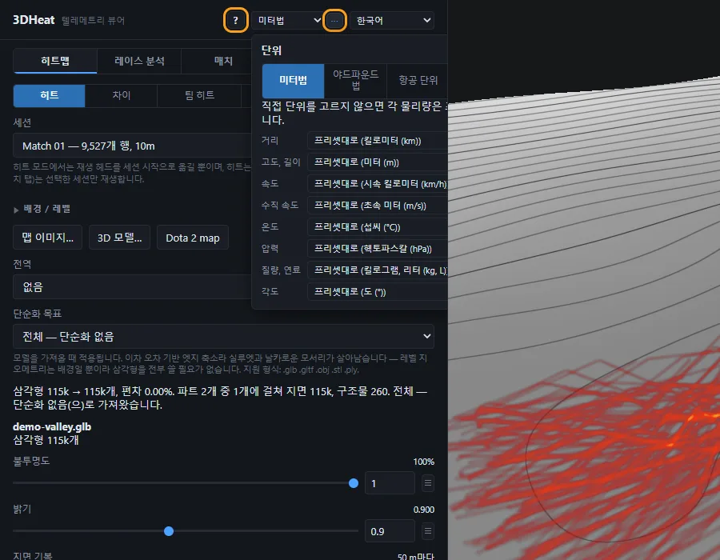
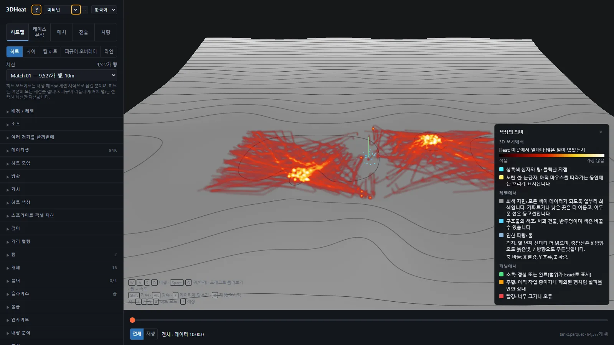
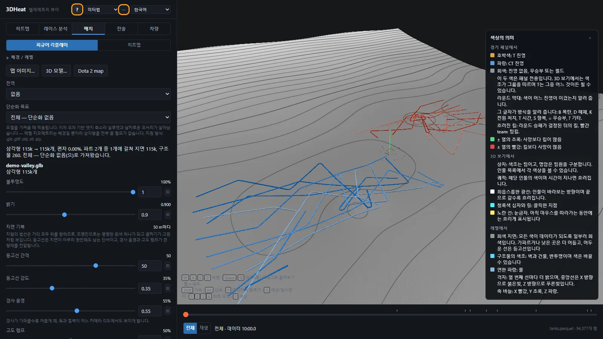

# 설정, 유닛과 키

사이드바 위쪽의 작은 컨트롤은 뷰어가 여러분에게 말하는 방식을 바꿉니다. 언어, 유닛(미터 또는 피트, km/h 또는 노트), 그리고 색을 설명해 주는 도움말 모드입니다. 선택은 브라우저에 기억됩니다.

## 머리글 {#the-header}

사이드바 위쪽에 있습니다.

| 컨트롤 | 하는 일 |
|---|---|
| **?** | 도움말 모드: 모든 색이 무엇을 뜻하는지 (`?` 또는 `F1`로도 가능) |
| **유닛** 메뉴 | 미터법, 야드파운드법, 항공, 해리 |
| **유닛** 옆의 **...** 버튼 | "양마다 유닛 고르기"를 엽니다: 양마다 드롭다운 하나 |
| **언어** 메뉴 | 뷰어의 언어: [40개 언어](languages.md), 또는 브라우저 언어 |

상자에 입력하는 숫자는 점 또는 쉼표를 쓸 수 있습니다 (`0.35` 또는 `0,35`). 뷰어는 둘 다 읽고, 뷰어의 언어가 쓰는 방식으로 숫자를 보여 줍니다.

## 유닛 {#units}

1. **유닛** 메뉴에서 프리셋을 고르세요. 모든 양이 함께 바뀝니다.
2. 양 하나만 바꾸려면, 그 옆의 **...** 버튼을 누르고 그 양의 유닛을 고르세요. 그러면 메뉴에 프리셋 뒤에 `*`가 나타납니다.
3. 설정하지 않은 양은 프리셋을 따릅니다. 되돌리려면 "프리셋 따르기"를 고르세요.

| 양 | 미터법 (기본) | 야드파운드법 | 항공 | 해리 |
|---|---|---|---|---|
| 거리 | km | mi | NM | NM |
| 고도, 길이 | m | ft | ft | m |
| 속도 | km/h | mph | kt | kt |
| 수직 속도 | m/s | ft/min | ft/min | m/s |
| 온도 | °C | °F | °C | °C |
| 기압 | hPa | inHg | hPa | hPa |
| 질량, 연료 | kg, l | lb, gal | lb, gal | t, m³ |
| 각도 | 도 | 도 | 도 | 도 |

한 양에 대해 고를 수 있는 다른 유닛: 거리 km, mi, NM; 속도 km/h, m/s, kt, mph; 수직 속도 m/s, ft/min, m/min; 온도 °C, °F, K; 기압 hPa, inHg, mmHg, psi; 질량 kg, lb, t; 각도 도 또는 NATO 밀(원 하나가 6400). 유닛은 뷰어 어디서나 같습니다: 라벨, 카드, 차트, 통계.

## 도움말 모드 {#help-mode}

`?` 또는 `F1`을 누르거나 **?** 버튼을 누르세요. *What the colours mean*(색이 뜻하는 것)을 보여 줍니다. 3D 뷰, 히트 램프, 팀 색, 레벨의 색, 패널의 상태 색, 매치 패널, 레이스 뷰의 범례입니다. 끌 때까지 켜져 있습니다. 매치 탭에서는 매치 패널의 색도 설명합니다.

## 브라우저가 기억하는 것 {#what-the-browser-remembers}

이 설정들은 방문 사이에 브라우저에 보관됩니다 (아무것도 어디로도 보내지 않습니다):

- 언어, 유닛, 도움말 모드;
- 재생의 피규어, 심볼, 라벨, 카메라, 전술 화면 설정;
- 재생 속도와 좌우 반전;
- 기록별 책갈피, 데이터셋별 볼륨, 목표 레이어;
- 외부 AI 설정 (*Remember*를 체크한 경우에만 키).

히트 설정, 필터, 모드는 불러올 때마다 새로 시작합니다. 전체 목록(자동 생성): [저장된 설정](ref-settings-storage.md).

## 뷰어가 브라우저에서 지키는 키 {#keys-the-viewer-keeps-from-the-browser}

큰 데이터가 있는 세션은 불러오는 데 시간이 걸리므로, 뷰어는 브라우저가 실수로 그것을 버리지 않게 합니다.

- 텍스트 상자 밖에서 인쇄, 저장, 열기, 새로 고침, 닫기, 새 창 열기에 해당하는 `Ctrl`/`Cmd` + 문자 키는 아무 일도 하지 않습니다. `F1`, `F3`, `F5`, `F6`, `F7`도 아무 일도 하지 않습니다.
- 데이터나 레벨이 불러와진 탭을 닫거나 새로 고치면 먼저 묻습니다.
- 전체 화면에서는 뷰어가 쓰는 키(W, T, N, S, R, P, Q, Esc)를 잠가서, 브라우저가 가져가지 못하게 합니다.

정확한 목록: [브라우저 키](ref-browser-keys.md). 뷰어의 모든 키: [키보드와 마우스 참고](keyboard-reference.md).
