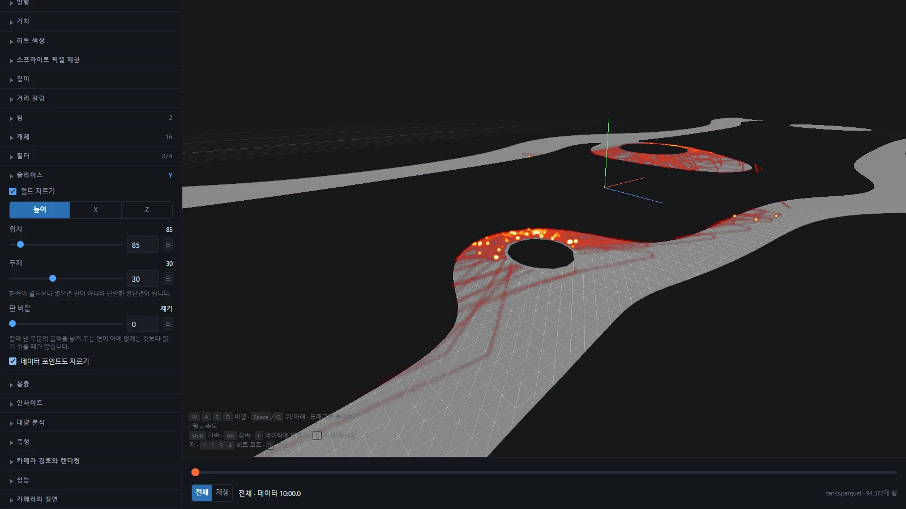

# 단면

**단면**은 케이크를 자르듯 월드를 잘라서, 건물 안을 볼 수 있게 합니다. 벽이 흥미로운 히트를 가릴 때 쓰세요. 예를 들어 건물의 한 층을 보고 싶을 때입니다.

## 해 보기 {#try-it}

1. 레벨과 데이터를 불러오고, **단면**을 여세요.
2. **월드 자르기**를 체크하세요. 축은 **높이**입니다.
3. **위치**를 위아래로 끄세요. 판이 레벨을 가로질러 움직입니다.
4. 평면도를 보려면 **두께**를 얇게, "여기 아래 전부"를 보려면 넓게 하세요.
5. 나머지를 없애려면 **판 바깥**을 0으로 두고, 희미한 흔적을 남기려면 올리세요.



판은 **레벨 지오메트리와 데이터 포인트를 함께** 자릅니다. 레벨만 자르면 히트가 건물이 있던 자리에 떠 있게 됩니다. 이 기능은 [깊이 가림](depth-and-culling.md)의 짝입니다. 레벨이 뒤에 있는 것을 올바르게 가리면, 건물 안쪽도 가려집니다. 자를 것이 있을 때(데이터셋이나 3D 레벨) 패널이 나타납니다. 켜져 있으면 헤더에 축이 보이고, 꺼져 있으면 *off*가 보입니다.

```
옆에서 본 모습    위치 = 판이 어디 있는지
 ----------       두께 = 판이 얼마나 높은지
 | 3층    |
 |=========|  <--- 판 (남김)
 | 2층    |  <--- 바깥: 제거 (또는 희미하게)
 | 1층    |
 ----------
```

## 컨트롤 {#controls}

| 컨트롤 | 기본값 | 뜻 |
|---|---|---|
| **월드 자르기** | 꺼짐 | 판을 켭니다. 위치가 처음 값 0이고 두께가 처음 값 500인 동안 켜면, 위치는 축의 가운데로, 두께는 축 범위의 15%로 옮겨집니다. |
| 축 | **높이** | *높이* (Y), *X* 또는 *Z*. 축을 바꾸면 판은 새 축의 가운데로 옮겨집니다. |
| **위치** | 가운데 | 판의 중심, 월드 단위로, 축 범위 전체에서 (500단계). |
| **두께** | 범위의 15% | 범위의 1/500에서 범위의 두 배까지, 로그 단계로. 범위만큼 넓어지면 *월드 너머*로 읽힙니다. 한쪽이 월드를 넘어서므로, 판이 아니라 그냥 잘라낸 것입니다. |
| **판 바깥** | 0, *제거됨* | 바깥의 것이 얼마나 보이는지, 0-100%. 잘라낸 것의 희미한 흔적은 아예 없애는 것보다 읽기 쉬운 경우가 많습니다. |
| **데이터 포인트도 자르기** | 켜짐 | 끄면 히트는 온전하게 남아, 잘린 곳으로 비쳐 보입니다. 판의 위와 아래에 무엇이 있는지 볼 때 유용합니다. |

축의 범위는 3D 레벨이 불러와져 있으면 그 레벨의 범위이고, 아니면 데이터셋의 범위입니다.

단면은 [거리 컬링](depth-and-culling.md#distance-culling)과는 독립적입니다. 거리 컬링은 월드 축이 아니라 보는 방향을 따라 자릅니다. 둘은 함께 쓸 수 있습니다. 단면 설정을 바꾸면 히트 누적이 다시 시작됩니다.

## 개발자용 {#for-developers}

판은 버텍스 셰이더에서 각 행의 월드 위치에 대해 검사합니다. 판 밖의 행은 기여분이 *판 바깥* 값과 곱해지므로, 0이면 어떤 프래그먼트도 그려지기 전에 버려집니다. 레벨 셰이더는 지면, 구조물, 물의 모든 프래그먼트에 같은 검사를 적용합니다.
