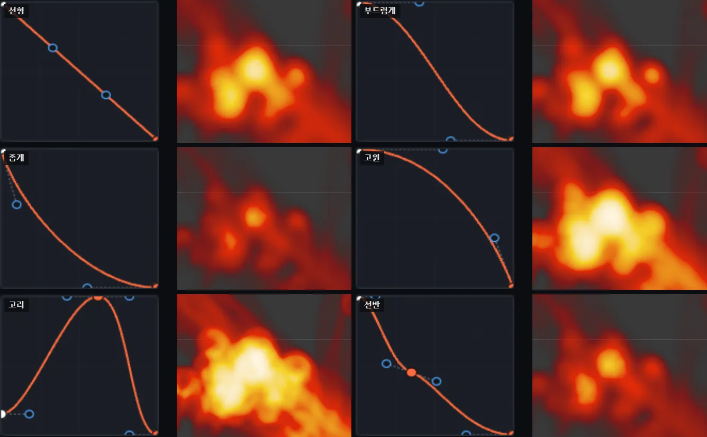

# 스프라이트 모양

각 행은 언제나 카메라를 향하는 둥근 스프라이트로 그려집니다. 크기와, 중심에서 가장자리까지의 윤곽(**램프**)이 핫스팟을 좁은 점으로 볼지, 부드러운 구름으로 볼지, 원판으로 볼지, 고리로 볼지를 정합니다. 이 조절들은 사이드바의 **히트 모양**과 **스프라이트 픽셀 제한** 섹션에 있으며, [히트](heat.md), [차이](difference.md), [팀 히트](team-heat.md)에 적용되고, 선의 반폭으로서 [선 히트](line-heat.md)에도 적용됩니다.

이 중 무엇을 바꾸든 누적이 다시 시작됩니다(필드를 새 모양으로 다시 그려야 하기 때문입니다).

각 점을 부드러운 빛 덩어리라고 생각하십시오. 작은 덩어리는 한 점 한 점을 보여 주고, 큰 덩어리는 이웃들을 합쳐 구름으로 만듭니다. 모양은 가장자리가 얼마나 부드러운지를 정합니다.



## 스프라이트 반경 {#sprite-radius}

스프라이트의 반경은 **세계 단위**(미터로 표시됨)입니다. 기본값은 6입니다. 불러올 때마다 데이터의 가로 범위 / 120으로 맞춰지며, 경로를 따라 이웃한 표본들이 머리카락 같은 선이 아니라 띠로 합쳐질 만큼 큽니다. 로그 슬라이더는 0.05-2000이고, 손잡이는 50,000까지 끌 수 있습니다.


멀리 있는 것은 더 작게 보이므로, 스프라이트는 거리에 따라 화면에서 작아집니다. 평행 투영에서는 어디서나 같은 크기이며, 이것이 평행 보기가 핫스팟을 비교하는 데 맞는 이유 중 하나입니다([카메라와 조작](camera.md#projection)).

## 픽셀 제한 {#pixel-clamps}

**스프라이트 픽셀 제한**(기본적으로 접혀 있음)은 위 변환을 거친 뒤 화면 반경의 범위를 정합니다.

| 조절 | 기본값 | 범위(조그) | 이유 |
|---|---|---|---|
| **최소 픽셀 반경** | 1 px | 0-16(512) | 먼 데이터가 1픽셀 아래로 사라지지 않게 합니다. |
| **최대 픽셀 반경** | 96 px | 2-1024, 로그(8192) | 과다 그리기 방지 장치입니다. 픽셀 N개를 덮는 스프라이트는 블렌드 연산 N번의 비용이 들므로, 카메라 가까이에서 제한 없는 반경이 빠른 프레임을 느린 프레임으로 바꿉니다. 뷰포트 높이를 넘으면 더는 아무것도 제한하지 않습니다. |

**줌과 관계없이 같은 밀도**(히트 모양 섹션, 기본값 켜짐)는 제한과 함께 작동합니다. 제한 때문에 더 커지거나(멀리) 더 작아진(가까이) 스프라이트는, 실제 크기였다면 더했을 히트를 그대로 더합니다. 그래서 줌과 관계없이 색은 땅 면적당 같은 행 수를 뜻합니다. 끄면, 제한된 스프라이트는 제한된 크기에서 전체 가중치를 더하므로, 비행해 들어갈 때마다 그림이 바뀝니다.

## 중심과 가장자리 강도 {#centre-and-edge-intensity}

스프라이트가 정확한 중심에 더하는 히트(**중심 강도**, 기본값 1, 0-10, 조그 1000)와 가장자리에 더하는 히트(**가장자리 강도**, 기본값 0, -2-10, 조그 1000)입니다. 램프 값 *t*(중심에서 1, 가장자리에서 0. 감쇠나 아래 곡선으로 모양이 정해짐)가 둘 사이를 섞습니다(공식은 [개발자용](#for-developers) 아래에 있습니다).

**음의 가장자리 강도**는 가장자리가 빼기를 하게 만듭니다. 그러면 각 핫스팟 둘레에 서늘한 후광이 파이고, 클러스터들이 서로에게서 또렷해집니다. 보임 여부에는 [가려짐](depth-and-culling.md)과 [단면](slice.md)이 포함됩니다. 페이드는 [수명](timeline.md#history) 페이드입니다. 부호는 [차이](difference.md)에서 ±1입니다.

## 램프 모양: 감쇠 또는 곡선 {#ramp-shape-falloff-or-curve}

**램프 모양**은 스프라이트에 걸쳐 *t*를 모양 짓는 두 방법 사이를 바꿉니다. *d*를 중심(0)에서 가장자리(1)까지의 거리라고 하면:

### 감쇠 {#falloff}

*감쇠*가 고른 상태일 때(기본값) 보입니다.

- **감쇠**(기본값 1.6, 0.1-8, 조그 64): `t = (1 - d) ^ falloff`. 1이면 곧은 선형 램프입니다. 더 높이면 히트를 중심으로 끌어 모아 핫스팟을 좁힙니다. 1보다 낮추면 원판처럼 평평해집니다.
- **부드러운 램프**(기본값 켜짐): *t*에 smoothstep S 곡선을 적용합니다. 그래서 스프라이트는 보이는 가장자리에서 끝나지 않고 가장자리에서 서서히 사라집니다.

### 곡선 편집기 {#the-curve-editor}

*곡선*이 고른 상태일 때 보입니다. 스프라이트의 단면을 그대로 옮긴 것입니다. 가로로는 중심에서의 거리(왼쪽이 *중심*, 오른쪽이 *가장자리*), 세로로는 히트의 양입니다. 곡선은 제어점들을 지나는 조각별 3차 베지에이며, 제어점마다 손잡이가 두 개씩 있습니다.

| 동작 | 효과 |
|---|---|
| 그래프에서 더블클릭 | 그 거리에 점을 추가합니다(0.02와 0.98 사이로 유지). 곡선 위에, 그 자리의 기울기를 따라 추가하므로, 끌기 전까지는 아무것도 바뀌지 않습니다. |
| 점 드래그 | 점을 옮깁니다. 높이는 0과 1 사이로 유지됩니다. |
| 작은 원 드래그 | 옆 구간을 구부립니다(그 손잡이를 옮깁니다). |
| 점을 Alt-클릭 또는 오른쪽 클릭 | 점을 제거합니다. 양 끝점은 제거할 수 없습니다. |
| 프리셋 버튼 | 곡선을 그 프리셋으로 바꿉니다. |

양 끝점은 중심과 가장자리에 고정됩니다. 그러나 그 높이는 여러분이 정합니다.

**프리셋**([`curve.ts`](https://github.com/Holdi601/3DHeat/blob/main/src/state/curve.ts)):

| 프리셋 | 모양 | 쓰임 |
|---|---|---|
| **선형** | 1에서 0까지 곧게 | *감쇠* 1에 *부드러운 램프*를 끈 것과 같습니다. |
| **부드럽게** | S 곡선 | 기본 곡선. 감쇠 1에서 *부드러운 램프*가 주는 것입니다. |
| **좁게** | 가파른 중심, 길고 희미한 치마 | 드문 데이터. |
| **고원** | 평평하다가 빠르게 떨어짐 | 덩어리보다 원판처럼 보입니다. |
| **고리** | 중심에서 0.15, 반경의 62%에서 1, 가장자리에서 0 | 속이 빈 스프라이트. 경로가 멈추는 곳이 아니라 지나가는 곳을 보여 줍니다. |
| **선반** | 35%에서 0.45인 두 단계 감쇠 | 조밀한 핵을 주변과 떼어 냅니다. |

## 지면 평면에 평탄화 {#flatten-onto-ground-plane}

**지면 평면에 평탄화**(기본적으로 꺼짐)는 각 행의 높이를 무시하고, 모든 히트를 한 높이에 그립니다. 데이터의 가장 낮은 Y입니다. 고전적인 2D 지도 히트맵입니다. 켜면 깊이 가려짐과 *지형 뒤 숨기기*가 꺼집니다(모든 점이 검사 대상인 표면 바로 위에 놓이게 되므로). 깊이 섹션이 이것을 알려 줍니다.

## 개발자용 {#for-developers}

### 공식 {#formulas}

화면 반경(픽셀): `radius × P[1][1] / w × viewport height / 2`. 여기서 `P`는 투영 행렬이고 `w`는 점의 보기 깊이입니다.

스프라이트가 더하는 히트:

```
heat added = mix(edge, centre, t) × sample weight × sign × fade × visibility
```

### 곡선 {#the-curve}

손잡이는 가로로 자기 구간에 맞게 제한됩니다. 그래서 곡선은 언제나 거리의 함수입니다. 손잡이를 다음 점을 훌쩍 넘어 끌면, 곡선을 되접는 대신 그 점에 맞춰 평평해집니다. 되접으면 결과가 솔버가 우연히 찾은 근에 따라 달라지기 때문입니다.

### 곡선을 그리는 법 {#how-the-curve-is-drawn}

곡선은 바뀔 때마다 256개 항목의 표로 구워지고, 16비트 부동소수점 텍스처로 올라갑니다. 그리고 프래그먼트마다 선형 필터링과 반 텍셀 안쪽 여백을 두고 샘플링하므로 양 끝이 정확하게 유지됩니다. x에 대해 베지에를 푸는 것은 반복 계산이 필요한데, 프로그램에서 가장 뜨거운 셰이더에 둘 자리가 없습니다. 게다가 표 조회는 감쇠가 쓰는 `pow()`보다 쌉니다. 8비트가 아니라 16비트인 이유는, 수천 개의 스프라이트가 합쳐지면 8비트는 띠가 지기 때문입니다. 16비트 반정밀도 부동소수점은 코어 WebGL2에서 필터링이 되는 반면, 32비트는 확장이 필요합니다.
