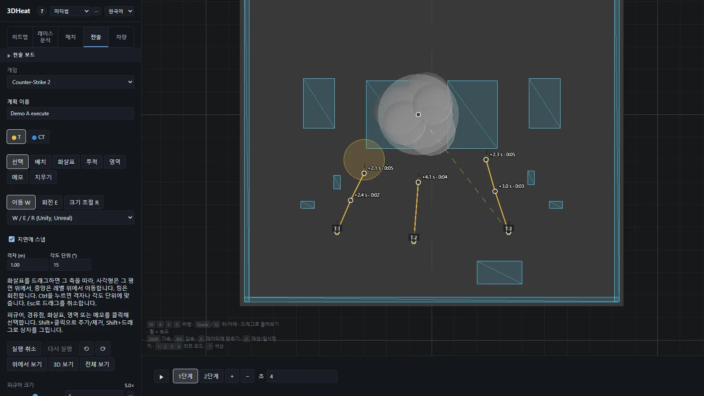

# 전술 보드

**전술** 탭은 팀 계획을 그리는 보드입니다. 지도 위에 작은 피규어를 놓고, 이동할 곳을 화살표로 그리고, 재생을 누르면 그것이 일어나는 것을 볼 수 있습니다. 경기 전에 라운드나 공격을 계획할 때 쓰세요. 캔버스, 카메라, [레벨](levels.md)은 다른 탭과 함께 쓰지만, 그 밖의 것은 공유하지 않습니다. 계획은 데이터가 아니므로 히트를 그리지 않습니다.

## 첫 계획 {#your-first-plan}

1. **전술** 탭을 여세요. **게임**을 고르세요(예: Counter-Strike 2). 발로란트라면 **발로란트 맵 불러오기**를 누르고 **맵**을 고르세요. 또는 먼저 [레벨](levels.md)을 불러오세요.
2. **진영**을 고르세요(색을 정합니다). 그다음 **위에서 보기**를 누르세요.
3. **장소**를 고르고, **피규어**에서 피규어를 고르세요(**피규어 검색**으로 찾을 수 있습니다). 그다음 지도를 클릭하세요. 두세 개를 놓으세요.
4. **화살표**를 고르세요. 피규어를 클릭하고, 그것이 가야 할 길을 따라 클릭한 다음, **Enter**를 눌러 화살표를 끝내세요.
5. 보기 아래의 **+**를 눌러 2단계를 추가하세요. 각 피규어는 자기 화살표가 끝난 곳에서 시작합니다. 거기서 화살표를 더 그리세요.
6. **▶**(또는 `K`)를 눌러 보이는 단계부터 끝까지 계획을 재생하세요.
7. **계획 이름**에 이름을 적고 **저장**을 누르세요.

## 계획 시작하기 {#starting-a-plan}

| 조작 | 하는 일 |
|---|---|
| **게임** | 팔레트가 제시하는 진영과 피규어를 고릅니다. Counter-Strike 2(T, CT. 플레이어와 유틸리티), 발로란트(공격, 수비. 플레이어와 일반 능력), Battlefield, Squad, Arma(보병, 지상 차량, 항공기, 보트), DCS / War Thunder / IL-2(제트기, 프로펠러 항공기, 헬리콥터, 방공, 지상, 함선, 무기), 그리고 기타. 이미 피규어가 있는 계획은 게임을 바꿔도 진영을 유지합니다. |
| **계획 이름** | 계획을 저장할 때 쓰는 이름입니다. |
| **맵**, **발로란트 맵 불러오기** | 발로란트를 골랐을 때: **발로란트 맵 불러오기**는 [valorant-api.com](https://valorant-api.com)에서 맵 목록을 가져옵니다. 그다음 **맵**은 고른 맵의 미니맵을 레벨로 깔고, 위에서 본 화면에 맞춥니다. 이미지는 고를 때 가져오며 배포하지 않습니다. 화면에 있는 동안에는 Riot의 안내문을 보여 줍니다(아래를 보세요). |
| **진영** | 다음 피규어, 화살표, 구역이 속할 진영입니다. 그 진영의 색을 받습니다. |

레벨이 없으면 보드는 평평한 지면입니다. 실제 맵에서 계획하려면 **레벨** 아래에서 레벨을 불러오세요. CS2 도구로 내보낸 CS2 맵, 라이브러리의 레벨, 또는 맵 그림을 쓸 수 있습니다.

## 도구 {#tools}

| 도구 | 클릭 | 메모 |
|---|---|---|
| **선택** | 피규어, 경유점, 화살표, 구역, 메모를 클릭하면 선택합니다. | Shift+클릭은 더하거나 뺍니다. Shift+드래그는 상자를 그려 그 안의 것을 더합니다. 선택한 것에는 변형 기즈모가 붙습니다(아래를 보세요). `Delete`나 `Backspace`로 지웁니다. `M`은 선택한 피규어를 다음 클릭 위치로 옮깁니다. |
| **장소** | 고른 피규어를 놓습니다. | 피규어는 **피규어** 팔레트(**피규어 검색**과 함께)에서 고릅니다. 아무것도 선택하지 않았다면, `R`은 다음 피규어를 놓기 전에 15° 돌립니다(`Shift+R`은 반대 방향). |
| **화살표** | 클릭할 때마다 점이 하나 추가됩니다. Enter, 더블클릭, 또는 우클릭으로 끝내고, Esc로 버립니다. | **이동**, **공격**(머리가 더 넓음), 또는 **감시**(눈높이의 가는 선). 피규어 위에서 시작한 화살표는 이 단계에서 그 피규어의 경로입니다. 재생하면 피규어가 그 길을 걸으며, 다음 단계는 그 끝에서 시작합니다. |
| **투척** | 던지는 쪽을 누르고, 떨어질 곳을 누릅니다. | 한쪽에서 다른 쪽으로 점선 호가 생기며, 고른 유틸리티(연막, 섬광, 화염병 ...)가 떨어진 곳에 나타나 이 단계부터 계속 남습니다. |
| **구역** | 가운데를 누르고, 가장자리를 누릅니다. | 진영 색의 원반. |
| **메모** | 메모가 갈 곳을 누릅니다. 그러면 글을 묻습니다. | 핀으로 보이며, 그 위에 글이 나타납니다. |
| **지우기** | 피규어, 화살표, 구역, 메모. | 이 단계부터 지웁니다. 첫 단계에서는 완전히 지웁니다. |

**실행 취소**와 **다시 실행**(`Ctrl+Z`, `Ctrl+Y` 또는 `Ctrl+Shift+Z`)은 모든 변경을 한 단계씩 되돌리거나 다시 합니다. 계획 아래의 줄은 피규어, 화살표, 단계가 몇 개인지 보여 줍니다. **위에서 보기**는 곧장 아래를 봅니다(직교 투영). **3D 보기**는 원근 투영으로 돌아갑니다. **프레임**은 계획에 맞추고, 계획이 비었을 때는 레벨에 맞춥니다.

**피규어 크기**는 보드의 모든 피규어를 키우거나 줄입니다. 1×가 실제 크기입니다. 높은 곳에서 보면 사람은 몇 픽셀에 불과합니다.

## 이동, 회전, 크기 조절 {#moving-turning-and-scaling}

보드의 모든 것은 3D 편집기처럼 옮길 수 있습니다. 피규어, 유틸리티, 표시, 경유점 하나, 화살표 전체, 구역, 메모가 그렇습니다. 선택한 것은 가운데에 기즈모가 붙습니다.

| 모드 | 키 | 손잡이 |
|---|---|---|
| **이동** | W(또는 G) | 축마다 화살표가 있으며(X 빨강, Y 초록과 위쪽, Z 파랑) 그 축을 따라 움직입니다. 정사각형은 그 평면을 따라 움직입니다. 가운데는 포인터 아래의 레벨 위로 움직입니다. |
| **회전** | E(또는 R) | 축마다 고리가 있으며 그 축을 중심으로 돕니다. 피규어 하나의 고리는 자기 요, 피치, 롤입니다. 그룹은 가운데를 중심으로 세계 축을 따라 돕니다. |
| **크기 조절** | R(또는 S) | 선택한 것을 가운데에서 한 축을 따라, 또는 모든 방향으로 벌리거나 모읍니다. 구역의 반지름도 함께 커집니다. |

**키**는 W / E / R(Unity, Unreal)과 G / R / S(Blender) 사이를 바꿉니다. 키는 무엇인가 선택되어 있을 때만 모드를 고르고, 그 밖에는 카메라를 날립니다. 그래서 선택한 것이 있을 때 `R`은 W / E / R 키에서는 **크기 조절**, G / R / S 키에서는 **회전**입니다. 아무것도 선택하지 않았다면 다음에 놓을 피규어를 돌립니다. 보드의 모든 키는 [키보드 참조](keyboard-reference.md#tactics-board)에 나옵니다. 끌 때 **Ctrl**을 누르고 있으면, 이동은 **격자**(미터)에, 회전은 **각도 단위**에 맞춥니다. **지면에 스냅**(기본으로 켜짐)은 옮긴 사람, 차량, 표시, 경유점, 구역을 레벨 표면에 놓습니다. 항공기와 헬리콥터는 높이를 유지하며, Y 화살표를 따라 끌면 스냅하지 않습니다. 손잡이를 끄는 동안에는 카메라가 움직이지 않습니다. **Esc**는 드래그를 취소하며, 모든 변경은 실행 취소 한 단계입니다.

경유점은 보이는 단계의 화살표 위에 점으로 나타납니다. 클릭하면 선택하고, 끌면 옮기고, Delete로 뺍니다. **선택됨** 부분은 선택한 것이 있는 위치를 미터로, 피규어의 요, 피치, 롤을 도 단위로, 구역의 반지름을 각각 직접 입력할 수 있게 보여 줍니다.

## 타이밍 {#timing}

피규어의 경로에는 시간이 있습니다. 각 구간은 레벨 위의 길이만큼 걸립니다. 길이는 몇 미터마다 표면에서 샘플해서 재므로, 두 점 사이의 언덕이나 계단도 계산에 들어갑니다. 속도는 그 게임에서 그 피규어의 **이동 방식**에 따르며, 경유점에서의 **대기**가 더해집니다. 보병은 기어가거나, 웅크리거나, 걷거나(소리 없이), 뛰거나, 전력 질주합니다. 차량과 보트는 천천히, 조심스럽게, 보통으로, 또는 돌진합니다. 항공기와 헬리콥터는 느리게, 순항으로, 전투 속도로, 또는 최대로 날습니다. 게임에 없는 방식(CS2에는 전력 질주가 없음)은 가장 가까운 방식을 씁니다. 경사가 속도를 얼마나 줄이는지는 게임마다 다릅니다. CS2와 발로란트에서는 게임과 같이 수평 거리만 셉니다. 군사 시뮬레이션은 언덕길의 보병을(토블러의 도보 함수), 차량은 경사에 따라 느리게 합니다.

속도는 게임마다 출처가 적힌 표에서 옵니다([이동 속도](tactics-speeds.md)를 보세요). CS2는 든 무기에 따라, 게임의 무기 정의에서 옵니다. 발로란트는 무기에 따라. Battlefield, Squad, Arma와 공중 게임은 차량 종류와 등급에 따라. **이동 방식**은 피규어의 프로필(무기, 차량 종류)을 고르고, **직접 입력 (m/s)**은 그 피규어의 모든 방식을 덮어씁니다. 방식의 이름은 보드에 보이는 그대로입니다. *기기*, *웅크리기*, *걷기(소리 없이)*, *뛰기*, *전력 질주*, *조심히*, *보통*, *돌진*, *느리게*, *순항*, *전투*, *최대*.

각 경유점에는 이전 경유점부터의 시간과, 계획 시작부터의 시간이 나옵니다("+3.9 s · 0:12"). 선택한 피규어의 경로는 모든 구간을 방식, 길이, 시간, 대기, 도착과 함께 나열합니다. **타이밍** 아래의 **도착**은 경로가 있는 모든 피규어를 하나의 시간선에 올리며, 첫 도착이 맨 위입니다. **실시간으로 재생**(기본으로 켜짐)을 쓰면, 단계는 가장 느린 경로가 도착할 때까지 지속되고, 각 피규어는 자기 속도로 움직입니다. 그러면 **초**는 그 단계의 가장 짧은 길이입니다. **미터당 레벨 단위**는 레벨이 어떤 단위인지 말합니다. CS2 맵은 39.37(게임 단위), 미터 맵은 1입니다.

## 매치 데이터와 비교 {#compare-with-match-data}

**매치 파일 불러오기…**는 그 맵의 CS2 매치 표를 읽습니다(CS2 도구의 Parquet 파일, 원하는 만큼. 필요한 열만, 배경에서 읽습니다). **불러온 데이터 사용**은 뷰어에 불러온 데이터를 가져옵니다. 그다음:

- **맵에서 가장 빠른 도착**은 플레이어가 각 장소에 처음 도달한 시간(라운드 시작부터)으로 맵을 칠합니다. **가장 빠름** 버튼은 모든 라운드에서 가장 빠른 것을, **일반적 (중앙값)**은 가운데 라운드를 보여 줍니다. 초록은 이른 시간, 빨강은 늦은 시간입니다. 한쪽 또는 양쪽 진영에 대해 보여 줍니다. 언제 무엇이 가능한지 보여 주는 것입니다.
- 고른 경로는, 플레이어들이 그 시작(또는 라운드 시작)부터 끝까지 달성한 것과 비교합니다. 끝마다 정해진 반지름의 원반이 있습니다. 예: "관측된 가장 빠른 기록 14.2 s, p10 15.0 s, 중앙값 18.3 s (41회 기록); 내 계획 15.1 s".
- 플레이어들이 실제로 움직인 속도(달리기, 걷기, 웅크리기. 표의 걷기와 숙이기 열에서 가져옴)를 m/s로 보여 줍니다.

## 단계 {#steps}

보기 아래의 막대에 단계가 있습니다. 계획은 단계 하나로 시작합니다. **+**는 하나를 더하며, 각 피규어는 지난 단계에서 자기 경로가 끝난 곳에서 시작합니다. **−**는 보이는 단계를 뺍니다. **초**는 재생할 때 보이는 단계가 걸리는 시간입니다. **▶**(K)는 보이는 단계부터 끝까지 재생합니다. 경로가 있는 피규어는 그 길을 걷고, 다음 단계에서 새 장소로 옮겨진 피규어는 그곳으로 미끄러져 가며, 나머지는 서 있습니다. 단계가 보이는 동안, 각 피규어의 다음 단계 위치는 희미한 유령으로 그려지고, 지난 단계의 화살표는 이 단계 아래에 옅게 깔립니다.

## 저장 {#saving}

**파일** 섹션에는 **저장**, **오프닝**, **지우기**가 있습니다. **저장**은 계획을 `<이름>.h3dplan.json`으로 씁니다(평범한 JSON. 진영, 단계, 단계마다 위치가 있는 피규어, 화살표, 구역, 메모). **오프닝**은 그것을 다시 읽습니다. 다른 버전의 파일, 또는 계획이 아닌 파일은 이유와 함께 거부합니다. **지우기**는 계획을 비웁니다. 실행 취소로 되돌릴 수 있습니다.

## 피규어 {#figures}

모든 피규어는 뷰어 자체가 만듭니다. 종류의 공개된 크기에 맞춘 단순한 모양이며, 이웃과 구별되는 특징을 가집니다. 전차의 도로륜과 포탑, 방공 차량의 포, 미사일, 레이더, 항공기의 날개 평면, 꼬리와 엔진, 헬리콥터의 로터와 짧은 날개가 그렇습니다. 어떤 게임에서도 가져오지 않습니다. 게임이 만든 설계는 그 등급의 일반 피규어로 보입니다. 데이터가 피규어를 찾는 방법은 [피규어](figures.md#which-figure-a-unit-gets)를 보세요.

## Riot의 안내 {#riots-notice}

발로란트 맵은 Riot Games의 "Legal Jibber Jabber" 정책에 따라 보입니다. 이 정책은 무료 커뮤니티 프로젝트가 맵을 쓰도록 허용하며, 맵이 나타나는 곳마다 이 안내를 요구합니다: *3DHeat는 Riot Games가 소유한 자산을 사용하여 Riot Games의 "Legal Jibber Jabber" 정책에 따라 만들어졌습니다. Riot Games는 이 프로젝트를 승인하거나 후원하지 않습니다.* 보드의 능력은 일반적인 모양이며, Riot의 그림이 아닙니다.
