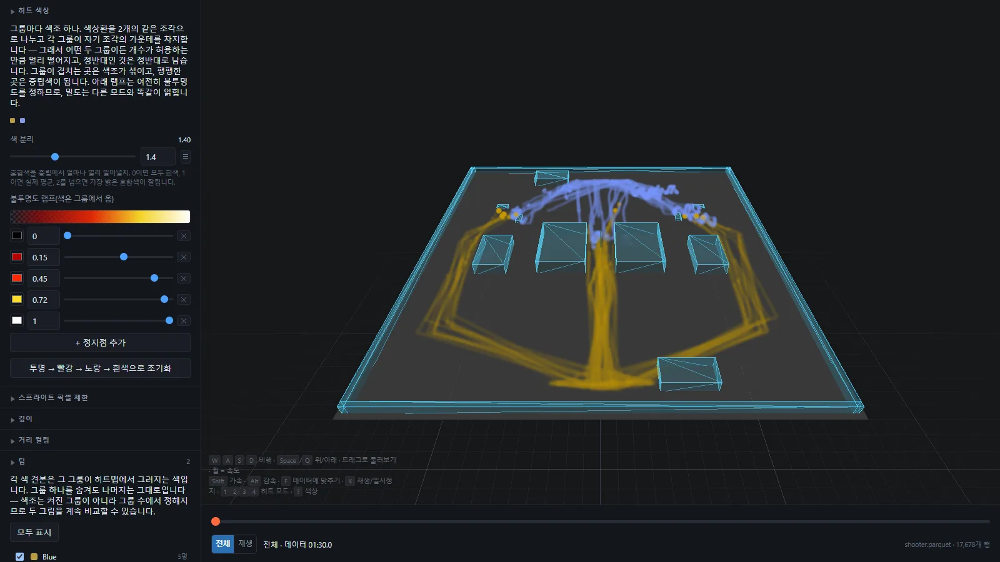

# 팀 히트

팀 히트는 각 팀이 어디에 있었는지 보여 줍니다. 팀마다 자기 색입니다. 팀이 겹치는 곳에서는 색이 섞입니다.

**팀 히트**(키 3)는 [히트](heat.md)의 밀도 장에 각 [그룹](glossary.md)마다 자기 색조를 준 것입니다. 그룹이 겹치는 곳에서 색조가 섞이며, 팽팽한 대결은 중립 색이 됩니다. 불투명도는 다른 모드와 똑같이 밀도를 그대로 나타내므로, 그림은 *얼마나*와 *누구의 것인지*를 동시에 알려 줍니다. 그룹 열이 있어야 합니다.

[피규어 오버레이](box-replay.md)와는 다릅니다. 피규어 오버레이는 사람마다 피규어 하나를 그리고, 이것은 같은 열로 색을 입힌 히트 장입니다.

## 사용 방법 {#how-to-use-it}

1. `3`을 누르세요 (또는 모드 막대에서 **팀 히트**를 고르세요).
2. **히트 색상**을 여세요. 견본은 각 그룹의 색을 보여 줍니다. 견본 위에 마우스를 올리면 팀 이름이 나옵니다.
3. 모두 회색으로 보이면 **색 분리**를 올리세요.
4. [팀 목록](teams-list.md)에서 그룹의 체크를 해제하면 빠집니다. 다른 색은 그대로 남습니다.

## 컨트롤 {#controls}

**히트 색상** 절에서:

| 컨트롤 | 기본값 | 뜻 |
|---|---|---|
| 견본 | | 각 그룹의 색. 처음 12개 그룹까지, 그다음은 *+N more*. 마우스를 올리면 그룹 이름과 색이 나옵니다. |
| **색 분리** | 1.4 | 섞인 색을 중립에서 얼마나 멀리 밀어낼지, 0-4. 0이면 모두 회색; 1이면 참된 평균; 약 2를 넘으면 가장 밝은 섞임이 표시 가능한 범위를 벗어나 채널별로 잘리고, 그래서 색조가 바뀝니다. |
| **불투명도 램프 (색은 그룹에서 옴)** | 기본 히트 램프 | 여기서는 램프의 **알파**만 씁니다. 아무것도 없는 곳은 투명, 꼭대기는 불투명. 램프의 색은 무시합니다. |

라벨이 "그룹 없음"을 뜻하는 그룹(`0`, 비어 있음, `none`, `unknown`, `null`, `-1`)은 회색으로 그려집니다.

나머지 히트 컨트롤(모양, 채도, 반응, 최소 히트, 깊이, 컬링)은 모두 [히트](heat.md)에서와 같이 작동합니다.

[팀 목록](teams-list.md)은 이 모드에서 각 그룹의 팀 히트 색을 견본으로 보여 줍니다. 그룹을 숨겨도 다른 그룹의 색은 그대로 남습니다. 색조는 켜진 것이 아니라 전체 그룹 수에서 정해지므로, 두 그림은 비교 가능하게 남습니다.

## 개발자용 {#for-developers}

### 팔레트 {#the-palette}

[`colors.ts`](https://github.com/Holdi601/3DHeat/blob/main/src/render/colors.ts)에서:

- 색은 고정된 명도(0.7)와 채도(0.115)의 **Oklab** 색 평면에 있으므로, 모든 그룹이 똑같이 밝고, 빨간 그룹이 파란 그룹보다 더 뜨겁게 보이지 않습니다.
- 그룹이 *n*개일 때, 색상환을 *n*개의 같은 부분으로 나누고, 그룹 *i*는 자기 부분의 **가운데**를 차지합니다. 한 바퀴의 `(i + 0.5) / n`. 어떤 두 그룹이든 개수가 허락하는 만큼 떨어져 있고, 반대편은 개수와 상관없이 반대편으로 남습니다.
- 최대 **16개**의 서로 다른 색조를 씁니다. 그룹이 더 많으면 id를 반복적 이등분으로 배치합니다 (비트 반전 id: 0, ½, ¼, ¾, ⅛, …). 그래서 이웃한 id끼리 색조를 나누지 않습니다. 16을 넘는 그룹은 필연적으로 색조를 나눕니다.
- 라벨이 "그룹 없음"을 뜻하는 그룹 - `0`, 비어 있음, `none`, `unknown`, `null`, `-1` (대소문자 무시) - 은 색상환의 한 조각을 받지 않고 **중립 회색**으로 그려집니다. 그룹 목록에서 그런 라벨은 첫 번째 것만 이렇게 취급합니다.

기본 분리는 1이 아니라 1.4입니다. 1에서는 고르게 퍼진 다섯 색조의 섞임이 *회색*이 되어, 정확하지만 읽을 수 없기 때문입니다. 1을 조금 넘기면 동점을 정직하게 유지하면서 60/40 나눔도 보이게 합니다.

### 작동 방식 {#how-it-works}

이 모드에서 히트 타깃은 네 채널을 가집니다. 각 스프라이트는 밀도 *v*를 첫 채널에 더하고, *v* × 그룹의 Oklab *a*와 *b* 좌표를 두 번째와 세 번째 채널에 더합니다. 합성 때 픽셀의 섞임은 밀도 가중 평균입니다. *a* = G / R, *b* = B / R로, 색 분리를 곱하고 팔레트의 명도에서 sRGB로 바꿉니다. 누적된 밀도로 나누므로 색조는 데이터가 얼마나 있는지와 무관하며, 그래서 모든 밀도 컨트롤은 불투명도에만 작용합니다.

네 채널 타깃은 같은 해상도의 단일 채널 히트 타깃보다 GPU 메모리를 네 배 씁니다.
