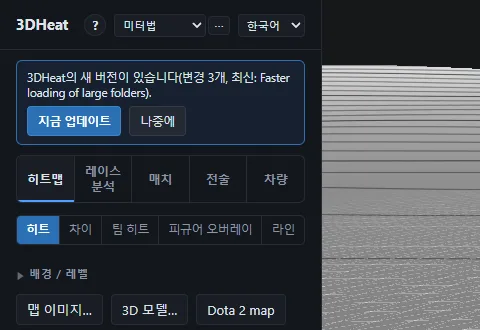

# 업데이트

뷰어는 더 새 버전이 있으면 알려 주고, 여러분이 승인할 때만 스스로 업데이트합니다. 여러분의 답 없이는 컴퓨터의 아무것도 바뀌지 않습니다.

## 뷰어 업데이트하기 {#update-the-viewer}

1. **페이지에서.** 더 새 버전이 있으면 사이드바 맨 위의 이름 아래에 상자가 나타납니다. "3DHeat의 더 새로운 버전이 있습니다". **지금 업데이트**를 누르세요. 끝나면 페이지가 저절로 다시 불러와집니다. **나중에**를 누르면 페이지를 다시 불러올 때까지 상자를 숨깁니다.
2. **restart.bat을 실행하라고 나오면**, 서버 창(`start.bat`이 연 검은 창)을 닫고 `restart.bat`을 더블클릭하세요.
3. **뷰어를 시작할 때.** `start.bat`도 확인합니다. 더 새 버전이 있으면 **지금 업데이트할까요? [Y/N]**를 묻습니다. `Y`를 누르면 업데이트합니다. `N`을 누르거나, 답하지 않고 60초를 기다리면, 가지고 있는 버전을 시작합니다.



여러분이 직접 바꾼 내용이 있는 사본은 자동으로 업데이트하지 않습니다. 상자는 업데이트가 기다리고 있다고만 알려 주고, 변경 사항을 커밋하거나 스태시한 다음 `git pull`을 실행하라고 말합니다. git으로 설치하지 않은 사본(예: zip 파일)은 아무것도 보여 주지 않습니다.

확인이 어떻게 이루어지는지 단계별로 보면 다음과 같습니다.

```
page ---(after 4 s, then every 6 h)---> dev server ---> git fetch
   behind?  no  -> nothing is shown
            yes -> your own changes or commits?  yes -> tell you only
                                                 no  -> [Update now] -> git pull
                                                        -> reload, or "run restart.bat"
```

## 안전 규칙 {#the-safety-rules}

- **빨리 감기만** (`git pull --ff-only`): 업데이트는 병합, 리베이스, 어떤 것의 다시 쓰기도 하지 않습니다.
- **로컬 변경 없음**: 추적하는 파일에 커밋되지 않은 변경이 있는 체크아웃(`git status --porcelain --untracked-files=no`의 결과가 비어 있지 않음)은 자동으로 업데이트하지 않습니다. 누군가의 작업을 업데이트가 덮어쓸 수는 없습니다. 업데이트가 기다리고 있다고만 알려 줍니다. 추적하지 않는 파일(데이터, 내보내기)은 변경으로 세지 않습니다.
- **로컬 커밋 없음**: 업스트림에는 없고 여기에만 있는 커밋("갈라짐")이 있는 체크아웃은 업데이트하지 않습니다. 빨리 감기로는 따라올 수 없고, 병합은 손으로 `git pull`을 해야 하기 때문입니다. 페이지와 `start.bat`은 같은 말로 이를 알려 주며, `start.bat`은 그곳에 있는 버전을 시작합니다.
- **페이지 자체에서만**: 개발 서버의 업데이트 요청에는 사용자 지정 헤더가 있어야 하고, 브라우저가 `Origin`을 보내면 서버 자체의 호스트에서 와야 합니다(아래를 보세요).
- git 체크아웃이고 업스트림 브랜치가 있는 것만 업데이트합니다. 그 밖의 것(`.git`이 없는 사본, git이 없는 환경, 정적 빌드)은 건드리지 않으며 아무 말도 하지 않습니다.

## start.bat이 하는 일 {#what-startbat-does}

`start.bat`(더블클릭하세요. 그 창이 서버입니다)은 순서대로 다음을 합니다.

1. Node.js를 찾습니다. `PATH`에서, 없으면 `%ProgramFiles%\nodejs`, `%ProgramFiles(x86)%\nodejs`, 또는 `%LOCALAPPDATA%\Programs\nodejs`에서 찾습니다. 없으면 `winget install -e --id OpenJS.NodeJS.LTS`로 설치할지 묻습니다(Y/N). 설치 후에는 Windows가 새 `PATH`를 읽도록 창을 다시 열어야 합니다.
2. git이 설치되어 있고 폴더에 `.git`이 있으면 **업데이트**를 확인합니다.
   - `git fetch --quiet`(네트워크가 없거나 업스트림이 없으면 조용히 건너뜁니다).
   - `git rev-list --count HEAD..@{u}`로 세고, 뒤처진 것이 없으면 아무 말도 하지 않습니다.
   - 로컬 변경이 있으면: "3DHeat의 더 새로운 버전이 있습니다(N개 변경). 하지만 이 사본에 로컬 변경이 있어서 업데이트하지 않습니다. 변경을 커밋하거나 스태시한 다음 git pull을 실행하세요." 그리고 가지고 있는 버전을 시작합니다.
   - 자기만의 커밋이 있으면(`git rev-list --count @{u}..HEAD`가 0이 아님): "3DHeat의 더 새로운 버전이 있습니다(N개 변경). 하지만 이 사본에는 가장 새 버전에 없는 자기만의 커밋이 있어서 업데이트하지 않습니다. git pull로 업데이트하세요." 그리고 가지고 있는 버전을 시작합니다.
   - 그 밖의 경우: "3DHeat의 더 새로운 버전이 있습니다(N개 변경)." 그리고 **지금 업데이트할까요? [Y/N]**를 묻습니다. `N`을 누르거나 60초 동안 답하지 않으면 "업데이트하지 않았습니다. 가지고 있는 버전을 시작합니다."라고 출력하고, 가지고 있는 버전을 시작합니다. `Y`를 누르면 "업데이트 중..."이라고 출력하고, `package.json`이나 `package-lock.json`이 바뀌는지 알리고, `git pull --ff-only`를 실행합니다(그래도 실패하면, 예: 네트워크 문제일 때는 "업데이트가 완료되지 않았습니다. 가지고 있는 버전을 시작합니다."). 그다음 `git submodule update --init`(고정된 도구, [문서 관리](maintaining.md#the-tools-under-exporters)를 보세요)을 실행하고, 패키지 파일이 바뀌었고 `node_modules`가 있으면 `npm install`을 실행한 뒤 "업데이트했습니다."라고 출력합니다.
3. 서버가 두 번 시작되지 않게 막습니다. 포트 **5273**에서 이미 무엇인가 기다리고 있으면 그렇다고 말하고, `restart.bat` / `stop.bat`을 가리킵니다.
4. 처음 실행할 때(`node_modules`가 없을 때) 의존성을 내려받기 전에 묻습니다(`node_modules\`에 약 300 MB. 시스템 전체에는 아무것도 설치하지 않습니다).
5. `127.0.0.1:5273`에서 개발 서버를 시작하고(`--strictPort`), 준비되면 브라우저를 엽니다.

`restart.bat`은 (포트로) 서버를 멈추고 `start.bat`을 다시 실행하므로, 같은 질문을 합니다. `stop.bat`은 멈추기만 합니다.

## 개발자용 {#for-developers}

### 실행 중: 업데이트 경로 {#while-it-runs-the-update-route}

개발 서버(`vite.config.ts`의 Vite 플러그인 `heat3d-self-update`)는 `/__heat3d/update`를 제공합니다. 이것은 개발 서버에만 있습니다. 정적 빌드나 `vite preview`에는 없습니다.

**`GET /__heat3d/update`**는 체크아웃이 뒤처졌는지 답합니다.

```json
{ "checkout": true, "upstream": "origin/main", "behind": 3, "ahead": 0, "dirty": false, "latest": "the newest commit's subject" }
```

- 폴더가 git 체크아웃이 아니면 `checkout: false`입니다.
- `git fetch --quiet`는 **최대 30분마다 한 번** 실행합니다(그 사이의 요청은 마지막으로 가져온 결과로 답합니다).
- `behind` / `ahead`는 `git rev-list --count HEAD..@{u}` / `@{u}..HEAD`에서, `dirty`는 `git status --porcelain --untracked-files=no`에서, `latest`는 업스트림의 가장 새 커밋 제목에서 옵니다.
- 업스트림 브랜치가 없으면 `upstream: null`, `behind: 0`입니다.

**`POST /__heat3d/update/apply`**는 체크아웃을 최신으로 만듭니다.

1. 요청에 헤더 `X-Heat3d-Update: 1`이 없으면 `403 { ok: false, reason: "forbidden" }`로 거부합니다. 요청에 `Origin`이 있다면, 그 origin의 호스트가 요청의 `Host`와 같아야 합니다. 다른 사이트의 폼은 CORS 사전 요청 없이는 사용자 지정 헤더를 보낼 수 없고, 이 서버는 그것을 허용하지 않습니다.
2. 할 일이 없으면(체크아웃이 아님, 업스트림 없음, 뒤처지지 않음): `{ ok: true, updated: false }`.
3. 로컬 변경이 있으면: `{ ok: false, reason: "dirty" }`. 로컬 커밋이 있으면: `{ ok: false, reason: "diverged" }`.
4. 그 밖에는 바뀔 파일을 기록하고(`git diff --name-only HEAD @{u}`), `git pull --ff-only`(시간 제한 2분), `git submodule update --init`(실패는 무시), `package.json`이나 `package-lock.json`이 바뀌었다면 `npm install`(시간 제한 15분)을 실행하고, `{ ok: true, updated: true, restart }`로 답합니다. `restart`는 실행 중인 서버가 업데이트를 반영할 수 없는 이유를 말합니다. 의존성을 다시 설치했다면 `"dependencies"`, `vite.config` 파일만 바뀌었다면 `"config"`, 다시 시작할 필요가 없으면 `false`입니다.
5. git이나 npm 명령이 실패하면 `{ ok: false, reason: "<오류, 최대 300자>" }`로 답합니다.

응답은 `Cache-Control: no-store`가 붙은 JSON입니다. 서버는 `127.0.0.1`에서만 듣기 때문에, 이 경로는 네트워크에서 닿지 않습니다.

### 페이지의 안내 {#the-notice-in-the-page}

`UpdateBanner`는 사이드바 맨 위의 이름 아래에 있습니다.

- 페이지를 불러온 뒤 **4초** 후에 경로에 묻습니다(처음 몇 초에는 묻지 않습니다. 페이지가 데이터셋을 불러오고 GPU를 시작해야 하기 때문입니다). 페이지를 열어 둔 동안에는 **6시간마다** 다시 묻습니다.
- 그 경로가 없거나(정적 빌드), 폴더가 체크아웃이 아니거나, 더 새로운 것이 없으면 **아무것도** 보여 주지 않습니다. 시작할 때마다 나오는 안내는 사람들이 무시하는 법을 배우게 되기 때문입니다.
- 뒤처졌고 로컬 변경이 없으면: "3DHeat의 더 새로운 버전이 있습니다(N개 변경, 가장 새 것: <제목>)." 그리고 **지금 업데이트**와 **나중에**가 있습니다(*나중에*는 페이지를 다시 불러올 때까지 숨깁니다).
- 뒤처졌고 로컬 변경이 있으면: 같은 문장과 "이 사본에 로컬 변경이 있어서 자동으로 업데이트하지 않습니다. 변경을 커밋하거나 스태시한 다음 git pull을 실행하세요." 버튼은 없습니다.
- **지금 업데이트**는 `/apply`로 보냅니다("업데이트 중..."). 그다음:
  - "업데이트했습니다. 페이지를 다시 불러옵니다." 그리고 1.5초 뒤에 다시 불러옵니다(서버가 이미 새 파일을 제공하고 있습니다).
  - 의존성을 다시 설치했을 때: "업데이트했습니다. 의존성이 바뀌었습니다. 서버 창을 닫고 **restart.bat**을 실행해서 마치세요."
  - 서버 설정만 바뀌었을 때: "업데이트했습니다. 서버 설정이 바뀌었습니다. 서버 창을 닫고 **restart.bat**을 실행해서 마치세요."
  - 결국 가져올 것이 없을 때(`updated: false`, 예: 그사이 `start.bat`이 사본을 최신으로 만들었을 때): "업데이트할 것이 없습니다. 이 사본은 이미 가장 새 버전입니다." 그리고 다시 불러오지 않습니다.
  - 거부되었을 때: *dirty* 문장, 또는 "이 사본에는 가장 새 버전에 없는 자기만의 커밋이 있습니다. git pull로 업데이트하세요.", 또는 "업데이트가 완료되지 않았습니다: <이유>".
