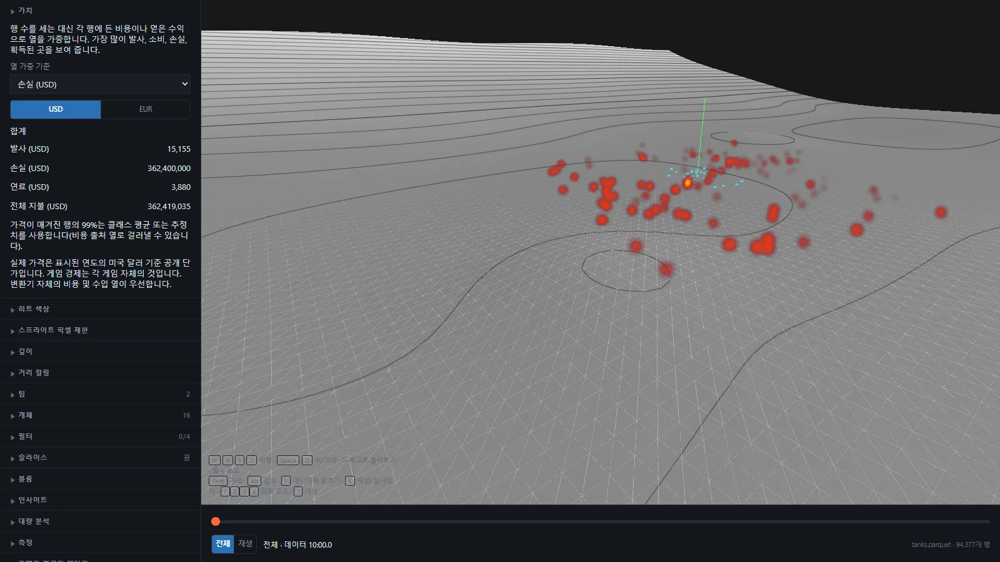

# 값 가중치

모든 발사, 탄약, 잃은 차량, 리터의 연료에는 가격이 있습니다. 뷰어는 각 행이 얼마나 들었거나 얻었는지 계산하고, 그 값으로 열을 가중할 수 있습니다. 그래서 지도는 행이 어디에 있는지가 아니라 **돈이 어디에 들었는지** 보여 줍니다.

## 사용 방법 {#how-to-use-it}

1. 이벤트(발사, 킬, 죽음)와 차량 또는 무기 이름이 있는 데이터를 불러오세요.
2. 히트 사이드바에서 **값**을 여세요.
3. **열 가중 기준**을 고르세요. 예: *Lost (USD)*. 이제 히트는 1 대신 각 행의 가격을 더합니다.
4. **합계**를 읽으세요: 보이는 것(필터와 시간 구간이 적용됨)에 대해 모든 값 열의 합입니다.
5. 가격이 실제 돈일 때는 **USD / EUR** 전환이 나타납니다.

메뉴의 빈 첫 항목을 고르면 다시 행을 셉니다.

## 무엇을 가중할 수 있나요 {#what-can-be-weighed}

값 열은 불러올 때 더해지며, 종류와 통화마다 하나씩입니다.

| 종류 | 어떤 행에 들어가나요 | 가격 책정 방법 |
|---|---|---|
| **발사** | 발사와 발사체 | 무기, 없으면 그 종류 탄약의 평균 |
| **소비** | 구매, 생성 | 게임의 돈 열 (예: 슈터의 구매 메뉴) |
| **손실** | 죽음, 파괴됨 | 자기 차량, 없으면 그 등급의 평균 |
| **파괴됨** | 킬 | 대상 차량 |
| **가한 피해** | 명중 | 대상 가치의 일부 |
| **연료** | 위치 | 쓴 연료. 연료 열에서 가져오거나, 등급과 시간으로 추정 |
| **전체 지불** | | 발사 + 소비 + 손실 + 연료 |
| **획득** | 보상 | 게임 자체의 보상 열 (`earn_…`) |
| **순액** | | 획득 - 지불. 부호가 있는 히트로 그림 (더 많이 얻은 곳은 양의 램프, 더 많이 지불한 곳은 음의 램프) |

열 이름은 `cost_<kind>_<currency>`, `earn_<currency>`, `net_<currency>`입니다. 게임 자체의 통화를 아는 변환기(예: 게임 내 크레딧으로 쓰는 재생 변환기)는 내장 가격표보다 우선합니다.

## 가격표 {#the-price-tables}

| 표 | 통화 |
|---|---|
| 실제 군사: 미사일, 폭탄, 탄, 대응 장치, 항공기, 헬리콥터, 지상 차량, 선박, 연료 | USD (EUR = USD × 0.92, [`cost.ts`](https://github.com/Holdi601/3DHeat/blob/main/src/data/cost.ts)의 고정 `EUR_PER_USD`; 실시간 환율이 아닙니다) |
| 슈터의 구매 메뉴와 킬 보상 | 게임의 크레딧 |
| 탱크와 선박 게임 | 게임의 크레딧 |
| 전략 게임 (여러 자원) | 자원마다 열 하나와 합친 열 하나 |
| 워게임 | 점수 |

게임은 데이터의 이름으로 알아봅니다. 실제 가격은 공개 자료(예산 문서, 백과사전)에서 왔거나 추정치로 표시되어 있습니다. 물가 상승을 반영하지 않습니다. 표의 생성된 목록은 [값 표](ref-value-tables.md)에 있습니다.

## 추정치 {#estimates}

추가 범주 열 **Cost source**는 각 행이 어떻게 가격이 정해졌는지 보여 줍니다: `table`, `class average`, `estimate`, `none`. 값 절은 가격이 정해진 행 중 얼마가 평균이거나 추정치인지 보여 줍니다. 정확히 가격이 정해진 행만 남기려면, [필터](filters.md)의 **Cost source**에서 *estimate*와 *class average*의 체크를 해제하세요.

## 값이 또 나타나는 곳 {#where-else-value-shows}

- [인사이트](insights.md): *Costly ground*와 *Earning ground* 발견.
- [분해](breakdown.md): 팀, 플레이어, 무기별 획득, 손실, 순액.
- [볼륨](volumes.md): 통계와 비교의 값 열.
