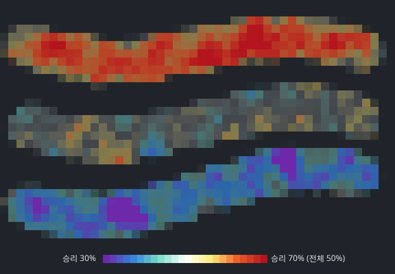

# 승률: 한 장소, 한 경로, 한 플레이가 얼마나 자주 이기는가

플레이어가 어디에 서는지, 어느 쪽으로 가는지, 어디에 유틸리티를 던지는지 - 그리고 그 뒤 그 편이 얼마나 자주 라운드를 이기는지. **승률 지도**는 각 장소를, 그곳의 행 가운데 행의 편이 이긴 라운드에 속한 행의 비율로 색칠하고, 표시된 전체에서의 비율과 비교합니다. 더 높은 곳은 따뜻한 색, 더 낮은 곳은 차가운 색, 같은 곳은 아무 색도 없습니다.

*이 그림은 지어낸 데이터입니다. 빈 레벨의 세 경로이며, 각 경로의 행 중 이긴 라운드의 행이 68%, 50%, 33%입니다.*

누가 이겼는지 알려 주는 데이터가 필요합니다. 바로 [결과 열](data-formats.md#outcome-columns)(`won`, `matchWon`, `roundEndReason`)입니다. CS2와 War Thunder 변환기가 이 열을 씁니다. Tacview 변환기도 DCS 서버의 캠페인에서 씁니다([DCS 서버](tacview-acmi.md#dcs-servers-who-won-and-how-each-sortie-ended)). 어떤 파일이든 이 열을 가질 수 있습니다.

## 해 보기 {#try-it}

1. 결과 열이 있는 경기를 불러오고 `2`(**차이**)를 누릅니다.
2. **차이 분할**에서 **라운드 승률**(또는 **경기 승률**)을 누릅니다. 이긴 라운드를 **+**에, 진 라운드를 **−**에 놓고 패널을 **+의 비율**로 바꿉니다.
3. 색을 읽습니다. 패널이 전체 비율을 알려 줍니다: *전체 1,200,000개 행 중 52.0%가 +에 있습니다.*
4. [필터](filters.md)로 좁힙니다. 한 편(T 또는 CT), 한 이벤트 종류(사람이 서 있던 곳은 *위치*, 쏘거나 던진 곳은 *발사 사격* 또는 *발사(미사일, 로켓, 폭탄)*), 한 가지 구매, 한 지도.

*위치* 행으로 따뜻한 곳은 그곳을 지킨 사람들이 라운드를 이기는 경우가 많았던 곳입니다. *격추* 행이라면, 그곳에서 낸 처치가 이긴 라운드로 이어진 곳입니다.

## 설정 {#the-settings}

| 설정 | 하는 일 | 기본값 |
|---|---|---|
| **차이** / **+의 비율** | 차이 자체, 또는 양쪽 행 가운데 + 쪽의 비율 | 차이 |
| **최대 색상 기준** | 전체 비율보다 얼마나 높거나 낮을 때 장소를 최대 색으로 보여 줄지, 포인트 단위 | ± 20포인트 |
| **장소를 색칠할 최소 행 수** | 행이 이보다 적은 장소는 색칠하지 않습니다. 그 절반부터 서서히 나타납니다 | 12 |
| **전체 비율로 끌어당김 (행)** | 모든 장소는 전체 비율로 이만큼의 행이 있는 상태에서 시작합니다. 그래서 행 3개가 모두 이긴 장소가 100%로 보이지 않습니다 | 12 |

세 가지 모두 완성된 그림에 작용합니다. 드래그해도 누적이 다시 시작되지 않습니다.

비율은 승리만이 아니라 어떤 분할의 것이든 됩니다. 편으로 나눈 *+의 비율*은 T가 존재의 더 큰 부분을 차지한 곳을 보여 주고, 두 지도의 파일로 나누면 한 파일의 행이 다른 파일의 행보다 무거운 곳을 보여 줍니다.

## 라운드가 아니라 행 {#rows-not-rounds}

이 지도는 행을 셉니다. 한 자리에 20초 동안 서 있는 플레이어는 샘플마다 행을 하나씩 더하지만, 모두 한 라운드의 것입니다. 그래서 한 장소의 증거는 라운드가 아니라 그 가까이에 있는 행입니다. 최솟값과 끌어당김이 행 단위인 것도, 한 라운드 분량보다 큰 것도 그 때문입니다.

라운드 자체를 보려면:

- 한 지점, 화면, 볼륨의 **[상세 분석](breakdown.md)**: *승률 %*는 각 플레이어의 라운드를 한 번씩 세고, 같은 방식으로 그 장소의 전체 비율 쪽으로 끌어당깁니다(4라운드).
- **[볼륨](volumes.md)** 통계: *승률* - 볼륨 안에 플레이어가 있던 라운드를 한 번씩 세고, 표시된 전체의 비율 쪽으로 끌어당긴 값이며, 개수도 함께 나옵니다.

## 결과 필터 {#outcome-filters}

[필터](filters.md) 패널은 뷰어 자체 열 바로 다음에 결과 열을 나열합니다: **라운드 결과**와 **경기 결과**(*전체*, *승리*, *패배*), 그리고 **라운드 종료 방식**(전멸, 폭탄 폭발, 폭탄 해체, 시간 종료, 항복, 무승부, 목표, 구역 점유, 티켓 소진, 모든 차량 손실). 모두 뷰어의 언어로 표시됩니다.

## 개발자용 {#for-developers}

히트 패스는 팀 히트가 쓰는 4채널 타깃에 세 합계를 씁니다. 히트 `R = Σ|v|`, + 쪽의 히트 `P`, 그리고 `S = Σ v²/w`이며, `w`는 패스의 가중치(샘플링 가중치 × 프레임 게인)입니다. 합성은 비율 `P/R`(커널 가중 평균)과 그것이 기대는 행 수 `n = R²/S`(Kish의 유효 표본 크기)를 읽고, 비율을 전체 비율 쪽으로 끌어당겨 `p = (n·P/R + m·r0)/(n + m)`, `p - r0`를 범위에 맞춰 차이 램프로 색칠합니다.

`n`은 한 픽셀의 행에 공통인 모든 계수 - 프레임 게인, 샘플링 가중치, 고정된 스프라이트의 면적 가중치 - 를 나누어 없앱니다. 그래서 그림은 어떤 줌과 샘플링 밀도에서도 같고, k번째 행마다의 프레임은 색이 튀지 않고 전체로 합쳐집니다. 전체 비율은 CPU의 편별 개수에서 나오며 0.1% 단위까지 유지합니다. GPU에서 아무것도 다시 읽어 오지 않습니다. 계산과 그 검사: [`render/rateMap.ts`](https://github.com/Holdi601/3DHeat/blob/main/src/render/rateMap.ts)와 그 테스트.

비용은 팀 히트와 같습니다. 4채널 타깃은 히트 패스의 블렌드 대역폭을 네 배로 늘리지만, *+의 비율*이 켜져 있는 동안만입니다.
