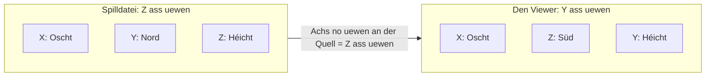

# Achsen, Eenheeten a Zäit

Spiller a Kaarte sinn sech net eens, wou uewen ass, wéi laang eng Eenheet ass, oder wéi d'Zäit geschriwwe gëtt. Dës Säit weist déi dräi Astellungen, déi Är Daten riicht stoen, riicht skaléieren a riicht spillen loossen.

Wann Är Kaart wéi eng Mauer steet anstatt wéi en Buedem ze leien, schalt **Achs no uewen an der Quell** ëm.

Mat der falscher **Achs no uewen an der Quell** steet d'Kaart wéi eng Mauer; mat der richteger leeit se wéi en Buedem.

## D'Welt, an där den Viewer zeechent {#the-world-the-viewer-draws-in}

D'Welt vum Viewer ass **Y-uewen**: X an Z sinn d'Buedenebene, Y ass d'Héicht. D'Mëschtdeel vun de Spillmotoren ass **Z-uewen**: fir si sinn X an Y de Buedem, a Z ass d'Héicht. E puer Motoren sinn zousätzlech gespigelt (lénkshänneg). D'Zuerdnung seet, wéi d'Achsen vun der Datei an d'Achsen vum Viewer ëmgedréint ginn. (Technesch ass den Viewer rechtshänneg, d'Konventioun vun three.js.)

### Achs no uewen {#up-axis}

**Achs no uewen an der Quell** an der [Spalte-Zuuerdnung](column-mapping.md):

| Astellung | Datei (x, y, z) gëtt Welt (X, Y, Z) |
|---|---|
| *Z ass uewen (d'Mëschtdeel vun de Spillmotoren)* - de Standard | (x, **z**, **y**): d'Z vun der Datei gëtt d'Héicht, an d'Y vun der Datei gëtt d'Z vun der Welt |
| *Y ass uewen (Grafikkonventioun)* | (x, y, z) onverännert |

Bei Z-uewen-Daten gi also déi dräi Felder nei beschrëfft anstatt kopéiert ([`remapAxesInPlace`](https://github.com/Holdi601/3DHeat/blob/main/src/data/ingest.ts)); dat spuert honnerte Megabytes bei groussen Luede. D'Vermutung gëtt aus der Probe gemaach: vun den Y- an Z-Kolonnen ass déi uewen, déi de klengere Beräich huet.

### Ëmdréinen {#flips}

**Flip X**, **Flip Y**, **Flip Z** negéieren d'*Achs vun der Datei* mat deem Numm, virun der Neibeschrëftung - also bei Z-uewen negéiert *Flip Y* dat, wat um Enn d'Z vun der Welt ass. E Ëmdréinen ännert déi gelueden Daten: d'Koordinaten, déi d'[Miessband](measure.md) weist, de Schnitt an d'Kameraposition sinn déi ëmgedréinten.

Fir eng gespigelt Welt richteg erëm ze zeechnen, **ouni** d'Daten z'änneren, benotzt **Kamera a Szen → Weltachs ëmkéieren** ([Kamera](camera.md#invert-world-axis)). Dat ass déi besser Wiel fir Spiller, deenen hir Welt lénkshänneg ass, well jiddereng Koordinaten, déi d'Werkzeuge weisen, dem Spill seng eege bleift.

### Eenheetsskala {#unit-scale}

**Eenheetsskala** multiplizéiert all Positioun. *1 (m)* setzt 1, *0,01 (cm→m)* setzt 0,01 (Unreal-Engine-Eenheeten si Zentimeter, dofir 0,01 benotzen; Source-Engine-Eenheeten si Zoll, dofir 0,0254; keng vun beiden ass Meter), an d'Këscht akzeptéiert all Wäert. Eng 0 oder en Wäert, dee keng Zuel ass, gëtt duerch 1 ersat.

Den Viewer schreift Distanzen a Meter (Sprite-Radius, Ofstandsgrenzen, de Miessband, d'Fluggeschwindegkeet), a dat stëmmt nëmmen, wann déi skaléiert Welteneenheet e Meter ass. Et geet näischt kaputt, wann se et net ass; d'Etiketten sinn dann einfach "m" fir wat och ëmmer d'Eenheet ass.

## Zäit {#time}

### Zäiteenheeten {#time-units}

Faustregel: Wäerter wéi 17000000000 (zéng oder méi Zifferen) sinn en Unix-Zäitstempel; Wäerter wéi 0, 0,25, 0,5 sinn Sekonnen zanter dem Ufank.

| Zäiteenheet (Menüetikett) | Gelies als | Wanduer gewisen |
|---|---|---|
| *Sekonnen (relativ)* | Wäert × 1 s | nee |
| *Millisekonnen (relativ)* | Wäert × 0,001 s | nee |
| *Mikrosekonnen (relativ)* | Wäert × 10^-6 s | nee |
| *Nanosekonnen (relativ)* | Wäert × 10^-9 s | nee |
| *Unix-Zäitstempel (s)* | Sekonnen zënter 1970-01-01 UTC | jo |
| *Unix-Zäitstempel (ms)* | Millisekonnen zënter 1970-01-01 UTC | jo |
| *ISO-8601-Datumstext* | Text wéi `2026-03-14T18:02:11.250Z`, gelies mam `Date.parse` vum Browser | jo |

Bei enger absoluter Eenheet (déi lescht dräi) behält d'Datesaz de Wanduermoment vu senger fréisster Zeil, an d'Zäitlinn weist nieft dem Ofspillkapp d'aktuell UTC-Zäit vum Dag (`HH:MM:SSZ`).

**Parquet-`TIMESTAMP`- an `DATE`-Kolonnen** ginn a richteg Momenter ëmgesat, dofir gëtt hir Eenheet-Astellung ignoréiert, an d'Panel seet dat. Eng `DATE`-Kolonn ass e ganzen Dag: all Zeil vun engem Dag deelt sech een Moment, a bei der Wiedergab sprénkt et ëmmer ee Dag weider, wat d'Panel warnt.

**ISO-8601-Text funktionéiert a CSV wéi a Parquet.** Eng Textzäitkolonn mat der ISO-Eenheet gëtt pro verschiddene Text eemol gelies; wann keen gelies ka ginn, bricht d'Luede mat *Keng liesbar ISO-8601-Zäitstempel an der zougeuerdneter Zäitkolonn.* of - an d'Zuuerdnung wäigert sech schonn ze starten, wann keen vun de geprobten Wäerter gelies ka ginn. Eng Parquet-`TIMESTAMP`-Kolonn gëtt als Zäitstempel gelies, egal wéi d'Eenheet agestallt ass, an eng Zuelen-Parquet-Kolonn mat der ISO-Eenheet gëtt als Unix-Millisekonnen gelies. Eng Textzäitkolonn mat enger Zuelen-Eenheet gëtt virum Lueden ofgewisen: all Wäert wier NaN.

### Wéi d'Zäit gespäichert gëtt {#how-time-is-stored}

Wärend d'Dateien zesummegefouert ginn, sinn d'Zäiten 64-Bit-Sekonnen, sou datt eng absolut Epoch hir Ënnersekonnen-Detailer behält. Wann all Dateien dran sinn, gëtt déi fréiste Zäit vun der ganzer Auswiel 0, an all Zeil späichert 32-Bit-Sekonnen dovun. E 32-Bit-Float huet 24 Bit Mantisse: Spannen bis ongeféier anderhalwe Dag léisen sech besser wéi 1/100 s op, Spannen vun engem halwe Joer bis ongeféier eng Sekonn. Eng Zeil, deenger Zäit feelt oder keng Zuel ass, gëtt op 0 gesat, den Ufank.

D'Zeilen ginn dann no Zäit sortéiert, wat d'Zäitlinn bëlleg mécht: en Zäitfënster gëtt mat zwou Binärsich fonnt (kuckt [Probennéiere a Budgeten](sampling-and-budgets.md)).

### Verstrach Zäit géint Wanduer {#elapsed-time-versus-wall-clock}

Eng Zäitkolonn wéi `match_time` oder `round_time` zielt vum eegene Ufank vun all Match. Wann Dir se wielt, setzt dat jiddereg Match op eng gemeinsam Achs - gutt fir ze vergläichen, wat an der 3. Minutt vun all Match geschitt - a d'Panel weist dat. Eng Wanduer-Kolonn weist d'Matcher an der Rei, a där se wierklech geschitt sinn, a si iwwerlappen, wou se sech iwwerlappt hunn.

## Kuckrichtung {#look-direction}

D'Kuckrichtung gëtt nëmmen vum [Box-Replay](box-replay.md) benotzt (d'Strale vun all Këscht). Si gëtt als zwee Wénkel gespäichert, Giering an Neigung, a Radiant.

- **Gier-/Nickwénkel-Kolonnen** ginn esou gelies, wéi se sinn, a vu Grad ëmgerechent, wann *Grad* gewielt ass. Si ginn net un d'Achs no uewen oder d'Ëmdréinen ugepasst.
- **Richtungsvektor-Kolonnen** gi duerch déiselwecht Neibeschrëftung a Ëmdréinen wéi d'Positiounen, a ginn dann zu Giering = atan2(x, -z) an Neigung = atan2(y, √(x² + z²)) an de Weltachsen, sou datt de Strahl och a enger gespigelter Quellwelt dohin weist, wou d'Këscht kuckt.

Wann d'Gier-/Nickwénkel-Kolonnen nach dem Ëmdréinen, enger Richtungsvektor oder ugepasste Wénkel falsch erëm weisen, ass dat d'Léisung.
