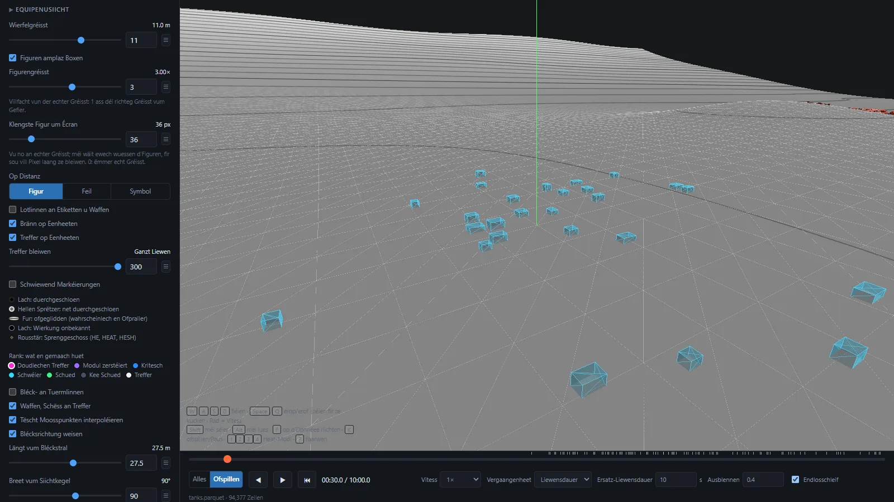

# Figuren-Overlay (Box-Replay)

En klengen Film: eng Figur fir all Persoun, déi sech beweegt, wéi d'Zäit leeft, mat enger Spuer hannendrun.

Am Modus-Balken heescht de Modus **Figuren-Overlay**. Dës Säit hat fréier de Numm "Box-Replay", well all Persoun eng Këscht war, ier et Figuren ginn. "Figuren-Replay" an "Box-Replay" heeschen dat selwecht. **Figuren-Overlay** huet keng Zifferdaaschtaste: wielt en an der Modus-Leescht. Hie zeechent eng Figur (oder Këscht) pro [Persoun](glossary.md), wéi se sech op der [Zäitlinn](timeline.md) beweegt, mat optionale Blécksstrale a Spuren. Et ass Wiedergab an net Dicht: *wien wou war, wann*. Et brauch eng Persoun-Kolonn; ouni Zäit-Kolonn gëtt all Probe op eemol gezeechent.

## Wéi et benotzt gëtt {#how-to-use-it}

1. Lued Daten mat enger Persoun-Kolonn an enger Zäit-Kolonn.
2. Wielt **Figuren-Overlay** an der Modus-Leescht.
3. Schalt d'Zäitlinn op **Ofspillen** a dréckt Ofspillen (`K`).
4. Maacht **Equipenusiicht** op, fir d'**Längt vun der Spuer**, d'Figurengréisst oder d'Blécksstrale z'änneren.

An dësem Modus gëtt keng Hëtzt gezeechent, an d'adaptiv Sprite-Budget ruht.

Standardméisseg gëtt all Persoun als d'Figur gezeechent vun deem, wat se sinn, net als Këscht - kuckt [Figuren](figures.md) fir d'Figur, déi eng Eenheet kritt, a [Match-Replay](match-replay.md) fir Beschrëftungen, d'Verfollegungskamera, d'Messung tëscht zwou Eenheeten an d'Evenementlëscht.

## D'Equipenusiicht-Panel {#the-team-viewer-panel}

An dësem Modus gëtt et amplaz vun de Hëtzt-Panelen gewisen.

| Reglage | Standard | Beräich (Schiebe) | Bedeitung |
|---|---|---|---|
| **Figuren amplaz Boxen** | un | | All Persoun als d'Figur vun deem, wat se sinn: en Zaldot zu Fouss, de Panzer oder de Fliger, déi d'Daten nennen. Wat d'Daten net sot, bleift eng Këscht. |
| **Figurengréisst** | 1× | | 1× ass déi richteg Gréisst. |
| **Klengste Figur um Écran** | 36 px | 0 = ëmmer richteg Gréisst | Richteg Gréisst no beim; méi wäit ewech wuessen d'Figuren, fir sou vill Pixel laang ze bleiwen. |
| **Waffen, Schëss an Treffer** | un | | Waffen am Fluch mat Rauch, Tracer, Eischléi, Treffer an Doudesfäll. Tracer, déi aus engem Treffer erausgerechent sinn, sinn gestréchelt. |
| **Wierfelgréisst** | Eenheetsgréisst, oder Ausmooss / 500 beim Lueden | 0,05-200 m, logaritmesch (5000) | Kantelängt vun all Këscht. Kuckt [Eenheetsgréisst](sessions-persons-groups.md#entity-size). |
| **Tëscht Moosspunkten interpoléieren** | un | | Tëscht zwee Moosspunkten vun der selwechter Persoun an der selwechter Sessioun d'Këscht proportional dertëschent setzen. Nie iwwer eng Sessiounsgrenz. |
| **Blécksrichtung weisen** | un | | E Strahl vun all Këscht an d'Kuckrichtung vun der Persoun (brauch [Blécks-Kolonnen](axes-units-and-time.md#look-direction)). |
| **Längt vum Bléckstral** | Eenheetsgréisst × 4, oder Ausmooss / 200 beim Lueden | 0,5-500 m, logaritmesch (20.000) | Gewisen, solang d'Blécksrichtung un ass. |
| **Längt vun der Spuer** | 8 s | 0-300 s (86.400); 0 = aus | Sekonnen Geschicht, déi hannert all Persoun gezeechent ginn. |
| **All raue Moosspunkt zeechnen** | aus | | Eng Këscht pro gespäichert Moosspunkt am Fënster amplaz eng interpoléiert Këscht pro Persoun. Gëtt ënnerprouwen, fir interaktiv ze bleiwen. |

D'Hiweiser am Panel erklären, datt Interpolatioun a Spuren nëmme Moosspunkte bannent enger Sessioun verbannen, an, wann d'Luede [gedeelte Nimm](sessions-persons-groups.md#names-worn-by-several-things-at-once) huet, wéivill Nimm als eenzel Moosspunkte gezeechent ginn.

## D'Sessioun, déi gespillt gëtt {#the-session-being-played}

Mat enger Sessiouns-Kolonn bestëmmt de **Sessioun**-Auswieler uewen an der Säitelleescht ([Sessiounen](sessions-persons-groups.md#the-session-picker)), wéi de Match zréckgespillt gëtt. Déi aktivst gëtt beim Lueden gewielt. Nëmmen d'Zeilen vun där Sessioun ginn Këschten a Spuren, an d'Zäitlinn leeft iwwer d'Spann vun där Sessioun amplaz vun der ganzer Datesaz. *All Sessiounen* spillt all Sessioun op eemol, ëmmer nach ouni Moosspunkte iwwer Sessiounen ze verbannen.

## Wat wann gezeechent gëtt {#what-is-drawn-when}

Vum [`TrackCursor`](https://github.com/Holdi601/3DHeat/blob/main/src/data/tracks.ts):

**Live-Këschten** (Ofspillmodus, raw-Moosspunkte aus). Fir all sichtbar Persoun hire leschten Moosspunkt um oder virun der Zäitlinnstelle:

- Wann d'Persoun en nächste Moosspunkt huet, deen an der selwechter Sessioun ass, an de Numm net gedeelt ass, da gëtt d'Këscht zwëschen den zwee Moosspunkte proportional zur Zäit gesat, mat dem Giering interpoléiert op dem kierzeren Wee an der Neigung linear (wann *Interpoléieren* un ass).
- Soss bleift d'Këscht um lescht Moosspunkt fir d'**Ersatz-Liewensdauer** vun der Zäitlinn (Standard 10 s) a gëtt dann ewechgeholl, sou datt eliminéiert Spiller net hänken.

**Alles-Modus** ignoréiert d'Zäitlinnstelle a zeechent all Moosspunkt an der Spann als Këscht.

**Raw-Moosspunkte** zeechent eng Këscht pro gespäichert Moosspunkt am Fënster: d'*Spann* mat der *Fënster*-Geschicht, soss alles bis zur Zäitlinnstelle. Héchstens 65.536 Këschten; mat méi Moosspunkte gëtt all *k*-ten gezeechent.

**Spuren** (wann d'Längt vun der Spuer méi wéi 0 ass an raw-Moosspunkte net gezeechent ginn): eng Linn tëscht all zwee openeen folgende Moosspunkte vun enger Persoun bannent de leschte *Längt vun der Spuer* Sekonnen bis zur Zäitlinnstelle, mat der Zäit vu 80 % Deckkraaft bis duerchsiichteg verbleechen. Eng Spuer hält bei engem Sessiounswiessel un a gëtt bei gedeelte Nimm net gezeechent. Héchstens 131.072 Eckpunkten; mat méi Zeilen ginn se gläichméisseg iwwersprongen.

**Wie sichtbar ass:** eng Persoun ass verstoppt, wann hir Equipe an der [Teamlëscht](teams-list.md) ausgeschalt ass (hir Equipe ass déi vun hirer éischter Zeil), wann e Gruppefilter se ausschléisst, oder wann d'[Entitéiten](entities.md)-Panel eng Auswiel huet, déi se net enthält. [Filteren](filters.md) vun de Kolonnen gëllen net fir Këschten.

## Faarwen {#colours}

Eng Faarffamill pro Gruppe an eng Schattéierung pro Member, sou datt ee mat engem Bléck gesäit, op wéi enger Säit iergendeen ass ([`teamMemberColor`](https://github.com/Holdi601/3DHeat/blob/main/src/render/colors.ts)). Gruppenfaarwen lafen duerch eng fix Lëscht vun zéng - Blo, Rout, Gréng, Bernstee, Violett, Cyan, Magenta, Limette, Orange, Indigo -, a Member vun enger Gruppe verdeelen sech iwwer Hellegkeet vun 42-76 % a Sättegung vun 90-65 %.

## Notizen {#notes}

- De Figuren-Overlay baut seng Figuren nëmmen nei, wann eppes sech ännert; e lietzen Bild zeechent déi lescht nei.
- D'Zeil *Këscht* am [Statistiken-Overlay](performance-and-stats.md) zielt d'Këschten um Écran.
- De Figuren-Overlay zeechent an deeselwechte Szen wéi de Level, dofir verschwemmt [Tiefeschäerf](camera.md#depth-of-field) d'Këschten, awer ni d'Hëtzt.
