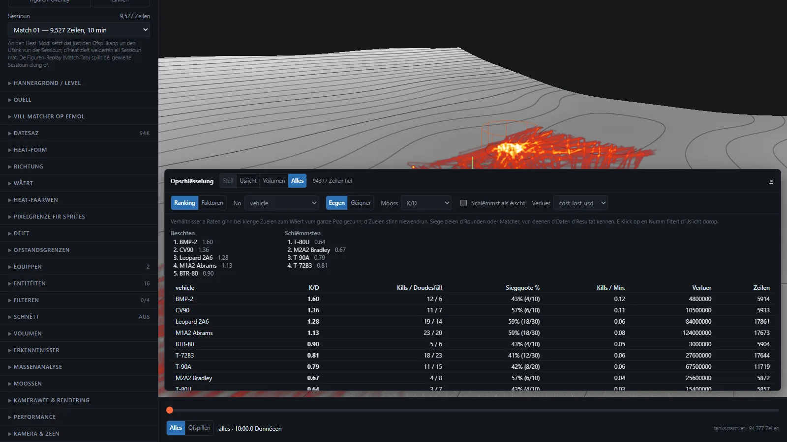
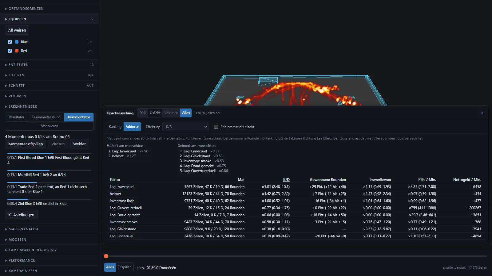

# Opschlësselung: wien an wat am beschte gëtt wou

D'**Opschlësselung** beäntwert eng Fro: un dësem Ort, wéi Gefier, Spiller oder Waff am beschte gëtt? Benotzt se, fir de Panzer ze fannen, deen op der Bréck gewënnt, oder ze gesinn, ob e Helm wierklech hëlleft.

Si rangéiert, wat un engem Ort geschitt (enger ausgewielter Stell, der Usiicht, engem Volumen oder allem, wat gewisen ass) no all Kategorie, a miesst all Zoustandsfaktor mat mat ouni.

## Probéiert et {#try-it}

1. Lued e Match mat Killen a Doudesfäll, a maacht **Volumen** op.
2. Zitt e Volumen ëm d'Plaz, déi Iech wichteg ass, a wielt en aus.
3. Drëckt **Opschlësselung...** ënner Statistiken.
4. Ënner **No** wielt *Gefier*, an d'Miessung *K/D* (Killen pro Doud).
5. Liest d'Lëscht, dat Bescht als éischt. Drëckt **Schlëmmst als éischt**, fir se ëmzedréinen. Klickt op e Numm, fir d'Usiicht drop ze filteren; nach eng Kéier klicken, fir et ze lassen.

## Opmaachen {#open-it}

| Vun | Beräich, mat deem et ufänkt |
| --- | --- |
| **Opschlësselung...** an [Volumen](volumes.md) (Statistiken) | dat gewielt Volumen |
| **Opschlësselung hei** op der Kaart fir e Punkt, nodeems Dir geklickt hutt | eng Kugel ronderëm dee Punkt (**Radius**, Standard 3 % vun der Gréisst vun den Daten) |
| den Ënnerscheed-Split-Panel | d'Usiicht |

D'Kopfzeil wiesselt de Beräich: **Stell**, **Usiicht** (wat d'Kamera beim leschte Zielen gesinn huet; **Nei zielen** nodeems Dir Iech beweegt hutt), **Volumen** (eent wielen) oder **Alles**. Et zielt am Hannergrond; d'Statuszeil seet, wéivill Zeilen am Beräich sinn.

## Rangéieren {#ranking}

Wielt, wat ee rangéiere wëll, an eng Miessung:

| Miessung | Wat et ass |
| --- | --- |
| A, B | Zeilen op all Säit vun der Ënnerscheedskaart, opgedeelt wéi d'Hëtzt se opdeelt |
| A / B, A - B, A / (A + B) | déi zwou Schichten géigeneen |
| K/D | Killen géint Doudesfäll |
| Gewënnt-% | Ronnen (oder Matcher), déi gewonnen goufen, wou d'Daten soen, wie gewonnen huet |
| Killen / Min. | Killen pro Minutt, déi do sinn (d'Lücke vun de Beweegungsprouwen) |
| Verdéngt, Verluer, Nettogeld | Summen vun de Spalten `earn_*` an `cost_*`; e Wieler wielt d'Währung |

Killen, Doudesfäll, Presenz, Gewënn a Suen zielen all Zeil, déi d'Usiicht an der Plaz weist, op iergendenger Säit vun der Opdeelung oder op kenger.

Quoten an Taxe ginn zum Wäert vun der ganzer Plaz gezu, wann d'Zuelen kleng sinn, sou datt 2 Killen an 1 Liewen net uewen an der Lëscht stinn. D'Zuelen sinn nieft hinnen gewisen.

Dir kënnt no de Gruppen, Spiller a Matcher rangéieren, no all Kategorie-Spalt (engem Gefier, enger Waff, enger Säit, enger Kafaart, engem Agent oder engem Kit), no all Zuelen-Spalt a Beräicher (Panzerung, de Wäert vun enger Ausrüstung), no der **Klass** vun enger Waff-Spalt (Gewier, Scharfschutz, SMG, Pistoul ...) an no wéivill Stécker **Hëllefsmëttel** eng Lëscht-Spalt wéi `inventory` hält.

**Eegen** rangéiert no dem eegene Wäert vun der Zeil. **Géigner** rangéiert no dem Wäert vun der anerer Partei: der Waff vum Affer bei engem Kill, der Waff vum Killer bei engem Doud (brauch eng Spalt `other` / `victim`, déi se nennt).

## Zoustand zu där Zäit {#state-at-the-time}

Den Wäert vun enger Zeil ass säin eegene, außer d'Zeil hält keen (eng Eventzeil ouni Ausrüstung) oder et ass en Doud (deem seng Waffspalt d'Waff vum Killer nenne kann); dann ass et dat, wat déiselwecht Persoun fréier am Match zulescht gedroen huet.

## Faktoren: mat géint ouni {#factors-with-against-without}

Wiesselt vun **Rangéieren** op **Faktoren**, wielt **Effekt op**, a liest *Hëlleft am meeschte* an *Schuedt am meeschte*:

Den Effekt vun all Faktor op K/D, gewonnene Ronnen, Iwwerliewen (Minutten pro Doud), Killen an der Minutt a Nettogeld an der Minutt, mat engem 95-%-Intervall: Quoten als x, gewonnen Ronnen als Ënnerscheed a Punkten. D'Rangéierung zitt all Schätzung zum Null-Effekt no hirer eegener Onsécherheet, sou datt e seltene Faktor e kloren Effekt brauch, fir héich ze rangéieren; d'Intervall, dat gewisen ass, ass dat ouni dës Zitt.

Daten mat Ronnen fügen d'Nahkampf-**Situatiounen** derbäi ([Nahkampf an Ronnen](close-quarters.md)), eemol bei engem Datesaz ausgerechent: *geblend* (de `state_flashed` vun der Zeil, oder en Feindblitz bannent 15 m an de leschte 3 s), *Doud ausgetosch*, *Ufangduell*, an *Mann méi*, *gläich vill* oder *Mann manner* (Spiller, déi op der Säit vun der Zeil liewen, géint de Feind). E Doud zielt an der Situatioun, an där säi Affer just virdrun war.

A engem Duerchgang ginn héchstens 256 Faktoren gemooss.

## Fir Entwéckler {#for-developers}

### Kleng Proben zéien {#pulling-small-samples}

De Rangéierwäert ass `(n + m*r0) / (d + m)`: `n` a `d` sinn d'Zuelen, `r0` d'Quot vun der ganzer Plaz an `m` d'Gewiicht vun deem Ausgangswäert.

### Fir Konverter-Autoren: Faktor-Spalte benennen {#for-converter-authors-naming-factor-columns}

E Konverter setzt en Faktor derbäi, andeems en seng Spalt benennt:

| Spalt | Faktor |
| --- | --- |
| `state_<Numm>` Zuel | un, solang et net null ass (`state_scoped`, `state_suppressor`) |
| `state_<Numm>` Kategorie | ee Faktor pro Wäert (`state_ammo` = AP, HE...) |
| `active_<Numm>` | dat selwecht, fir eppes, dat ageschalt oder viru kuerzem benotzt gouf: en Fäegkeet, en Ultimate, en Gadget, en Buff (`active_ult`, `active_stim`) |
| Lëscht-Spalt (`inventory`, `loadout`, `perks`, `abilities`, `attachments`, `modules`, `buffs`, `debuffs`, `upgrades`, oder en `state_`/`active_`-Numm, deen op `s` endt) | ee Faktor pro Stéck vun engem `a\|b\|c`-Wäert |
| Ausrüstungsflaggen, déi schonn üblech sinn (`helmet`, `defuser`, `armor`, `scoped`, `airborne`, `duck`, `flashed`...) | un, solang et net null ass |
| `ammoType`, `shellType`, `ammoName` | d'Ronn, déi als Lescht geschoss gouf |

Resultater: eng 0/1-Spalt `won` (d'Säit vun der Zeil huet d'Ronn oder de Match gewonnen) an eng Spalt `round` - d'[Resultatspalten](data-formats.md#outcome-columns); wou e Fichier souwuel `won` wéi `matchWon` huet, zielt *Siegquote %* Ronnen. Suen: `earn_<Währung>` an `cost_<Aart>_<Währung>`; en Akommes nëmmen no Aart (`earn_round_cs2`, déi genau Ronnenbelounungen vun engem Konverter) ersetzt nëmmen d'Akommes vun deem Aart am Käschtemodell (`round` deckt och Plazéierungen an Entschäerfungen), an de Modell preist de Rescht.

D'Zuuerdnung lued dës Spalten vun sech selwer, nieft der eegener Lëscht vun der Datei: all `state_*`, `active_*`, `won`, `round` an Lëscht-Spalten, ausser déi, wou d'Statistiken vun enger Parquet-Datei weisen, datt se duerch all Zeil nëmmen ee Wäert hunn (all gelueden Spalt kascht 4 Byte pro Zeil).
