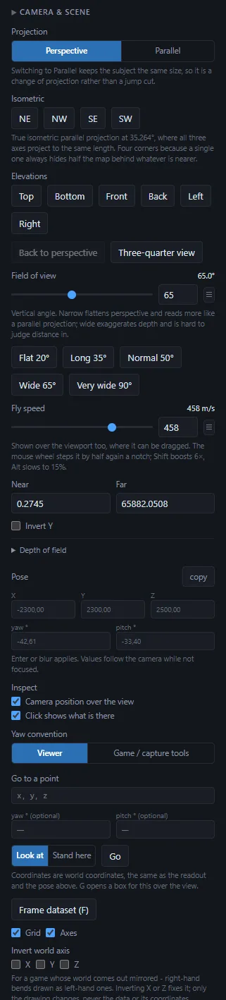

# Kamera a Steierung

Dir fléit duerch d'Szen wéi en Vull: **W A S D** fir ze bewegen, zitt mat der Maus fir ze kucken. Benotzt dës Säit fir ze fléien, fir op eng Uewen- oder Säitenusiicht ze sprangen, an fir genau ze liesen, wou d'Kamera ass.

## An 4 Schrëtt fléien {#fly-in-4-steps}

1. Klickt eemol op d'Usiicht, fir datt se d'Tastatur huet.
2. Hal **W** fir no vir ze fléien, **S** zréck, **A** an **D** zur Säit, **Space** erop, **Q** erof.
3. Hal de lénksen oder riichten Mausknäppchen a zitt, fir ronderëm ze kucken.
4. Drëck **F**, fir all d'Date nei an de Rumm ze setzen.

D'Kamera ass eng fräi Fluchkamera mat enger Perspektiv- an enger Parallelprojektioun, virdefinéierte Usiichten, enger getippter Positioun an enger Déifteschäerft. Hir Astellungen sinn am Panel **Kamera & Zeen** ënnen an der Säitebar (och an den Tabs Course-Analys an Match gewisen). D'Ëmsetzung ass [`camera.ts`](https://github.com/Holdi601/3DHeat/blob/main/src/render/camera.ts).

## Fléien {#flying}

| Input | Effekt |
|---|---|
| `W` `A` `S` `D` oder d'Pfeiltasten | No vir (laanscht d'Usiicht, mat hirer Neigung), lénks, zréck, riets |
| `Space` oder `E` | Erop (Weltuewen) |
| `Q` oder lénks `Ctrl` | Erof |
| `Shift` (gehalen) | 6× méi séier |
| lénks `Alt` (gehalen) | 15 % Geschwindegkeet |
| Zitt mat dem lénksen oder riichten Mausknäppchen | Ronderëm kucken. De Schwiwer ass beim Zéien gespaart. |
| Mausrad | Fluchvitess ×1,5 pro Rascht (Perspektiv); Zoom (parallel) |
| `F` | D'Date an de Rumm setzen |
| Klick (ouni ze zéien) | Weist, wat ënner dem Schwiwer ass ([D'Usiicht ënnersichen](#inspecting-the-view)) |
| `C` | D'Positioun, de Gierwénkel an de Nickwénkel vun der Kamera kopéieren |
| `G` | Op e getippten Punkt sprangen |
| `Esc` | D'Kaart zoumaachen (an ophalen, eng Eenheet ze follegen) |

### Wärend eng Eenheet verfollegt gëtt {#while-following-a-unit}

Wann d'Kamera eng Eenheet an enger Replay verfollegt ([Match-Replay](match-replay.md)), maachen d'Flugtasten eppes anescht:

| Input | Effekt |
|---|---|
| Mausrad, `W` / `S` | Méi no bei der Eenheet / méi wäit fort (méi héich / méi niddereg an der Satellitte-Usiicht) |
| `A` / `D`, `Q` / `E` | Ronderëm d'Eenheet kreesen (Hannendrun- an Orbit-Usiichten) |
| Zéien | Ronderëm d'Eenheet kucken (Cockpit: drannen ronderëm kucken) |
| `V` / `Shift+V` | Nächst / vireg Kamerausiicht |
| `Esc` | Éischt aufhalen, déi zweet Eenheet ze kucken, dann ophalen ze follegen |

Bewegungstasten zielen mat engem [Gamepad](gamepad.md) zesummen; fir alles anert kuckt d'[Tastatur-Referenz](keyboard-reference.md). Tasten gi ignoréiert, wann e Textfeld oder eng Dropdown-Lëscht den Fokus huet. D'Neigung bleift ëmmer e bëssen ënner geroder no uewen an no ënnen.

## Panel Kamera & Zeen {#camera--scene-panel}

### Projektioun {#projection}

**Projektioun**: *Perspektiv* (Standard) oder *Parallel*.

*Parallel* (orthografesch) hëlt d'Verkierzung ewech, sou datt zwee Hotspots mat gläicher Dicht iwwerall am Bild gläich gro ausgesinn - de Vergläich, fir deen eng Kaart-Heatmap do ass - a si mécht eng isometresch Usiicht isometresch. Am Parallelmodus zoomt d'Mausrad (et gëtt kee Virwärtsfluch, dee d'Gréisst ännert), an d'[Geschwindegkeetsanzeig](#fly-speed) ass verstoppt.

**Wiesselen hält d'Motiv gläich gro.** Eng Parallelprojektioun huet kee Siichtfeld, dofir hänkt d'Héicht vum Frustum net mat der Distanz vun der Kamera zesummen; ouni Iwwerleeung ze- oder erausgezoomt oder gar näischt gesinn. Wann Dir op Parallel gitt, setzt d'Frustum-Héicht dat, wat d'Perspektiv-Kamera op der Fokusdistanz deckt (2 × Distanz × tan(Siichtfeld / 2), d'Fokusdistanz ass d'Distanz vum leschte Rumm). Zréckgoen stellt d'Perspektiv-Positioun erëm her, déi Dir verlooss hutt, an der selwechter sichtbarer Gréisst, anstatt wou d'Parallelusiicht hiergaang ass.

### Virdefinéiert Usiichten {#preset-views}

| Grupp | Knäppercher | Ausriichtung |
|---|---|---|
| **Isometresch** | **NO**, **NW**, **SO**, **SW** | Parallel, Neigung -35,264° (= atan(1/√2), de Wénkel, wou all dräi Achsen op déi selwecht Längt projizéiert ginn), Gier -45°, 45°, -135°, 135°. Véier Ecken, well eng eenzeg ëmmer d'Halschent vun der Kaart hannert deem verstoppt, wat méi no ass. |
| **Usiichten** | **Uewen**, **Ënnen**, **Vir**, **Hannen**, **Lénks**, **Riets** | Parallel. Uewen kuckt direkt no ënnen (Neigung -89,9°), Ënnen direkt no uewen, Vir laanscht -Z (Gier 0°), Hannen laanscht +Z (180°), Lénks laanscht -X (-90°), Riets laanscht +X (90°). |
| | **Zréck op Perspektiv** | Zréck op d'Perspektiv-Positioun, déi Dir verlooss hutt. Am Perspektiv net aktiv. |
| | **Dräiveierels-Usiicht** | Perspektiv, Gier -35°, Neigung -28°. |

All Virastellung wiesselt d'Projektioun selwer - a Perspektiv konvergéiert eng "Uewenusiicht" nach ëmmer op e Fluchpunkt, an gläich Flächen gesinn net méi gläich aus - a setzt d'Date aus där Richtung an de Rumm.

### Siichtfeld {#field-of-view}

**Siichtfeld** - de vertikale Wénkel. Standard 65°, 10-140° op der Leescht (179° mat dem Griff), mat den Knäppercher **Flach 20°**, **Laang 35°**, **Normal 50°**, **Breet 65°**, **Ganz breet 90°**. Eng schmuel Siicht flaacht d'Perspektiv of an erënnert méi u eng Parallelprojektioun; breet iwwertreift d'Déift a mécht Distanzen schwéier ze schätzen. Et bleift live am Parallelmodus, wou et d'Gréisst setzt, déi de Réckwiessel ausrechent, an d'Distanz, déi **Frame** benotzt.

### Fluchvitess {#fly-speed}

**Fluchvitess** - Weltunitéiten (Meter) pro Sekonn bei voller Gasstellung. Standard 120; bei all Lueden d'horizontal Ausdehnung vun de Date / 12. Logarithmesch, 0,02-20.000 (200.000 mat dem Griff; de Griff ännert et a Verhältnisser, net a Beträg). Den Mausrad multiplizéiert oder dividéiert se pro Rascht mat 1,5, bannent 0,02-200.000.

Deeselwechten Wäert gëtt ënnen riets an der Usiicht gewisen (nëmmen Perspektiv): d'Geschwindegkeet a m/s oder km/s an d'Zäit, déi et mat där Geschwindegkeet brauch, fir d'Date (oder de Niveau, wann ee 3D-Niveau gelueden ass) ze duerchfueren. Zitt en no uewen oder no ënnen, fir d'Geschwindegkeet z'änneren.

### No a wäit {#near-and-far}

**No** (Standard 0,5) an **Wäit** (Standard 40.000) sinn d'Schneidedistanzen. Béid ginn all Kéier beim Lueden aus den Date nei berechent (no = max(0,05; Ausdehnung / 20.000), wäit = Ausdehnung × 12) an duerch e gréisseren 3D-Niveau ausgeweit, ni enger gemaach ([Niveauen](levels.md#what-a-level-does-for-the-heat)). Hiert Verhältnis setzt d'Déiftepräzisioun, op déi d'Verdeckung sech verlooss; e winzegt No mat engem enorme Wäit schwächt d'[Verdeckung](depth-and-culling.md). Vu baussen vun der Szen oder héich iwwer hirem Buedem gesinn, geet déi No-Fläch, déi tatsächlech benotzt gëtt, bis op 2 % vun där Distanz eraus, sou datt eng Kaart vu wäit uewen genuch Déiftepräzisioun behält, fir datt Waasser a Küst net flackeren; de Kaschte weist nach ëmmer de gesate Wäert.

### Aner Steierungen {#other-controls}

| Steierung | Standard | Bedeitung |
|---|---|---|
| **Y ëmdréinen** | aus | Dréint de Mausblick no uewen/ënnen ëm. |
| **Déifteschäerft** | aus | Kuckt drënner. |
| **Gamepad** | aktivéiert | Kuckt [Gamepad a HOTAS](gamepad.md). |
| **Positioun** | | Kuckt drënner. |
| **Ënnersichen** | | D'Kamera-Ufuerderung, Klick-zum-Wielen, d'Gierwénkel-Konventioun an *Op e Punkt sprangen*; kuckt [D'Usiicht ënnersichen](#inspecting-the-view). |
| **Dateset fokusséieren (F)** | | Passt d'Date (am Tab Course-Analys: d'Ronnen) an d'Usiicht an, mat der aktueller Richtung. D'Kamera steet op r / tan(Siichtfeld / 2) vum Zentrum, wou r d'Halschent vun der Diagonal vun de Begrenzunge vun den Date ass. |
| **Gitter**, **Achsen** | un, un | En Bodegitter mat engem Ofstand vun 1/2/5 × 10ⁿ vu ronn 1/40 vun der Spann vun den Date (geet bis 1,5 × d'Date, tëscht 8 an 120 Gitterschrëtt), an faarweg Achsen. |
| **Weltachs ëmdréinen** X, Y, Z | aus | Kuckt drënner. |

### Positioun {#pose}

Fënnf Zuelefelder - **X**, **Y**, **Z** an **Gierwénkel °**, **Nickwénkel °** - déi der Kamera follegen, solang keen dovun den Fokus huet. Tippt e Wäert an drückt `Enter` (oder verlooss d'Feld), fir d'Kamera dohinner ze réckelen. **kopéieren** leet `pos X Y Z · yaw A · pitch B` an d'Zwëschenoflag (mat `(Spill-Gier)` dohanner, wann dës Konventioun gewielt ass). Fléien ass, wéi Dir entdeckt; Koordinate si, wéi Dir eng Usiicht nach eng Kéier maacht. Et sinn déiselwecht Zuelen wéi d'[Kamerauflesung](#camera-readout): d'eege Koordinate vun den Date, och wann eng Achs ëmgedréint ass, an de Gier an der gewielter [Konventioun](#yaw-conventions).

### Weltachs ëmdréinen {#invert-world-axis}

**Weltachs X / Y / Z ëmdréinen** zeechent d'Welt mat där Achs ëmgedréint. En Spill, dat eng lénkshänneg Welt behält, kënnt an dësem rietshänneg Viewer gespigelt eraus - Riets-Kurven als Lénks-Kurven gemoolt - a X oder Z ëmdréinen stellt et erëm hier. **Nëmmen d'Zeechnung ännert sech**: d'Date, d'Analyse an all Koordinat, déi d'Werkzeuge weisen (Positioun, Miessstaang, Schnëtt), bleiwe dem Spill säi eegene Wäert. D'Usiicht dréint sech um Ort, sou datt Dir weiderhi op deeselwechte Fleck kuckt. Dës Astellung gëtt am Browser gespäichert (`localStorage`-Schlëssel `heat3d.mirror`); vergläicht d'[Ëmdréinungen](axes-units-and-time.md#flips) beim Lueden, déi d'Date änneren.

## D'Usiicht ënnersichen {#inspecting-the-view}

Wou d'Kamera ass, wat ënner dem Schwiwer ass, an d'Fuere op e Punkt - de Block **Ënnersichen** am Panel Kamera & Zeen, an zwee Iwwerlagerunge uewen lénks an der Usiicht. De Code ass an [`pose.ts`](https://github.com/Holdi601/3DHeat/blob/main/src/render/pose.ts), [`pick.ts`](https://github.com/Holdi601/3DHeat/blob/main/src/render/pick.ts) an [`inspector.ts`](https://github.com/Holdi601/3DHeat/blob/main/src/render/inspector.ts).

| Steierung | Standard | Bedeitung |
|---|---|---|
| **Kamerapositioun iwwer der Usiicht** | un | D'Kamera-Uflesung, hei drënner. Gëtt och mat sengem **×** zougemaach. |
| **Klick weist, wat do ass** | un | Klick-zum-Wielen, hei drënner. |
| **Gierwénkel-Konventioun** | Betrachter | Wéi de Gier, d'Positiounsfelder an d'Sprangbox weisen an liesen. |

Dës dräi ginn am Browser gespäichert (`localStorage`-Schlëssel `heat3d.inspect`).

### Kamerauflesung {#camera-readout}

Uewen lénks an der Usiicht: d'Kamera seng **x**, **y**, **z**, **Gier** an **Neigung**, live, mat engem Schëld, dat d'Gierkonventioun nennt. Et weist déiselwecht Zuelen wéi d'[Positioun](#pose)-Felder a kascht beim Fléien näischt (et gëtt op der Frame-Auer an d'Säit geschriwwen, ouni d'Panelen nei ze zeechnen).

- **kopéieren** (oder `C` iwwerall ausser an engem Textfeld) leet `x X y Y z Z yaw A pitch B (Betrachter-Gier)` op d'Zwëschenoflag, mat `.` als Komma ënner all Sprooch - eng Zeil, déi d'Sprangbox an all Skript liest.
- **sprangen** (oder `G`) mécht eng Box drënner op: en Punkt astellen an `Enter` drécken, fir en ze kucken, oder eng ganz kopéiert Positioun astellen, fir an där Usiicht ze stoen. `Esc` mécht d'Box zou.

### Koordinaten: d'eege Frame vun den Date {#coordinates-the-datas-own-frame}

All Koordinat, déi d'Ënnersuchungs-Werkzeuge weisen oder annehmen, ass am **eegene Frame vun den gelueden Date**: d'[Achsenzuerdnung](axes-units-and-time.md) vum Lueden (Uewenachs, Ëmdréinungen, Skala) gëtt réckgängeg gemaach. Eng Positioun, déi vun der Usiicht gelies gëtt, ass d'Zuel, déi d'Quelltabell hält, an eng Zuel aus der Tabell, déi an d'Sprangbox getippt gëtt, kënnt op deem Fleck un. Wann d'Zuerdnung näischt ännert (en Y-uewen, net skaléierten Lueden - wat d'Opnamwerkzeuge an d'Niveau-Exporter schreiwen), ass dat einfach d'Welt; soss dréit d'Uflesung e **Datesystem**-Schëld. Ouni Dateset sinn d'Koordinate Weltkoordinaten. Gier an Neigung sinn ëmmer iwwer d'Welt vum Viewer, Y uewen.

### Gierkonventiounen {#yaw-conventions}

| Konventioun | Gier 0° kuckt laanscht | Wiisst géint | Benotzt vun |
|---|---|---|---|
| **Betrachter** | -Z | -X | d'Fluchkamera, [virdefinéiert Usiichten](#preset-views) |
| **Spill / Opnamtools** | +X | -Z | de Gier- a Positiounsspalten vun den Opnamwerkzeuger; an engem Niveau, dat am Frame vum Viewer exportéiert gouf, de Gier vum Spill selwer |

D'Neigung ass an beiden d'selwecht: vum Horizont no uewen. Déi zwee ënnerscheeden sech ëm eng Véierelsdréiung an soss näischt:

> Gier vum Betrachter = Gier vum Spill - 90°

Eng Richtung `d` ass `(cos p · cos y, sin p, -cos p · sin y)` an der Spillkonventioun a `(-sin y · cos p, sin p, -cos y · cos p)` an där vum Viewer. Wielt **Spill / Opnamtools**, fir e Gier direkt aus enger Opnamtabell ze tippen, oder fir d'Uflesung mat enger ze vergläichen.

### Op e Punkt sprangen {#going-to-a-point}

**Op e Punkt sprangen**, am Block Ënnersichen (an der Box **sprangen** vun der Uflesung):

- d'Textbox hëlt `x, y, z` oder `x y z` (oder `x; y; z`), mat engem Dezimalpunkt oder enger Dezimalkomma - `-321.6, 137.8, -59.9` an `-321,6 137,8 -59,9` sinn den selwechten Punkt. Fënnf Zuelen addéieren en Gier an eng Neigung, an eng Positioun, déi aus der Uflesung oder de Positiounsfelder kopéiert gouf, gëtt ganz gelies, mat Etiketten an Konventioun;
- **Gier °** an **Neigung °** (optional) drénken d'Kamera, an der gewielter Konventioun;
- **Kucken** behält d'Richtung (ëm mindestens 20° no ënnen gekippt, wann se geradeaus war) a geet op déi aktuell Distanz zréck, a deenen 0,3 % bis 3 % vun der Breet vun der Szen gehalen - 6 bis 60 m op engem zwee Kilometer Niveau. D'Fokusdistanz, d'Héicht vun der Parallelusiicht an d'Fluchvitess ginn no, sou datt d'Usiicht brauchbar ukënnt;
- **Hei stoen** setzt d'Kamera op de Punkt, gedréint op de Gier an d'Neigung, déi ginn, oder wéi se war.

Eng agefüügt Positioun mat sengem eegene Gier an Neigung steet ëmmer a där Usiicht.

### Klick-zum-Wielen {#click-to-pick}

E Klick op d'Usiicht - dréckt a léisst lass, ouni méi wéi 4 Pixel ze zéien; e Zéie kuckt nach ëmmer ronderëm - weist uewen lénks eng Kaart mat deem, wat ënner dem Schwiwer ass. Wann de [Miessstaang](measure.md) un ass, goe Klicke statt dorunner un de Miessstaang.

**En gezeechent Datepunkt gewënnt.** De nootste Muster bannent 8 Pixel vum Klick, vun deenen, déi wierklech gezeechent sinn: d'Zeilen am Zäitfenster an an der Liewensdauer, déi duerch d'[Filtere](filters.md) goen, d'Gruppen, déi gewisen sinn, an d'Differenzopdeelung, bannent dem Ofstand-Ofschneiden an enger Scheif, déi d'Heatmap ofschneit. An der Box-Replay e Kaschte ënner dem Schwiwer (iwwerall drop). D'Kaart lëscht all Kolonn, déi d'Zeil dréit, ënner den eegenen Kolonnennimm vun der Quell - Zäit (Wanduhr, oder d'Sekonnen vun der Datei mat `m:ss.ss`), Persoun, Gruppe, Sessioun, all behalen Kolonn, d'Positioun an d'Blickrichtung - an d'Distanz vun der Kamera. Nëmmen d'Kolonne, déi d'Lueden behalen huet, sinn am Späicher: eng Kolonn, déi net als [Filterkolonn](column-mapping.md) gewielt gouf, gëtt net gewisen.

**Soss d'Uewerfläch vum Niveau**: de Punkt, wou de Strahl vum Klick op déi richtegen Dräiecker vum Niveau trëfft (net op d'Referenzplang vum Miessstaang), mat dem **Deel**, deen dozou gehéiert (den Numm vum Exporter, `structure:props`, `ground:terrain …`), senger **Aart** (Buedem, Struktur, Waasser, Kaartbild), de Koordinaten an der Distanz. Geometrie, déi vun enger Scheif oder vum Distanz-Ofschneiden verstoppt ass, gëtt duerchgelooss. Wann de Niveau e [Navigatiounsnetz](model-levels.md#navigation-meshes) huet, nennt eng Linn en, a seet, ob de Fleck dropläit (✓). E Deelnumm mat `≈` virun gouf aus den Begrenzungskäschte vun de Deeler geschätzt, well dësen Deel vum Niveau beim Lueden vereinfacht gouf.

D'Kaart bleift, bis se zougemaach gëtt (**×**, `Esc`), en anere Klick eng aner Fro beäntwert oder op eng eidel Stell geklickt gëtt. E cyane Kräiz gëtt am Punkt an der Szen gezeechent, an ëm en en Rank op der Bildschierm. Seng Knäppercher: **kopéieren** (all Wäert, an d'Koordinaten als `x, y, z`), **Kucken**, an **Hei stoen** (op engem Datepunkt, a Richtung, wou d'Zeil gekuckt huet, wann se eng Blickrichtung huet; op enger Uewerfläch 1,7 m driwwer et).

De Niveau gëtt fir d'Wielen am éischte Klick indexéiert, deen en brauch: e Gitter vu Kolonnen iwwer säin Ofdrock, a wéinege Millisekonnen op eemol tëscht de Frame gebaut, sou datt d'Usiicht ni stoppt (ongeféier eng Sekonn Aarbecht fir e Niveau mat e puer Millioune Dräiecker), a bis den Niveau sech ännert behalen. Bis dohinner steet op der Kaart *Den Niveau gëtt fir d'Wielen virbereet* mat engem Prozentzuel, an d'Kaart äntwert op de Klick, wann se fäerdeg ass. Eng Datepunkt-Sich iwwer méi wéi véier Millioune gezeechent Zeilen gëtt op d'selwecht Aart iwwer Frames verdeelt.

## Déifteschäerft {#depth-of-field}

En zesummeklappbare Ofschnëtt am Panel Kamera & Zeen, mam Titel *Déifteschäerft - un*, wann se aktivéiert ass. Standardméisseg aus: et ass en Duerstellungseffekt, an d'Standardusiicht soll d'Date weisen an net eng Interpretatioun dovun.

| Steierung | Standard | Beräich (Schëtt) | Bedeitung |
|---|---|---|---|
| **Aktivéiert** | aus | | |
| **Op dat fokusséieren, wat ausgeriicht gouf** | un | | Fokus op der Distanz, déi d'lescht Ausriichtung benotzt huet (*Fokusséiert op N m.*). |
| **Fokusdistanz** | 1000 | 1-200.000, logarithmesch (10.000.000) | Gëtt gewisen, wann de Fokus manuell ass. |
| **Blend** | ±35 % | ±2 % bis ±200 %, logarithmesch (±3200 %) | D'Déift, déi scharf bleift, als Bréch vun der Fokusdistanz - relativ, net als f-Zuel, well Szenen vun engem Zëmmer bis zu enger aacht Kilometer grousser Kaart goen. |
| **Maximal Onschäerft** | 12 px | 1-48 (256) | De gréisste Onschäerfts-Radius; d'Kaschten wiisst mat him. |

Et verwëscht **Niveau, Gitter a Kaschten** - *net d'Heatmap*. D'Hëtzt un engem Pixel ass d'Summ vu Sprites a ville Déiften, dofir huet se kee eenzegt Dëftegen, wou se onscharf kéint sinn; wann een se mat deem verwëscht, wat hannendrun steet, wier dat falsch, wou se virun eppes schwiewt. Schaarf Date iwwer engem gemëllene Kontext si och déi nëtzlechst vun deenen zwee. D'Onschäerfe ass e 24-Tap-Gülden-Wénkel-Zesummeholl am Zesummesetzungsdurchgang, gewiicht, sou datt en schaarfe Virgrond net vum onschaarfen Hannergrond no baussen verschmiert gëtt. Wann Dir se ännert, zeechent et nei, ouni d'Heatmap-Ophuelung nei unzefänken.

## Kanvasopléisung {#canvas-resolution}

De Kanvas gëtt an der Pixelrate vun der Anzeig gerendert, begrenzt op 2. De Hitzpuffer kann an enger méi klenger Opléisung gerendert ginn, wéi dat ([Heat-Opléisung](performance-and-stats.md)).

## Säiten an dësem Ofschnëtt {#pages-in-this-section}

- [Gamepad a HOTAS](gamepad.md)
- [Tastatur- a Mausreferenz](keyboard-reference.md)

