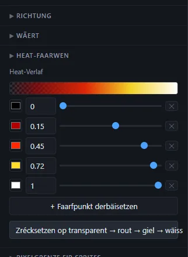

# Faarf a Belichtung

Dës Reglen bestëmmen, wéi vill Hëtzt wéi eng Faarf kritt. **Sättegungspunkt** ass, wéi vill Hëtzt als wäiss-hëtz zielt.

## Schnell Hëllef {#quick-fixes}

- Alles ass wäiss: erhéicht **Sättegungspunkt**, oder drëckt **Automatesch Beliichtung aus dem Feld**.
- Näischt ass ze gesinn: senkt **Sättegungspunkt**, oder drëckt **Automatesch Beliichtung aus dem Feld**.
- Nëmmen e puer eenzel Punkte weisen sech: dréint **Minimal Heat** méi huet.

All Reglage op dëser Säit wierkt, wann d'Hëtzt a eng Faarf ëmgesat gëtt. Wann Dir een dovun zitt, gëtt d'Bild direkt nei gezeechent, an **d'Accumulatioun fänkt ni nei un**.

## Sättegungspunkt {#saturation-point}

**Sättegungspunkt** (Sektioun Heat-Form): d'ukumuléiert Hëtzt, déi op d'Spëtzt vum Faarfverlaf geet (mat der *Linearer* Reaktioun; fir déi aner Reaktiounen kuckt weiderhin). Logaritmesche Schieber 0,1-4000, de Griff gëtt bis 10.000.000 gezu, well d'ukumuléiert Hëtzt mat der Zuel vun de Zeilen wiisst. Standard 24; bei all Lued gëtt et eng **analytesch Schätzung**, duerno **gemooss** aus dem Bild.

Et mécht de Ënnerscheed tëscht enger Hëtztkaart an engem eidelen (oder wäisse) Bild, a mir kënnen en net zouverléisseg ausrechnen: d'Telemetrie hänkt sech sou staark zesummen - en Ufank, eng Dir, e Engpass - dat d'Verhältnis vun Spëtzendicht zu Duerchschnittsdicht bei verschiddenen Daten an bei verschiddene Kamerawénkel ëm eng Zénerpotenz schwätzt.

## Beliichtung {#auto-exposure}

**Automatesch Beliichtung aus dem Feld** miesst d'Feld, dat de Shader wierklech gemaach huet. Et ignoréiert eidel Pixelen, hëlt de 98. Perzentil vun de beliichtenen an setzt en op 85 % vum Wee bis zum Sättegungspunkt, sou datt d'Spëtzt vum Verlaf fir déi richteg Spëtzen bleift.

D'Panel weist dann *gemooss X % vum Bild; 98. Perzentil R ass no bei der Spëtzt vum Verlaf*. Mat der *Sättegender* Reaktioun kënnt en Wäert op 85 % vum Sättegungspunkt op ongeféier 57 % vum Verlaf an net 85 %.

Et leeft och **vun alleng**:

- 8 gerendert Biller nodeems en Datesaz gelued ass;
- 8 Biller nodeems d'[Filteren](filters.md) sech änneren (wann all Positioun op honnert Eventer erofgesat gëtt, ännert sech d'Dicht ëm Zénerpotenzen);
- 8 Biller nodeems mat [Linn-Hëtzt](line-heat.md) vu Punkt-Hëtzt gewiesselt gëtt, oder wann anescht gewielt gëtt, wéi eng Linnen d'Linn-Hëtzt zeechent, well eng Linn vill manner Hëtzt pro Probe leet wéi e Sprite.

Wann näischt beliicht ass, léisst den automatesche Lauf d'Sättegung a Rou; de Knäppchen fällt op déi analytesch Schätzung zréck a seet *näischt beliicht fir ze moossen - analytesch Schätzung benotzt*.

### Dem Bild nofolgen {#follow-the-view}

**Der Usiicht nogoen** (Sektioun Heat-Form, Standard un) mësst all Kéier nei, wann d'Kamera zur Rou kënnt. Also kann eng Géigend, an déi Dir fléien, de ganze Faarfverlaf benotzen an net nëmmen d'Skala, déi fir d'ganz Kaart gemooss gouf. Kleng Ännerungen ginn ignoréiert, an d'Skala gleit eng Kéier, sprénkt awer net. Et leeft an de véier Hëtztmodi, net am Figuren-Iwwerlagerung.

Maacht et aus, fir d'Skala ze fixéieren an Plaze op enger Skala ze vergläichen. Wann Dir **Sättegungspunkt** vun Hand zitt, gëtt se och fixéiert.

## Reaktioun op d’Dicht {#density-response}

**Reaktioun op d’Dicht** - wéi *k* (Hëtzt / Sättegung) op de Verlaf geet:

| Reaktioun | Formel | Benotzung |
|---|---|---|
| **Sättegend** (Standard) | t = 1 - e^(-k) | Geet asymptotesch un d'Spëtzt vum Verlaf, wéi gestapelt duerchsiichteg Sprite. Näischt schneit ni a flaach Wäiss of, dofir ass et d'sécher Standard bei onbekannten Daten. |
| **Linear** | t = k | Déi eenzeg Zoumoossung, bei där gläich Faarf gläich Zuel heescht. Benotzt se, fir zwee Datesätz oder zwou Zäitspannen ze vergläichen. |
| **Log** | t = log₂(1 + 7k) / 3 | Dréckt en laange Schwanz zesummen, sou datt en extremen Hotspot net méi all anerer Punkt op de Buedem vum Verlaf dréckt. Hellt schwaach Gebidder op. |

## Minimal Heat {#minimum-heat}

**Minimal Heat** (Standard aus, 0-100 %): all Pixel mat iergendeng Hëtzt ginn op op d'mannst dësen Punkt vum Verlaf. Dréint en op, an de Sprite-Radius erof, fir ze gesinn, **wou iergendeppes eppes passéiert ass** - eenzel Dateepunkten ginn däitlech sichtbar, anstatt just iwwer dem Duerchsichtegen ze sëtzen. Loosst en aus, wann Dir d'Dicht beurteelt, well en de Buedem vum Verlaf mat Absicht flaach mécht. D'Schwell (k > 0,0001) hält wierklech eidel Pixelen eidel.

## De Faarfverlaf-Editor {#the-ramp-editor}

Am Abschnitt **Heat-Faarwen**. Seng Iwwerschrëft seet, woufir de Verlaf ass: *Heat-Verlaf* bei Heat an Linnen, *Positiv (additiv Teams)* bei Differenz, *Opazitéitsverlaf (d'Faarf kënnt aus der Gruppe)* bei [Team-Hëtzt](team-heat.md), wou nëmmen seng Alpha-Wäerter benotzt ginn.



D'Leescht uewen weist de Verlaf vir. Drënner gëtt et eng Zeil pro Punkt:

| Deel | Bedeitung |
|---|---|
| Faarfkäschtchen | D'Faarf vum Punkt (den Faarfwiel vum Browser). |
| Zuel | D'Positioun vum Punkt um Verlaf, vu 0 bis 1 (0 = keng Hëtzt). |
| Schieber | D'Opazitéit vum Punkt, 0-100 %. |
| ✕ | Läscht de Punkt; ass ausgrot, wann nëmmen nach zwee do sinn. |

**+ Faarfpunkt derbäisetzen** setzt en Punkt halwer tëscht déi lescht zwee Punkten, mat der Faarf an der Opazitéit vum leschte Punkt. **Zrécksetzen op transparent → rout → giel → wäiss** stellt de Standard erëm her.

D'Punkten kënnen an all Reiefolleg ugi ginn; si ginn sortéiert, wann de Verlaf gebaut gëtt. D'**Alpha** ass dat, wat d'Hëtzt iwwer d'Szen mécht, a just dofir ass den Null-Enn vum Standardverlaf ganz duerchsiichteg.

### Déi Standard-Verleef {#the-default-ramps}

| Positioun | Positiv (Heat, Linnen, Differenz +) | Negativ (Differenz −) |
|---|---|---|
| 0,00 | schwaarz, Alpha 0 | schwaarz, Alpha 0 |
| 0,15 | rgb(180, 0, 0), Alpha 0,55 | rgb(0, 170, 60), Alpha 0,55 |
| 0,45 | rgb(255, 40, 0), Alpha 0,85 | rgb(0, 190, 200), Alpha 0,85 |
| 0,72 | rgb(255, 220, 40), Alpha 0,95 | rgb(40, 80, 255), Alpha 0,95 |
| 1,00 | wäiss, Alpha 1 | rgb(170, 60, 255), Alpha 1 |

## Wann d'Kamera beweegt {#while-the-camera-moves}

Wann d'Kamera sech beweegt, fänkt d'Accumulatioun all Bild vum Vuerns un. Mat **All Zeil all Bild zeechnen** un (Standard) ass all bewegt Bild nach ëmmer exakt; wann et aus ass, weist en bewegt Bild eng Stichprouwen-Schätzung - méi hell, Klumpen mat Gewiicht -, déi sech bei engem Stopp op dat méi glat richtegt Bild ophëlt. Dat ass normal; kuckt [Accumulatioun](accumulation.md).

## Fir Entwéckler {#for-developers}

### De Composite-Pass {#the-composite-pass}

Nodeems d'Hëtzt accumuléiert ass, gëtt de Wäert vun all Pixel an engem Composite-Pass a eng Faarf ëmgesat ([`COMPOSITE_FS`](https://github.com/Holdi601/3DHeat/blob/main/src/render/webgl2/shaders.ts)). D'Schrëtt sinn:

```
k = |heat| / saturation point
t = response(k)                         clamped to 0..1
if minimum heat > 0 and k > 0.0001:  t = minimum + (1 - minimum) × t
colour, alpha = ramp(t)                  (the negative ramp when heat < 0, Difference only)
pixel = mix(scene, colour, alpha)
```

### D'analytesch Schätzung {#the-analytic-estimate}

**D'analytesch Schätzung** ([`estimateSaturation`](https://github.com/Holdi601/3DHeat/blob/main/src/data/calibrate.ts)) geet dovun aus, datt d'Zeilen sech iwwer de X-Z-Fussofdrock vun den Daten verdeelen: mëttler Hëtzt = Zeilen × (π r² / Fussofdrockfläch) × 1/3 × Mëtt-Intensitéit (1/3 ass de Scheiwen-Duerchschnitt vun engem lineare Verlaf), mal en ugeholzen Spëtzen-zu-Mëttel-Verhältnis vun 25, begrenzt op 0,1-1.000.000. Et muss just bannent enger Zénerpotenz riicht sinn.

### Moossen {#metering}

[`exposure.ts`](https://github.com/Holdi601/3DHeat/blob/main/src/render/exposure.ts):

1. d'Hëtztziel gëtt vun der GPU zeréckgelies, op héchstens 40.000 Wäerter erofgesat;
2. eidel Pixelen (Hëtzt ≤ 0,0001) gi fortgeheit - de gréissten Deel vun engem Hëtztfeld ass eidel, a wann een se mat drasetzt, wär alles ze donkel belicht, wéi bei engem Belichtungsmesser op engem schwaarze Hannergrond;
3. de 98. Perzentil vun de beliichtenen Pixelen ass d'Referenz;
4. d'Sättegungspunkt gëtt Referenz / 0,85, sou datt d'Referenz bei 85 % vum Wee zum Sättegungspunkt sëtzt an d'Spëtzt vum Verlaf fir déi richteg Spëtzen bleift.

### D'Faarfdabell {#the-colour-table}

De Verlaf gëtt an eng 256 × 2 RGBA-Tabell gebak (positive Verlaf an der éischter Zeil, negative an der zweeter) ([`buildColorLut`](https://github.com/Holdi601/3DHeat/blob/main/src/render/colors.ts)). Faarwen ginn am lineare Liicht interpoléiert a als sRGB gespäichert; d'Opazitéit gëtt linear interpoléiert.
