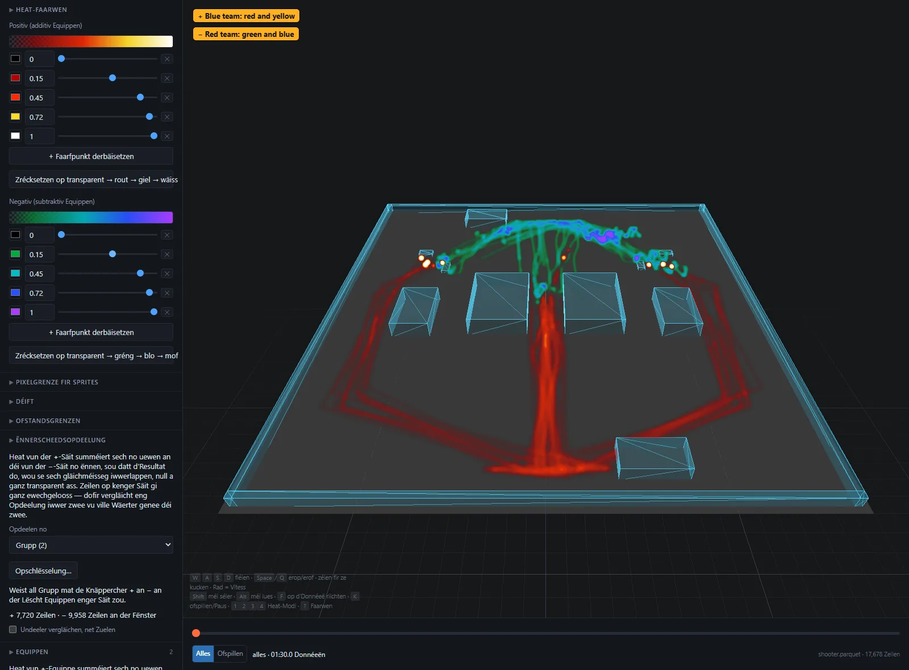

# Ënnerscheed

Rout, wou Team A méi war, gréng-blo, wou Team B méi war, näischt, wou se gläich waren.

**Ënnerscheed** (Tast 2) ass vorzeechend Hëtzt. Zeilen vun enger Populatioun addéieren Hëtzt; Zeilen vun enger anerer zéien se of. Wou sech déi zwee gläichméisseg iwwerlappen, ass d'Resultat null a ganz transparent; wou eng Säit dominéiert, weist sech dat a senger Säitefaarf - standardméisseg waarm (transparent → rout → giel → wäiss) fir d'**+**-Säit a kal (transparent → gréng → blo → purpur) fir d'**−**-Säit.

## Wéi een et benotzt {#how-to-use-it}

1. Drëckt `2` (oder wielt **Ënnerscheed** an der Modus-Leescht).
2. Maacht **Ënnerscheedsopdeelung** an der Säitelleescht op.
3. Wielt, **Opdeelen no**: normalerweis *Gruppen*.
4. Setzt eng Grupp (oder e Wäert) op **+** an eng aner op **−**.
5. Liest d'Faarwen: waarm heescht d'+-Säit, kal heescht d'−-Säit. De Panel warnt, wann eng Säit keng Zeile huet (kuckt [Meldungen, déi s de gesäis](#messages-you-may-see)).

*Wéi* zwou Populatiounen ass déi ganz Fro, dofir kann d'Opdeelung iwwer all behalen Kolonn goen, net nëmmen iwwer Gruppen. Zeilen, déi op **keng vun deenen zwou** Säiten falen, ginn **ausgelooss**, net als null gezielt: dat mécht, datt eng Opdeelung iwwer zwee vu ville Wäerter genau déi zwee vergläicht, an et kombinéiert sech mat de [Filteren](filters.md) - filtert op eng Kaart erof, an deelt dann dat no Versioun op.

De Modus brauch zwou Säiten: eng Gruppekolonn mat op d'mannst zwou Gruppen, oder eng Opdeelung iwwer eng Kolonn, déi fir d'Filteren behalen ass. Bei Daten mat manner wéi zwou Gruppen fänkt e Lueden mat enger Kolonnenopdeelung un - déi *Quellendatei*-Kolonn bei engem Lueden vu méi Dateien als éischt, soss déi éischt Kategoriekolonn mat zwee Wäerter, soss déi éischt numeresch Kolonn mat enger Spannwäit - sou datt *zwee Lueden vergläichen* och ouni Gruppe funktionéiert. Nëmmen Daten ouni dat alles loosse de Modus net verfügbar; dat gëtt och bei enger Opdeelung, déi op enger Säit näischt huet.

## De Panel Ënnerscheedsopdeelung {#the-difference-split-panel}

Gewise am Ënnerscheed-Modus, ënner den Hëtzt-Panelen.

**Opdeelen no** bitt un:

| Optioun | Gewise als | Opdeelungsregel |
|---|---|---|
| Gruppen | *Grupp (N)* (wann et eng Gruppekolonn gëtt) | All Grupp op +, − oder keng, agestallt an der [Team-Lëscht](teams-list.md) |
| Eng Kategoriekolonn | *Kolonn (N Wäerter)* | Wäerter op +, − oder keng |
| Eng numeresch Kolonn | *Kolonn (numeresch)* | E Wäertberäich fir all Säit |
| D'Datei vun der Hierkunft | *Quellendatei - zwee Lueden vergläichen* (wann méi Dateie gelueden sinn) | Dateien op +, − oder keng |

Nëmmen Kolonnen, déi beim Lueden ënner *Fir Filteren behalen* bleiwen, ginn ugebueden.

### Undeeler vergläichen, net Zuelen {#compare-shares-not-counts}

**Undeeler vergläichen, net Zuelen** (standard aus) gewiicht all Säit mat eent duerch hir eege Zuel vun Zeilen, sou datt eng Säit mat fënnemol sou vill Zeilen net just duerch d'Zuelen gewënnt. D'Faarf weist dann, wou all Säit proportionell méi heefeg ass wéi déi aner. Benotzt et, wann déi zwee Säiten ganz ënnerschiddlech vill Daten hunn, zum Beispiel zwou Sessiounen vu verschiddener Längt.

### Meldungen, déi s de gesäis {#messages-you-may-see}

De Panel warnt, wann d'Bild kee richtegen Ënnerscheed ass:

| Meldung | Bedeutung |
|---|---|
| *N + / M −* (oder *N + / M − / K net benotzt*) | Wéi vill Wäerter op all Säit sinn (an op keng). |
| Keng Zeil am Fënster ass op der **+**-Säit | Nëmmen d'**−**-Säit gëtt gezeechent. Réckt d'Zäitlinn-Fënster oder ännert d'Opdeelung. |
| Keng Zeil am Fënster ass op der **−**-Säit | Nëmmen d'**+**-Säit gëtt gezeechent. |
| Kee Wäert ass op enger Säit | Den Ënnerscheed zeechent näischt. Setzt op d'mannst een Wäert op **+** oder **−**. |
| *Kolonn* kann esou net opgedeelt ginn | D'gewielte Kolonn passt net zur Opdeelung. Wielt d'Kolonn nei. |
| D'Opdeelungskolonn huet fir N vu M Stéck net an de GPU-Späicher gepasst | Déi Zeilen ginn net gezeechent. Hieft de GPU-Budget ënner Leeschtung → Ressourcebudgeten, oder lued manner Zeilen. |

### No Grupp {#by-group}

De Panel weist just op d'[Team-Lëscht](teams-list.md), wou all Grupp en **+**- an e **−**-Knäppchen huet. Beim Lueden kënnt déi éischt Halschent vun de Gruppe (opgerënnt) op +, de Rescht op −; **Gläichméisseg opdeelen** an der Team-Lëscht mécht dat nach eng Kéier. Eng Grupp op keng vun deenen zwou Säiten, oder mat hirem Kontrollkästchen verstoppt, dréit näischt bäi.

### No Kategoriewäerter {#by-category-values}

| Deel | Bedeutung |
|---|---|
| `a + / b − / c net benotzt` | Wéi vill Wäerter op all Säit an op keng sinn. |
| **Läschen** | Setzt all Wäerter op keng Säit. |
| Wäerterlëscht | All Wäert mat engem **+**- an engem **−**-Knäppchen (den aktiven nach eng Kéier ukléckt, fir en vun där Säit ze huelen). E eidelen Wäert steet als *(fehlt)*. |
| Hiweis zur Begrenzung | Nëmmen déi éischt 200 Wäerter ginn ugewisen: *Déi éischt 200 vun N Wäerter. Eng sou breet Kolonn ass besser, wann Dir se fir d'Éischt mat engem Filter enger maacht, oder no Beräich opdeelt, wann hir Wäerter geuerdent sinn.* |

Wann Dir d'Kolonn wielt, kënnt hire éischten Wäert op + an hire zweete op −. Wann keng Säit iergendeng Wäerter huet, fällt d'Opdeelung op d'Gruppen zréck, amplaz e leeren Rumm ze weisen. *Quellendatei* funktionéiert genau sou, mat engem Wäert pro Datei - sou vergläicht een zwee Exporter, zwee Testlaf oder zwee Versiounen.

### No Beräich {#by-range}

| Deel | Bedeutung |
|---|---|
| Hiweis | Dat Minimum an d'Maximum vun der Kolonn. |
| **Positive Beräich (+)**, **vun** / **bis** | Zeilen mat engem Wäert an dësem Beräich, bannent beid Enden abegraff, zielen derbäi. |
| **Negative Beräich (−)**, **vun** / **bis** | Zeilen an dësem Beräich ziehen of. |
| **An der Mëtt opdeelen** | Setzt + op [Minimum, Mëtt] an − op [Mëtt, Maximum] - dat mécht och d'Wiel vun der Kolonn. |

E Wäert, deen a béiden Beräicher ass, zielt als +. D'Beräicher musse keng Kolonn ofdecken; Wäerter ausserhalb vun allen ginn ausgelooss. *Déi éischt zwou Minutten géint déi lescht zwou* ass eng Beräichsopdeelung iwwer eng zäitähnlech Kolonn.

## Faarwen {#colours}

D'Sektioun **Heat-Faarwen** weist an dësem Modus zwee Verlafseditoren: **Positiv (additiv Equippen)** a **Negativ (subtraktiv Equippen)**, all mat sengem eegene Zrécksetzknäppchen (*Zrécksetzen op transparent → rout → giel → wäiss*, *Zrécksetzen op transparent → gréng → blo → purpur*). D'Zesummesetzung hëlt de absolute Wäert vun der Nettohëtzt duerch den [Sättegungspunkt an d'Reaktioun](colour-and-exposure.md), a wielt den negativen Verlaf, wou de Netto ënner null ass. Kuckt [Faarf a Belichtung](colour-and-exposure.md#the-ramp-editor).

Benotzt d'*Linear*-Dichtreaktioun, wann d'Gréisst vum Ënnerscheed wichteg ass: dat ass déi eenzeg Reaktioun, wou déiselwecht Faarf déiselwecht Zuel heescht.

## Wéi et funktionnéiert {#how-it-works}

All Zeil kritt am Vertex-Shader en Vorzeechen vun +1, -1 oder 0 ([`POINT_HEAT_VS`](https://github.com/Holdi601/3DHeat/blob/main/src/render/webgl2/shaders.ts)); eng 0 wëlt d'Zeil ab, ier iergendeen Fragment gezeechent gëtt.

- Bei Gruppen kënnt den Vorzeechen aus enger Gruppetabell mat 4.096 Plazen, indexéiert mat der Gruppe-ID vun der Zeil (d'Gruppe-ID sëtzt am véierten Kanal vum Positiounstexel vun der Zeil).
- Bei Kategorien kënnt den Vorzeechen aus enger zweeter Tabell mat 4.096 Plazen, gefëllt pro Kategoriewäert, an de Wäert vun der Zeil gëtt aus der Filtertextur vun der Kolonn gelies; e Wäert no dem Enn vun der Tabell gëtt op béide Backends ofgelehnt.
- Bei Beräicher gëtt de Wäert vun der Zeil mat den zwee Beräicher verglach.

Eng Ännerung vun der Opdeelung fänkt d'Akkumulatioun nei un.

**Verstoppte Gruppen bleiwen bei all Opdeelung verstoppt.** Bei enger Opdeelung iwwer eng Kolonn huet d'Gruppetabell keng Vorzeechen méi; si hält 1 fir eng gewisen Grupp a 0 fir eng verstoppt ([`frameSignTables`](https://github.com/Holdi601/3DHeat/blob/main/src/render/filterTables.ts)), an béid Tabelle kommen zesummen beim Shader un - zwou Zeilen vun enger Vorzeechentextur op WebGL2, zwou Hallschten vun engem Storage-Buffer op WebGPU. Eng Zeil gëtt nëmmen gezeechent, wann hir Grupp gewise ass *an* hire Kolonnewäert op enger Säit ass. Also dréit eng Grupp, déi an der [Team-Lëscht](teams-list.md) ausgehaakt ass, oder déi duerch d'Säitefokus vum Match-Tab ausgelooss ass, näischt bäi, egal wéi d'Ënnerscheed opgedeelt ass.
