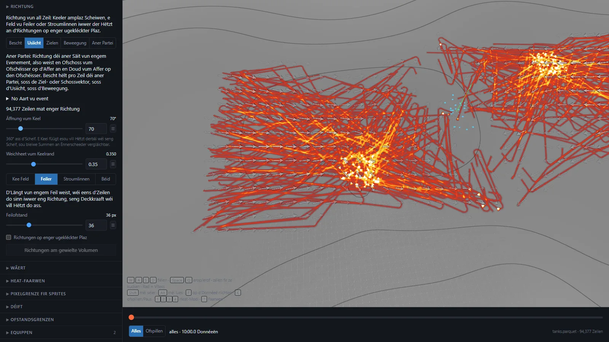

# Richtungshëtzt

Eng einfach Hëtzt seet **wou** Saachen geschéien. Richtungshëtzt seet och **a wéi enger Richtung**: a wéi enger Richtung d'Leit gekuckt hunn, gezielt hunn, sech beweegt hunn, oder wou déi aner Säit vun engem Kampf war.

En normale Sprite ass eng ganz Scheif (360 Grad). Mat enger **Äffnung vum Keel** vun 70 Grad gëtt deeselwechte Sprite zu engem schmuele Keel, dee an d'Richtung weist, an där d'Zeil gekuckt huet, a addéiert déi selwecht Gesamthëtzt.

## Wéi et benotzt gëtt {#how-to-use-it}

1. Lued Daten, an deenen eng Richtung dra ass (kuckt [Wat engem Zeil eng Richtung gëtt](#what-gives-a-row-a-direction)).
2. Wielt **Heat**, **Ënnerscheed** oder **Equipen-Heat** an der Modus-Leescht.
3. Maacht d'Sektioun **Richtung** an der Säitelleescht op.
4. Wielt eng **Quell** (wéi eng Richtung benotzt gëtt), an dann d'Zeechnung un:
   - setzt **Äffnung vum Keel** ënner 360° erof, fir all Zeil als Keel ze zeechnen, deen an hir Richtung weist, anstatt als Scheif;
   - wielt e **Feld**, fir Pfeile oder Stroumlinnen iwwer d'Hëtzt ze zeechnen;
   - hakt **Richtungen op enger ugekléckter Plaz** un a klickt op d'Hëtzt, fir eng Polardiagramm vun där Plaz ze kréien.

D'Statuszeil seet, wéivill Zeilen eng Richtung vun der gewielter Quell hunn.

## Astellungen {#settings}

| Astellung | Standard | Wat et mécht |
|---|---|---|
| Quell: **Beschten**, **Usiicht**, **Zielen**, **Beweegung**, **Aner Partei** | Beschten | Welch Richtung all Zeil kritt. *Beschten* hëlt pro Zeil d'aner Partei, soss d'Zielen, soss d'Usiicht, soss d'Beweegung. |
| **Pro Aart vun Eventer** | wéi uewen | Eng aner Quell fir all Eventaart, zum Beispill *Aner Partei* fir Killen an *Usiicht* fir Positiounen. Gëtt gewisen, wann d'Daten eng Eventspalt mat héchstens 40 Wäerter hunn. |
| **Äffnung vum Keel** | 360° | 360° ass déi normal Scheif (aus). Méi kleng ass e méi schmuele Keel. E Keel setzt sou vill Hëtzt, wéi seng Scheif géif, sou datt d'Gesamtzuelen an d'Differenzen vergläichbar bleiwen. |
| **Weichheet vum Keelrand** | 0,35 | 0 ass en Keel mat schaarfem Rand, 1 en weeche Fächer. |
| **Feld**: Kee Feld, Pfeile, Stroumlinnen, Béid | Kee Feld | Pfeile: d'Längt vun engem Pfeil seet, wéi eens d'Zeilen do sinn, an hir Deckkraaft, wéi vill Hëtzt do ass. Pfeile weisen sech nëmmen, wou Hëtzt ass. |
| **Feilofstand** | 28 px | Ofstand tëscht de Pfeile op der Usiicht. |
| **Stroumlinnen animéieren** | un | Stroumlinnen fléissen, wann dat un ass. |
| **Richtungen op enger ugekléckter Plaz** | aus | Klickt op d'Hëtzt, fir d'Richtungen do ze gesinn (ënnen). |
| **Richtungen am gewielte Volumen** | | Dat selwecht Diagramm fir alles bannent dem gewielte [Volumen](volumes.md). |

## Dat Polardiagramm bei enger Plaz {#the-polar-chart-at-a-spot}

Mat **Richtungen op enger ugekléckter Plaz** un klickt Der op d'Hëtzt. D'Zeilen no bei dësem Punkt (bannent 1,5 Sprite-Radien) ginn an eng Roséin mat 24 Scheiwen zu 15° gesammelt:

- **orange** Blieder: ausgoend Richtungen (wouhin d'Zeilen weisen);
- **blo** Blieder: kommend Richtungen (wou se hiergekomm sinn);
- d'**Fläch** vun engem Blat wiisst mat senger Zuel; e Pfeil weist déi Haaptrichtung;
- d'Linnen ënner dem Diagramm ginn d'Haaptpeilung, wéi staark d'Zeilen eens sinn (R, 0 bis 1), d'Streeung a Grad an d'Zuel vun den Zeilen.

0° ass uewen am Diagramm, wat negativ Z vun der Welt ass (Norden bei Tacview-Opnamen). D'Plaz gëtt och an der 3D-Usiicht mat engem Pfeil an engem Rank markéiert.

## Wat engem Zeil eng Richtung gëtt {#what-gives-a-row-a-direction}

| Quell | Brauch an den Daten |
|---|---|
| Usiicht | eng Giering-Spalt (als Kuckrichtung zougeuerdnet): `yaw`, `heading`, `azimuth`, `view_yaw`, `rot_z` |
| Zielen | Zuelpaaren wéi `aim_x`/`aim_y`, `shot_x`/`shot_y`, `fire_x`/`fire_y`, `hit_dir_x`/`hit_dir_y` (e fakultativt `…_z`) |
| Beweegung | näischt Zousätzliches: de Schrëtt vum fréiere Moosspunkt vun der selwechter Persoun (héchstens 10 s virdrun, selwecht Sessioun) |
| Aner Partei | eng Spalt, déi déi aner Säit vun engem Event nennt (`other`, `victim`, `target`, `killer`, `attacker`, `shooter`, `other_player` ...), deenen hir Wäerter Nimm vu Persounen sinn; e Kill weist vum Killer zum Affer, en Doud vum Affer zum Killer |

## Tipps {#tips}

- Keeler brauche e bësse Gréisst op der Usiicht; ënner e puer Pixelen ginn se nees als Scheiwen gezeechent.
- Benotzt *Aner Partei* bei Killzeilen, fir ze gesinn, **vun wou** Kämpf gewonne goufen, an *Usiicht* bei Positiounszeilen, fir ze gesinn, **wou d'Leit kucken**.
- Bei **Ënnerscheed** weisen d'Keeler vun den zwou Säiten an hir eege Richtungen, sou datt strittegen Schéisslinnen opfalen.
