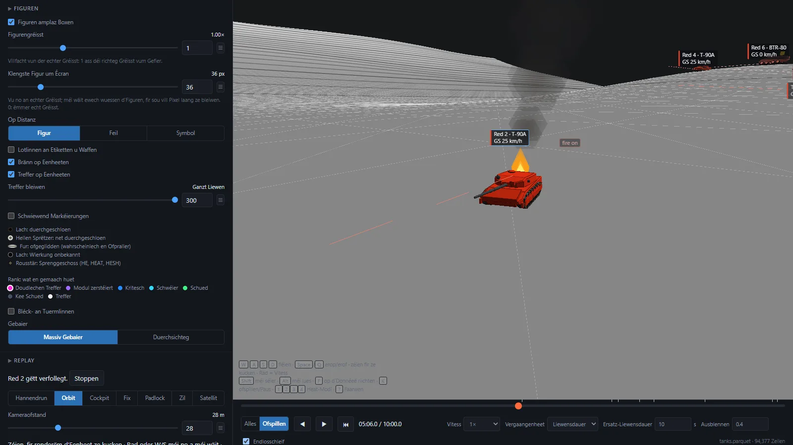

# Figuren

Eng **Figur** ass e klenge 3D-Modell vu wat eng Eenheet wierklech ass: e Panzer, en Jet, e Schëff, en Zaldot. De [Replay](match-replay.md) zeechent all Eenheet als hir Figur an der wierklecher Gréisst, amplaz als eenfach Box.

Et gi ronn 2.000 benannt Gefierer, Fligeren, Schëffer, Waffen a Zaldoten, all vun der Visualisatioun selwer gebaut.

## Wat am Katalog ass {#what-is-in-the-catalogue}

| Beräich | Beispiller |
|---|---|
| Mënschen | Zaldot stoend, kniend, um Bauch; Scharfschützen, Panzerofwehr, Sanitéter, Besatzung |
| Buedem | Panzer, Infanteriekampffahrzeuger, Loftofwehr, Artilleri, Camionen a Autoen, Zich a Stroossebunnen |
| Loft | Jagdfliger, Angrëffsfliger, Bommeflieger, Transportfliger, Helikopteren, vun Duebeldeckeren bis zu modernen Jetten |
| Mier | Krichsschëffer no Klass, Fligerkräiser, U-Booter, Boten, Handelsschëffer |
| Waffen | Raketen, Raketten, Bommen, Torpedoen, Liichtkugelen a Stanniol |
| Markéierungen | Rauch-, Blitz- a Brandgranaten, geluechte Bommen, Fändelen, Spawns, Wegpunkten |

## Wéi d'Figuren gemaach ginn {#how-the-figures-are-made}

- **Aus publizéierte Moossen gebaut.** Déi meescht Figuren maache mir selwer, aus ëffentlechen Zuelen: Längt, Breet, Héicht, Stroossenräder, Turm an Kanoun, Flilleke a Schwanz. Hir Form gëtt dann géint ëffentlech Fotoen, Zeechnungen an publizéiert Moossen ofgestëmmt. Et gëtt kee Modell vun engem Spill benotzt.
- **Gratis Modeller.** E puer Figuren benotze gratis 3D-Modeller (CC0 oder CC BY), wou se méi wouer sinn, heiansdo mat dem gebaute Rumpf kombinéiert. D'Autoren vun CC-BY-Wierker sinn op [Figur-Kreditter](figure-credits.md) genannt; CC0-Wierker brauchen keen Kredit a sinn dort net opgelëscht.
- All Figur huet eng voll, eng grob an eng wäit Versioun (Detailstufen, LOD), sou datt Dausende op eemol gezeechent kënne ginn.

## Watt Figur eng Eenheet kritt {#which-figure-a-unit-gets}

D'Visualisatioun kuckt sech d'eege Kolonnen vun de Daten un:

1. **Nimm** - Kolonnen mat deenen Nimm *Name*, *Vehicle*, *Unit*, *Unit type*, *Model*, *Aircraft*, *Plane*, *Tank*, *Ship*, *Craft*, *Loadout*, *Kit* oder *Figure* - ginn mam Katalog verglach: genau, duerch ongeféier 4.000 Aliase (Eenheeten-IDen vu ville Spiller), duerch dee längste bekannte Ufank (`F-16C_50` ass d'F-16C), oder duerch den kierzesten Figurnumm, deen domat ufänkt.
2. E Numm, dessen Figur net zum **Typ** vun der Eenheet passt, gëtt net benotzt (en Camion mam Numm *Typhoon* ass net de Jet).
3. **Typen** - Kolonnen mat deenen Nimm *Type*, *Class*, *Kind*, *Category*, *Icon*, *Role* oder *Domain* - ginn eng Klassefigur: Tacview-Markéierungen (`Air+FixedWing`, `Ground+Heavy+Armor+Vehicle+Tank`, `Sea+Watercraft+Warship`, `Weapon+Missile`), Kaarteikonen oder einfach Wieder (Panzer, Helikopter, Infanterie).
4. Daten ouni eent vun deenen zwee sinn Daten vu Mënschen: jiddereen ass e Soldat.

Déi einfachst Manéier, déi richteg Figuren ze kréien, ass also eng `vehicle`-Kolonn mat den echte Nimm, oder eng `type`-Kolonn mat Tacview-Markéierungen.

**Meng Eenheet weist sech als Box oder Zaldot.** Setzt eng `vehicle`-Kolonn mat dem echte Numm derbäi, oder eng `type`-Kolonn mat enger Tacview-Markéierung. Leet d'Maus op d'Eenheet, fir ze gesinn, welche Numm zougeuerdent gouf. Daten mat esou Kolonnen, déi awer näischt iwwer eng Eenheet soen, loossen se als Box; Daten ouni eent vun deenen zwee ginn als Zaldoten gezeechent.

## Astellungen {#settings}

D'Sektioun **Figuren** an der Replay-Säitelëscht stellt d'Gréisst an, déi klengst Gréisst op dem Bildschierm, wat wäit Eenheeten ginn (Figur, Pfeil, Symbol) an d'Effekter, déi drop gezeechent ginn. Kuckt [Match-Replay](match-replay.md#figures). Rauch, Feier an aner zäitlech Effekter: [Figuren an der Figuren-Iwwerlagerung](figure-replay.md).

## E fakultative lokale Figurepak {#an-optional-local-figure-pack}

Dir kënnt op Ärem eegene Rechner e fakultativen Pak mat eegene Figuren halen. Seng Figuren huelen d'Plaz vun de Katalogfiguren mat deenen selwechten Nimm. Et ass ni Deel vum Repository oder vun engem publizéierte Build; ouni een ännert sech näischt.
