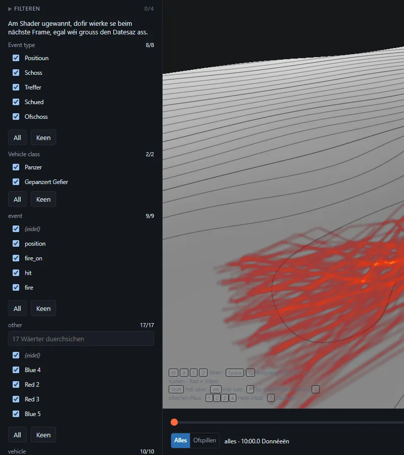
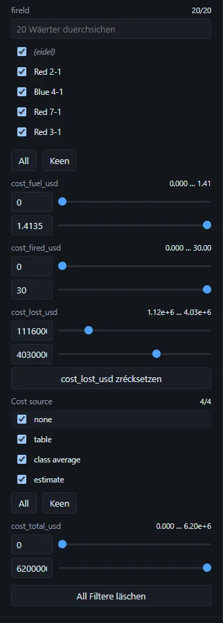

# Filteren

**Filteren** verstoppen d'Zeilen, déi Iech net interesséieren, wéi eng Gefierklass oder eng Aart vun Evenement, an d'Bild aktualiséiert sech direkt. D'Panel lëscht d'Kolonnen op, déi beim Lueden ënner *Fir Filteren behalen* bleiwen ([Kolonnenzouweisung](column-mapping.md)), plus *Quellendatei*, wann méi Dateien gelueden sinn.

## Probéiert et {#try-it}

1. Lued e Datesaz a maacht **Filteren** an der Säitelleescht op.
2. Ënner **Gefierklass** hakt *Tank* of. D'Bild ännert sech direkt.
3. Drëckt **All Filtere läschen**, fir ze réckgängeg ze maachen.

Déi éischt Zeilen sinn d'Kolonnen vum Viewer selwer (hei ënnen). D'Zeilen duerno kommen aus Ärer Datei.

## Kolonnen, déi den Viewer derbäi setzt {#columns-the-viewer-adds}

Beim Lueden erkennt den Viewer véier eege Kolonnen a lëscht se **als éischt**, mat Nimm a Wäerter a Ärer Sprooch, sou datt dee selwechte Filter fir all Spill an all Datequell funktionéiert:

| Kolonn | Wäerter | Ofgeleet aus |
|---|---|---|
| **Evenementtyp** | 23 Aarten: Positioun, Schoss ofgefeiert, Lancement (Rakéit, Fusée, Bomm), Treffer, Fehlschoss (Waff ass bei kengem Zil geendegt), Explosioun, Schued, Ofschoss, Doud, Zerstéiert, Crash, Auswerfen / Fallschirm, Spawn, Despawn, Start, Landung, Bodekontakt, Stopp um Buedem, Nei bewafnen / Tanken, Capture / Zil, Lockvugel, Noriicht, Anerer | eng Kolonn mat dem Numm `event`, `events`, `event_type` oder `event_name`; all Spiller seng eegen Wieder (`shot`, `burst`, `fired`, `struck`, `flare`, `plant` ...) ginn op dës Aarten ofgebilt. Déi komplett Tabell: [Evenementtypen a -klassen](ref-event-types.md). |
| **Spiller oder KI** | Spiller, KI | eng Kolonn `ai`, `is_ai`, `bot` oder `actor`; soss `is_player` / `human`; soss eng Kont-ID (`user_id`, `steam_id`; eidel oder 0 ass KI); bei Tacview-Opnamen, ob d'Objekt en Pilot huet |
| **Gefierklass** | 17 Klassen: Jeeër, Attack-Fliger, Bomber, Anere Fliger, Helikopter, Panzer, Gepanzert Gefier, Loftofwier, Artillerie, Camion / Auto, Schëff, U-Boot, Infanterie, Waff, Lockvugel, Bau, Anerer | den Numm vum Gefier oder der Eenheet (verglach mat dem [Figurekatalog](figures.md)) an d'Typ-Kolonnen |
| **Zilklass** | déiselwecht Klassen | d'Gefier vum aneren Deel (`other_vehicle`, `target_vehicle`, `victim_type` ...) |

Nëmmen d'Aarte, déi virkommen, ginn ugewisen. Wäertkolonnen (`cost_*`, `earn_*`, `net_*` an *Käschtequell*, kuckt [Wäertgewiichtung](value-weighting.md)) kënne wéi all Zuelekolonn gefiltert ginn: zum Beispill hakt *estimate* ënner *Käschtequell* of, fir nëmmen Zeilen mat engem Präis ze behalen.

Eng Kategorie-Lëscht mat méi wéi 12 Wäerter kritt e Sichkascht (*Search n values*) an e Knäppchen **Nëmmen dës**, deen genau d'Wäerter erlaabt, déi passen.

Welch Kolonnen gefiltert kënne ginn, gëtt beim Lueden festgeluecht, well se dann gelies musse ginn. Ouni behalen Kolonn seet de Panel dat an verweist op *Fir Filteren behalen*.

## Numeresch Kolonnen (Beräich) {#numeric-columns-range}

| Deel | Bedeutung |
|---|---|
| Numm, an `min ... max` | D'Kolonn, an den aktuellen Beräich (de ganze Beräich vun der Kolonn, solang kee Filter gesat ass). |
| Éischt Zeil: Zuelekascht an Schieber | D'Ënnergrenz. Wann Dir de Schieber iwwer d'Obergrenz zitt, schiebt se déi mat. |
| Zweet Zeil: Zuelekascht an Schieber | D'Obergrenz. Wann Dir ënner d'Ënnergrenz zitt, schiebt se déi mat. |
| **Filter *Kolonn* zrécksetzen** | Hieft dësen Filter op. |

D'Schieber decken d'Minimum bis d'Maximum vun der Kolonn a 1.000 Schrëtt of; d'Zuelekäschte huelen all Wäert. E Zeil passt, wann hire Wäert am Beräich läit, béid Enden abegraff. Grouss Wäerter ginn a Exponentform gewisen (`1.23e6`).

## Kategoriekolonnen {#category-columns}

| Deel | Bedeutung |
|---|---|
| Numm, an `erlaabt/total` | D'Kolonn, an wéivill vun hiren Wäerter erlaabt sinn. |
| Wäerterlëscht | Eng Ukräizungsbox pro Wäert; e eidelen Wäert steet als *(eidel)*. |
| **Alles** / **Keen** | All Wäerter erlaben / kee Wäert erlaben. |

All Wäerter erlaben hieft den Filter op.

## Reegelen {#rules}

- **Véier Filter op eemol.** De Kapp weist `aktiv/4`. E fënneften Filter gëtt net ugewannt, an de Panel seet dat. Eng Auswiel an [Entitéiten](entities.md) (oder d'Spillerfokus vum Match-Tab) benotzt och een vun de véier. E Filter, deen d'ganz Kolonn ofdeckt, benotzt keen.
- **Eng Kategoriekolonn huet héchstens 4.096 Wäerter**; eng méi breet gëtt beim Lueden net behalen.
- **Filteren kombinéiert mat AND**, a mat der Equipesichtbarkeet, der Ënnerscheedsopdeelung, dem Zäitfënster, dem Distanzausblenden an der [Schnëtt](slice.md).
- **E Filter änneren fänkt d'Akkumulatioun nei un a mësst d'Beliichtung e puer Biller méi spéit nei**, well Filteren d'Dicht staark änneren kann ([Faarf a Belichtung](colour-and-exposure.md#auto-exposure)).
- **All Filtere läschen** nëmmt all Kolonnefilter ewech. Equipesichtbarkeet an Spilleraauswiele, déi anderswou gesat goufen, bleiwen.
- Kolonnefilter ännere d'Hëtztmodi. Si änneren d'Figuren vum [Figuren-Replay](box-replay.md) net, déi der Equipesichtbarkeet an der Entitéiten-Auswiel folgen. D'Entitéiten-Auswiel ännert beides.
- Bei [Linn-Hëtzt](line-heat.md) gëtt en Filter op der Zeil getest, wou all Segment *endet*.
- Beim Lueden vun all neien Datesaz ginn all Filter ewech geraumt.

## Fir Entwéckler {#for-developers}

**Slots.** Jiddere aktiven Filter huelt ee vun de véier GPU-Slots ([`MAX_FILTER_SLOTS`](https://github.com/Holdi601/3DHeat/blob/main/src/render/types.ts)), eng Textur mat 4 Bytes pro Zeil. D'Slots goen an der Reiefolg, wéi se zoulescht geännert goufen ([`filterSlots`](https://github.com/Holdi601/3DHeat/blob/main/src/render/filterTables.ts), vum Shader an beiden Panelen gedeelt). Iwwer véier kënnt en Fehler: *Only the first 4 filters are applied. Clear one - the rest are being ignored, not silently combined*, an d'Nimm vun den extra Filtere liesen *Kolonn (not applied)*. Filter lafen all Zeil am Vertex-Shader, also brauch d'Ännerung vun enger Schwell kee neit Parsing an kee neit Eroplueden.

**Filter, déi de Panel net weist.** Et gi nach zwou Aarte am Programmstatus ([`FilterSpec`](https://github.com/Holdi601/3DHeat/blob/main/src/state/types.ts)):

- en **Gruppen**-Filter, vum Match-Tab gesat, wann dee eng Säit fokusséiert. Hie verstoppt déi aner Gruppen an all Modus, och eng [Ënnerscheed](difference.md)-Opdeelung iwwer eng Kolonn.
- en **Persounen**-Filter, vum [Entitéiten](entities.md)-Panel gesat an vum Match-Tab, wann e ee Spiller fokusséiert. Hie beschränkt de Figuren-Replay an d'Hëtztmodi. An der Hëtzt ass dat en Kategoriefilter iwwer d'Persoun-IDen an hëlt ee vun de véier Slots. Seng Mask hält 65.536 IDen ([`FILTER_MASK_CAPACITY`](https://github.com/Holdi601/3DHeat/blob/main/src/render/types.ts)); eng Persoun iwwer dat hinaus gëtt in der Hëtzt net gezeechent, solang den Filter aktiv ass, och wann se ausgewielt ass. De Figuren-Replay weist se nach.
