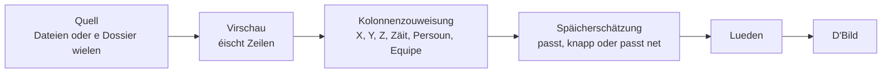

# Daten astellen

Ier 3DHeat eppes kann zeechnen, brauch et eng Tabell: all Zeil seet, wou eppes war an, wann Dir et hutt, wann a wiem. Dës Sektioun weist, wéi eng Datei en Bild gëtt. Nach keng Daten? Probéiert d'[Demo-Daten](demo-data.md).

**Maacht dat elo:**

1. An der Heatmap-Säitelleescht maacht **Quell** op an drëckt **Fichieren…** (oder werft eng Datei oder e Dossier op d'Ofleeungszone).
2. Kuckt op **Kolonnenzouweisung**: d'Felder sinn normalerweis schonn ausgefëllt.
3. Kuckt, datt d'**Späicherschätzung** *passt* seet.
4. Drëckt **Lueden**.

All wat de Heatmap-Tab weist, kënnt vun engem eenzege **Datesaz**: enger Tabell mat Zeilen, all mat enger Positioun an, optional, enger Zäit, enger Persoun, enger Grupp, enger Sessioun, enger Blécksrichtung an all Zuel vu Extra-Kolonnen, déi fir d'Filteren bleiwen. Dës Sektioun erkläert, wéi e Datesaz gemaach gëtt.

## De Wee vun de Dateien bis zum Bild {#the-path-from-files-to-picture}

1. **Dateie wielen** am **Quell**-Panel - eng Datei, méi, en Dossierbaum oder mat Drag-and-Drop. Parquet, CSV, Tacview, GPS-Spuren an méi ginn ugeholl; déi eenzeg komplett Lëscht steet am [Datenformater](data-formats.md#files). Kuckt [Dateien lueden](loading-files.md).
2. **Virschau.** Déi éischt Datei vun der Auswiel gëtt opgemaach: hir Kolonnennimm, hir éischt 50 Zeilen, wéi d'Kolonnen numeresch ausgesinn, an (Parquet) de logeschen Typ vun all Kolonn an d'Liesanweisungen vun der Datei selwer, den `heat3d`-Fousseingank.
3. **Automatesch Zouweisung.** Kolonne ginn Rollen zougewisen - X, Y, Z, Zäit, Persoun, Sessioun, Grupp, Blécksrichtung - an eng Handvoll bleift fir d'Filteren. All Vermutung gesäit een am Panel **Kolonnenzouweisung** an dat kann ännert ginn. Kuckt [Kolonnenzouweisung](column-mapping.md) a [Achsen, Eenheeten a Zäit](axes-units-and-time.md).
4. **Zielen.** D'Zuel vun de Zeilen all Datei gëtt gelies (genau aus den Parquet-Fousse, geschätzt bei CSV), sou datt de Panel virdrun, ouni datt eppes gelueden ass, weist, wéi vill Späicher d'Lueden brauch an ob et passt. Passt et net, schlätt et vir, all *N*-te Zeil ze lueden. Kuckt [Späicher a Budgeten](memory-and-budgets.md).
5. **Lueden.** En Hannergrond-Worker liest nëmmen d'zougewisen Kolonnen vun all Datei - e puer Dateie gläichzäiteg, bis zum Budget vun de [Parser-Threads](memory-and-budgets.md#parser-threads) - a féiert se an der Reiefolg vun der Auswiel an ee Datesaz zesummen: ee gemeinsamt Wierterbuch vu Persounen, Gruppen a Sessiounen iwwer all Dateien, ee gemeinsame Zäit-Nullpunkt, all Zeilen no Zäit sortéiert. Kuckt [Sessiounen, Persounen a Gruppen](sessions-persons-groups.md).
6. **Eroplueden.** Den Haaptfuedem mellt "Uploading N rows to the GPU" fir ee Bild, a packt dann d'Zeilen am GPU-Späicher bannent dem GPU-Budget. Kuckt [GPU-Späicher-Residenz](gpu-memory.md).
7. **Éischt Bild.** D'Kamera riicht d'Daten aus, de Sprite-Radius an d'Sättegung ginn aus der Ausdehnung an der Zuel vun de Zeilen gesat, a no 8 gerenderte Biller gëtt d'Sättegung aus dem Bild selwer gemooss ([Faarf a Belichtung](colour-and-exposure.md)).

## Ufuerderunge, virun engem Lueden gepréift {#requirements-checked-before-a-load}

| Brauch | Wat geschitt ouni et |
|---|---|
| **Op d'mannst zwou vun X / Y / Z** | D'Lueden gëtt ofgelehnt. Mat genau zwou ass déi drëtt Achs 0, an d'Daten ginn als flaach Fläch an der 3D-Szen gezeechent - wat eng Heatmap vun uewen op enger Kaart brauch. |
| Eng Zäitkolonn | Optional. Ouni se ass d'Zäitlinn ausgeschalt, d'Usiicht bleift am Modus **Alles**, an d'Säitelleescht seet dat. |
| Eng Persounskolonn | Optional. Gebraucht fir d'[Figuren-Overlay](box-replay.md) (eng Figur fir all Persoun), [Linn-Hëtzt](line-heat.md) (de Wee vun all Persoun), Interpolatioun, Spuren an d'**Liewensdauer**-Geschicht. |
| Eng Gruppekolonn | Optional. Gebraucht fir [Equipen-Heat](team-heat.md) an den [Ënnerscheed](difference.md)-Modus (op d'mannst zwou Gruppen). |

En Modus, deen d'gelueden Daten net droen, ass an der Modus-Leescht ausgegraut; wann een driwwer fiert, seet et firwat.

## Ouni är eege Daten {#without-your-own-data}

De Panel **Datesaz** (ënner **Quell**) huet en [synthetesche Generator](synthetic-generator.md), deen en Datesaz vun der Form vun engem Battle Royale an all Gréisst mécht. Dat ass gutt fir den Viewer ze probéieren an fir ze testen, wat e Rechner packt.

## Säiten an dëser Sektioun {#pages-in-this-section}

- [Dateien lueden](loading-files.md) - Auswiel, Dossieren, Drag-and-Drop, Zesummeféiere vu méi Dateien, d'Beweegungsdatei-Regel, Fortschrëtt an Ofbriechen
- [Kolonnenzouweisung](column-mapping.md) - all Feld vum Zouweisungspanel, wéi d'Automatik rréit, d'`heat3d`-Hiweiser
- [Achsen, Eenheeten a Zäit](axes-units-and-time.md) - Vertikal-Achs, Ëmdréinen, Eenheetskala, Zäiteenheeten, Blécksrichtung
- [Sessiounen, Persounen a Gruppen](sessions-persons-groups.md) - wat all Eent mécht, d'Limite, gemeinsam Nimm, d'Gréisst vun den Entitéiten, de Panel Datesaz
- [Synthetesche Generator](synthetic-generator.md)
- [Späicher a Budgeten](memory-and-budgets.md) - d'Fussofdrock-Modell, d'Passpréifung, d'Ausdënnung, d'Sortéierlimit, d'Ressourcebudgeten
