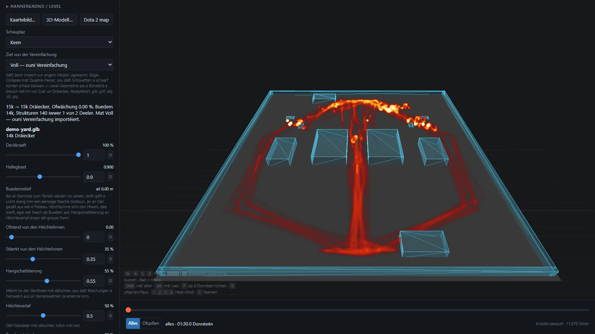
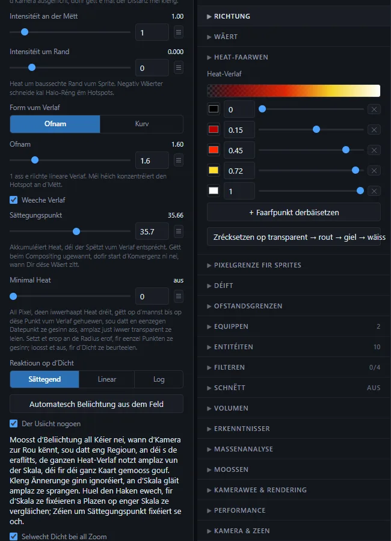

# Hëtzt

Hëtzt molt d'Plaze, wou ganz vill geschitt ass: rout, wou et e bëssen geschitt ass, wäiss-hëtz, wou et ganz vill geschitt ass. Hie beäntwert d'Fro "wou geschitt dat, a wéi vill".

**Heat** (Tast 1) ass de Standardmodus. All sichtbar [Zeil](glossary.md) setzt e kameragerichtete ronne [Sprite](glossary.md) derbäi; sech iwwerlappend Sprite addéieren sech an engem Float-Puffer; d'Summ gëtt duerch en Faarfverlaf geschéckt - standardméisseg transparent → rout → giel → wäiss - a iwwer d'Szen gezeechent.

D'Bild weist d'Hëtzt vun enger Schéisser-Ronn op engem Level mat Gebaier: waarm Plaze sinn an de Raim an op de Trappen, net nëmmen um Buedem.

## Wéi et benotzt gëtt {#how-to-use-it}

1. Lued Daten an drëckt `1` (oder wielt **Heat** an der Modus-Leescht).
2. Wann alles wäiss oder eidel ass, drëckt **Automatesch Beliichtung aus dem Feld** an der Sektioun **Heat-Form**.
3. Ännert **Sprite-Radius**, bis d'Noper-Punkte an Bänner zesummewuessen: méi kleng weist eenzel Flecken, méi grouss weist Gebidder.
4. Maacht **Heat-Faarwen** op, fir d'Faarwen z'änneren, oder **Déift**, fir datt Hiwwele a Mauere d'Hëtzt hannendru verstoppen.

Déiselwecht Panelen formen [Ënnerscheed](difference.md), [Equipen-Hëtzt](team-heat.md) an [Linn-Hëtzt](line-heat.md); si ënnerscheede sech an deem, wat derbäigesat gëtt (mat Vorzeechen, a Faarwen, oder laanscht Linnen), net an der Weis.

## D'Panelen an hir Standarden {#the-panels-and-their-defaults}

All Reglage gëtt op senger eegener Säit erkläert; d'Spalt Detailer verlinkt dohin. Schieber hunn en Textfeld drneewent a ee Griff (de klenge Handgriff rechts: erop oder erof zéien, wat méi wäit, wat méi séier; Shift fir Feinabstëmmung); wann d'Schiebestrecke virum richtege Limit ophält, kann de Griff iwwer hir bis zur *Schiebe-Grenz* hei ugeginn dréckt ginn. Wäerter mat *beim Lueden* ginn fir all nei Datesaz nei ausgerechent.

### Heat-Form (oppen) {#heat-shape-open}

| Reglage | Standard | Beräich (Schiebe-Grenz) | Detailer |
|---|---|---|---|
| **Sprite-Radius** | 6 m; beim Lueden Ausmooss / 120 | 0,05-2000 m, logaritmesch (50.000) | [Sprite-Form](sprite-shape.md#sprite-radius) |
| **Intensitéit an der Mëtt** | 1 | 0-10 (1000) | [Sprite-Form](sprite-shape.md#centre-and-edge-intensity) |
| **Intensitéit um Rand** | 0 | -2-10 (1000) | [Sprite-Form](sprite-shape.md#centre-and-edge-intensity) |
| **Form vum Verlaf** | *Ofnam* | *Ofnam* / *Kurv* | [Sprite-Form](sprite-shape.md#ramp-shape-falloff-or-curve) |
| **Ofnam** (nëmmen bei Ofnam) | 1,6 | 0,1-8 (64) | [Sprite-Form](sprite-shape.md#falloff) |
| **Weeche Verlaf** (nëmmen bei Ofnam) | un | | [Sprite-Form](sprite-shape.md#falloff) |
| Kurveneditor (nëmmen bei Kurv) | Virlag *Weech* | | [Sprite-Form](sprite-shape.md#the-curve-editor) |
| **Sättegungspunkt** | 24; beim Lueden eng Schätzung, dono gemooss | 0,1-4000, logaritmesch (10.000.000) | [Faarf a Belichtung](colour-and-exposure.md#saturation-point) |
| **Minimal Heat** | aus (0) | 0-100 % | [Faarf a Belichtung](colour-and-exposure.md#minimum-heat) |
| **Reaktioun op d’Dicht** | *Sättegend* | *Sättegend* / *Linear* / *Log* | [Faarf a Belichtung](colour-and-exposure.md#density-response) |
| **Automatesch Beliichtung aus dem Feld** | | Knäppchen | [Faarf a Belichtung](colour-and-exposure.md#auto-exposure) |
| **Der Usiicht nogoen** | un | | Misst d'Belichtung nei, all Kéier wann d'Kamera zur Rou kënnt, sou datt eng Géigend, an déi Dir fléien, de ganze Faarfverlaf benotzt. Kleng Ännerungen ginn ignoréiert, an d'Skala gleit. Maacht et aus, oder zitt **Sättegungspunkt**, fir d'Skala ze fixéieren an Plaze op enger Skala ze vergläichen. [Faarf a Belichtung](colour-and-exposure.md#follow-the-view) |
| **Selwecht Dicht bei all Zoom** | un | | Eng Faarf heescht déiselwecht Zuel Zeilen pro Fläch Buedem, wéi no Dir och sidd. E Sprite, deen d'Pixelgrenzen gréisser maachen (wäit ewech) oder méi kleng (no bei), behält d'Hëtzt, déi seng richteg Gréisst derbäi géif setzen, sou datt e Bild, dat vu wäit belicht gouf, net verbléicht, wann Dir an et fléien. Ausgeschalt setzt e begrenzte Sprite säi ganze Gewiicht a senger begrenzter Gréisst derbäi. [Sprite-Form](sprite-shape.md#pixel-clamps) |
| **Op d’Buedemfläch projizéieren** | aus | | [Sprite-Form](sprite-shape.md#flatten-onto-ground-plane) |

### Heat-Faarwen (zou) {#heat-colours-closed}

| Reglage | Standard | Detailer |
|---|---|---|
| Gruppefaarwen an **Faarftrennung** (nëmmen Equipen-Hëtzt) | 1,4 | [Equipen-Hëtzt](team-heat.md) |
| Editor vum **Heat-Verlaf** (*Positiv (additiv Equippen)* bei Ënnerscheed, *Opazitéitsverlaf* bei Equipen-Hëtzt) | transparent → rout → giel → wäiss | [Faarf a Belichtung](colour-and-exposure.md#the-ramp-editor) |
| **Zrécksetzen op transparent → rout → giel → wäiss** | | |
| Verlaf **Negativ (subtraktiv Equippen)** (nëmmen Ënnerscheed) | transparent → gréng → blo → purpur | [Ënnerscheed](difference.md#colours) |

### Pixelgrenze fir Sprites (zou) {#sprite-pixel-clamps-closed}

| Reglage | Standard | Beräich (Schiebe-Grenz) | Detailer |
|---|---|---|---|
| **Minimale Pixelradius** | 1 px | 0-16 (512) | [Sprite-Form](sprite-shape.md#pixel-clamps) |
| **Maximale Pixelradius** | 96 px | 2-1024, logaritmesch (8192) | [Sprite-Form](sprite-shape.md#pixel-clamps) |

### Déift (oppen) {#depth-open}

| Reglage | Standard | Detailer |
|---|---|---|
| **Hannert dem Terrain verstoppen** | un | [Déift a Ofstandsgrenzen](depth-and-culling.md#hide-behind-terrain) |
| **Hannert Geometrie verstoppt** | 0,8 (*80 % méi däischter*) | [Déift a Ofstandsgrenzen](depth-and-culling.md#hidden-behind-geometry) |

### Ofstandsgrenzen (zou) {#distance-culling-closed}

| Reglage | Standard | Beräich (Schiebe-Grenz) | Detailer |
|---|---|---|---|
| **No** | aus (0) | 0,5-5000 m, logaritmesch, ënnen am Spuer = aus (200.000) | [Déift a Ofstandsgrenzen](depth-and-culling.md#distance-culling) |
| **Wäit** | aus (0) | 1-200.000 m, logaritmesch, ënnen = aus (10.000.000) | [Déift a Ofstandsgrenzen](depth-and-culling.md#distance-culling) |
| **Un enger Fläch schneiden** | un | | [Déift a Ofstandsgrenzen](depth-and-culling.md#distance-culling) |
| **De Level och schneiden** | un | | [Déift a Ofstandsgrenzen](depth-and-culling.md#distance-culling) |

Tasten: `[` a `]` dréckt déi weit Grenz eragoen a erausgoen, `\` schalt se an aus ([Déift a Ofstandsgrenzen](depth-and-culling.md#keyboard)).

### Richtung a Wäert {#direction-and-value}

Zwou weider Sektiounen sinn ënner Heat-Form. **Richtung** zeechent all Zeil als Keel a setzt Pfeile derbäi: kuckt [Richtungshëtzt](directional-heat.md). **Wäert** gewiicht d'Hëtzt no deem, wat all Zeil kascht oder verdéngt huet: kuckt [Wäertgewiicht](value-weighting.md).

## Wat gespäichert gëtt {#what-is-saved}

Déi Hëtzt-Astellungen hei uewen gi tëscht de Sitzungen net gespäichert: wann d'Säit nei gelueden gëtt, kommen d'Standarden zréck. Zwee Saache ginn am Browser gehalen: déi lescht Ofspillgeschwindegkeet (`heat3d.speed`, kuckt [Zäitlinn](timeline.md)) an d'Astellunge vun de weiderwäiten Figuren vum [Figuren-Overlay](box-replay.md) (Symbolstil, Gréisst, Trefferzeechen an sou weider). Dat selwecht gëllt fir d'Sprooch, déi [ëmgedréinte Weltachsen](camera.md#invert-world-axis), d'Autosnimm, déi den Reiter Rennanalyse sech mierkt, a d'[Level-Bibliothéik](level-library.md). Déi ganz Lëscht steet op [Gespäichert Astellungen](ref-settings-storage.md).
