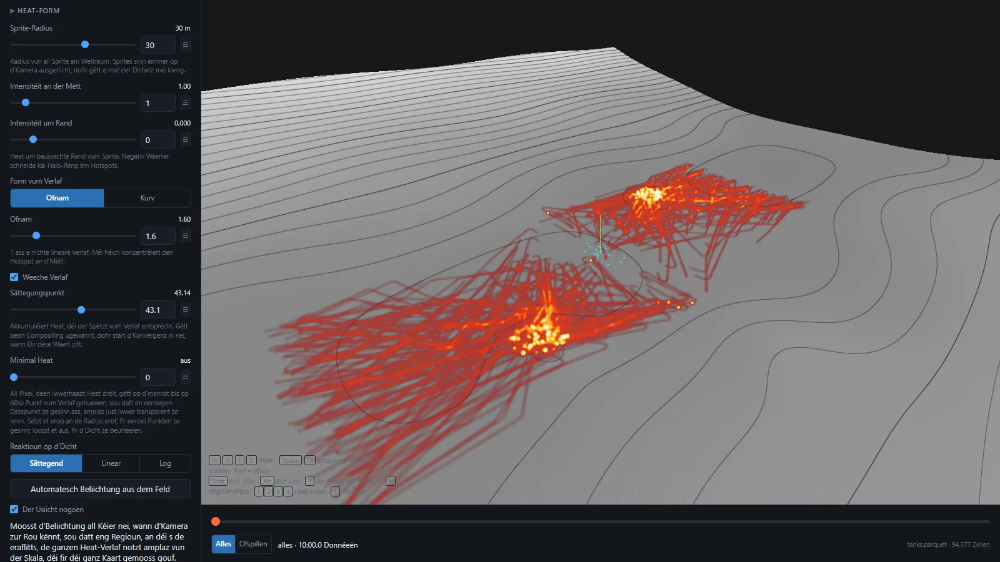
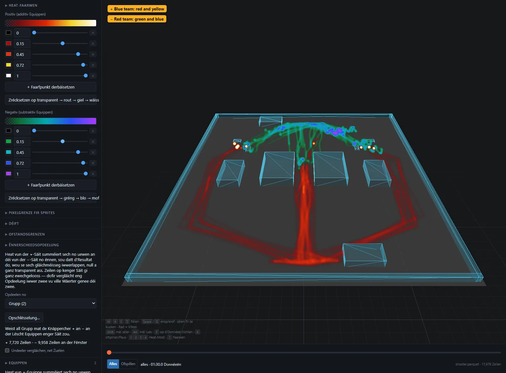
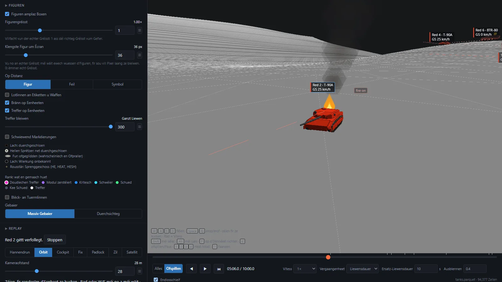
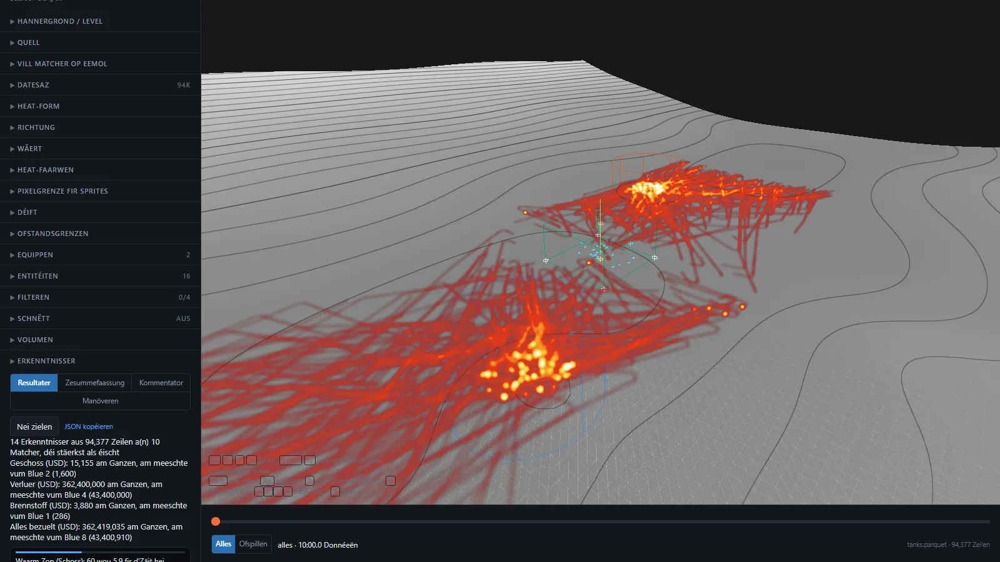
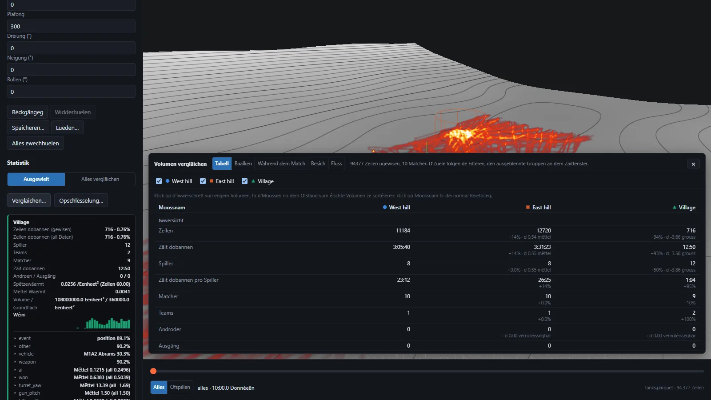
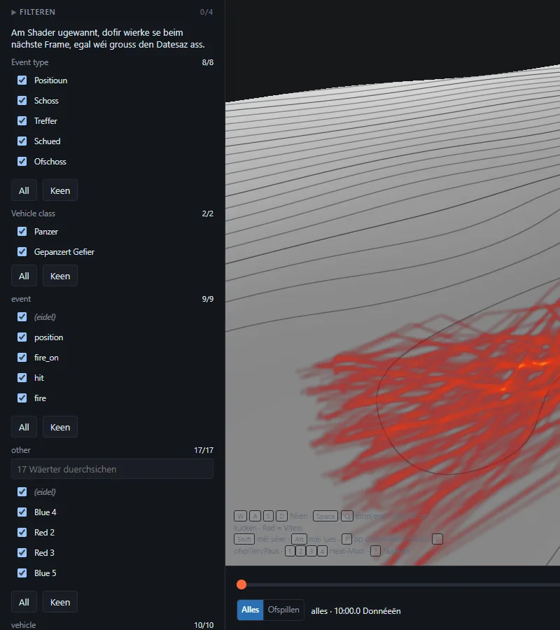
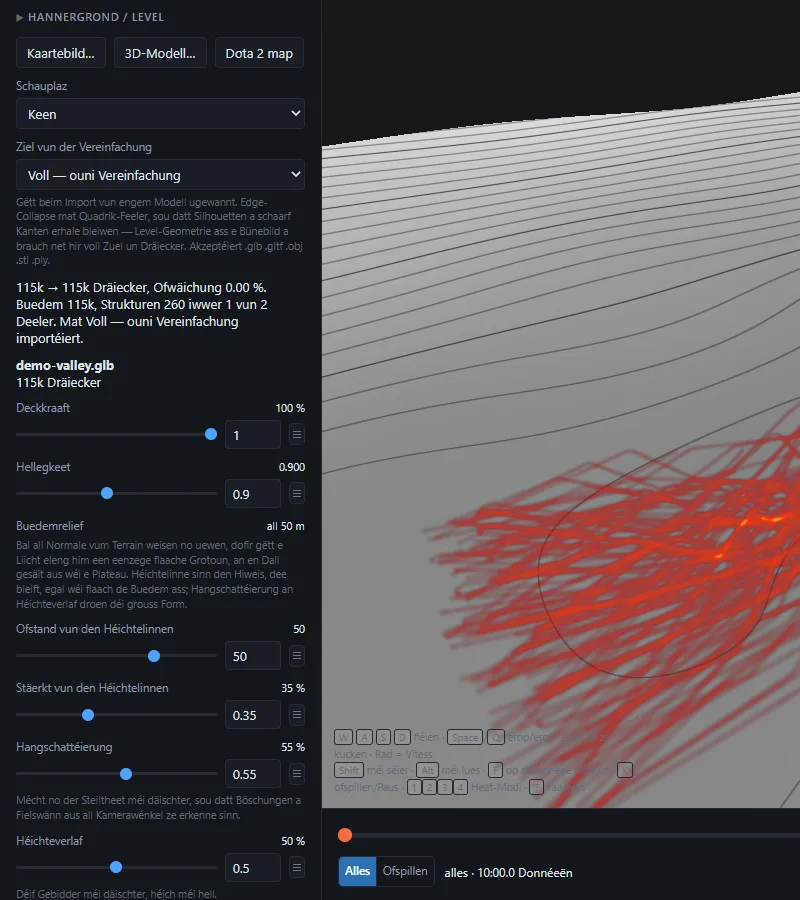

# 3DHeat

3DHeat weist, wou Saache lass waren - wou Spiller gaang sinn, gekämpft hunn an gefall sinn - als glëtzeg Faarwen, duerch déi s de fléien kanns, oder als kleng 3D-Figuren, déi de Match nach eng Kéier ofspillen.

Luet Positiounen - CSV, Parquet, Tacview-Opnamen, konvertéiert Replayen, eng eenzeg Datei, en Dossier oder Dausende Matcher - a kuckt se als **Hëtztkaart, duerch déi s de fléien kanns**, als **Figuren, déi de Match ofspillen**, als Linnen laanschs d'Weeër, déi d'Leit geholl hunn, oder als eng Populatioun géint eng aner. Et fënnt selwer, wat sech ofhieft, a rangéiert et mat den Beweiser, a alles leeft komplett an Ärem Browser: näischt gëtt iergendwou higelueden. 3DHeat a all seng Werkzeich si gratis a Open Source ënner der [MIT-Lizenz](https://github.com/Holdi601/3DHeat/blob/main/LICENSE).



**Nei hei?** Maacht d'[Demo-Daten](demo-data.md) a follegt hiren siwe Schrëtt. All Bild op dëser Säit ass mat hinnen gemaach.

## Wat et mécht {#what-it-does}

| | |
|---|---|
|  | **[Hëtztmodi](heat-modes.md)** - Hëtzt, [Ënnerscheed](difference.md) (rout, wou eng Säit méi war, grénzbloen, wou déi aner war), [Equipen-Heat](team-heat.md), [Linn-Hëtzt](line-heat.md); [Richtungs-Hëtzt](directional-heat.md) mat Kielen, Pfeilfelder a Polardiagrammer; Hëtzt [no Wäert gewiicht](value-weighting.md): wat Waffen, Gefierer an Sprit kosten. |
|  | **[Match-Replay](match-replay.md)** - all Eenheet als [Figur](figures.md) vun deem, wat se ass, NATO- oder russesch Symboler op wäit Distanz, Raketen a Leuchtspuren, Treffermarken, Wracken, Bränn, Tuerm, Ziler a taktesch Usiicht; [vill Matcher op eemol](many-matches.md). |
|  | **[Erkenntnisser](insights.md)** - staark Positiounen, gefäerlech Terrain, Spawn-Fallen, Engpässer a staark Spiller, fonnt a gerangéiert mat den Beweiser; eng geschriwwen Nobesprechung, optional vun enger KI vun Ärer Wiel; en Caster fir ee Match; d'[Wëssenslens](knowledge.md). |
|  | **[Volumen](volumes.md)** - Këschten, Prismen, Zylinder a Kugele zéchnen, drop filteren, zielen, wat dra geschitt, exportéieren, a Plazen niewenenee vergläichen; [Opschlësselung](breakdown.md) vu wiem a wat an enger Plaz am beschte ass. |
|  | **[Filteren](filters.md)** - no Evenementtyp, Spiller oder KI, Gefierklass, Wäert, all Kolonn, op der Grafikkaart bei all Datemgréisst. |
|  | **[Levelen](levels.md)** - Kaartbiller, 3D-Levelen, mat den [Datenwerkzeich](#related-repositories) gemaach, Vereinfachung, de [Welt-Hannergrond](world-backdrop.md) mat richtegem Terrain fir Fluchdaten. |

Dobäi: den [Course-Analys](race-analysis.md)-Tab fir Ronnen vu Rennspiller, den [Match](match-analysis.md)-Tab fir Zesummenfassungen vu Counter-Strike 2, den [Taktik-Board](tactics-board.md) fir Pläng op engem Level, [Treffer-Analys](hit-analysis.md) pro Gefier, [Massenanalys](mass-analysis.md) vu Dausende Matcher, [Kamerapfad a Video](camera-path-and-video.md), [40 Sproochen](languages.md), [metresch oder imperial Eenheeten](settings.md).

## D'Tabs {#the-tabs}

D'Tabs sti uewen an der Säitelleescht, ënner dem Numm, den Eenheeten an dem Sprooch-Menü.

| Tab | Wat en ass fir |
|---|---|
| **Heatmap** | All positionell Tabell: d'Hëtztmodi, d'Figuren-Overlay, Filteren, Volumen, Erkenntnisser, Levelen, Miessen a Video. |
| **Course-Analys** | Zwee oder méi Ronnen vun engem Kurs: wou Zäit verluer geet, firwat, a wat een ännere soll. |
| **Match** | Den Figuren-Replay vun engem Match, a Zesummefassunge vu Counter-Strike-2-Matcher. |
| **Taktik** | Pläng op engem Level: Figuren, Weeër, geworf Ausrüstung, Gebidder a Notizen a Schrëtt, déi sech ofspillen. |
| **Gefierer** | Wou all Eenheet getraff gouf, vun wiem a mat wat. |

## Installéieren a lafen {#install-and-run}

### Windows, de einfache Wee {#windows-the-easy-way}

D'Wuerzel vum Repository huet dräi Batch-Dateien.

| Datei | Wat se mécht |
|---|---|
| `start.bat` | Start de Viewer. Fënnt Node.js och wann et net am `PATH` ass (et sicht a `%ProgramFiles%\nodejs`, `%ProgramFiles(x86)%\nodejs` an `%LOCALAPPDATA%\Programs\nodejs`), a wann Node.js feelt, bitt et un, d'LTS-Versioun mat `winget install -e --id OpenJS.NodeJS.LTS` z'installéieren. Beim éischte Lafen freet et, ier d'Abhängegkeeten erofgeluede ginn (ongeféier 300 MB an `node_modules\` an dësem Dossier, näischt systemwäit). Et wëll net starten, wann eppes schonn op Port 5273 lauschtert, a verweist op `restart.bat`. Wann de Dossier e git-Checkout ouni lokal Ännerungen ass an eng méi nei Versioun existéiert, freet et, ob aktualiséiert gëtt (J/N; ouni Äntwert an 60 s behält et dës Versioun; kuckt [Updates](updates.md)). Dann start et den Dev-Server op `http://127.0.0.1:5273/` an maacht den Browser op. **Dat Fënster ass de Server**: loosst et op, mécht et zou oder dréckt Strg+C, fir ze stoppen. |
| `restart.bat` | Leeft `stop.bat quiet` an dann `start.bat`. Brauch een nëmmen no enger Ännerung un `vite.config.ts`, beim Derbäisetzen vun enger Abhängegkeet oder wann de Server hänkt - Quelltext-Ännerungen ginn direkt nogelueden. |
| `stop.bat` | Stoppt wat op Port 5273 lauschtert, mat der Prozessnummer, déi iwwer `netstat` gefonnt gëtt, ni duerch de Programmnumm, sou datt aner Node.js-Prozesser um Rechner a Rou bleiwen. Wart ongeféier zwou Sekonnen, bis de Socket fräi ass. Mat dem Argument `quiet` pauséiert et um Enn net. |

### Manuell (all Betribssystem) {#by-hand-any-os}


```bash
git clone --recursive https://github.com/Holdi601/3DHeat.git
cd 3DHeat
npm install
npm run dev      # http://127.0.0.1:5273
```

De `exporters/`-Dossier enthält d'separat Datenwerkzeich als git-Submodulen, all als eegent Repository; no engem reine Clone `git submodule update --init` lafen loossen. De Viewer selwer brauch se net fir ze lafen. `exporters/ext/` enthält d'optional Konverter (War Thunder, World of Tanks, World of Warships, Squad-Replayen; DCS- a IL-2-Kaarten), getrennt gehalen, sou datt e Problem mat engem vun hinnen näischt beaflosst.

Kee Spillmaterial kënnt mat dervun: Levelen, Kaarten a Opnamen ginn op Ärem eegenen Rechner mat den Werkzeich gemaach, aus Spiller, déi Dir besëtzt.

### npm-Skripter {#npm-scripts}

| Skript | Wat et leeft |
|---|---|
| `npm run dev` | Den Vite-Dev-Server op Port 5273, gebonnen un `127.0.0.1`. |
| `npm run build` | Typprüfung (`tsc --noEmit`) an en Produktiounspak an `dist/`. |
| `npm run preview` | Déngt dat Produktiounspak. |
| `npm run typecheck` | Nëmmen d'Typprüfung. |
| `npm test` / `npm run test:watch` | Unit- a Integratiounstester (vitest). |
| `npm run smoke` | Steuert d'Echt-App am Headless-Chromium a prüft, ob de Canvas Pixel an de Datenfaarwen huet; Screenshoten ginn an `tools/.smoke/`. Erwaart, datt de Dev-Server leeft. |
| `npm run smoke:f16` | Dee selwecht Test mat `?heat=f16`, sou datt den Half-float-Akkumulatiounswee erzwongen gëtt (kuckt [Half-float-Akkumulatioun](half-float-accumulation.md)). |
| `npm run bench` | Ingest-Benchmark, schreift `tools/.smoke/ingest-bench.json`. |
| `npm run test:heavy` | Tester, déi grouss Echtdateien brauchen; si iwwersprénge sech selwer, wann d'Dateien feelen. |
| `npm run inspect -- <file.parquet>` | Weist d'Schema vun enger Parquet-Datei an e puer Zeilen (`tools/inspect-parquet.mjs`). |

### Wat de Dev-Server derbäi huet {#what-the-dev-server-adds}

Den Viewer ass eng statesch Websäit, mee den Dev-Server (kuckt `vite.config.ts`) bäidréit zwee lokal Weeër, déi en statescht Deployment vum `dist/` net huet:

- `/__host/memory` mellt den installéierten an den fräie RAM an, wou et se liese kann, de Grafikkaart-Späicher (vun `nvidia-smi`, oder op Windows vum Registry-Eintrag vum Display-Adapter). Dat erlaabt de [Späicher-Budgeten](memory-and-budgets.md), richteg Zuelen ze benotzen amplaz vun de Schätzungen vum Browser, déi begrenzt sinn.
- `/__heat3d/update` kuckt, ob de Checkout hannendru ass, a kann en virufueren ([Updates](updates.md)).

De Server bindet nëmmen un `127.0.0.1`, sou datt keen vun deenen Weeër vum Netz aus erreechbar ass. Maacht en als `http://127.0.0.1:5273` op: `localhost` kann op de IPv6-Loopback `::1` opléisen, wou näischt lauschtert. Hie schéckt keng Cross-Origin-Isolatiouns-Kapp (COOP/COEP): näischt am Viewer benotzt `SharedArrayBuffer`, an d'Workers ginn hir Daten duerch Iwwerdroen ab, wat keng brauch.

## Browser- a GPU-Ufuerderunge {#browser-and-gpu-requirements}

- **E Browser mat WebGPU oder WebGL2.** WebGPU gëtt als éischt probéiert (Chrome an Edge hunn et); ouni dat gëtt de WebGL2-Backend benotzt. WebGL2 muss `EXT_color_buffer_float` bidden (Rendering op Float-Texturen), soss weist de Viewer "Cannot initialise the renderer." Kuckt [Déi zwee Backends](backends.md). De Viewer gëtt op Chromium entwéckelt an getest; anerer Browser sinn net verifizéiert.
- **Hardware-Beschleunigung ageschalt.** Wann de Browser op der CPU zeechent (SwiftShader, llvmpipe, den Microsoft Basic Render Driver an ähnlech), weist en roude Banner uewen an der Säitelleescht dat a wéi een et behiewen. Kuckt [Erkennung vum Software-Rendering](software-rendering.md).
- **Eng separat GPU hëlleft, ass awer net Pflicht.** Béid Backends froen den Hochleeschtungs-Adapter un. D'Datemenge, déi op der GPU gehale ka ginn, ass e Budget, dat Dir gesitt an änneren kënnt ([Späicher a Budgeten](memory-and-budgets.md)).
- **Optional Funktioune** benotzen weider Browser-APIs: Video-Rendering brauch WebCodecs `VideoEncoder` mat VP9 oder VP8 ([Kamerapfad a Video](camera-path-and-video.md)); d'Mesh-Vereinfachung vun Levelen brauch WebAssembly; Ordner fallen liesen benotzt d'File- and Directory-Entries-API; d'Level-Bibliothéik benotzt IndexedDB; Gamepads benotzen d'Gamepad-API.

## Dokumentatiounskaart {#documentation-map}

**Start**: [Demo-Daten](demo-data.md) · [Daten astellen](getting-data-in.md) ([Dateien lueden](loading-files.md), [Kolonnenzouweisung](column-mapping.md), [Achsen, Eenheeten a Zäit](axes-units-and-time.md), [Sessiounen, Persounen a Gruppen](sessions-persons-groups.md), [Tacview](tacview-acmi.md), [Konverter](converters.md), [.3dheat](container.md), [Späicher a Budgeten](memory-and-budgets.md))

**Kucken**: [Hëtztmodi](heat-modes.md) ([Hëtzt](heat.md), [Sprite-Form](sprite-shape.md), [Faarf a Belichtung](colour-and-exposure.md), [Déift a Ausblenden](depth-and-culling.md), [Ënnerscheed](difference.md), [Equipen-Heat](team-heat.md), [Linn-Hëtzt](line-heat.md), [Box-Replay](box-replay.md), [Richtungs-Hëtzt](directional-heat.md), [Wäertgewiichtung](value-weighting.md)) · [Zäitlinn](timeline.md) · [Levelen](levels.md) ([Kaartbiller](map-images.md), [3D-Levelen](model-levels.md), [Ausgesinn](level-appearance.md), [Bibliothéik](level-library.md), [Welt-Hannergrond](world-backdrop.md), [seng Quellen](world-backdrop-sources.md)) · [Kamera](camera.md) ([Gamepad](gamepad.md), [Tasten](keyboard-reference.md)) · [Kamerapfad a Video](camera-path-and-video.md)

**Analyséieren**: [Filteren a Werkzeich](filters-and-tools.md) ([Filteren](filters.md), [Team-Lëscht](teams-list.md), [Entitéiten](entities.md), [Schnëtt](slice.md), [Mooss](measure.md), [Volumen](volumes.md), [Opschlësselung](breakdown.md)) · [Erkenntnisser](insights.md) ([Wëssenslens](knowledge.md)) · [Massenanalys](mass-analysis.md)

**Replay**: [Match-Replay](match-replay.md) · [Vill Matcher op eemol](many-matches.md) · [Figuren](figures.md) ([am Figuren-Overlay](figure-replay.md), [Kreditter](figure-credits.md)) · [Tacview-Parittéit](tacview-parity.md) · [Treffer-Analys](hit-analysis.md)

**Aner Tabs**: [Course-Analys](race-analysis.md) ([d'Method](race-analytics.md), [aner Spiller](other-games.md)) · [Match-Analys](match-analysis.md) · [Taktik-Board](tactics-board.md) ([Geschwindegkeeten](tactics-speeds.md))

**De Viewer**: [Glossar](glossary.md) · [Astellungen, Eenheeten a Schlësselen](settings.md) · [Sproochen](languages.md) · [Updates](updates.md) · [Rendering-Interna](rendering-internals.md) ([Backends](backends.md), [Akkumulatioun](accumulation.md), [Sampling a Budgeten](sampling-and-budgets.md), [Half-float](half-float-accumulation.md), [GPU-Späicher](gpu-memory.md), [Software-Rendering](software-rendering.md), [Leeschtungspanel an Statistiken](performance-and-stats.md)) · [Datenformater](data-formats.md) · [Referenz](reference.md) · [D'Dokumentatioun pflegen](maintaining.md)

## Verbonne Repositories {#related-repositories}

De Viewer liest Daten; dës Werkzeich maachen s. All ass en eegent ëffentlecht Repository (MIT) mat der eegener Dokumentatioun. Keent vun hinnen liwwert Spillmaterial: Levelen, Kaarten a Opnamen ginn op Ärem eegenen Rechner gemaach, aus Spiller, déi Dir besëtzt.

| Repository | Wat et mécht | Gutt fir | Dokumentatioun |
|---|---|---|---|
| [3DHeat-GameFiles](https://github.com/Holdi601/3DHeat-GameFiles) | Liest Kurse a Levelen aus den Archiven, déi Spiller mat sech bréngen (Forza Horizon, BeamNG, Assetto Corsa Rally; Lieser fir Unreal, Unity, Frostbite a Source 2) als glTF | en 3D-Level ënner Ärer Hëtzt oder Ärem Replay | [Websäit](https://holdi601.github.io/3DHeat-GameFiles/) |
| [3DHeat-GameCapture](https://github.com/Holdi601/3DHeat-GameCapture) | Nimmt Rondentelemetrie aus den Schnëttstellen op, déi Rennspiller veröffentlechen, a baut Levelen aus Spillvideoe nei op | Ronnen fir d'Course-Analys; e Level, wou keng Dateie gelies kënne ginn | [Websäit](https://holdi601.github.io/3DHeat-GameCapture/) |
| [3DHeat-UnrealExporter](https://github.com/Holdi601/3DHeat-UnrealExporter) | Plugin fir den Unreal Editor, deen e Level als eng glTF-Datei exportéiert | Levelen vun Ären eegenen Unreal-Projeten | [Websäit](https://holdi601.github.io/3DHeat-UnrealExporter/) |
| [3DHeat-CS2](https://github.com/Holdi601/3DHeat-CS2) | Counter-Strike-2-Demoen an Hëtzttabellen an Zesummefassunge vun de Matcher, CS2-Kaarte an Geometrie | CS2-Hëtzt, Replayen an de Match-Tab | [Websäit](https://holdi601.github.io/3DHeat-CS2/) |
| [3DHeat-Watcher](https://github.com/Holdi601/3DHeat-Watcher) | Nimmt Äert Spill am Hannergrond op, aus deem wat d'Spiller verëffentlechen: Telemetrie, Spillstatus-Integratiounen, Logbicher, Replayen | Är eegen Statistiken, ouni datt Dir eppes Hand maacht | [Websäit](https://holdi601.github.io/3DHeat-Watcher/) |
| [3DHeat-Ext-WarThunder](https://github.com/Holdi601/3DHeat-Ext-WarThunder) | War-Thunder-Replayen (`.wrpl`) an Tabellen: Luft- a Buedemspueren, Schëss, Treffer, Ofschoss, Tierm, Ziler | War-Thunder-Replayen, Treffermarken a Erkenntnisser | [Websäit](https://holdi601.github.io/3DHeat-Ext-WarThunder/) |
| [3DHeat-Ext-WoT](https://github.com/Holdi601/3DHeat-Ext-WoT) | World-of-Tanks-Replayen an Tabellen: d'Positioun all Gefier, Doudesfäll an Ofschoss | World-of-Tanks-Hëtzt a Replayen | [Websäit](https://holdi601.github.io/3DHeat-Ext-WoT/) |
| [3DHeat-Ext-WoWs](https://github.com/Holdi601/3DHeat-Ext-WoWs) | World-of-Warships-Replayen an Tabellen: d'Positioun vum all Schëff an d'Versenkungen | World-of-Warships-Hëtzt a Replayen | [Websäit](https://holdi601.github.io/3DHeat-Ext-WoWs/) |
| [3DHeat-Ext-Squad](https://github.com/Holdi601/3DHeat-Ext-Squad) | Squad-Serverdemoen an Tabellen: d'Positioun vun all Spiller, Team a Squad | Squad-Hëtzt a Replayen | [Websäit](https://holdi601.github.io/3DHeat-Ext-Squad/) |
| [3DHeat-Ext-DCS](https://github.com/Holdi601/3DHeat-Ext-DCS) | DCS-World-Terrainen aus Ärer eegener Installatioun zu Levelen: Buedem, Stroosse, Dierfer, Fligerhaff, Felder, Waasser | DCS- an Tacview-Opnamen op hirem richtege Terrain | [Websäit](https://holdi601.github.io/3DHeat-Ext-DCS/) |
| [3DHeat-Ext-IL2](https://github.com/Holdi601/3DHeat-Ext-IL2) | IL-2-Great-Battles-Kaarte fir Levelen | IL-2-Opnamen op hirer Kaart | [Websäit](https://holdi601.github.io/3DHeat-Ext-IL2/) |

## Quelltext-Opbau, kuerz {#source-layout-briefly}

| Dossier | Inhalt |
|---|---|
| [`src/data/`](https://github.com/Holdi601/3DHeat/tree/main/src/data) | Dateiauswiel, CSV- a Parquet-Import, Automatik-Zuordnung, Validatioun, Späicher-Modell, Dataset-Bauer, Modellverarbechtung, Klassifikatioun, Vereinfachung, Level-Bibliothéik |
| [`src/render/`](https://github.com/Holdi601/3DHeat/tree/main/src/render) | D'Bild-Schläif (`engine.ts`), Sampling, béid Backends, Kamera, Gamepad, Miessen, Kamerapfad, Videoopnam |
| [`src/state/`](https://github.com/Holdi601/3DHeat/tree/main/src/state) | De Programmstatus (`store.ts`) mat all de Standarden, d'Domänen-Typen (`types.ts`), d'Sprite-Kurv |
| [`src/ui/`](https://github.com/Holdi601/3DHeat/tree/main/src/ui) | D'Säitelleschtepanelen, d'Zäitlinn, d'Overlayen |
| [`src/race/`](https://github.com/Holdi601/3DHeat/tree/main/src/race), [`src/match/`](https://github.com/Holdi601/3DHeat/tree/main/src/match) | D'Tabs Course-Analys an Match |
| [`src/i18n/`](https://github.com/Holdi601/3DHeat/tree/main/src/i18n) | Iwwersetzungen |
| [`src/insights/`](https://github.com/Holdi601/3DHeat/tree/main/src/insights) | Erkenntnisser: Detektoren, Nobesprechung, Caster, KI-Ubidder, d'Wëssenslens |
| [`src/mass/`](https://github.com/Holdi601/3DHeat/tree/main/src/mass) | Massenanalys iwwer vill Matcher |
| [`src/volumes/`](https://github.com/Holdi601/3DHeat/tree/main/src/volumes) | Volumen, hir Statistiken, Export an Verglach |
| [`src/breakdown/`](https://github.com/Holdi601/3DHeat/tree/main/src/breakdown) | Opschlësselung an Faktoren |
| [`src/overlay/`](https://github.com/Holdi601/3DHeat/tree/main/src/overlay) | D'Overlay fir vill Matcher |
| [`src/figures/`](https://github.com/Holdi601/3DHeat/tree/main/src/figures) | De Figurekatalog an deen, dee en opbaut |
| [`src/vehicle/`](https://github.com/Holdi601/3DHeat/tree/main/src/vehicle) | Treffer-Analys (Gefierer-Tab) |
| [`src/tactics/`](https://github.com/Holdi601/3DHeat/tree/main/src/tactics) | D'Taktik-Board |
| [`src/world/`](https://github.com/Holdi601/3DHeat/tree/main/src/world) | De Welt-Hannergrond |
| [`src/units/`](https://github.com/Holdi601/3DHeat/tree/main/src/units) | Miessaiheeten |
