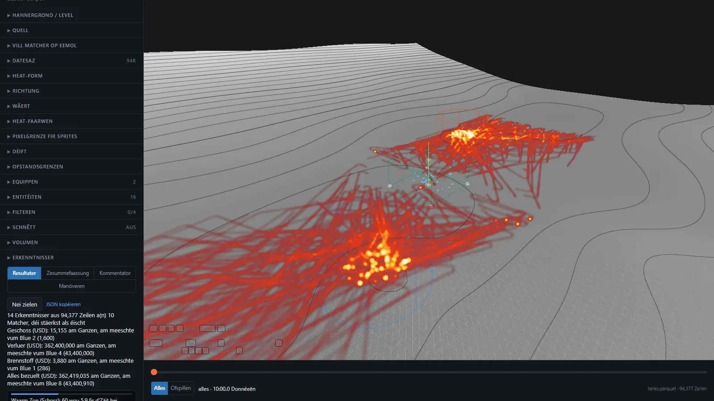

# Erkenntnisser

**Erkenntnisser** sicht an den gelueden Daten no deem, wat erausstécht - staark Positiounen, gefäerlech Terrain, Spawn-Fallen, Engpässer, Spiller wäit iwwer hire Kollegen - a seet Iech et, dat Staarkst fir d'éischt, mat den Beweiser. Benotzt et, fir an enger Minutt ze léieren, wou e Match gewonne oder verluer gouf. Dann kann et eng Zesummefaassung schreiwen, a bei engem eenzege Replay kann et als Kommentator op déi grouss Momenter sprangen.

Alles gëtt am Browser gezielt. Näischt verléisst Ären Rechner, ausser Dir schalt eng extern KI an (kuckt [Extern KI](#external-ai)).

D'Sektioun **Erkenntnisser** ass an der Säitelleescht vum Heatmap- an Match-Tab. Si huet dräi Tabs: **Resultater**, **Zesummefaassung** an **Kommentator**.

## Resultater {#findings}

1. Lued Daten an maacht **Erkenntnisser** op. Drëckt **Erkenntnisser fannen** (*Zielen… n%* weist de Fortschrëtt).
2. Liest d'Lëscht. All Resultat huet eng Stäerkebar, e Saz, wéi gutt d'Beweiser sinn (*Staark Beweiser*, *Gutt Beweiser* oder *E puer Beweiser*), de Detektor, deen en fonnt huet, an d'Gefierklass, wou dat zielt.
3. **Klickt op e Resultat**: de Viewer wend seng Filter un, fléit d'Kamera op d'Plaz an sprengt op d'Zäit, a mécht d'Detailer op: den Effekt mat sengem 95%-Intervall, d'p- an q-Wäerter, d'gezielte Beweiser, a **Volumen hei**, dat e [Volumen](volumes.md) ronderëm d'Plaz zeechent.
4. **Filtere restauréieren** setzt Är Filteren erëm an. **JSON kopéieren** kopéiert de ganze Bericht.

Zielen benotzt déi aktuell Filteren, verstoppt Gruppen an de gewielte Match iwwer de ganzen Zäitraum. Wann Dir d'Filteren duerno ännert, seet eng Notiz dat; drëckt **Nei zielen**.

D'Zeilen uewen an der Lëscht (zum Beispill d'Geldsummen) fasse all d'Daten zesummen, ier d'Resultater kommen.

### D'Detektoren {#the-detectors}

| Detektor | Wat en fënnt | Brauch an den Daten |
|---|---|---|
| **Power-Positiounen** | Plazen mat vill besseren Ofschoss-zu-Doud-Chancen wéi de Rescht vun der Kaart, a *sécheren Terrain*, wou fir d'Zäit, déi verbruecht gëtt, wéineg stierwen | Ofschoss- an Doudesevenementer |
| **Waarm a kal Zonen** | Plazen, wou eng Aart vun Evenement (Schëss, Treffer, Capturen ...) vill méi oder vill manner dacks geschitt, wéi d'Zäit dort virausgesot hätt | eng Evenementkolonn |
| **Oppent Terrain an Deckung** | Doudesfäll am Oppenen géint noen Terrain-Geometrie, a lues géint séier Bewegung | Doudesfäll; e 3D-Level fir den Geometrieteil |
| **Spawns** | Staark Spawns, Spawn-Fallen, sécher Spawns, Zäit bis zum éischte Kontakt | Zäit an Persoune |
| **Klass no Plaz** | Eng Gefierklass, oder Spiller géint KI, déi an enger Gegend vill besser oder schlechter sinn | Ofschëss plus eng Gefierklass- oder Spiller/KI-Kolonn |
| **Spiller** | Spiller, déi vill méi oder vill manner ofschéissen oder stierwen wéi anerer an der selwechter Klass | Persoune an Ofschëss |
| **Engpäss a Flanken** | Engpässer (vill méi Iwwergäng wéi um Terrain ronderëm) an Flankenwee (selten benotzt, awer féieren zu Ofschëss) | Persoune |
| **Wäert** | *Deier Terrain* a *Verdéngt Terrain* | [Wäertkolonnen](value-weighting.md) |

Detektoren, déi mat de Daten net lafe kënnen, stinn ënnen mat dem Grond.

### Wéi d'Resultater gerangéiert ginn {#how-findings-are-ranked}

All Plaz oder Grupp gëtt géint de Rescht vun der Kaart getest (exakt Binomial- oder Ratentester). D'Falsch-Entdeckungsquote gëtt bei 5% gehalen (Benjamini-Hochberg). Zoufall kann wéi e Muster ausgesinn; dat hält falsch Alarmer kleng: vun den Resultater, déi gewise ginn, ass héchstens ongeféier een vun zwanzeg Zoufall. Effekter aus wéinege Evenementer ginn virum Rangéieren Richtung "kee Effekt" gezunn. Héchstens 60 Resultater ginn opgelëscht, a jeden Detektor kritt e puer Plazen nieft der Spëtzt.

## Zesummefaassung {#debrief}

De Tab **Zesummefaassung** schreift d'Resultater als kuerze Text: en Opstart, dat kloerste Resultat, ee fir d'Taktik, ee fir d'Gläichgewiicht, de Rescht no Detektor gruppéiert, a wéivill op méi schwaache Beweiser beruhen. All Absatz huet nummeréiert Knäppchen, déi seng Resultater weisen. **Text kopéieren** kopéiert en.

De agebaute Erzieler funktionéiert offline, an Ärer Sprooch. De **Lëns**-Wieler driwwer (kuckt [Dat Wëssenslens](knowledge.md)) bestëmmt, aus wéi enger Literatur d'Absätz zitéieren.

### Extern KI {#external-ai}

**KI-Astellungen** léisst en KI-Modell Ärer Wiel d'Zesummefaassung schreiwen:

| Astellung | Bedeutung |
|---|---|
| **Fournisseur** | Anthropic (Claude), OpenAI (ChatGPT), OpenRouter, Ollama (lokal), LM Studio (lokal), llama.cpp-Server (lokal), oder all OpenAI-kompatibel Endpunkt |
| **Basis-URL**, **Modell** | Vum Fournisseur ausgefëllt; **Modeller opzielen** freet de Server |
| **API-Schlëssel** | Gëtt nëmmen un d'Basis-URL geschéckt. Gëtt ni protokolléiert, ni an Ansichten, Exporter oder `.3dheat`-Dateien gespäichert. Déi meescht lokal Serveren brauchen keen. |
| **Schlëssel an dësem Browser behalen** | Standardméisseg aus: de Schlëssel gëtt vergiess, wann d'Säit zoumécht |
| **Eng extern KI benotzen** | Standardméisseg aus |
| **Spillernimm schécken** | Standardméisseg aus: Spiller ginn als P1, P2 ... geschéckt |

Duerno tippt Dir eng optional Fro an drëckt **Mat KI schreiwen**. Nëmmen d'Resultater an hir Zuelen ginn geschéckt - ni d'Zeilen Är Daten. D'Äntwert kënnt Stéck fir Stéck; zitéiert Resultater ginn Knäppchen.

## Kommentator {#caster}

Fir **ee Match** (wielt een, wann méi gelueden sinn) fënnt den **Kommentator** d'Momenter, déi et wäert sinn ze kucken: éischte Bluttrëpfe, Mehrfach-Ofschëss, Trades, Clutches, Ännerunge bei Ziler, Comebacks, staark Spiller, laang Schëss.

- Klickt op e Moment: d'Usiicht wiesselt op de Replay, sprengt just virdrun, fléit dohin a follegt de Spiller.
- **Momenter ofspillen** spillt all ee bis zum Enn a geet weider; **Virdrun** / **Weider** blät duerch se.
- Mat engem extern KI un schreift **Kommentar vun der KI** en Kommentar aus der Momentlëscht (Aarten, Zäiten, Nimm oder Pseudonymer, Equipen, Klassen, Distanzen).

Et brauch Persoune a Ofschoss- (oder Capture-)Evenementer; eng `other`/`victim`-Kolonn mécht Trades an laang Schëss méiglech.

## Dat Wëssenslens {#knowledge-lens}

E Resultat kann duerch e **Lens** vu bewéierter Wëssen gelies ginn: militäresch Doktrin, Loft- a Marinekampf, urban Operatiounen, Spillgestaltung an Esport (oder *Auto*, vun den Eenheeten an den Daten gewielt). En opgemaachte Resultat weist dann den nootste **Doktrin- an Literatur**-Entrée an e **historesche Parallel**, mat Referenzen, an **Lens-Moossen** rechent Miessungen aus där Literatur op den Daten (Lanchester-Passungen, Austauschverhältnisser, Krafverhältnisser, Feuerfelder, Schlësselterrain, Trades, Initiativ). D'Zesummefaassung an den KI-Prompt enthalen se. Alles doriwwer: [Dat Wëssenslens](knowledge.md).

D'Lens-Moossen miessen och, wéi sech d'Spiller als Masse an als Grupp verhalen - Ausrichtung an Kreesen, Routenhierdung, Spuren an Trails, Dicht, Leader an Follower, Nokömmlingen, de Bréchpunkt ënner Verloschter, Risiko nodeems e Liewen verluer gouf, Serien, Kafgenehmegung an d'Reaktioun op eragehend Feier - jeweils géint säi eegent Null-Modell: [Kollektivt Verhalen](collective-behaviour.md).

## Daten, déi Erkenntnisser méiglech maachen {#data-that-makes-insights-work}

- Positiounen mat **Zäit**, enger **Persoun**- an enger **Equipe**-Kolonn;
- eng **Evenement**-Kolonn mat Ofschëss an Doudesfäll (`kill`, `death`), a anere (`hit`, `fire`, `capture` ...);
- eng Kolonn fir **de Géigner** (`other`, `victim`) fir Trades an Richtunge;
- eng **Gefier**- oder **Typ**-Kolonn fir Klassen; eng `ai`-Kolonn fir Spiller géint KI;
- eng **Sessioun**-, **Match**- oder **Ronn**-Kolonn, wann et méi Matcher sinn.

D'[Demo-Daten](demo-data.md) hunn se all.
