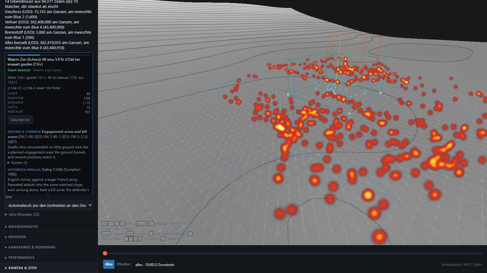
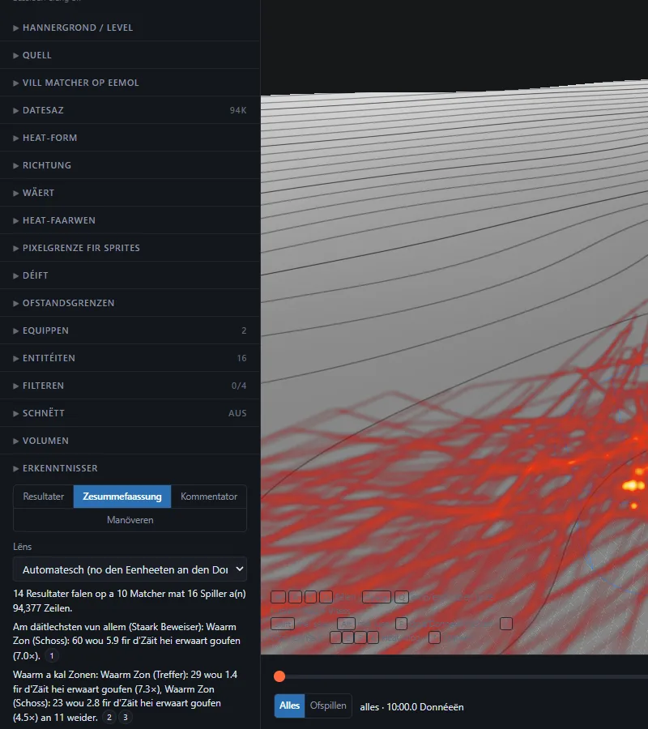
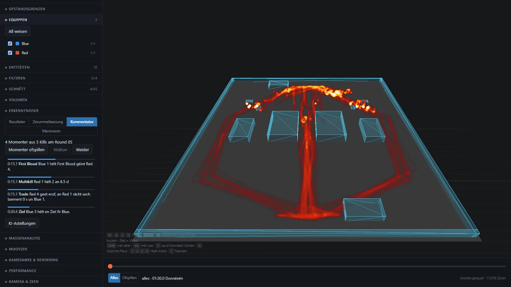

# Erkenntnisser

**Erkenntnisser** sicht an den gelueden Daten no deem, wat erausstécht - staark Positiounen, gefäerlech Terrain, Spawn-Fallen, Engpässer, Spiller wäit iwwer hire Kollegen - a seet Iech et, dat Staarkst fir d'éischt, mat den Beweiser. Benotzt et, fir an enger Minutt ze léieren, wou e Match gewonne oder verluer gouf. Dann kann et eng Zesummefaassung schreiwen, a bei engem eenzege Replay kann et als Kommentator op déi grouss Momenter sprangen.

Alles gëtt am Browser gezielt. Näischt verléisst Ären Rechner, ausser Dir schalt eng extern KI an (kuckt [Extern KI](#external-ai)).

D'Sektioun **Erkenntnisser** ass an der Säitelleescht vum Heatmap- an Match-Tab. Si huet dräi Tabs: **Resultater**, **Zesummefaassung** an **Kommentator**.

## Resultater {#findings}

1. Lued Daten an maacht **Erkenntnisser** op. Drëckt **Erkenntnisser fannen** (*Zielen… n%* weist de Fortschrëtt).
2. Liest d'Lëscht. All Resultat huet eng Stäerkebar, e Saz, wéi gutt d'Beweiser sinn (*Staark Beweiser*, *Gutt Beweiser* oder *E puer Beweiser*), de Detektor, deen en fonnt huet, an d'Gefierklass, wou dat zielt.
3. **Klickt op e Resultat**: de Viewer wend seng Filter un, fléit d'Kamera op d'Plaz an sprengt op d'Zäit, a mécht d'Detailer op: den Effekt mat sengem 95%-Intervall, d'p- an q-Wäerter, d'gezielte Beweiser, a **Volumen hei**, dat e [Volumen](volumes.md) ronderëm d'Plaz zeechent.
4. **Filtere restauréieren** setzt Är Filteren erëm an. **JSON kopéieren** kopéiert de ganze Bericht.

Zielen benotzt déi aktuell Filteren, verstoppt Gruppen an de gewielte Match iwwer de ganzen Zäitraum. Wann Dir d'Filteren duerno ännert, seet eng Notiz dat; drëckt **Nei zielen**.

D'Zeilen uewen an der Lëscht (zum Beispill d'Geldsummen) fasse all d'Daten zesummen, ier d'Resultater kommen.

### D'Detektoren {#the-detectors}

| Detektor | Wat en fënnt | Brauch an den Daten |
|---|---|---|
| **Power-Positiounen** | Plazen mat vill besseren Ofschoss-zu-Doud-Chancen wéi de Rescht vun der Kaart, a *sécheren Terrain*, wou fir d'Zäit, déi verbruecht gëtt, wéineg stierwen | Ofschoss- an Doudesevenementer |
| **Waarm a kal Zonen** | Plazen, wou eng Aart vun Evenement (Schëss, Treffer, Capturen ...) vill méi oder vill manner dacks geschitt, wéi d'Zäit dort virausgesot hätt | eng Evenementkolonn |
| **Oppent Terrain an Deckung** | Doudesfäll am Oppenen géint noen Terrain-Geometrie, a lues géint séier Bewegung | Doudesfäll; e 3D-Level fir den Geometrieteil |
| **Spawns** | Staark Spawns, Spawn-Fallen, sécher Spawns, Zäit bis zum éischte Kontakt | Zäit an Persoune |
| **Klass no Plaz** | Eng Gefierklass, oder Spiller géint KI, déi an enger Gegend vill besser oder schlechter sinn | Ofschëss plus eng Gefierklass- oder Spiller/KI-Kolonn |
| **Spiller** | Spiller, déi vill méi oder vill manner ofschéissen oder stierwen wéi anerer an der selwechter Klass | Persoune an Ofschëss |
| **Engpäss a Flanken** | Engpässer (vill méi Iwwergäng wéi um Terrain ronderëm) an Flankenwee (selten benotzt, awer féieren zu Ofschëss) | Persoune |
| **Wäert** | *Deier Terrain* a *Verdéngt Terrain* | [Wäertkolonnen](value-weighting.md) |
| **Wat d’Ronnen entscheed huet** | Wat gewonne vu verluerene Ronnen getrennt huet, an d'Spiller, déi am meeschte Siegwahrscheinlechkeet bäigedroen oder kascht hunn (kuckt [Wien huet gewonnen](#who-won-what-decided-the-rounds)) | Ronnen, Ofschëss an Doudesfäll, an d'[Resultatspalten](data-formats.md#outcome-columns) (`won`) |

Detektoren, déi mat de Daten net lafe kënnen, stinn ënnen mat dem Grond.

### Wéi d'Resultater gerangéiert ginn {#how-findings-are-ranked}

All Plaz oder Grupp gëtt géint de Rescht vun der Kaart getest (exakt Binomial- oder Ratentester). D'Falsch-Entdeckungsquote gëtt bei 5% gehalen (Benjamini-Hochberg). Zoufall kann wéi e Muster ausgesinn; dat hält falsch Alarmer kleng: vun den Resultater, déi gewise ginn, ass héchstens ongeféier een vun zwanzeg Zoufall. Effekter aus wéinege Evenementer ginn virum Rangéieren Richtung "kee Effekt" gezunn. Héchstens 60 Resultater ginn opgelëscht, a jeden Detektor kritt e puer Plazen nieft der Spëtzt.

### Wien huet gewonnen: wat d'Ronnen entscheed huet {#who-won-what-decided-the-rounds}

Wann d'Daten soen, wien all Ronn gewonnen huet (d'[Resultatspalt](data-formats.md#outcome-columns) `won`: CS2, Rainbow Six Siege, War Thunder ...), dréint sech bei den Erkenntnisser alles ëm d'Resultat. Fir all Säit deelt et d'Ronnen no deem, wat an hinne geschitt ass, a vergläicht d'Gewannquoten:

| Faktor | D'Ronne vun der Säit domat | ... an ouni |
|---|---|---|
| Ouverture-Duell | si huet den éischte Kill gemaach | si ass als éischt gestuerwen |
| Akaf | hiren Akaf war besser wéi dee vun der anerer Säit | méi schlecht |
| Éischten Doud getradet | hiren éischten Doud gouf bannent 5 s getradet | net getradet |
| Plant | si huet geplant | kee Plant |
| Utility | méi Granaten wéi an hirer gewéinlecher Ronn | manner |
| Fréie Kontakt | dat éischt Duell koum virun der Medianzäit vum Match | méi spéit |
| Eng Plaz gehalen | e Spiller stoung 5 s oder méi op der Plaz | keen |
| Eng Plaz fréi erreecht | e Spiller ass an den éischten 25 s do ukomm (de Wee) | keen |

All Verglach ass en Ënnerscheed vun zwou Gewannquoten mat sengem 95%-Intervall (Newcombe), dem exakte p vu Fisher an engem q iwwer all probéiert Faktoren (Benjamini-Hochberg). E Grupp mat manner wéi 8 Ronne gëtt als *wéineg Ronnen* markéiert. Déi ënner der Falschentdeckungsrate vu 5% ginn zu Resultater; déi stäerkst stinn iwwer deene vun den aneren Detektoren (e Resultat zum Ausgang weit 1,35 mol esou vill wéi een anert mat demselwechten Effekt a Beweis).

En erfonnt Beispill iwwer 40 Ronnen:

> **T** huet 79% vun den 19 Ronne gewonnen, an deenen et **Mid** gehalen huet, géint 24% vun 21 ouni (55 Punkten, 95% vun 26 bis 74) - q 0,004.

Et verfollegt och d'**Siegwahrscheinlechkeet** vun der Ronn - d'Chance vun all Säit an all Moment, aus de Leit, déi nach liewen, dem Plant an der Auer: un d'Ronnen ugepasst, wann et 30 oder méi sinn, soss e fixt Virab-Modell (an den Text seet, wat). Doraus kommen d'**Wendepunkten** (d'Kills an d'Plants, déi d'Chance am meeschte verréckelt hunn) an d'**bäigedroe Siegwahrscheinlechkeet** vun all Spiller: seng Kills a Plants zielen fir hien, seng Doudesfäll géint hien, a Ronnewäert iwwer de Match, eng Ronn am Duerchschnëtt mat hirem Intervall, géint null getest. D'Plaze kréien déiselwecht Bilanz: wéi eng Säit am meeschte gewonnen huet an den Duellen, déi do gefouert goufen.

D'Date brauchen Ronnen, Kills an Doudesfäll mat béide Säiten, an d'Kolonn `won`; benannt Plazen (`place`) fir gehale Plazen, eng Kolonn `buy` fir den Akaf.

## Zesummefaassung {#debrief}

De Tab **Zesummefaassung** schreift d'Resultater als kuerze Text: en Opstart, dat kloerste Resultat, ee fir d'Taktik, ee fir d'Gläichgewiicht, dann - wann d'Daten soen, wien gewonnen huet - wat d'Ronnen entscheed huet, de Rescht no Detektor gruppéiert, a wéivill op méi schwaache Beweiser beruhen.

Wat d'Ronnen entscheed huet, kënnt a véier Absätz: de Score a vu wou d'Siegwahrscheinlechkeete kommen; déi stäerkst Faktore mat hiren Zuelen, Intervall an q (wann keen ënner der Falschentdeckungsrate bleift, seet den Text *näischt dovun ass nach sécher*, a nennt trotzdem dee stäerksten); déi dräi gréissten Wendepunkten; an d'Spiller, déi am meeschte Siegwahrscheinlechkeet bäigedroen a kascht hunn, mat de Plazen, déi am meeschte gewonnen hunn. En erfonnt Beispill:

> T huet 23 gewonnen an CT huet 17 gewonnen vu 40 Ronne mat bekannte Resultat (T: 58%, 95% vu 42% bis 72%). D'Siegwahrscheinlechkeete kommen aus engem Modell, dat un dës Ronnen ugepasst gouf.
>
> Wat gewonne vu verluerene Ronnen getrennt huet: T huet 79% vun den 19 Ronne gewonnen, an deenen et Mid gehalen huet, géint 24% vun 21 ouni (55 Punkten, 95% vun 26 bis 74) (q 0,004), ...
>
> Wendepunkten: Ronn 17 bei 48 s, e Kill vu CT um B-Site huet hir Chance vun 31% op 58% verréckelt, an si huet d'Ronn gewonnen, ...

All Absatz huet nummeréiert Knäppchen, déi seng Resultater weisen. **Text kopéieren** kopéiert en.

De agebaute Erzieler funktionéiert offline, an Ärer Sprooch. De **Lëns**-Wieler driwwer (kuckt [Dat Wëssenslens](knowledge.md)) bestëmmt, aus wéi enger Literatur d'Absätz zitéieren.

### Extern KI {#external-ai}

**KI-Astellungen** léisst en KI-Modell Ärer Wiel d'Zesummefaassung schreiwen:

| Astellung | Bedeutung |
|---|---|
| **Fournisseur** | Anthropic (Claude), OpenAI (ChatGPT), OpenRouter, Ollama (lokal), LM Studio (lokal), llama.cpp-Server (lokal), oder all OpenAI-kompatibel Endpunkt |
| **Basis-URL**, **Modell** | Vum Fournisseur ausgefëllt; **Modeller opzielen** freet de Server |
| **API-Schlëssel** | Gëtt nëmmen un d'Basis-URL geschéckt. Gëtt ni protokolléiert, ni an Ansichten, Exporter oder `.3dheat`-Dateien gespäichert. Déi meescht lokal Serveren brauchen keen. |
| **Schlëssel an dësem Browser behalen** | Standardméisseg aus: de Schlëssel gëtt vergiess, wann d'Säit zoumécht |
| **Eng extern KI benotzen** | Standardméisseg aus |
| **Spillernimm schécken** | Standardméisseg aus: Spiller ginn als P1, P2 ... geschéckt |

Duerno tippt Dir eng optional Fro an drëckt **Mat KI schreiwen**. Nëmmen d'Resultater an hir Zuelen ginn geschéckt - ni d'Zeilen Är Daten. D'Äntwert kënnt Stéck fir Stéck; zitéiert Resultater ginn Knäppchen. Wann d'Daten soen, wien gewonnen huet, kritt de Modell gesot, mat deem unzefänken, wat d'Ronnen entscheed huet, mat dem Intervall an dem q vun all Zuel, an ze soen, wann e Faktor op wéinege Ronne beruht oder d'Siegwahrscheinlechkeeten aus dem Virab-Modell kommen.

## Kommentator {#caster}

Fir **ee Match** (wielt een, wann méi gelueden sinn) fënnt den **Kommentator** d'Momenter, déi et wäert sinn ze kucken: éischte Bluttrëpfe, Mehrfach-Ofschëss, Trades, Clutches, Ännerunge bei Ziler, Comebacks, staark Spiller, laang Schëss, an **Wendepunkten** - d'Kills, déi d'Chance vun enger Säit, d'Ronn ze gewannen, am meeschte verréckelt hunn (no de Spiller, déi op all Säit nach liewen, a Ronnen ouni Respawn).

Wann d'Daten soen, wien all Ronn gewonnen huet, seet all Moment et: *"Anna schaltet Ben aus: d'Chance vun T, d'Ronn ze gewannen, geet vun 38% op 62% - an si gewannen d'Ronn."* E Moment vun der Säit, déi duerno gewonnen huet, zielt méi, wann de Kommentator auswielt, wéi eng hie behält, an e Comeback gëtt a gewonnene Ronne gezielt.

- Klickt op e Moment: d'Usiicht wiesselt op de Replay, sprengt just virdrun, fléit dohin a follegt de Spiller.
- **Momenter ofspillen** spillt all ee bis zum Enn a geet weider; **Virdrun** / **Weider** blät duerch se.
- Mat engem extern KI un schreift **Kommentar vun der KI** en Kommentar aus der Momentlëscht (Aarten, Zäiten, Nimm oder Pseudonymer, Equipen, Klassen, Distanzen).

Et brauch Persoune a Ofschoss- (oder Capture-)Evenementer; eng `other`/`victim`-Kolonn mécht Trades an laang Schëss méiglech.

## Dat Wëssenslens {#knowledge-lens}

E Resultat kann duerch e **Lens** vu bewéierter Wëssen gelies ginn: militäresch Doktrin, Loft- a Marinekampf, urban Operatiounen, Spillgestaltung an Esport (oder *Auto*, vun den Eenheeten an den Daten gewielt). En opgemaachte Resultat weist dann den nootste **Doktrin- an Literatur**-Entrée an e **historesche Parallel**, mat Referenzen, an **Lens-Moossen** rechent Miessungen aus där Literatur op den Daten (Lanchester-Passungen, Austauschverhältnisser, Krafverhältnisser, Feuerfelder, Schlësselterrain, Trades, Initiativ). D'Zesummefaassung an den KI-Prompt enthalen se. Alles doriwwer: [Dat Wëssenslens](knowledge.md).

D'Lens-Moossen miessen och, wéi sech d'Spiller als Masse an als Grupp verhalen - Ausrichtung an Kreesen, Routenhierdung, Spuren an Trails, Dicht, Leader an Follower, Nokömmlingen, de Bréchpunkt ënner Verloschter, Risiko nodeems e Liewen verluer gouf, Serien, Kafgenehmegung an d'Reaktioun op eragehend Feier - jeweils géint säi eegent Null-Modell: [Kollektivt Verhalen](collective-behaviour.md).

## Daten, déi Erkenntnisser méiglech maachen {#data-that-makes-insights-work}

- Positiounen mat **Zäit**, enger **Persoun**- an enger **Equipe**-Kolonn;
- eng **Evenement**-Kolonn mat Ofschëss an Doudesfäll (`kill`, `death`), a anere (`hit`, `fire`, `capture` ...);
- eng Kolonn fir **de Géigner** (`other`, `victim`) fir Trades an Richtunge;
- eng **Gefier**- oder **Typ**-Kolonn fir Klassen; eng `ai`-Kolonn fir Spiller géint KI;
- eng **Sessioun**-, **Match**- oder **Ronn**-Kolonn, wann et méi Matcher sinn.

D'[Demo-Daten](demo-data.md) hunn se all.
