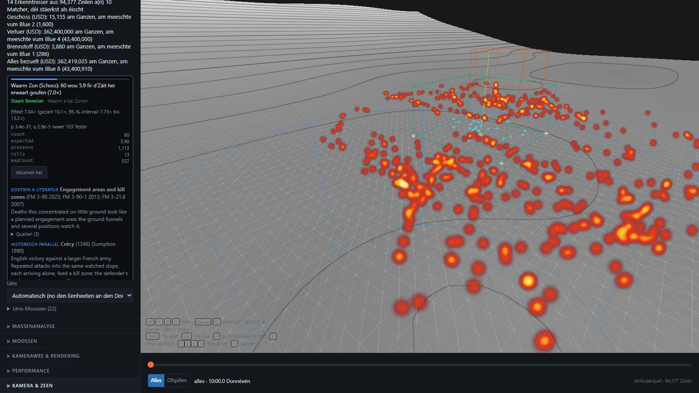

# D'Wëssenslens

Wann [Erkenntnisser](insights.md) eppes fonnt huet, erkläert dësen Deel et mat Iddien aus der Militärgeschicht, dem Spilldesign an der Sportanalys, a nennt d'Buch oder d'Studie, wou se hierkommt. Benotzt en, fir *firwat* e Muster wichteg ass, net nëmmen, datt et et gëtt.

## Probéiert et {#try-it}

1. Ladet Daten a maacht **Erkenntnisser** op, da dréckt **Erkenntnisser fannen**.
2. Klickt op e Fund, fir en opzemaachen.
3. Liest **Doktrin a Literatur** an **Historesch Parallel**; d'vollstänneg Quellen si drënner ageklappt.
4. Änneren **Lëns** (zum Beispill op *Militär-Doktrin*), fir dee selwechte Fund duerch en anert Literaturfeld ze liesen.

## Wéi et funktionéiert {#how-it-works}

De Panel Erkenntnisser beurteelt seng Fonnt, wéi en Analyst vum Fach dat machen géif: duerch Militär-Doktrin a Operatiounsfuerschung, historesch Gefechter, an d'Literatur iwwer Spilldesign, Leveldesign a Analyse. Dat geschitt offline, aus enger ausgewielter Wëssensbank am Viewer, an dee selwechte Stoff gëtt engem externen Modell mat, wann dat Modell d'Zesummefaassung schreift.

## Wat de Panel weist {#what-the-panel-shows}

- **Lëns** wielt d'Literatur, duerch déi d'Fonnt gelies ginn: *Auto* (no den Aarte vun Eenheeten an den Donnéeën: Fligeren, Schëffer, Gefierer, Infanterie), *Militär-Doktrin*, *Loftkampf*, *Marine*, *Stadkampf*, *Spill-Design a Balance*, *E-Sport*. Eeler, déi net zu der gewielter Lëns gehéieren, bleiwen draussen.
- All opgemaachte Fund weist säin noosten Agank aus **Doktrin a Literatur** an säin noosten **Historesch Parallel**, mat den vollstännegen Quellen ageklappt drënner.
- **Lëns-Moossen** listt d'Miessunge vun der Operatiounsanalys op, déi aus de selwechte Zeilen berechent goufen (hei drënner), all mat deem, wat se bedeiten, an hirer Literatur.
- **Zesummefaassung** setzt Zeilen fir déi féierend Fonnt an d'Lëns-Moossen bäi: "Doktrin a Literatur: ..." an "Historesch Parallel: ...", jiddereng mat Zitater Autor-Joer a den ageklappte Quellen drënner.
- **Mat KI schreiwen** schéckt déi relevantst Agänge (Zesummefassung, Lektioun, d'Fonnt, déi se betreffen, vollstänneg Quellen) mat dem Bericht, a bieet dem Modell un, se mat hirer ID ze zitéieren - `{concept.lanchester-square}` - a keng aner Quelle ze benotzen.

D'Etiketten sinn iwwersat; d'Wëssen selwer ass op Englesch.

## Lëns-Moossen {#lens-metrics}

Berechent am Erkenntnis-Worker, an dem selwechten Duerchgang duerch d'Zeilen wéi d'Erkennungsfunktiounen (`src/insights/lensMetrics.ts`). All gëtt weggelooss, wann d'Donnéeën se net droen.

| Moossung | Wat et misst | Brauch |
|---|---|---|
| Lanchester-Passung | All Säit hir Verloschter pro 20 s, zréckgerechent op déi lieweg Stäerkt vu béide Säiten (Poisson, Quasi-Likelihood-Feeler); d'Exponente bei eegener an Gegner-Stäerkt, getest géint de Quadratgesetz (gezielt Feier) an de linearen Gesetz (Flächenfeier) | Zäit, Equipen, Killen a Doudesfäll |
| Austauschverhältnis | Killen pro Doud pro Säit an no Plaz; den Undeel vun den Dout op dem gefährlechsten Buedem, deen 5 % vun der Zäit hält, am Verglach mat deem Undeel, deen de Zoufall bei deene Dout allen gëtt; Gini vun den Dout iwwer d'Zäit; Moran's I vun den Doudesquoten | Killen a Doudesfäll |
| Lokale Kraaftverhältnis | Eegen an Gegner-Eenheeten, déi bannent der Engagementsdistanz vun all Kill liewen (d'Distanz aus de Daten: zweemol de Medianofstand zum nächste Gegner); den Undeel vu Killen duerch déi lokal iwwerleeën Säit, a seng Iwwerleeënheet iwwer dat, wat d'Zuelen allee virausgesot hätten | Zäit, Equipen, Persounen |
| Feuerfelder | Siichtfelder vun de beschäftegsten Killplazen op enger 2,5D-Hindernissflächt (Levelgeometrie bis Mauerhéicht, oder de begaangene Buedem) géint de Duerchschnëtts-Plaz, an d'Rankkorrelatioun vu Siicht an Killundeel | Positiounen; e gelueden Level mécht et méi scharf; net fir d'Loft |
| Energiezoustand | Spezifesch Energie (Héicht plus d'Héicht, déi d'Geschwindegkeet kafe kann) vu Loftkiller an Loftoffer, verglach mat der Mann-Whitney-Statistik | Fligerklassen, Zäit, Héicht |
| Schlësselterrain | Wéi oft all Plaz ënnert den dräi beschäftegsten Killplazen vun engem Match ass | e puer Matcher |
| Géigesäiteg Ënnerstëtzung (Austausch) | Dout, op déi e Matebierder mat engem Kill an der Engagementsdistanz an 5 s äntwert | Zäit, Equipen |
| Éischte Schlag | Engagementer - Killen, no Match gruppéiert, no 20 s Rou an no dräi Engagementsdistanzen - gewonne vun der Säit, déi als éischt getraff huet | Zäit, Equipen |
| Salvenmodell | Hughes' Salvengleichung, un 20-s-Perioden vu Schëffer am Kontakt ugepasst: Schëffer, déi pro Ugräifschëff aus dem Gefecht geholl ginn, a gerett pro Verteidegungsschëff; eng Lanchester-Passung nëmme fir Schëffer | Schëffsklassen, Zäit, Equipen |
| Gefechtswierksamkeet | Killen pro Eenheet-Stonn am Gefecht pro Säit an d'Verhältnis vun den zwee gréissten (e Gefechtswierksamkeets-Wäert am Dupuy-Sënn) mat sengem 95-%-Intervall, an all Säit hiren Undeel u Killen bei gläichen lokale Zuele | Zäit, Equipen |
| Engagementsdistanzen | Distanz zum nächste Gegner bei Killen, bei Starts an bei dem éischte Schoss vun all Liewen (Entdeckung bis Engagement), no Aart vun der Eenheet | Zäit, Equipen; Starts, wou d'Daten se hunn |
| Killkette | Sekonnen vum leschte Start vum Killer bis zum Kill, an vum éischte Schoss vum Gefecht bis zum Kill | Zäit; Starts oder Schoss-Eventer |
| Konzentratioun oder Zerstreiung | An all 20-s-Period d'Streuung vun de zwee gréisste Säiten an den Undeel vun de Killen, déi déi méi enk Säit geholl huet | Zäit, Equipen |
| Sortien | Pro Säit: Sortien (Start vun de Fligeren oder Fligerspawns), Landungen, verluer Fligeren an Killen duerch Fligeren; Verloschtquot a Killen pro Sortie | Fligerklassen; Starts oder Spawns |

Daten mat Ronnen fügen d'Nahkampf- an d'E-Sport-Moossunge derbäi - Rondgewënn-Wahrscheinlechkeet, Wäert vun Aktiounen, Ufangsduelle, Austausch, Peeker géint Holder, Zilen, Kräizfeier, Hëllefsmëttel, Mannvirdeel, Clutches, Opstellungen, Post-Plant, déidlech Trichter a Spiller-Afloss: kuckt [Nahkampf a Ronnen](close-quarters.md).

Spuren a Equipen fügen d'Moossunge vum kollektiven Verhalen aus der Massewëssenschaft, dem kollektiven Bewegen, der Verhalenswirtschaft an der Militärpsychologie derbäi - Ausriichtung an Ëmkreesen, Routen-Herding, Gäng a Spuren, Gedréng, Leader a Follower, Nachzügler, den Bréchpunkt, Risiko nom Verloscht, Serien, Kafvereinbarung a Ënnerdréckung, all géint säi eegent Null-Modell: kuckt [Kollektivt Verhalen](collective-behaviour.md).

Waffen, Lockvillen a Gebaier ginn net als Eenheeten gezielt. Wann Waffenzeilen hiren Startende Eenheet nennen (eng `Shooter`- oder `Launcher`-Kolonn, wéi se Tacview-erofgeleeten Donnéeën hunn), gëtt de Start där Eenheet gutgeschriwwen, a Numm oder Objekt-ID passen.

## Wéi d'Fonnt op d'Literatur trëfft {#how-findings-meet-the-literature}

Agänge an Fonnt treffe sech iwwer eng **Muster-Taxonomie** (`src/insights/knowledge/patterns.ts`): Konzentratioun, lokal Iwwerleeënheet, gezielt an Flächefeier, Engpässer, Killzonen, Feuerfelder, Hannerhangstellung, Flanken, géigesäiteg Ënnerstëtzung, Energievirdeel, Spawn-Drock, Balance a sou weider. All Erkennungsart an all Lëns-Moossung seet, wéi Muster hir Zuelen weisen (`src/insights/lens.ts`); all Wëssenseentrag seet, wéi Muster en ugeet, mat engem Gewiicht. D'Relevanz vun engem Agank fir e Fund ass d'gewiichte Iwwerlappung, skaléiert no wéi gutt d'Domän vum Agank (Land, Loft, Mier, Stad) zu den Donnéeën passt, an no der eegener Stäerkt vum Fund. D'Begrënnung, déi gewisen gëtt, ass d'Zuele vum Fund a engem Saz, gefollegt vun der Lektioun vum Agank.

## Katalog {#catalogue}

All Muster, Konzept, Method, historesche Fall, Designprinzip a Studie, mat der Bibliographie: kuckt de [Wëssenskatalog](knowledge-catalogue.md).

## Fir d'Entwéckler {#for-developers}

### Agänge derbäisetzen {#adding-entries}

1. Wielt d'Datei no der Aart: `concepts.ts` an `concepts-more.ts`, `methods.ts`, `cases.ts`, `cases-land.ts`, `cases-air-sea.ts`, `cases-esports.ts`, `design.ts` (Designprinzipien) oder `studies.ts` an `src/insights/knowledge/`.
2. Gitt him eng nei ID `<type>.<slug>` (ni eng alt benotzen), seng Lënsen, Domänen, a d'Muster, déi e bedréit, mat Gewiichter 0..1. Setzt e Muster nëmmen an `patterns.ts`, wann e Fund en weise kann, a verbanne en an `lens.ts` mat engem Fund oder enger Moossung.
3. Schreift d'Zesummefaassung an d'Lektioun **a Ären eegenen Wieder**. Zitater nëmme vu gemeinfräie Wierker (`pd: true` an der Quell), a kuerz.
4. Zitéiert: setzt all nei Wierk an `refs.ts` mat Autoren, Joer, Titel an Verlag (Zäitschrëft mat Band a Säiten); eng URL oder DOI, wann et e ëffentlechen Eintrag gëtt.
5. Lafft `npx vitest run src/insights/lens.test.ts` (eendeiteg IDen, bekannten Muster, lafend Quellen, gemeinfrei Zitater, Fäll mat Datum an Ausgang) an `node tools/knowledge-doc.mjs`, fir de [Katalog](knowledge-catalogue.md) opzefrëschen.
