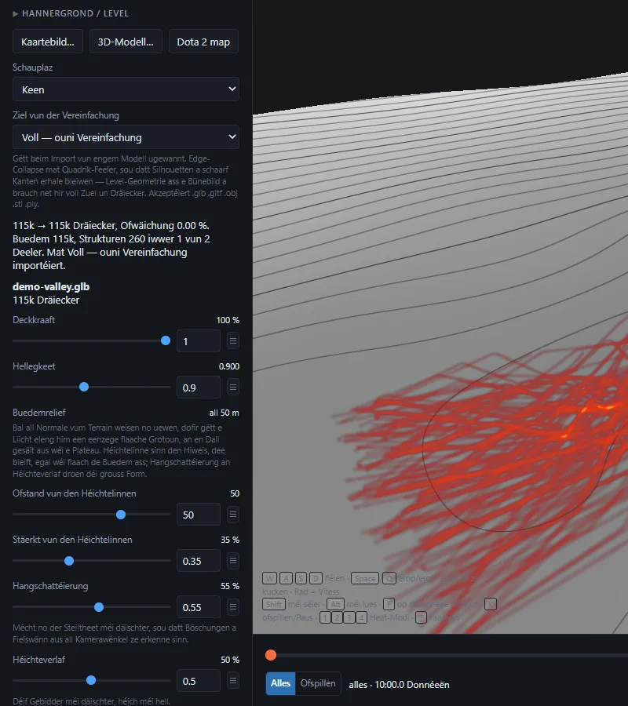

# Levelen a Hannergrond-Geometrie

E Level ass den 3D-Ort, wou d'Spill stattfonnt huet - eng Kaart, eng Stad, eng Piste. Setzt een hannert Är Daten, da gesäit ee, *wou* d'Hëtzt ass. D'Panel **Hannergrond / Level** (kuckt [Glossar](glossary.md) fir "Level") gëtt Iech dräi Aarte vun Zesummenhang:

- e **Kaartebild**, mat zwee Ankerpunkte georeferenzéiert - kuckt [Kaartebiller](map-images.md);
- e **3D-Level** - `.glb`, `.gltf`, `.obj`, `.stl` oder `.ply` - opgedeelt an Buedem, Strukturen a Waasser a beim Import vereinfacht - kuckt [3D-Levelen](model-levels.md) a [Level-Ausgesinn](level-appearance.md);
- eng **richteg Welt als Hannergrond** - fir eng Opnam, déi seet, wou se op der Äerd ass (eng Tacview-ACMI-Datei), dat echt Terrain, d'Stroossen, d'Waasser, d'Fluchhäfen a Gebaier, aus oppenen Daten geluet - kuckt [Richteg Welt als Hannergrond](world-backdrop.md).

Wann näischt gelueden ass, ass d'Szen däischter mat engem Gitter an faarwege Achsen (**Gitter** an **Achsen** an [Kamera a Szen](camera.md)), a d'Panel seet *Näischt gelueden - d'Szen weist en Gitter an Achsen. Setzt en Kaartebild oder en Levelnetz derbäi, fir der Hëtzt en Ëmfeld ze ginn.*

De Level gëtt vun all dräi Reider gedeelt: en Trajet, dee am Reiter Rennanalyse gelueden ass, ass dee selwechte Level, dee d'Hëtztkaart weist.

## E Level hannert Är Daten setzen {#put-a-level-behind-your-data}

1. Lued als Éischt Är Daten ([Daten lueden](getting-data-in.md)), sou datt de Level derno passt.
2. Maacht **Hannergrond / Level** an der Säitelleescht op.
3. Drëckt **Kaartebild…** fir e Bild oder **3D-Modell…** fir en 3D-Level, a wielt d'Datei aus. Fir eng Opnam aus der richteger Welt benotzt **Richteg Welt als Hannergrond** oder **Schauplaz**.
4. Waart, bis d'Fortschrëttszeil fäerdeg ass. E grousst Modell gëtt als Éischt vereinfacht (kuckt **Ziel vun der Vereinfachung** hei ënnen).
5. Drëckt **F** an der Usiicht, fir alles an de Rumm ze bréngen. Benotzt **Deckkraaft** an **Hellegkeet**, bis d'Hëtzt sech vum Level ofhieft.
6. Drëckt **An der Bibliothéik späicheren**, wann Dir de Level nach eng Kéier benotzt ([Level-Bibliothéik](level-library.md)).

## Wat e Level fir d'Hëtzt mécht {#what-a-level-does-for-the-heat}

- Et **verdeckt**: Dateepunkte hannert him ginn nach Fläch fir Fläch gedämpft, an Dateepunkte hannert dem Terrain sinn verstoppt ([Déift a Ofstandsgrenzen](depth-and-culling.md)). Ouni Level gëtt et keng Verdeckung.
- Et gëtt vum [Schnitt](slice.md) geschnidden an, mat *De Level och schneiden*, vun [Ofstandsgrenzen](depth-and-culling.md#distance-culling), zesumme mat der Hëtzt.
- Et ass dat eenzegt, wat [Tiefeschäerf](camera.md#depth-of-field) verschwemmt, nieft dem Gitter an de Këschte.
- E 3D-Level **verbreet d'Fernebene vun der Kamera**, wann en méi grouss ass wéi d'Daten: Nooer- an Wäitebene ginn aus den Daten kalibréiert, an eng exportéiert Kaart vu Kilometer Breet wier soss ganz hannert der Fernebene an d'Usiicht bléif eidel. D'Fernebene gëtt 3 × d'horizontal Ausmooss vum Level, wann dat méi grouss ass, d'Nooerebene geet matgeholl (mindestens Wäit / 100.000), fir d'Déiftpräzisioun ze halen, vun där d'Verdeckung hänkt, an d'Fluggeschwindegkeet gëtt op mindestens Ausmooss / 12 eropgesat. Et gëtt ëmmer nëmmen verbreet, ni verengt.

## D'Panel vun uewen no ënnen {#the-panel-top-to-bottom}

| Deel | Detailer |
|---|---|
| **Kaartebild…**, **3D-Modell…** | Ee lueden; et ersetzt den aktuelle Level. |
| **Richteg Welt als Hannergrond**, **Kaartekachele vergiessen** | Nëmmen fir en Datesaz mat engem geografeschen Ëmfeld: de richtege Standuert drënner als Level bauen, oder d'erofgeluechte Kaachelen läschen. [Richteg Welt als Hannergrond](world-backdrop.md) |
| **Ziel vun der Vereinfachung** | D'Dräieckbudget fir de nächsten Modellimport: *Voll - keng Vereinfachung* (Standard), *Héich - 8M*, *Mëttel - 3M*, *Niddreg - 800k*, *Silhouette - 100k*. [3D-Levelen](model-levels.md#simplification) |
| Fortschrëtt an **Ofbriechen** | Wärend et dekodéiert oder importéiert gëtt. |
| Import-Notiz | Dräiecker virdrun an derno, d'Opdeelung an Buedem / Strukturen / Waasser, de Detailgrad, dee benotzt gouf. |
| Numm a Gréisst | `Breet×Héicht px · x × z m/px` bei engem Bild, `N Dräiecker (vun M)` bei engem Modell. |
| **Deckkraaft**, **Hellegkeet** | Bei béide Zorte. |
| Bildreglage | **Entsättegen**, **Norden/Süden ëmdréinen**, **Placéierung** (zwee Ankerpunkte), **Un d'Grenz vun den Donnéeën upassen**, **Héicht**. [Kaartebiller](map-images.md) |
| Modellreglage | Buedemrelief, Waasser, Buedemdräiecker, Drotmodell, Textur, erfaasst Faarf, Strukturen, Deelklassifikatioun. [Level-Ausgesinn](level-appearance.md) |
| **An der Bibliothéik späicheren**, **Ewechhuelen** | [Level-Bibliothéik](level-library.md); Ewechhuelen lued den Level erof. |
| **Bibliothéik** | Levelen, déi an dësem Browser gespäichert sinn. [Level-Bibliothéik](level-library.md) |

## Säiten an dëser Sektioun {#pages-in-this-section}

- [Kaartebiller](map-images.md)
- [3D-Levelen](model-levels.md) - Formate, Deeler, Klassifikatioun, Vereinfachung, Texturen
- [Level-Ausgesinn](level-appearance.md) - all Reglage fir en 3D-Level
- [Level-Bibliothéik](level-library.md)
- [Richteg Welt als Hannergrond](world-backdrop.md) - d'richteg Welt ënner enger Opnam, aus oppenen Daten

Wéi een Levelen aus Spiller a Motoren kritt, ass d'Aufgab vun den eenzelne Exporter-Werkzeuger (kuckt [README](https://github.com/Holdi601/3DHeat/blob/main/README.md) vum Repository); de Vertrag, an deen se schreiwen, ass a [3D-Levelen](model-levels.md#the-exporter-contract) zesummegefaasst.
