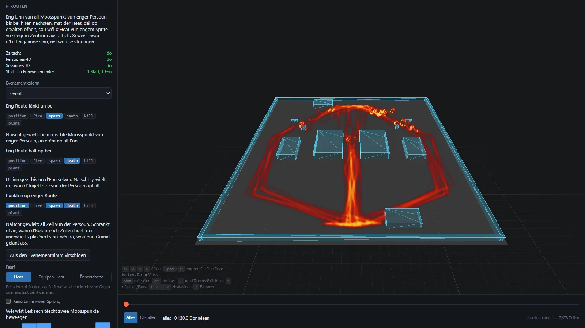

# Linn-Hëtzt

Hëtzt weist, wou d'Leit gestanen hunn. Linnen weist d'Weeër, déi se gaange sinn.

**Linnen** (Tast 4) ass Linn-Hëtzt: eng Linn vun all Probe vun enger [Persoun](glossary.md) bis zu hirer nächster, mat dem selwechte Offall, deen e [Sprite](glossary.md) huet - iwwer d'Linn statt ronderëm e Punkt. Et weist, wou d'Leit *higaange* sinn, net wou se gestanen hunn: e Gang, deen eemol duerchgaang gouf, ass sou gutt ze gesinn wéi e Raum, wou eent gelaff huet, an déi wéineg Proben vun engem séieren Spiller verbannen sech zu enger duerchgehender Route statt enger gepunkter Spuer. Et brauch eng Persoun-Kolonn an eng Zäitkolonn.

## Wéi et benotzt gëtt {#how-to-use-it}

1. Dréckt `4` (oder wielt **Linnen** an der Modusleescht).
2. Maacht **Routen** op a kuckt d'gréng Checkliste: d'Zäitachs an d'Persoun-ID mussen do sinn.
3. Dréckt **Aus den Evenementnimm virschloen**, fir d'Stelle ze fëllen, wou d'Routen ufänken an ophalen.
4. Liest d'Statistik-Zeil: "N Routen, M dovun erreechen en Enn".
5. Wann Linnen iwwer d'Kaart sprangen, passt **Längste Schrëtt** un (kuckt [D'Sprong-Grenz](#the-jump-limit)).

Eng Linn ergëtt nëmmen Sënn zwëschen engem Ufank an engem Enn. Dofir seet de Panel **Routen**, wat eng Route begrenzt. Alles aus [D'Reegelen vun enger Route](#the-rules-of-a-route) un ass Detail, dat Dir iwwersprange kënnt.

## De Panel Routen {#the-routes-panel}

Gewisen iwwer den Hëtzt-Panelen am Linnen-Modus.

### Wat d'Daten hunn {#what-the-data-has}

Eng Checkliste, gréng wann do, orange wann net:

| Linn | Zoustänn |
|---|---|
| **Zäitachs** | *do* / *fehlt - gebraucht* |
| **Persounen-ID** | *do* / *fehlt - gebraucht* |
| **Sessiouns-ID** | *do* / *keng - all Zeilen si just eng Sessioun* |
| **Start- an Ennevenementer** | *N Ufäng, M Enn* / *keng ausgewielt - ganz Spuren* (nëmmen gréng mat enger Evenementkolonn an op d'mannst engem Start an engem Enn) |

### Steierelementer {#controls}

| Element | Bedeitung |
|---|---|
| **Evenementkolonn** | Eng Kategoriekolonn, deren Wäerter Evenementer sinn (Spawn, Doud, Positioun, ...). *Keng - ganz Spuren*: d'Spur vun all Persoun an all Sessioun ass eng Route, a gebrach, wou d'Spur e Lach huet. Nëmmen Kolonnen, déi beim Lueden fir de Filter bliwwen sinn, ginn ugebueden. |
| **Eng Route fänkt un bei** | Evenementwäerter, déi eng Route ufänken (Spawn, Respawn, Opstellung). Keng ausgewielt: eng Route fänkt bei der éischter Probe vun enger Persoun un, an nees nom all Enn. |
| **Eng Route hält op bei** | Evenementwäerter, déi eng Route ophalen (Doud, Evakuéierung, Teleport). D'Linn geet bis zu där Enn-Zeil selwer. Keng ausgewielt: eng Route hält do op, wou d'Spur vun der Persoun ophält. |
| **Punkten op enger Route** | Evenementwäerter, deenen hir Zeilen op der Route leien. Keng ausgewielt: all Zeil vun der Persoun. Engem enk maachen, wann d'Kolonn och Zeilen hält, déi anderswou leien, wéi wou eng Granat gelant ass. |
| **Aus den Evenementnimm virschloen** | Fëllt déi dräi Lëschten aus den Nimm vun de Wäerter (hei drënner). |
| **Faarf** | *Heat*, *Team heat* oder *Difference*. Déiselwecht Routen an der Faarwung vun deem Modus: all Grupp a senger eegener Faarf, oder eng Säit géint déi aner, mat der Gruppelëscht, der Opdeelung an de Faarwskalen, wéi se an deenen Modi funktionéieren. Standard *Heat*. Team heat an Difference brauchen eng Gruppekolonn. |
| **Keng Linnen iwwer Sprong** / **Längste Schrëtt** | Wann déi nächst Probe vun enger Persoun weider ewech ass wéi dat, ass dat e Respawn, en Teleport oder en Fall an net e Wee, wou se higaang ass; dann verbënnt keng Linn déi zwee. Beim Lueden ausgefëllt, wann d'Daten eng kloer Lücke weisen (hei drënner), a fort, wann net. Funktionéiert mat oder ouni Evenementkolonn. |
| Statistik-Zeil | `N Routen, M dovun erreechen en Enn, K Segmenter`, all puer Mol pro Sekonn neu. |

All Lëscht ass eng Rei vu Schalterchips, ee pro Wäert, dee heefegste fir. Wann Dir mat der Moss driwwer fuert, weist de Chip seng Zuel vu Zeilen. Héchstens 120 Wäerter ginn ugebueden (*N méi Wäerter net gewisen*).

Wann Dir eng aner Evenementkolonn wielt, gëtt de Virschlag ugewannt, wann de Virschlag déiselwecht Kolonn wielt; soss fänken d'Lëschte eidel un.

### De Virschlag {#the-suggestion}

Bei all Lueden an bei **Aus den Evenementnimm virschloen** ([`suggestLineSettings`](https://github.com/Holdi601/3DHeat/blob/main/src/data/lines.ts)):

- **Evenementkolonn:** déi éischt behalen Kategoriekolonn mat dem Numm `event`, `eventname` oder `eventtype`; soss `kind`, `type` oder `action`; soss all, déi *event*, *kind*, *action* oder *type* enthält.
- **Ufänk:** Wäerter, déi *spawn, deploy, join, enter, start, begin, respawn, revive, land/landed/landing, drop* enthalen - ausser si enthalen och e Enn-Wuert.
- **Enn:** Wäerter, déi *death, died, dead, kill/killed, eliminat…, extract, evac, teleport, leave, left, disconnect, quit, exit, end, finish, downed* enthalen - ausser de Wäerter `kill` an `kills` (e Killer mécht e Kill, dat ass kee Enn vu senger Route).
- **Punkten:** Wäerter, déi exakt *position, location, player location, move, movement, tick, sample* oder *pos* sinn; wann e gefonnt gëtt, kommen d'Ufänk an d'Enn och bei d'Punkten. Wann keen gefonnt gëtt, bleiwen d'Punkten eidel (all Zeil).

### D'Sprong-Grenz {#the-jump-limit}

Wou d'Leit springen, falen d'Längten vun de Schrëtt an zwou Gruppen, tëscht deenen praktesch näischt ass: wat eng Persoun tëscht zwou Proben zréckleet, a wéi breet d'Kaart ass. Beim Lueden ([`suggestMaxJump`](https://github.com/Holdi601/3DHeat/blob/main/src/data/lines.ts)) gi d'Schrëtt pro Verdoppelung vun hirem Quadrat gezielt, bis zu 16 Millioun, an d'Grenz kënnt an d'Mëtt vun der éischter Rei iwwer dem Median, déi op d'mannst eng Verdoppelung vun der Längt breet ass, ënner 0,02 % vun de Schrëtt pro Beräich hält, a Schrëtt drdriwwer huet. Gëtt et keng sou Rei, gëtt näischt geschnidden, well ee dann e Sprong net vun engem schnelle Auto kann ënnerscheeden; Wann Dir d'Grenz Hand setzt, fänkt se dann bei engem Zéngtel vun der Diagonal vun de Daten un.

D'Grafik iwwer der Grenz weist, wéi laang d'Schrëtt wierklech sinn, mat enger Linn bei der Grenz: d'Balken rechts dervun ginn net gemoolt. Béid Achsen sinn logarithmesch, well d'Sprénge hunnert Mol kleng sinn wéi d'Schrëtt, an dausend Mol sou laang. Fuert mat der Moss iwwer e Balken, fir säin Beräich an säin Undeel ze gesinn; klickt op d'Grafik, fir d'Grenz dohinner ze setzen. Drënner steet den Undeel vun de Schrëtt iwwer der Grenz.

## D'Reegelen vun enger Route {#the-rules-of-a-route}

D'Zeilen ginn an der Zäitreiefolleg duerchgaangen, pro Persoun ([`buildLines`](https://github.com/Holdi601/3DHeat/blob/main/src/data/lines.ts)):

1. Zeilen mat engem [gemeinsame Numm](sessions-persons-groups.md#names-worn-by-several-things-at-once) ginn ganz iwwersprongen.
2. Wann Punkten ausgewielt sinn, gëtt eng Zeil, déi weder en Ufank, en Enn nach e Punkt ass, iwwersprongen.
3. D'Zeilen ginn pro Persoun an pro Sessioun verfollegt, sou datt eng Persoun, deren Sessiounen an der Zäit ineneen lafen, an all eng Route huet. Eng Route gëtt zougemaach, wann d'Zeile virdrun keen Nofolger hat (hir [Liewensdauer](sessions-persons-groups.md#person) ass "keng") - eng Route geet ni iwwer eng Sessiounsgrenz oder eng Lücke, déi d'Lueden als ouni nächst Probe entscheet huet. Op welcher Route eng Zeil sëtzt, gëtt eemol ausgerechent a behalen, 4 Byte pro Zeil, sou datt eng Ännerung vun der längster Schrëtt dee Schrëtt net nei mécht.
4. E **Ufank**-Zeil mécht all oppe Route zou a fänkt do eng nei un.
5. Wann Ufänk ausgewielt sinn, gëtt eng Zeil ausserhalb vun enger Route ignoréiert. Ouni Ufänk fänkt all Zeil ausserhalb vun enger Route, déi kee Enn ass, eng Route un.
6. All aner Zeil bannent enger Route bäidréit en **Segment** vun der virdrun Zeil vun der Route bis zu dëser.
7. Eng **Enn**-Zeil, déi eng Route verlängert, mécht se no hirem Segment zou; déi Route zielt als *erreecht en Enn*.
8. E Schrëtt, deen méi laang ass wéi **Längste Schrëtt**, mécht d'Route do zou, wou se war, an eng nei Route fänkt um anere Enn un, ausser déi Zeil ass en Enn. Iwwer en gëtt keng Linn gezeechent, an d'Statistik-Zeil zielt en.

All Segment gëtt op senger *Enn*-Zeil gespäichert, sou datt d'Segmenter an der Zäitreiefolleg bleiwen, an d'[Zäitlinn](timeline.md)-Fënster, de Sampler, d'[Filteren](filters.md), d'Gruppesichtbarkeet an d'Vorzeeche vum Ënnerscheed mat hinnen all wéi mat de Punkten schaffen. E Filter gëtt also op d'Zeil ugewannt, bei där e Segment endegt.

## Ofspillen {#playback}

Am **Alles**-Modus gëtt all Route ganz gemoolt. Am **Ofspillen**-Modus ass all Persoun e Punkt, deen tëscht hiren Proben wandert, an hiert Wee zitt sech hanner hir:

- e Segment, dat nom Playhead ufänkt, gëtt net gemoolt;
- dat Segment, an deem d'Persoun grad ass, gëtt bis zu hirer interpoléierter Positioun gemoolt, mat engem Enn-Dëppchen um Kapp;
- d'Hëtzt verbléckt laanscht de **Schwanz**: mat der *Kumulativ*-Geschicht bleift de Schwanz onbegrenzt, an déi ganz Route bis elo bleift; mat *Fënster* verschwënnt en iwwer d'*Spann* (Standard 30 s). Mat *Liewensdauer* ass de Schwanz och d'*Spann*, an am Linnen-Modus weist d'Zäitlinn fir déi Geschicht de Kaseg *Spann* (amplaz *Réserv-Lieweszäit* an *Verblosse*, déi d'Linn-Hëtzt net benotzt).

Beim Ofspillen gëtt all Frame ganz gemoolt, net ugesammelt, well d'Käpp sech all Frame beweegen, an e beweeglechen Duerchschnëtt géif all op eng Schlaang zéien.

## Fir d'Entwéckler {#for-developers}

### Späicher {#memory}

D'Routen ginn am Haaptthread gebaut, wann de Linnen-Modus ugeet (oder d'Route-Astellungen sech änneren), an fräigemaach, wann een en verléisst: 5 Byte pro Zeil am Späicher an 8 Byte pro Zeil op der GPU (d'Ufangsposition vun all Segment, op 16 Bit pro Achs an der Begrenzungsbox vun den Daten quantiséiert, an hir Flaggen).

### Wéi eng Linn gezeechent gëtt {#how-a-line-is-drawn}

Béid Backends zeechnen all Segment vun senger Enn-Zeil aus als **18 Vertices** ([`lineHeatVs`](https://github.com/Holdi601/3DHeat/blob/main/src/render/webgl2/shaders.ts) an säi WGSL-Zwilling):

- Déi halleg Breet an all Enn ass de [Sprite-Radius](sprite-shape.md#sprite-radius) op där Enn senger Distanz, mat den Pixel-Grenzen ugewannt. Eng Linn méi schmuel wéi 2,5 px gëtt 2,5 px breet gezeechent, mat der Hëtzt erof gerechent, sou datt dënn Linnen weder verschwannen nach hell ginn.
- D'Hëtzt verbléckt **iwwer** d'Linn mat der selwechter Rampe wéi e Sprite - Verbléckung oder Kurv, Zentrums- an Randintensitéit.
- Rond Enden ginn **nëmmen** gezeechent, wou eng Route ufänkt oder endegt, sou datt d'Verbindungen tëscht opaneen-folgende Segmenter net wéi eng Perlekette ausgesinn.
- D'Geometrie gëtt am Bildschierm gebaut a just do linear interpoléiert, sou datt de Verbléck op der Linn zentréiert bleift, egal wéi se an d'Déift leeft. E Segment, dat d'Nopeschtsebene schneit, gëtt do ofgeschnidden statt fortgeworf.

Punkt-Hëtzt a Linn-Hëtzt leeën pro Zeil ganz verschidde Mengen Hëtzt, dofir gëtt d'Sättigung nei gemooss, wann Dir tëscht beiden wiesselt ([Faarf a Belichtung](colour-and-exposure.md#auto-exposure)).
