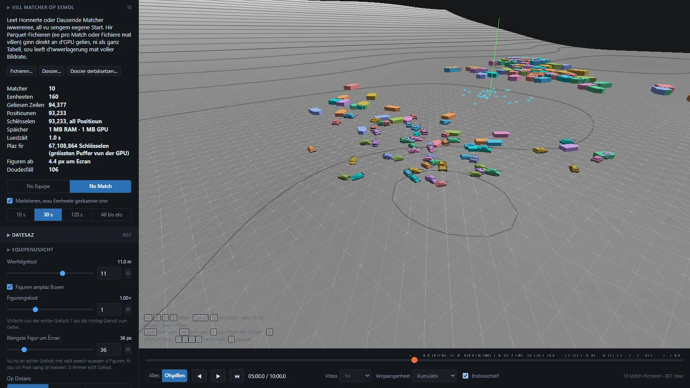

# Vill Matcher op eemol

**Vill Matcher op eemol** spillt ganz vill Matcher iwwer- an ëwwer eneen of, sou datt Dir gesitt, wou all Match seng Spiller normalerweis hirt. Benotzt en, fir Honnerte oder Dausende Matcher a engem eenzege Bild ze vergläichen.

All Match fänkt op sengem eegene Ufank un, an seng Eenheete beweegen sech als Figuren. D'Dateie goen direkt an d'Grafikkaart, an et gëtt keng ganz Tabell gebaut, sou datt et glätt leeft, wou e normalt Lueden op wéineg Späicher stéisst.

## Wéi een et benotzt {#how-to-use-it}

1. Maacht **Vill Matcher op eemol** an der Heatmap-Säitelleescht op.
2. Drëckt **Fichieren…** (vill Dateien wielen), **Dossier…** (e Dossier an seng Ënnerdossieren) oder **Dossier derbäisetzen…** (derbäi zu deem, wat gelueden ass).
3. De Viewer wiesselt op de Figuren-Overlay a fänkt um Ufank un. Drëckt **Ofspillen**.

All Datei ass ee Match (oder hält méi). Parquet-Dateien an [`.3dheat`](container.md)-Container funktionéieren. Eng Datei brauch eng Positioun, eng Zäit an eng Eenheetekolonn; Nimm- an Equipe-Kolonnen bleiwen. Anerer Dateien an d'Nebendateien vun de Konverter (Flug, Noriichten, Evenementer, Chat, Ziler) ginn iwwersprongen. Fir eng normal Tabell kuckt [Daten astellen](getting-data-in.md).

## Astellungen {#settings}

| Astellung | Wat et mécht |
|---|---|
| **No Equipe** / **No Match** | Faarwen no Säit, oder eng Faarf pro Match. |
| **Markéieren, wou Eenheete gestuerwe sinn** | Eng Marke, wou all Eenheet gestuerwe ass, fir 10 s, 30 s, 120 s, oder all bis elo. |

De Panel weist, wéivill Matcher, Eenheeten, Zeilen a Positiounen gelies goufen, de Späicher, deen benotzt gouf, an d'Ladezäit. *Plaz fir* ass, wéivill méi Positiounen d'Grafikkaart nach kéint huelen. *Figuren ab* ass d'Gréisst um Écran, ënner där eng Eenheet als kleng Pfeil gezeechent gëtt amplaz vun hirer Figur.

D'Ausgesinn vun de Figuren benotzt déiselwechte Steierungen wéi de [Match-Replay](match-replay.md#figures): **Figurengréisst**, **Klengste Figur um Écran** an **Op Distanz**.

## Tipps {#tips}

- Wann alles am Späicher net géif passen, ginn d'Positiounen ausgedënnt (nëmme all puer Meter eng Positioun bleift), an de Panel seet dat.
- D'Hëtztmodi funktionéiere och mat den Daten vum Overlay.
- Fir Statistiken iwwer Dausende Matcher ouni se ze zeechnen, kuckt [Massenanalys](mass-analysis.md).
