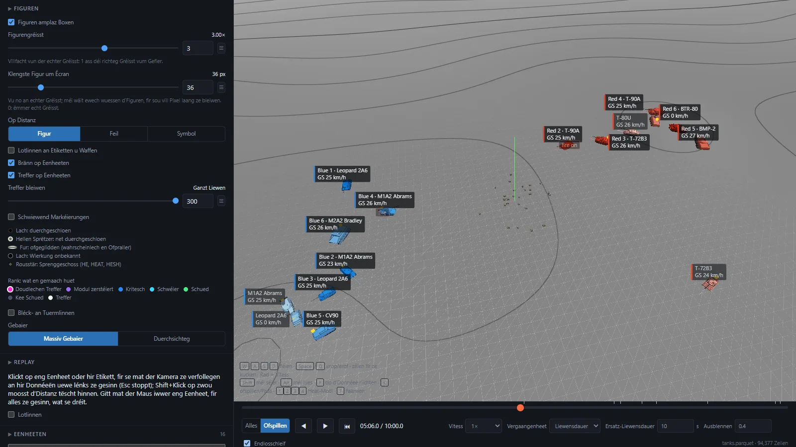
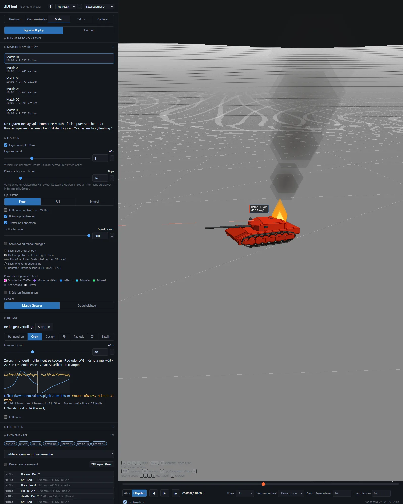
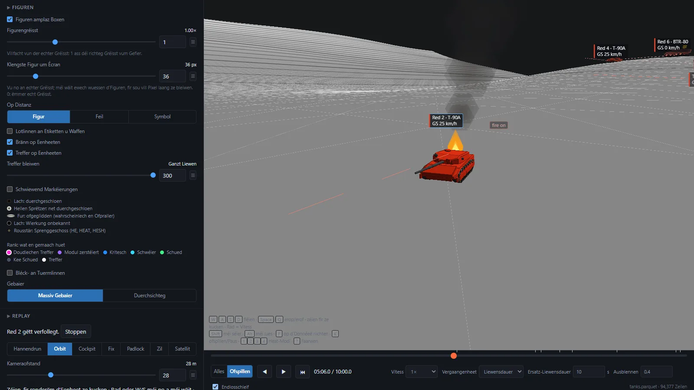
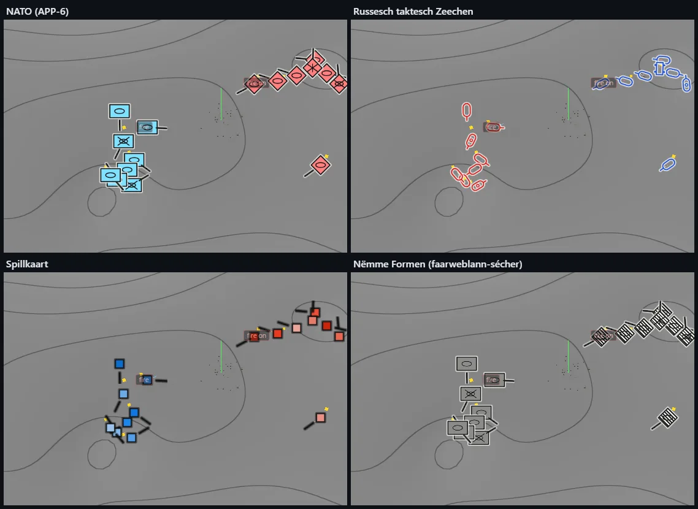
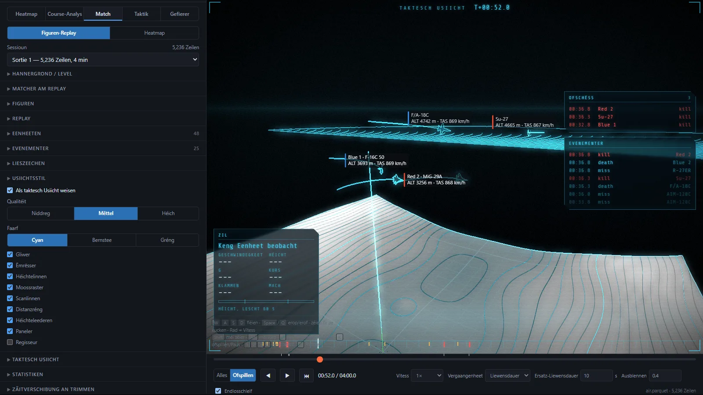
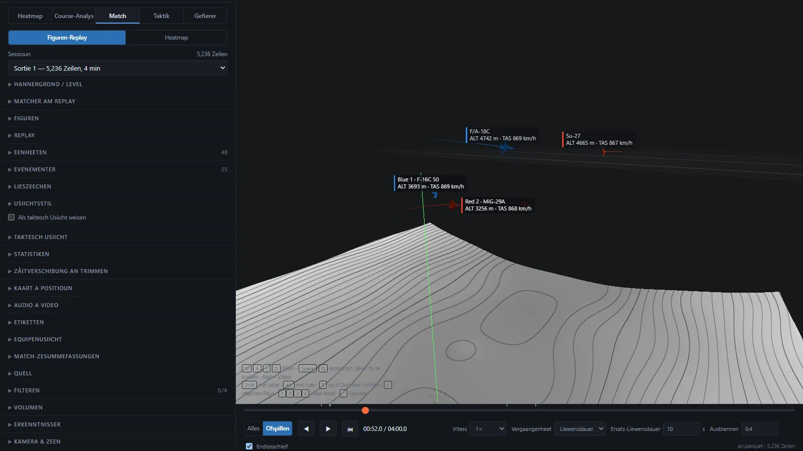

# Match-Replay

De Replay ass e Film vum Match, wou all Spiller als dat gewise ginn, wat si gefuer hunn. Benotzt en, fir e Gefecht nach eng Kéier ze kucken, eng Eenheet ze verfollegen an ze gesinn, wiem wien getraff huet.

Schëss, Treffer, Bränn a Wracks ginn op den Eenheeten a Ziler vum Level gezeechent. Kameraen, Beschrëftungen an eng taktesch Usiicht hëllefen Iech, de Kampf ze liesen. Kennt Dir Tacview? [Tacview-Parität](tacview-parity.md) weist, wou all seng Werkzeuge sinn.

## E Replay starten {#start-a-replay}

1. Lued eng Opnam mat **Source → Files…** oder andeems Dir se op d'Source-Panel zitt (all Tabell mat enger **person**- an enger **time**-Kolonn, eng Tacview-Datei, en ëmgewandelt Replay, e [`.3dheat`](container.md)-Match). Kuckt [Daten lueden](getting-data-in.md).
2. Maacht de Reiter **Match** op a wielt **Figuren-Replay**, oder wielt **Figuren-Overlay** an der Modus-Leescht vum Reiter Heatmap.
3. Ënner **Matcher am Replay** wielt ee Match, all op eng Kéier oder e puer.
4. Drëckt **Ofspillen** op der Zäitlinn (oder `K`). Zitt d'Zäitlinn, fir ze sprangen.

Figuren ersetzen d'Boxen fir all Eenheet, deem säi Numm oder säi Typ bekannt ass (kuckt [Figuren](figures.md)). Daten ouni Numm- oder Typ-Kolonn ginn als Zaldoten gezeechent.

## Figuren {#figures}

| Astellung (Sektioun **Figuren**) | Standard | Wat et mécht |
|---|---|---|
| **Figuren amplaz Boxen** | un | Aus zeechent einfach Boxen. |
| **Figurengréisst** (Mal déi richteg Gréisst) | 1 | 1 ass déi richteg Gréisst; 0,25 bis 20 Mal (logaritmesch Skala). Méi grouss hëlleft vu wäit ewech. |
| **Klengste Figur um Écran** | 36 px | Weit ewech Figuren wuessen, fir sou laang ze bleiwen, 0 bis 200 px; 0 hält déi richteg Gréisst. |
| **Op Distanz**: Figur, Pfeil, Symbol | Figur | Wat eng wäit Eenheet gëtt. |
| **Symboler** | NATO (APP-6) | NATO (APP-6), russesch taktesch Zeechen, **Spillkaart**-Symboler, oder **Nëmme Formen (faarweblann-sécher)**. |
| **Symbolgréisst**, **Meng Säit**, **Feindlech / Neutral**, **Kursstrécher** | 28 px (12 bis 64), automatesch, feindlech, un | Wéi d'Symboler ausgesinn an wat d'Frëndlech ass. |
| **Lotlinnen** | un | Eng Linn vun all Eenheet direkt erof op de Buedem, sou datt d'Héichte a 3D lescht ginn. |
| **Lotlinnen an Etiketten u Waffen** | aus | Linnen op de Buedem an Etiketten u Raketen an Bommen. |
| **Bränn op Eenheeten** | un | Flammen vun deem Moment un, wou eng Eenheet Feier fänkt, bis se geläscht ass. |
| **Treffer op Eenheeten** | un | Marken, wou d'Schëss getraff hunn (ënnen). **Treffer bleiwen**: 1 bis 300 Sekonnen, oder **Ganzt Liewen**. **Schwiewend Markéierungen**: Marken, déi iwwer der Uewerfläch gezeechent ginn. |
| **Bléck- an Tuermlinnen** | aus | Gestréchelt: wou de Spiller kuckt; voll: wou d'Kanoun zielt. |
| **Gebaier** | voll | Voll oder duerchsiichteg Gebaier, wann d'Level se molt. |

### Symboler op Distanz {#symbols-at-a-distance}

Wann eng Eenheet méi kleng wier wéi **Klengste Figur um Écran**, kann se en Symbol ginn, dat liesbar bleift. D'Form seet, wat fir eng Aart et ass (zum Beispill e ofgerënnte Kaschte mat enger Kette-Marik fir Panzerung); d'Faarf seet, op wéi enger Säit et ass. Mécht d'Menü **Symboler** op, fir de Stil z'änneren.

### Treffermarken, Wracks a Bränn {#hit-marks-wrecks-and-fires}

- **Treffermarken** sëtzen op der Fläch, wou de Schoss ukomm ass, an der Gréisst vun der Figur. Hiren Aspekt seet, wat geschitt ass: e Lach (ass duerchgaang), e hellen Spritzer (ass net duerchgaang), e Krazer (ass ofgerutscht), e Russ-Stär (Explosiounsschoss). E faarwege Rank seet, wat et gemaach huet: deelen Schoss, Modul zerstéiert, kritesch, schwéier, Schued, keen Schued, Treffer. Hält d'Maus iwwer eng Marke, fir den Numm vum Schoss ze gesinn.
- Eng zerstéiert Eenheet gëtt **verkuelt** als Wrack gezeechent, vum Dout un bis sech se erëm spawnt oder ewechgeholl gëtt; hiren Symbol ass duerchgestrach.
- **Bränn** brennen op enger Eenheet vum Moment un, wou se Feier fänkt, bis se geläscht ass.
- **Tuermer** dréinen sech dohinner, wou d'Daten soen, datt d'Kanoun zielt (oder, ouni dës Daten, wou de Spiller kuckt).

### Waffen, Lockmëttel an Tracer {#weapons-decoys-and-tracers}

Mat **Waffen, Schëss an Treffer** un (Sektioun Team-Zuschauer): Raketen, Rakéiten, Bommen a Torpedoen fléien als eege Figuren mat enger Rauchspur; Kugele a Granaten sinn Tracer; Eischléi a Explosiounen blëtzen. En Tracer, deen **gestréchelt** gezeechent ass, gouf aus engem Treffer erausgerechent, well d'Daten kee Schoss hatten. Fakelen a Chaff ginn als Lockmëttel gezeechent; se sinn an der Eenheetslëscht verstoppt, ausser *Lockmëttel a Granaten* ass ugeklickt.

## Kameraen {#cameras}

Klickt op eng Eenheet oder hir Beschrëftung, fir se ze **verfollegen**; d'Sektioun **Replay** bitt **Hannendrun**, **Orbit**, **Cockpit** (mat engem Head-up-Display, `H`), **Fix**, **Padlock**, **Zil** an **Satellit** un. `V` wiesselt se duerch, **Kameraofstand** setzt, wéi wäit. `Esc` hält un.

- **Zwou-Eenheeten-Usiicht**: wielt en **Zil** (oder klickt mat Ctrl/Alt op eng Eenheet), fir se vun där ze kucken, déi verfollegt gëtt; **Täuschen** dréint se ëm.
- **Mooss**: Shift-klickt op zwou Eenheeten, fir d'Peilung, d'Distanz a den Héichtenënnerscheed tëscht hinnen ze gesinn.
- **2D-Kaart** (`M`): Eck oder ganz Usiicht, mat Spuren an Nimm.
- **Lieszeechen** (`B`): spuert de Moment an d'Kamera; d'Killen, Doudesfäll a Markéierungen aus der Opnam stinn och drop.
- **Evenementer**: all Evenement a Zäitreiefolleg; ee Klick sprint dohinner. `Page Up` / `Page Down` sprangen tëscht den Evenementer; **Pausen am Evenement** hält bei all engem.

## Taktesch Usiicht {#tactical-display}

D'Sektioun **Taktesch Usiicht** zeechent fir keng Eenheet, fir déi gewielten, fir all, oder fir eng Aart (Fligeren, Buedem, Schëffer, Waffen): Geschwindegkeetsvektoren an de Wee virun sech, Nues- a Liftlinnen, Radarkegelen, Schléisser, Datenverbindungen, Engagementzonen an -Linnen, Siichtlinnen, wou d'Spiller kucken (Siichtkegelen), d'Tuermausriichtung an d'Kamera, déi opgeholl gouf.

### Ausgesinn vun der Usiicht {#display-style}

`T` (oder den Schalter **Als taktesch Usiicht weisen**) wiesselt de Look op eng Radarschierm-Aart: Glanz, Ëmrëss, Héichtelinnen, e Miessraster, Scanlinnen, Distanzringen, Héichtelaieren, Panelen mat Killen an Evenementer, an e **Regisseur**, deen d'Kamera vun alleng zu den Evenementer réckt.

## Ziler {#objectives}

Wann e Match mat sengen Zilen kënnt, zeechent d'Sektioun **Ziler** se op dem Level: Erueberungszonen (mat Besëtzer a Fortschrëtt), Spawnpunkten, Fluchhäfen, Beräicher a Bombenzilen, all Schicht schalt- an ausschaltbar, mat Beschrëftungen. Si ginn duerch de Buedem gesinn. Wann méi Spillmodi gelued sinn, filtréiert **Modus** d'Matcher no Modus. Ziler kommen aus enger Match-Datei vun engem Ëmwandler nieft der Opnam oder bannent engem [`.3dheat`](container.md)-Container.

## Beschrëftungen a Statistiken {#labels-and-statistics}

- **Beschrëftungen**: Reegelen pro Aart (**Gewielt**, **Fligeren**, **Buedem**, **Schëffer**, **Waffen**, **KI**): gewisen oder net, wéi Wäerter, an eng **Prioritéit** fir wien de Plaz kritt, wann d'Beschrëftungen sech iwwerlappen. **Etiketten ausenanerhalen** réckt eng Beschrëftung nieft hir Eenheet, wann se eng aner zudeckt, a léisst se fort, wann kee Plaz do ass. **Etikettegréisst** ass 60 bis 250 %. **Zréck op Numm, Gefier, Héicht a Vitess** setzt d'Reegelen zréck.
  - Buedem-Eenheeten fänke mat Numm, Gefier a Vitess un.
  - Fligeren fänke mat Numm, Gefier, Héicht a Vitess un.
  - Schëffer fänke mat Numm, Gefier, Vitess an Kurs un.
  - Hält d'Maus iwwer eng Eenheet, fir all Wäert ze gesinn, deen se huet.
- **Statistiken**: pro Team an Eenheet: Killen, Doudesfäll, Schëss, Treffer, Treffer-Quot, Offlich, Landunge, Zäit an der Loft, héchst Vitess, Héicht an G, Distanz. CSV-Export.
- **Diagrammer**: d'Wäerter vun enger Eenheet iwwer d'Zäit, zwou Eenheeten am Verglach, oder ee Wäert géint en anere.

## Vill Matcher op eng Kéier {#many-matches-at-once}

Fir Honnerte oder Dausende Matcher iwwerenee ze leeën, kuckt [Vill Matcher op eng Kéier](many-matches.md). Figurdetailer (Rauch, Feier, aner zäitlech Effekter): [Figuren am Figuren-Overlay](figure-replay.md). Lëscht vun de Tacview-Fonktiounen: [Tacview-Parität](tacview-parity.md), eng Ënnersäit vun dëser hei.
