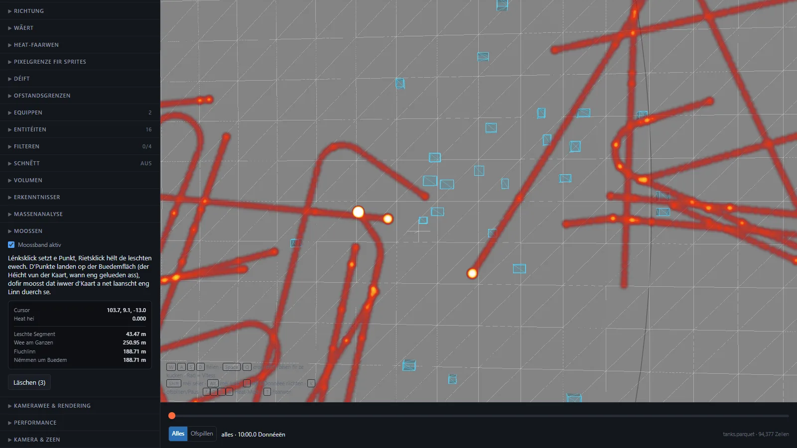

# Mooss

**Mooss** mécht d'Maus zu engem Lineal a seet Iech, wéi vill Verkéier op der Plaz ënnert dem Cursor ass. Benotzt en, fir erauszefannen, wéi wäit zwou Plazen auserneen sinn, oder wéi vill Verkéier eng Plaz huet.

## Probéiert et {#try-it}

1. Maacht **Mooss** an der Säitelëscht op a markéiert **Moossband aktiv**.
2. Klickt mat der lénkser Maustast dräi Plazen op der Kaart. All Klick setzt e Punkt.
3. Liest **Wee am Ganzen** (d'Längt vum ganze Wee) an **Leschte Segment** (dee lescht Stéck).
4. Rietsklickt, fir de leschte Punkt ewechzehuelen, oder dréckt **Clear (3)**, fir all ewechzehuelen.

| Aktioun | Wierkung |
|---|---|
| Lénksklick | Setzt en Punkt, wou den Cursor d'Buedemfläch trëfft. E Klick, bei deem sech d'Maus méi wéi 4 Pixel beweegt huet tëscht Drécken a Lassen, ass en Kameraziehen, kee Punkt. |
| Rietsklick | Hëlt de leschte Punkt eraus. |
| Beweegen | D'Cursorposition an d'Heat drënner aktualiséieren sech live. |

D'Kamera funktionéiert weider, wann de Moossband un ass: Zéien kuckt ëm, d'Tasten fléien nach ëmmer. Solang de Moossband un ass, hëlt en all Klick, dofir wartet [Mat Klick auswielen](camera.md#click-to-pick), bis en aus ass.

**D'Buedemfläch** ass d'Héicht vum [Kaartbild](map-images.md), wann ee gelueden ass; soss de niddregsten Y-Wäert vum Datesaz (0, wann et keen gëtt). D'Punkte landen dorop, dofir miisst de Moossband iwwer d'Kaart, net entlaang enger Linn duerch se. Bei engem 3D-Level ass d'Fläch nach ëmmer de niddregsten Y-Wäert vum Datesaz, net d'Uewerfläch vum Level - fir e Punkt op der richtegen Uewerfläch, schalt de Moossband aus a klickt en un ([Mat Klick auswielen](camera.md#click-to-pick)); dann liest en d'Koordinaten direkt aus den eegene Dreieecke vum Level.

## Liesungen {#readouts}

| Zeil | Bedeitung |
|---|---|
| **Cursor** | Welt-X, Y, Z vum Punkt ënnert dem Cursor, op der Fläch. |
| **Heat hei** | Wéi vill Heat ass am Cursor-Pixel. E gréisseren Wäert heescht méi Verkéier op där Plaz. Et ass de Wäert, deen de Faarfverlaf kritt, ier de Sättigungspunkt en deelt; sou kann ee en mam [Sättigungspunkt](colour-and-exposure.md#saturation-point) vergläichen. |
| **Leschte Segment** | Distanz vum leschte Punkt bis zum Cursor (oder tëscht den leschten zwee Punkten). |
| **Wee am Ganzen** | Längt vun der Linn duerch all Punkt an den Cursor. |
| **Fluchlinn** | 3D-Distanz vum éischten Punkt bis zum Cursor (oder zum leschte Punkt). |
| **Nëmmen um Buedem** | Dat selwecht, nëmmen op X an Z. |
| **Clear (N)** | Läscht all Punkte. |

Distanzen gi bei manner wéi 1 Eenheet a Zentimeter gewisen, bei manner wéi 1.000 a Meter, duriwwer a Kilometer - mat der Annahme, datt eng Welt-Eenheet e Meter ass ([Achsen, Eenheeten a Zäit](axes-units-and-time.md#unit-scale)). Koordinaten sinn Weltkoordinaten, och wann eng Achs [fir d'Ufuerderung ëmgedréint](camera.md#invert-world-axis) ass.

D'Punkte an d'Linn tëscht hinne ginn als Iwwerlagerung an der Ansiicht gezeechent, a richte sech no den Gitterofstänn. D'Punkte vum Lineal ginn an Ansiichten net gespäichert; si bleiwen, wann een aner Daten lued.

## Fir Entwéckler {#for-developers}

**Heat hei** gëtt héchstens all 120 ms vun der GPU gelies, well ee Liesung vun engem eenzege Pixel d'Pipeline stoppt. Et benotzt deeselwechte Wee wéi `engine.readHeatProbe()`: gedeelt duerch d'Verstäerkung, mat där de Bild geschriwwe gouf. Op dem Half-Float-Akkumulatiounswee (`?heat=f16`) ass et also a(n) selwechten Eenheeten wéi op engem 32-Bit-Zil ([Half-Float-Akkumulatioun](half-float-accumulation.md)).
