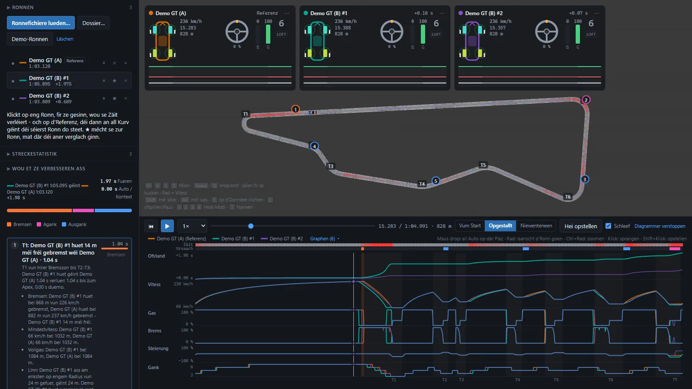

# Course-Analys

Dir sidd dee selwechte Strecke zweemol gefuer. De Tab **Course-Analys** spillt béid Fahrten zesummen a 3D, weist, wou eng Ronn méi lues war, a seet Iech firwat. Nach keng Ronnen do? Dréckt **Demo-Ronnen**.

De Tab vergläicht zwou oder méi Ronnen vun enger Strecke. Hien deelt sech de Canvas, d'Kamera an de gelueden Streckenmodell (**Hannergrond / Level**) mat dem Heatmap; alles anescht ass eegen: seng eege Säitelëscht an eng eege Leist ënner der Usiicht. Wierder wéi *Ronn*, *Referenz* an *Scheitelpunkt* stinn am [Glossar](glossary.md).

Dës Säit ass d'Kaart vum Tab. All Deel huet seng eege Säit:

| Säit | Wat se abegräift |
|---|---|
| [Ronnen lueden](race-loading-laps.md) | all Dateiformat, Dossiere a Strecken, Autonimm, Demo-Ronnen, d'Ronnlëscht, Referenz an Fokus |
| [Replay an d'3D-Szen](race-replay-and-scene.md) | d'Transportleist, déi dräi Replay-Modi, d'Autoen nieft eneen stellen, d'Verfolgungskamera, Linnen, Kaarten, Autoen, Beschrëftungen, gespigelt Welten |
| [Diagrammer an d'HUD](race-charts-and-hud.md) | d'Distanzdiagrammer, d'Graphe-Auswiel, Hovern a Zoom, d'Autokaarten, d'Kanaltabell |
| [Autokontroll-Evenementer](race-control-events.md) | Blockéiere, Radspin, Iwwersteieren, Dréiungen, Ënnersteieren, Treffer, Crashen, ABS/TC, Handbrems, Loft - wéi all erkannt gëtt, mat jiddwer Schwell |
| [Kurv-fir-Kurv-Analys](race-corner-analysis.md) | Ausriichtung no Distanz, Kuerwen an Segmenter, d'Zäitrechnung vun enger Kurv, all Ursaach an d'Rei, an där se probéiert ginn, d'Linnenform an de Rot |
| [Autosprofiler an Verglach](race-car-profiles.md) | wat all Auto kann, gemooss aus senge Ronnen; *Autoen am Verglach*; wat de Auto an all Kurv entscheet |
| [Streckestatistik](race-course-statistics.md) | vill Ronnen vun enger Strecke: Feeler pro Kurv an pro Aart, d'Feelerkaart, den Heatmap-Export, d'Leeschtungsgrenzen |
| [Rennanalys: d'Method](race-analytics.md) | d'Fuerschung hannert de Reegelen, mat de Quellen |
| [Aner Rennspiller](other-games.md) | wat de Viewer mat Ronnen aus all Spill mécht: Rutsch a Drift, wou e Spill se net schécken, gespigelt Welten, déi zousätzlech Kanäl |

## D'Usiicht {#the-screen}

**Säitelëscht**, vun uewen no ënnen (d'Sektiounen kënnen ageklappt ginn):

1. **Ronnen** - lueden, Lëscht, weisen/verstoppen, Referenz, Fokus, Verfolgung.
   Kuckt [Ronnen lueden](race-loading-laps.md).
2. **Streckestatistik** - nëmmen vun dräi gelueden Ronnen un.
   Kuckt [Streckestatistik](race-course-statistics.md).
3. **Wou et ze verbesseren ass** - d'Ergebnisser vun der fokusséierter Ronn, Kurv fir Kurv.
   Kuckt [Kurv-fir-Kurv-Analys](race-corner-analysis.md).
4. **Kurv fir Kurv** (oder *Kurv fir Kurv - Klass X*, wann e puer Klassen do sinn) - déi schnellst Ronn duerch all Kurv an hir Linn. Gewisen ab zwou oder méi Ronnen.
5. **Autokontroll** - d'Blockéiere, d'Rutschen, d'Iwwersteieren an d'Treffer vun der fokusséierter Ronn.
   Kuckt [Autokontroll-Evenementer](race-control-events.md).
6. **Autoen am Verglach** (oder **Den Auto**, wann nëmmen ee Auto do ass) - kuckt [Autosprofiler an Verglach](race-car-profiles.md).
7. **Usiicht** - wéi eng Kaart op der Strecke gemoolt gëtt an wat gezeechent gëtt.
   Kuckt [Replay an d'3D-Szen](race-replay-and-scene.md).
8. D'gemeinsam Panelen **Level** an **Kamera & Zeen** (Streckemodell, Achsen-Ëmkéiere, Kamera) - si sinn mam Heatmap an der [Kamera](camera.md) beschriwwen.

**D'Usiicht** weist d'Strecke, d'gefuer Linnen, d'Kaart, d'Autoen, Beschrëftungen, déi un der Strecke festgemaach sinn, an bis zu sechs Autokaarten uewe lénks (kuckt [Diagrammer an d'HUD](race-charts-and-hud.md)). Ouni gelueden Ronnen steet do "Keng Ronnen gelueden - zitt zwou oder méi Ronnedateien hei eran, oder lued d'Demo-Ronnen aus der Säitelëscht."

**D'Leist ënner der Usiicht** hält d'Replay-Transportleist an, wann se net verstoppt ass, d'Distanzdiagrammer.

## Schnellstart {#quick-start}

1. Maacht den Tab **Course-Analys** op (nieft **Heatmap** uewen an der Säitelëscht).
2. Kritt Ronnen erbäi. Dréckt **Demo-Ronnen**, fir ze gesinn, wat de Tab mat dräi erfonnen Ronnen mécht. Fir Är eege Ronnen nëmmen: nëmmen se virdrun opzeechnen ([Dateiformater an Rekorder](race-loading-laps.md#file-formats)), dann dréckt **Ronnefichiere lueden…** oder **Dossier…**, oder zitt Dateien oder Dossiere op d'Usiicht.
3. D'schnellst vollstänneg Ronn gëtt d'Referenz; d'lues Ronn vun den anere gëtt fokusséiert. Klickt op all Ronn an der Lëscht, fir se ze fokussen; ★ mécht eng Ronn zur Referenz.
4. Liest **Wou et ze verbesseren ass**. Klickt op ee Fund: d'Autoen ginn 40 m virdrun nieft eneen gestallt, d'Kamera rahmt en, d'Replay spillt duerch en, an d'Miessunge gi op.
5. Hovert iwwer d'Diagrammer, fir all Auto op dee Meter ze réckelen; Shift+Klick, fir se do nieft eneen ze stellen.

## Tastatur {#keyboard}

Wann de Tab Course-Analys op ass:

| Tast | Mécht |
|---|---|
| **K** | Replay spillen / pausen |
| **Pos1** (Home) | zréck op den Ufank vum Replay |
| Zifferentasten | näischt (am Heatmap wiesselen se de Modus) |

Tasten, déi an e Textfeld oder eng Auswiel geschriwwe ginn, ginn ignoréiert. D'Kamera-Tasten funktionéieren wéi am Heatmap (**W A S D**, **Espace** no uewen, **Q** no ënnen, **Shift** méi séier, **Alt** méi lues, d'Moss zum Kucken; alles an [Kamera](camera.md)); **F** rahmt d'gelueden Ronnen (wéi beim Ronnen lueden).

## Vill Ronnen {#many-laps}

- All gelueden Ronnen ginn analyséiert a gezielt; Dosende brauchen eng oder zwou Sekonnen.
- Iwwer **8** Ronnen (`SHOW_ALL_UP_TO`) ginn derbäigesate Ronnen nëmmen gemoolt, wann se d'Referenz sinn, d'fokusséiert Ronn, oder déi bescht Ronn vun der Klass vun der fokusséierter Ronn. *All weisen* / *Nëmmen déi gekuckten* schalten dat ëm.
- Iwwer **10** sichtbar Autoen (`PLAIN_PAST`) ginn d'Ronnen, déi net ugekuckt ginn (net de Fokus, d'verfollegt Auto oder d'Referenz), mat Linnen gemoolt, déi op all 6 m ee Punkt gedënnt sinn amplaz op 1,5 m, an d'Autoen eenfach.
- D'Diagrammer zeechnen héchstens **8** Ronnen; d'HUD weist héchstens **6** Kaarten.
- D'Streckestatistik erschéngt ab **3** Ronnen.

Detailer: [Streckestatistik](race-course-statistics.md#performance-with-many-laps).

## Standard-Usiichtastellungen {#default-view-settings}

| Astellung | Standard |
|---|---|
| Kaart | Zäitkaart |
| Gefuer Linnen, Autoen, Pneien & Federung, Beschrëftungen, Strecke aus den Ronnen | un |
| All Wäerter op den Kaarten | aus |
| Autogréisst | 1× |
| Diagrammer | gewisen |
| Replay-Modus | Vun der Linn |
| Replay-Geschwindegkeet | 1× |
| Schleefe | un |

Keng vun dësen Astellungen gëtt gespäichert; eng Neilueden fänkt bei de Standarden un. Am Browser bleift dat hänke: d'Sprooch, a d'Autonimm, déi aus de Ronnefichieren geléiert goufen (kuckt [Ronnen lueden](race-loading-laps.md#car-names)).

## Fir d'Entwéckler {#for-developers}

### Wat geschitt, wann Ronnen gelueden ginn {#what-happens-when-laps-are-loaded}

All Kéier wann d'Zuel vun de Ronnen, d'Referenz oder d'Sprooch sech ännert, gëtt déi ganz Analys nei gemaach (`analyse` an
[`src/race/analysis.ts`](https://github.com/Holdi601/3DHeat/blob/main/src/race/analysis.ts)):

1. Ofgeleet Kanäl gi bei all Ronn derbäi, wou d'Spill se net schécken: Driftwénkel, Radspin aus de Radgeschwindegkeeten, an der Loft, lockere Buedem, Gierrate ([`derive.ts`](https://github.com/Holdi601/3DHeat/blob/main/src/race/derive.ts)).
2. D'Referenz gëtt gewielt, an all Ronn gëtt op hire Wee projizéiert an all 2 m nei ofgetast ([`align.ts`](https://github.com/Holdi601/3DHeat/blob/main/src/race/align.ts)).
3. Ob d'Welt vum Spill gespigelt ass, gëtt aus de Ronnen erausgeschafft ([`handedness.ts`](https://github.com/Holdi601/3DHeat/blob/main/src/race/handedness.ts)).
4. Kuerwe ginn op der Referenz fonnt an a Segmenter gruppéiert, vun enger Bremszon bis zur nächster ([`segments.ts`](https://github.com/Holdi601/3DHeat/blob/main/src/race/segments.ts)).
5. Pro Auto: seng Hëllef (Grip, Brems, Zuch pro Geschwindegkeet), säi Profil, seng Reifenkurven ([`envelope.ts`](https://github.com/Holdi601/3DHeat/blob/main/src/race/envelope.ts),
   [`profile.ts`](https://github.com/Holdi601/3DHeat/blob/main/src/race/profile.ts),
   [`control.ts`](https://github.com/Holdi601/3DHeat/blob/main/src/race/control.ts)).
6. Pro Ronn an Segment: wat se gemaach huet (Bremspunkt, lues Punkt, voll Gas, ...) an d'Linn, déi se gefuer huet ([`line.ts`](https://github.com/Holdi601/3DHeat/blob/main/src/race/line.ts)).
7. Pro Ronn: hir Autokontroll-Evenementer, all dovun dorunner gelaagt, mat där Ronn, mat där se do verglach gëtt.
8. Pro Ronn an Segment: d'Zäitrechnung géint hir Vergläichsronn an d'Ergebnis a Wierder.
9. D'Zäitkaart an d'Ursaachskaart pro Ronn.

D'Texter ginn an der aktueller Sprooch gemaach; e Sproochewiessel léisst d'Analys nees lafen (an hëlt d'Demo-Ronnen nei). E Feeler an der Analys gëtt ënner de Knäppercher **Ronnen** als Feeler gewisen, an d'Ronnen bleiwen gelueden.

### Quelldateien {#source-files}

| Datei | Roll |
|---|---|
| `src/race/adapters.ts`, `ibt.ts` | Ronndateien liesen |
| `src/race/lap.ts`, `carNames.ts`, `synthetic.ts` | den Ronn-Typ, d'Benennung, d'Demo-Ronnen |
| `src/race/derive.ts`, `handedness.ts` | ofgeleet Kanäl, gespigelt Welten |
| `src/race/align.ts`, `segments.ts`, `line.ts` | Distanzachs, Kuerwen, Linnen |
| `src/race/analysis.ts` | Kuerwen verglach, Ursaachen, Ergebnisser |
| `src/race/envelope.ts`, `profile.ts` | wat een Auto kann |
| `src/race/control.ts`, `impacts.ts` | Autokontroll, Treffer a Crashen |
| `src/race/stats.ts` | vill Ronnen |
| `src/race/replay.ts`, `scene.ts`, `glyph.ts`, `geometry.ts` | Replay a Zeechnen |
| `src/race/schema.ts`, `graphs.ts` | d'Kanaltabell, d'Reien vun de Diagrammer |
| `src/ui/race/*` | d'Säitelëscht, d'Diagrammer, d'HUD, d'Beschrëftungen |
| `src/state/raceStore.ts` | de Stand vum Tab an d'Replay-Auer |
