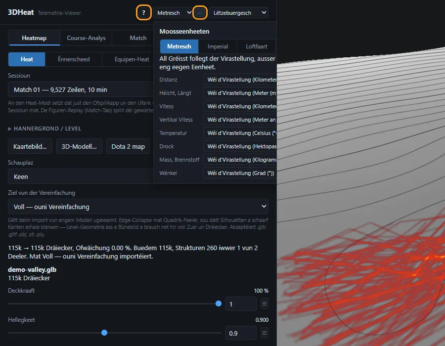
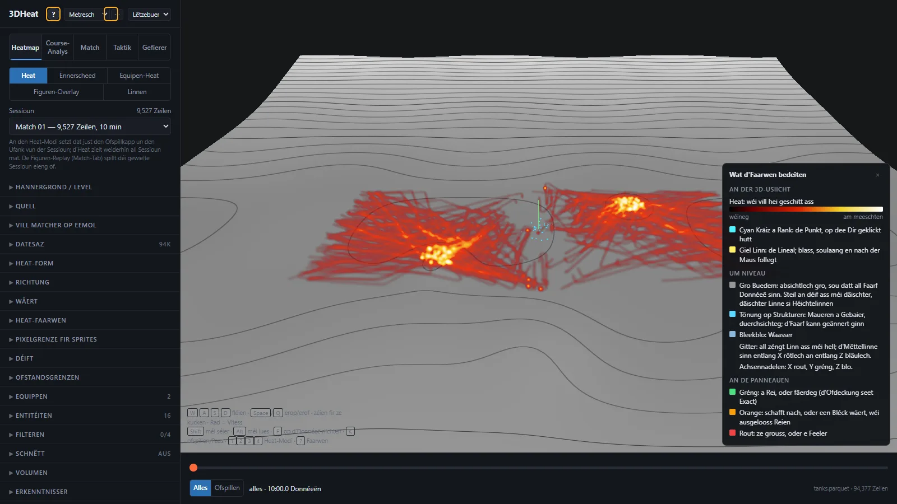

# Astellungen, Eenheeten a Schlësselen

Déi kleng Steierunge ganz uewen an der Säitelleescht änneren, wéi den Viewer mat Iech schwätzt: d'Sprooch, d'Eenheeten (Meter oder Fouss, km/h oder Knuewen) an e Hëllefmodus, dee d'Faarwe erkläert. Är Wiele ginn am Browser gemierkt.

## Den Header {#the-header}

Ganz uewen an der Säitelleescht:

| Steierung | Wat et mécht |
|---|---|
| **?** | Hëllefmodus: wat all Faarf bedeit (och mat `?` oder `F1`) |
| **Eenheeten**-Menü | Metresch, Imperial, Loftfaart oder Nautesch |
| **...**-Knäppchen nieft **Eenheeten** | Mécht "Eng Eenheet fir all Gréisst wielen" op: eng Dropdown-Lëscht pro Gréisst |
| **Sprooch**-Menü | D'Sprooch vum Viewer: [40 Sproochen](languages.md), oder déi vum Browser |

Zuelen, déi Dir an e Kascht tippt, dierfen en Punkt oder e Komma hunn (`0.35` oder `0,35`). Den Viewer liest béid a weist Zuelen esou, wéi d'Sprooch vum Viewer se schreift.

## Eenheeten {#units}

1. Wielt eng Viraschtellung am **Eenheeten**-Menü. All Gréissten wiesselen zesummen.
2. Fir just eng Gréisst z'änneren, klickt den **...**-Knäppchen nieft där a wielt eng Eenheet fir déi Gréisst. Dann steet e `*` hannert der Viraschtellung am Menü.
3. Eng Gréisst, déi Dir net gesat hutt, follegt der Viraschtellung. Wielt "Wéi Viraschtellung", fir zréckzegoen.

| Gréisst | Metresch (Standard) | Imperial | Loftfaart | Nautesch |
|---|---|---|---|---|
| Distanz | km | mi | NM | NM |
| Héicht, Längt | m | ft | ft | m |
| Vitess | km/h | mph | kt | kt |
| Vertikal Vitess | m/s | ft/min | ft/min | m/s |
| Temperatur | °C | °F | °C | °C |
| Drock | hPa | inHg | hPa | hPa |
| Mass, Sprit | kg, l | lb, gal | lb, gal | t, m³ |
| Wénkel | Grad | Grad | Grad | Grad |

Aner Eenheeten, déi Dir fir eng Gréisst wielen kënnt: Distanz km, mi, NM; Vitess km/h, m/s, kt, mph; Vertikal Vitess m/s, ft/min, m/min; Temperatur °C, °F, K; Drock hPa, inHg, mmHg, psi; Mass kg, lb, t; Wénkel Grad oder NATO-Mils (6400 pro Krees). D'Eenheete sinn am ganze Viewer d'selwecht: Beschrëftungen, Kaarten, Diagrammer, Statistiken.

## Hëllefmodus {#help-mode}

Drëckt `?` oder `F1`, oder klickt de **?**-Knäppchen. Et weist *Wat d'Faarwe bedeiten*: Legende fir d'3D-Usiicht, d'Hëtzt-Verlaf, d'Equipenfaarwen, d'Faarwe vum Level, d'Statusfaarwe vun de Panelen, de Match-Panel an d'Rennusiicht. Et bleift un, bis Dir en ausschalt. Am Match-Tab erkläert et och d'Faarwe vum Match-Panel.

## Wat de Browser sech mierkt {#what-the-browser-remembers}

Dës Astellunge bleiwe tëscht de Besuche am Browser (näischt gëtt iwwerall hin geschéckt):

- d'Sprooch, d'Eenheeten an de Hëllefmodus;
- d'Replay-Astellunge fir Figuren, Symboler, Beschrëftungen, Kamera an d'taktesch Usiicht;
- d'Wiedergabegeschwindegkeet an d'Spiegelung;
- Lieszeechen pro Opnam, Volumen pro Datesaz, d'Schichte vun de Ziler;
- d'Astellunge vun der extern KI (de Schlëssel nëmmen, wann Dir *Behalen* ukräizt).

D'Hëtzt-Astellunge, d'Filteren an de Modus fänken mat all Lueden vun vir un. D'ganz generéiert Lëscht: [Gespäichert Astellungen](ref-settings-storage.md).

## Tasten, déi de Viewer vum Browser behält {#keys-the-viewer-keeps-from-the-browser}

Eng Sitzung mat grousse Daten brauch Zäit fir ze lueden, dofir hält de Viewer den Browser dovun of, se aus Versehen ewechzeheven:

- `Strg`/`Cmd` + Buschtawen, déi drécken, späicheren, opmaachen, neilueden, zoumaachen oder nei Fënsteren opmaachen, maachen ausserhalb vu Textkäschte näischt; `F1`, `F3`, `F5`, `F6` a `F7` maachen näischt.
- Zoumaachen oder Neilueden vum Tab mat Daten oder engem Level gelueden freet d'éischt.
- Am Vollbild spären de Viewer d'Tasten, déi hien benotzt (W, T, N, S, R, P, Q, Esc), sou datt de Browser se net iwwerhëlt.

Déi genau Lëscht: [Browser-Tasten](ref-browser-keys.md). All eege Tasten vum Viewer: [Referenz fir Tastatur a Maus](keyboard-reference.md).
