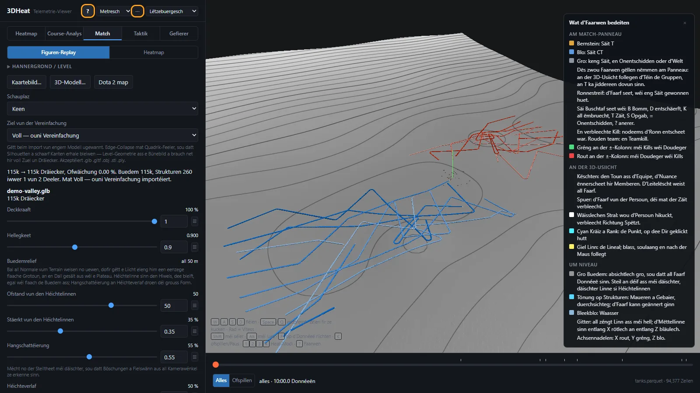

# Astellungen, Eenheeten a Schlësselen

Déi kleng Steierungen uewen an der Säitelëscht änneren, wéi d'Visualisatioun mat Iech schwätzt: d'Sprooch, d'Eenheete (Meter oder Fouss, km/h oder Knuet) an e Hëllefmodus, deen d'Faarwe erkläert. Är Wiele ginn an Ärem Browser gespäichert.

## De Kapp {#the-header}

Uewen an der Säitelëscht:

| Steierung | Wat se mécht |
|---|---|
| **?** | Hëllefmodus: wat all Faarf bedeit (och `?` oder `F1`) |
| Menü **Eenheeten** | Metresch, Imperial, Loftfaart oder Nautesch |
| Knäppchen **...** neewent **Eenheeten** | Mécht "Eng Eenheet fir all Gréisst wielen" op: eng Dropdown-Lëscht pro Gréisst |
| Menü **Sprooch** | D'Sprooch vun der Visualisatioun: [40 Sproochen](languages.md), oder déi vum Browser |

Zuelen, déi Dir an eng Box tippt, kënnen e Punkt oder e Komma benotze (`0.35` oder `0,35`). D'Visualisatioun liest béides a weist d'Zuelen, wéi d'Sprooch vun der Visualisatioun se schreift.

## Eenheeten {#units}

1. Wielt eng Viraschtellung am Menü **Eenheeten**. All Gréissten wiesselen zesummen.
2. Fir nëmmen eng Gréisst ze änneren, klickt op de Knäppchen **...** neewent se a wielt eng Eenheet dofir. Dono steet e `*` nom Viraschtellung am Menü.
3. Eng Gréisst, déi Dir net gesat hutt, follegt der Viraschtellung. Wielt "Wéi Viraschtellung", fir zréckzegoen.

| Gréisst | Metresch (Standard) | Imperial | Loftfaart | Nautesch |
|---|---|---|---|---|
| Distanz | km | mi | NM | NM |
| Héicht, Längt | m | ft | ft | m |
| Geschwindegkeet | km/h | mph | kt | kt |
| Vertikal Geschwindegkeet | m/s | ft/min | ft/min | m/s |
| Temperatur | °C | °F | °C | °C |
| Drock | hPa | inHg | hPa | hPa |
| Mass, Brennstoff | kg, l | lb, gal | lb, gal | t, m³ |
| Wénkel | Grad | Grad | Grad | Grad |

Aner Eenheeten, déi Dir fir eng eenzeg Gréisst wielen kënnt: Distanz km, mi, NM; Geschwindegkeet km/h, m/s, kt, mph; vertikal Geschwindegkeet m/s, ft/min, m/min; Temperatur °C, °F, K; Drock hPa, inHg, mmHg, psi; Mass kg, lb, t; Wénkel Grad oder NATO-Mils (6400 pro Krees). D'Eenheeten sinn an der ganzer Visualisatioun d'selwecht: Beschrëftungen, Kaarten, Diagrammer, Statistik.

## Hëllefmodus {#help-mode}

Dréckt `?` oder `F1`, oder klickt de Knäppchen **?**. Et weist *Wat d'Faarwe bedeiten*: Legenden fir d'3D-Ansiicht, d'Hëtzt-Verläf, d'Equipefaarwen, d'Faarwen vum Level, d'Statusfaarwe vun de Panelen, de Matchpanel an d'Rennansiicht. Et bleift un, bis Dir en ausmaacht. Am Tab Match erkläert et och d'Faarwe vum Matchpanel.

## Wat de Browser sech merkt {#what-the-browser-remembers}

Dës Astellunge bleiwen an Ärem Browser tëscht de Besuche (näischt gëtt nirgendswou geschéckt):

- d'Sprooch, d'Eenheeten an de Hëllefmodus;
- d'Astellungen vum Replay fir Figuren, Symboler, Beschrëftungen, Kamera an taktesch Ufzeeg;
- d'Afspillgeschwindegkeet an d'Spiegelung;
- d'Lieszeechen pro Opnam, d'Volumen pro Datesaz, d'Zieler-Ebenen;
- d'extern KI-Astellungen (de Schlëssel nëmmen, wann Dir *Merken* ukreest).

D'Hëtzt-Astellungen, d'Filter an de Modus fänken mat all Lueden vu vir un. D'ganz generéiert Lëscht: [Gespäichert Astellungen](ref-settings-storage.md).

## Schlëssel, déi d'Visualisatioun vum Browser behält {#keys-the-viewer-keeps-from-the-browser}

Eng Sitzung mat grousse Daten brauch Zäit fir ze lueden, dofir hält d'Visualisatioun de Browser of, se aus Versehen ewechzeginn:

- `Ctrl`/`Cmd` + Buschtawen, déi drécken, späicheren, opmaachen, neilueden, zoumaachen oder nei Fënstere opmaachen, maachen näischt ausser Textfelder; `F1`, `F3`, `F5`, `F6` a `F7` maachen näischt.
- Wann Dir de Tab zoumaacht oder neilued, während Daten oder en Level gelueden sinn, frot d'Visualisatioun als Éischt.
- Am Vollbild spaart d'Visualisatioun d'Tasten, déi se benotzt (W, T, N, S, R, P, Q, Esc), sou datt de Browser se net hëlt.

D'genau Lëscht: [Browser-Schlëssel](ref-browser-keys.md). All Tasten vun der Visualisatioun selwer: [Tastatur- a Mausreferenz](keyboard-reference.md).
