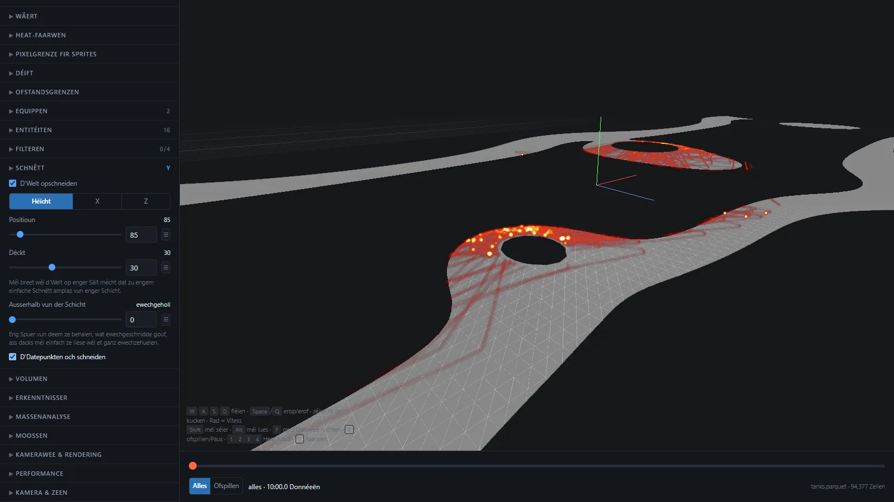

# Schnëtt

**Schnëtt** schneidt d'Welt wéi e Stéck Kuch, sou datt Dir an Gebaier kënnt kucken. Benotzt en, wann Maueren d'interessant Hëtzt verstoppen, zum Beispill fir ee Stack vun engem Gebai ze gesinn.

## Probéiert et {#try-it}

1. Lued e Level an e puer Daten, a maacht **Schnëtt** op.
2. Markéiert **D’Welt opschneiden**. D'Achs ass **Héicht**.
3. Zitt **Positioun** erop a erof: d'Schicht beweegt sech duerch de Level.
4. Maacht **Déckt** dënn fir e Grondrëss, oder breet fir "alles hei ënnen".
5. Hält **Ausserhalb vun der Schicht** bei 0, fir de Rescht ewechzehuelen, oder erhéicht en, fir e schwaache Rescht ze behalen.



D'Schicht schneit **Level-Geometrie a Datepunkten zesummen** - nëmmen de Level ze schneiden, géif d'Hëtzt do schwiewen loossen, wou säi Gebai war. Et ass den Géigespiller zu der [Tiefe-Ofdeckung](depth-and-culling.md): sobald de Level richteg verbléift, wat hannendrun ass, ass och d'Inneren vun engem Gebai verstoppt. D'Panel gëtt ugewisen, wann et eppes ze schneiden gëtt (en Datesaz oder en 3D-Level); säin Titel weist d'Achs, wann se un ass, soss *aus*.

```
Seiteansiicht     Positioun = wou d'Schicht ass
 ----------       Déckt = wéi héich d'Schicht ass
 | Stack 3 |
 |=========|  <--- Schicht (bleift)
 | Stack 2 |  <--- dobausse: ewechgeholl (oder schwaach)
 | Stack 1 |
 ----------
```

## Steierungen {#controls}

| Steierung | Standard | Bedeitung |
|---|---|---|
| **D’Welt opschneiden** | aus | Schalt d'Schicht un. Wann d'Positioun nach op hirem Ausgangswäert 0 steet an d'Déckt op 500, réckt d'Aschalten se an d'Mëtt vun der Achs a op 15 % vun hirer Längt. |
| Achs | **Héicht** | *Héicht* (Y), *X* oder *Z*. Wann een d'Achs wiesselt, geet d'Schicht an d'Mëtt vun der neier Achs. |
| **Positioun** | d'Mëtt | D'Mëtt vun der Schicht, a Weltenheeten, iwwer d'Längt vun der Achs (500 Schrëtt). |
| **Déckt** | 15 % vun der Längt | Vun 1/500 vun der Längt bis zum Duebelten vun der Längt, a logarithmesche Schrëtt. Liest *iwwer d'Welt hinaus*, wann se sou breet wéi d'Längt ass: da geet eng Säit iwwer d'Welt eraus, an et ass e rengen Schnëtt amplaz vun enger Schicht. |
| **Ausserhalb vun der Schicht** | 0, *ewechgeholl* | Wéi vill vun deem, wat dobausse läit, sichtbar bleift, 0-100 %. E schwaache Rescht vun dem, wat ewechgeschnidden gouf, ass oft méi einfach ze liesen, wéi et ganz ewechzehuelen. |
| **D’Datepunkten och schneiden** | an | Aus léisst d'Hëtzt ganz, sou datt se duerch de Schnëtt siichtbar ass - nëtzlech, fir ze gesinn, wat iwwer an ënner der Schicht ass. |

D'Längt vun enger Achs ass déi vum 3D-Level, wann een gelueden ass, soss déi vum Datesaz.

Schnëtt ass onofhängeg vun der [Distanzofdeckung](depth-and-culling.md#distance-culling), déi laanscht d'Siichtrichtung schneit amplaz vun enger Weltachs; béid kombinéieren sech. Eng Ännerung u enger Schnëttastellung fänkt d'Hëtzt-Akkumuléierung nei un.

## Fir Entwéckler {#for-developers}

D'Schicht gëtt bei all Zeil senger Weltposition am Vertex-Shader gepréift: eng Zeil dobausse gëtt hiren Bäitrag mam Wäert *Ausserhalb* multiplizéiert, sou datt se bei 0 ofgelaat gëtt, ier iergendeng Fragment gezeechent gëtt. D'Level-Shader maachen dee selwechte Test bei all Fragment vum Buedem, vun de Strukturen a vum Waasser.
