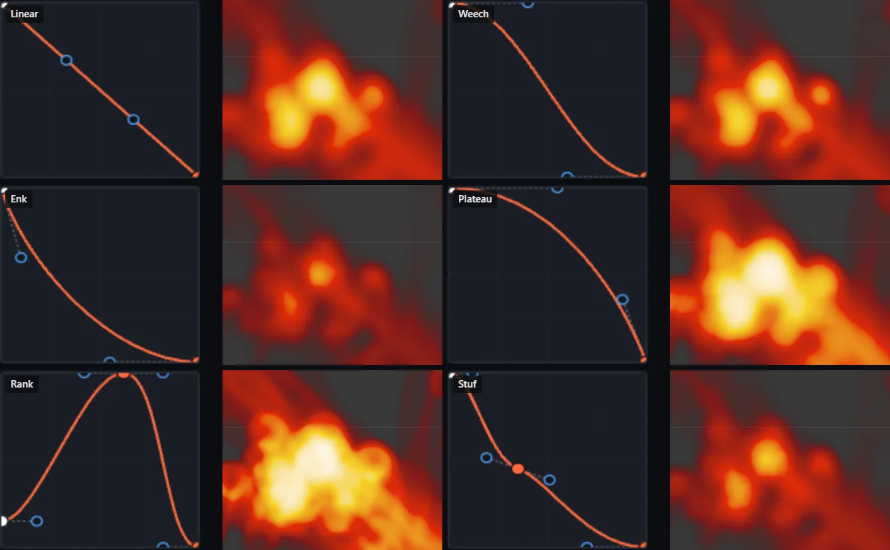

# Sprite-Form

All Rei gëtt als e runde Sprite gezeechent, deen ëmmer zur Kamera steet. Seng Gréisst a de Profil vu sengem Zentrum bis zum Rand - de **Verlaf** - bestëmmen, ob eng Hotspot wéi e enke Punkt, eng weech Wollek, eng Scheif oder e Rank ausgesäit. Dës Reglage sinn an de Sektiounen **Heat-Form** an **Pixelgrenze fir Sprites** an der Säitelleescht, a gëllen fir [Hëtzt](heat.md), [Differenz](difference.md), [Team-Hëtzt](team-heat.md) an, als halleft Breet vun enger Linn, fir [Linn-Hëtzt](line-heat.md).

Wann Der eng vun hinnen ännert, fänkt d'Accumulatioun nei un (d'Feld muss mat der neier Form nei gezeechent ginn).

Denkt Iech all Punkt als eng weech Wolleke vu Liicht. E klenge Fleck weist eenzel Punkten; e grousse Fleck verbënnt Nowunnen zu enger Wollek. D'Form bestëmmt, wéi weech de Rand ass.



## Sprite-Radius {#sprite-radius}

De Radius vum Sprite an **Weltenheeten** (beschriwwen als Meter). Standard 6, an all Kéier beim Lueden de horizontalen Ausmooss vun den Daten / 120 - grouss genuch, datt d'Nopesch-Proben laanscht e Wee zu engem Band zesummeginn an net als Hoerlinn gelieft ginn. Logaritmesche Schieber 0,05-2000, de Griff bis 50.000.


Dinger, déi weit ewech sinn, gesinn méi kleng aus, also gëtt e Sprite op der Usiicht mat der Distanz méi kleng. Bei der parallelen Projektioun ass hie guer iwwerall gläich, wat ee Grond ass, firwat d'parallel Usiicht déi richteg ass fir Hotspoten ze vergläichen ([Kamera](camera.md#projection)).

## Pixelgrenzen {#pixel-clamps}

**Pixelgrenze fir Sprites** (standardméisseg zou) begrenzt den Radius op der Usiicht nodeems d'Ëmrechnung hei uewen gemaach ass.

| Reglage | Standard | Beräich (Schiebe) | Warum |
|---|---|---|---|
| **Minimale Pixelradius** | 1 px | 0-16 (512) | Hält d'Daten, déi weit ewech sinn, dovun ofzehalen, datt se ënner e Pixel verschwannen. |
| **Maximale Pixelradius** | 96 px | 2-1024, logaritmesch (8192) | De Schutz géint Iwwerzéiung. E Sprite, deen N Pixel deckt, kascht N Mëschoperatiounen; e net begrenzte Radius no bei der Kamera ass dat, wat e séieren Bild an e lues mécht. Iwwer der Héicht vum Viewport begrenzt hie guer näischt méi. |

**Selwecht Dicht bei all Zoom** (an der Sektioun Heat-Form, standardméisseg un) schafft mat de Grenzen. E Sprite, dee vun enger Grenz gréisser (wäit ewech) oder méi kleng (no bei) gemaach gëtt, behält d'Hëtzt, déi seng richteg Gréisst dobäi géif bäidroen, sou datt eng Faarf bei all Zoom déiselwecht Zuel Zeilen pro Fläch Buedem bedeit. Ausgeschalt bäidréit e begrenzte Sprite mat sengem vollen Gewiicht an senger begrenzter Gréisst, an d'Bild ännert sech, wann Dir eragefléit.

## Intensitéit an der Mëtt an um Rand {#centre-and-edge-intensity}

D'Hëtzt, déi e Sprite genau an sengem Zentrum derbäisetzt (**Intensitéit an der Mëtt**, Standard 1, 0-10, Schiebe 1000) an um Rand (**Intensitéit um Rand**, Standard 0, -2-10, Schiebe 1000). De Verlafwäert *t* (1 an der Mëtt, 0 um Rand, geformt duerch den Ofnam oder d'Kurve hei ënnen) mëscht tëscht dësen zwee (d'Formel steet ënner [Fir Entwéckler](#for-developers)).

Eng **negativ Intensitéit um Rand** léisst de Rand ofzéien, wat e kille Hallo ronderëm all waarme Spot schnëtt an d'Clusteren géigeneen schäerft. D'Sichtbarkeet enthält [Verdeckung](depth-and-culling.md) an den [Schnitt](slice.md); d'Verbleechung ass d'[Liewensdauer](timeline.md#history)-Verbleechung; d'Vorzeeche ass ±1 bei [Differenz](difference.md).

## Verlaf-Form: Ofnam oder Kurve {#ramp-shape-falloff-or-curve}

**Form vum Verlaf** wiesselt tëscht zwou Manéieren, *t* iwwer de Sprite ze formen. Mat *d* als Distanz vum Zentrum (0) bis zum Rand (1):

### Ofnam {#falloff}

Gëtt gewisen, wann *Ofnam* gewielt ass (Standard).

- **Ofnam** (Standard 1,6, 0,1-8, Schiebe 64): `t = (1 - d) ^ Ofnam`. 1 ass e gerade lineaire Verlaf; méi héich zitt d'Hëtzt Richtung Mëtt a mécht de Hotspot enk; ënner 1 mécht en eng Scheif draus.
- **Weechen Verlaf** (Standard un): wennt eng Smoothstep-S-Kurv op *t* un, sou datt de Sprite um Rand verschwënnt, anstatt op enger sichtbarer Kante ze ophalen.

### Den Kurveneditor {#the-curve-editor}

Gëtt gewisen, wann *Kurv* gewielt ass. En direkten Querschnitt vun engem Sprite: d'Distanz vum Zentrum iwwer d'Breet (*Mëtt* lénks, *Rand* riets), d'Hëtzt no uewen. D'Kurv ass eng stéckweis kubesch Bézier-Kurv duerch Kontrollpunkten, all mat zwee Griffen.

| Aktioun | Effekt |
|---|---|
| Duebelklick op de Graph | Setzt e Punkt op där Distanz (gehale ginn tëscht 0,02 an 0,98), op der Kurv an mat der Steigung vun der Kurv dono, sou datt d'Derbäisetze näischt ännert, bis Der en zéit. |
| En Punkt zéien | Réckelt en. Héichte bleiwen tëscht 0 an 1. |
| En klengen Krees zéien | Béit d'Segment nieft him (réckelt dee Griff). |
| Alt-Klick oder Rietsklick op e Punkt | Léisst en fort. Déi zwee Endpunkte kënnen net fortgeholl ginn. |
| En Knäppchen mat enger Virlag | Setzt d'Kurv duerch d'Virlag ersetzt. |

D'Endpunkte sinn an der Mëtt an um Rand fix; hir Héicht bleift awer Är Saach.

**Virlagen** ([`curve.ts`](https://github.com/Holdi601/3DHeat/blob/main/src/state/curve.ts)):

| Virlag | Form | Benotzung |
|---|---|---|
| **Linear** | Gerade vun 1 op 0 | Identesch mat *Ofnam* 1 mat *Weechen Verlaf* aus. |
| **Weech** | S-Kurv | D'Standardkurv; wat *Weechen Verlaf* bei Ofnam 1 gëtt. |
| **Enk** | E steile Kär, en laange schwaache Rand | Schwaach Daten. |
| **Plateau** | Flach, dann en séiere Réckgang | Gesäit eher wéi eng Scheif aus wéi eng Wollek. |
| **Rank** | 0,15 an der Mëtt, 1 bei 62 % vum Radius, 0 um Rand | E hohle Sprite: weist, wou d'Weeër laafen, anstatt wou se stoen. |
| **Stuf** | Zweestufegen Ofnam, 0,45 bei 35 % | Trennt en dichte Kär vu senger Ëmgéigend. |

## Op d'Buedemfläch projizéieren {#flatten-onto-ground-plane}

**Op d'Buedemfläch projizéieren** (standardméisseg aus) ignoréiert d'Héicht vun all Zeil a zeechent all Hëtzt op enger Héicht - dem niddregste Y vun den Daten - de klassesche 2D-Kaartenhëtztkaart. Wann et un ass, sinn d'Tiefeverdeckung an *Hannert dem Terrain verstoppen* aus (all Punkt géif genau op der Fläch sëtzen, géint déi se getest gëtt), an de Bereich Déift seet dat.

## Fir Entwéckler {#for-developers}

### Formelen {#formulas}

Radius op der Usiicht a Pixelen: `Radius × P[1][1] / w × Héicht vum Viewport / 2`, wou `P` d'Projektiounsmatrix ass an `w` d'Usiichtstiefe vum Punkt.

D'Hëtzt, déi e Sprite derbäisetzt:

```
heat added = mix(edge, centre, t) × sample weight × sign × fade × visibility
```

### D'Kurv {#the-curve}

Griffe ginn horizontal op hiert eegent Segment begrenzt, sou datt d'Kurv ëmmer eng Funktioun vun der Distanz ass: wann Dir e Griff wäit iwwer den nächsten Punkt zéit, flaacht hie sech géint en of, anstatt d'Kurv zréckzefalen, wat d'Resultat dovun ofhänke léisst, wéi eng Wuerzel en Léisser fonnt huet.

### Wéi d'Kurv gezeechent gëtt {#how-the-curve-is-drawn}

D'Kurv gëtt all Kéier ëmgeformt, wann se sech ännert, an eng 256-Eegeschafte-Tabell gebak, als 16-Bit-Float-Textur higelueden, an all Fragment mat linearer Filterung ofgeholl, mat engem hallwe Texel Abstand, sou datt béid Enden exakt bleiwen. E Bézier fir x ze léisen brauch Iteratioun, wat am haardste Shader vum Programm näischt ze sichen huet, an e Tabellen-Zougrëff ass och bëllegless wéi d'`pow()`, déi de Verlaf benotzt. 16 Bit an net 8 Bit, well 8 Bit Bandeeffekter weist, sobal Dausende Sprites zesummegeluegt sinn; 16-Bit-Halffloat ass an Core WebGL2 filterbar, wou 32 Bit eng Erweiderung brauch.
