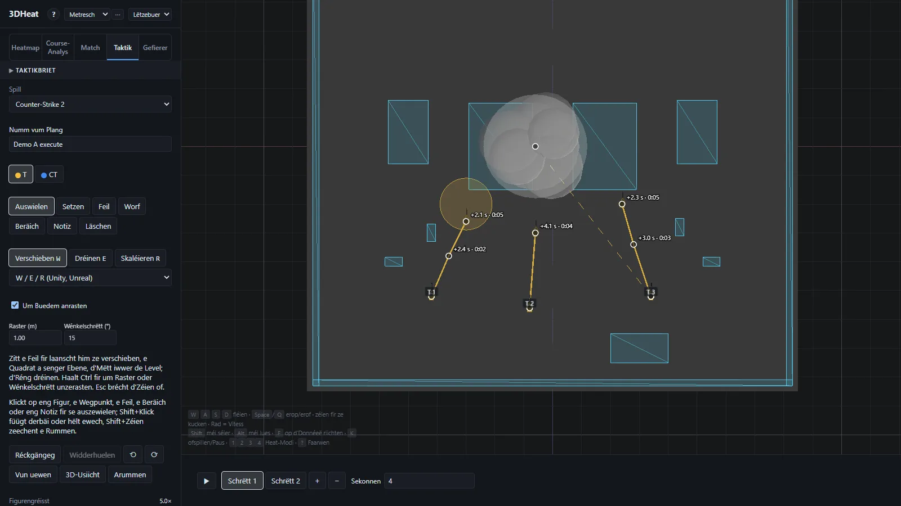

# Taktik-Board

De Tab **Taktik** ass e Zeechebriet fir e Teamplang: Dir setzt kleng Figuren op eng Kaart, zitt Feile fir de Wee, an dréckt op Spillen, fir et ze gesinn. Benotzt en, fir eng Ronn oder en Ugrëff ze plangen, ier Dir spillt. Hie deelt sech de Canvas, d'Kamera an de [Level](levels.md) mat den anere Tabs an näischt anescht; e Plang ass keng Donnéeë an zeechent keng Hëtzt.

## Ären éischte Plang {#your-first-plan}

1. Maacht den Tab **Taktik** op. Wielt de **Spiel** (zum Beispill Counter-Strike 2) an, fir Valorant, dréckt **Valorant-Kaarte lueden** an wielt eng **Kaart**. Oder lued als éischt e [Level](levels.md).
2. Wielt eng **Säit** (si setzt d'Faarf) an dréckt **Vun uewen**.
3. Wielt **Plaz**, sicht eng Figur an **Figuren** (benotzt **Figuren duerchsichen**, fir eng ze fannen), a klickt op d'Kaart. Setzt zwou oder dräi.
4. Wielt **Feil**, klickt op eng Figur, klickt laanscht de Wee, deen se goe soll, a dréckt **Enter**, fir d'Feil ze beschléissen.
5. Dréckt **+** ënner der Usiicht, fir Schrëtt 2 derbäi ze setzen. All Figur fänkt do un, wou hir Feil opgehalen huet. Zitt do méi Feilen.
6. Dréckt **▶** (oder `K`), fir de Plang vum gewisenen Schrëtt bis zum Enn ze spillen.
7. Gitt de Plang en Numm am **Numm vum Plang**-Feld a dréckt **Späicheren**.

## E Plang ufänken {#starting-a-plan}

| Element | Wat et mécht |
|---|---|
| **Spiel** | Wielt d'Säiten an d'Figuren, déi d'Palette bitt: Counter-Strike 2 (T, CT; Spiller a Hëllefsmëttel), Valorant (Ugrëff, Verteidegung; Spiller a generesch Fäegkeeten), Battlefield, Squad, Arma (Infanterie, Buedem-Gefierer, Fligeren, Boote), DCS / War Thunder / IL-2 (Jets, Propellerfligeren, Helikopteren, Loftofwier, Buedem, Schëffer, Waffen) an Anerer. E Plang, deen scho Figuren huet, behält seng Säiten, wann d'Spiel wiesselt. |
| **Numm vum Plang** | De Numm, ënner deem de Plang gespäichert gëtt. |
| **Kaart**, **Valorant-Kaarte lueden** | Wann Valorant gewielt ass: **Valorant-Kaarte lueden** hëlt d'Lëscht vun de Kaarten vun [valorant-api.com](https://valorant-api.com); **Kaart** leet dann d'Minimap vun der gewielter Kaart als Level, vun uewen gerahmt. D'Bild gëtt beim Wielen gelueden an nie mat ausgeliwwert. Riot seng Notiz steet op dem Bildschierm, sou laang se do ass (kuckt hei drënner). |
| **Säit** | D'Säit, zu där déi nächst Figur, Feil oder Gebitt gehéiert; si kritt d'Faarf vun der Säit. |

Ouni Level ass d'Board déi flaach Buedemfläch. Lued e Level ënner **Level**, fir op enger richteger Kaart ze plangen: eng CS2-Kaart, déi mam CS2-Werkzeug exportéiert gouf, e Level aus der Bibliothéik, oder en Kaartbild.

## Werkzeich {#tools}

| Werkzeug | Klick | Notizen |
|---|---|---|
| **Auswielen** | Eng Figur, e Wee-Punkt, eng Feil, e Gebitt oder eng Notiz wielt se aus. | Shift+Klick setzt derbäi oder hëlt eraus; Shift+Zéien zitt e Rechteck ëm dat, wat derbäi soll. D'Auswiel kritt en Transformationsgizmo (kuckt hei drënner); `Delete` oder `Backspace` läscht se. `M` verréckelt déi gewielte Figur bis zum nächste Klick. |
| **Plaz** | Setzt déi gewielte Figur hin. | Eng Figur gëtt an der **Figuren**-Palette gewielt (mat **Figuren duerchsichen**). Wann näischt gewielt ass, dréint `R` déi nächst Figur em 15° ier se gesat gëtt (`Shift+R` an déi aner Richtung). |
| **Feil** | All Klick setzt en Punkt derbäi; Enter, en Duebelklick oder en Rietsklick mécht se fäerdeg, Esc werft se fort. | **Verréckelen**, **Ugrëff** (méi breete Kapp) oder **Iwwerwaachen** (eng dënn Linn op Aegenhéicht). Eng Feil, déi op enger Figur ugefaangen huet, ass dem Wee vun där Figur an dësem Schrëtt: bei der Wiedergab leeft d'Figur hien, an den nächste Schrëtt fänkt do un, wou hie opgehalen huet. |
| **Worf** | De Werfer, dann wou et landet. | E gestrechelte Bogen vum een zum anere, an d'gewielt Hëllefsmëttel (Rauch, Blëtzer, Molotov, ...) erschéngt, wou et landet, a bleift vun dësem Schrëtt un. |
| **Gebitt** | D'Mëtt, dann de Rank. | Eng Scheif an der Faarf vun der Säit. |
| **Notiz** | Wou d'Notiz hi soll; freet no hirem Text. | Gewise wéi eng Nadel, an dersiwwer hire Text. |
| **Läschen** | Eng Figur, eng Feil, en Gebitt oder eng Notiz. | Léscht se vun dësem Schrëtt un; op hirem éischte Schrëtt léscht se se ganz. |

**Réckgängeg** an **Widderhuelen** (`Ctrl+Z`; `Ctrl+Y` oder `Ctrl+Shift+Z`) goen duerch all Ännerung. Eng Linn ënner dem Plang weist, wéivill Figuren, Feilen a Schrëtt en huet. **Vun uewen** kuckt direkt erof (orthografesch), **3D-Usiicht** geet zréck op d'Perspektiv, **Frame** passt de Plang un, oder de Level, wann de Plang eidel ass.

**Figurengréisst** skaléiert all Figur op dem Board; 1× ass richteg Gréisst, a vun ganz uewen ass eng Persoun e puer Pixel.

## Verréckelen, Dréinen a Skaléieren {#moving-turning-and-scaling}

Alles op dem Board kann verréckelt ginn wéi an engem 3D-Editor: Figuren, Hëllefsmëttel, Markéierungen, eenzel Wee-Punkte an ganz Feilen, Gebidder an Notizen. Dat Ausgewielt kritt en Gizmo a senger Mëtt:

| Modus | Tasten | Griffe |
|---|---|---|
| **Verréckelen** | W (oder G) | Eng Feil pro Achs (X rout, Y gréng an no uewen, Z blo) réckelt laanscht si; e Quadrat réckelt a senger Fläch; d'Mëtt réckelt iwwer de Level ënner dem Zeiger. |
| **Dréinen** | E (oder R) | E Rank pro Achs dréint sech ëm se. D'Ringer vun enger eenzeler Figur sinn hir eegen Giering, Nick a Roll; eng Grupp dréint sech ëm d'Achsen vun der Welt, ëm hir Mëtt. |
| **Skaléieren** | R (oder S) | Breet d'Auswiel aus hirer Mëtt op oder zesumme laanscht eng Achs oder a alle Richtungen; de Radius vun engem Gebitt wiisst domat. |

**Tasten** wiesselt tëscht W / E / R (Unity, Unreal) an G / R / S (Blender); d'Tasten wielen den Modus nëmmen, wann eppes ausgewielt ass, a fléien soss d'Kamera. Also heescht `R` **Skaléieren** mat de Tasten W / E / R an **Dréinen** mat de Tasten G / R / S, wann eppes ausgewielt ass, an et dréint déi nächst Figur fir ze setzen, wann näischt ausgewielt ass. All Board-Tasten stinn an der [Tastatur-Referenz](keyboard-reference.md#tactics-board). Hält **Ctrl** beim Zéien, fir eng Verréckelung op de **Gitter** (Meter) oder eng Dréiung op de **Wénkelschrëtt** ze rasten. **Um Buedem anrasten** (standardméisseg un) setzt verréckelt Leit, Gefierer, Markéierungen, Wee-Punkte a Gebidder op d'Uewerfläch vum Level; Fligeren an Helikopteren behalen hir Héicht, an en Zéien laanscht de Y-Feil rast ni. Wann Dir e Griff zitt, bewegt sech d'Kamera ni. **Esc** brécht e Zuch of, an all Ännerung ass ee Schrëtt vum Réckgängeg.

Wee-Punkte sinn als Punkten op de Feilen vum gewisenen Schrëtt ze gesinn: klickt op ee, fir en auszewielen, zitt en, fir en ze verréckelen, Delete, fir en ewechzehuelen. D'Sektioun **Gewielt** weist d'Plaz vun der Auswiel a Meter, d'Giering, d'Nick an d'Roll vun enger Figur a Grad an de Radius vun engem Gebitt, jeeweils zum Aginn.

## Zäitmiessung {#timing}

D'Wee vun enger Figur sinn zäitgemooss: all Stéck brauch seng Längt iwwer dem Level - all puer Meter um Buedem ofgetast, sou datt en Hiwwel oder eng Trapp tëscht zwee Punkten mat zielt - an der Geschwindegkeet vum **Beweegungs-Modus** vun där Figur an deem Spill, plus all **Waart** bei engem Wee-Punkt. Infanterie kriecht, duckt sech, geet (lues), leeft oder spréngt; Gefierer a Boote kréien, fueren vorsiichteg, normal oder eilen; Fligeren a Helikopteren fléie lues, Reiseflug, Kampfgeschwindegkeet oder maximal. E Modus, deen d'Spiel net huet (CS2 huet keng Spréngt), hëlt deen nootbaschte, deen et gëtt. Wéi eng Steigung bremst, hänkt vum Spill of: an CS2 a Valorant zielt nëmme d'horizontal Distanz, wéi a den Spiller; Milsims bremsen Infanterie bergop (Tobler's Wanderfunktioun) an Gefierer no Steigung.

D'Geschwindegkeete kommen aus Tabellen pro Spill mat hiren Quellen (kuckt [Beweegungsgeschwindegkeeten](tactics-speeds.md)): CS2 no der Waff, déi getrot gëtt, aus den Waffedefinitioune vum Spill; Valorant no Waff; Battlefield, Squad, Arma an d'Loftspiller no Gefierstyp an -klass. **Beweegt sech als** wielt dat Profil vun enger Figur (eng Waff, en Gefierstyp); **Eegen (m/s)** setzt all Modus fir déi Figur oniwwer. D'Modi heeschen op dem Board, wéi se gewise ginn: *Kriechen*, *Duckt sech*, *Geet (lues)*, *Leeft*, *Spréngt*; *Vorsiichteg*, *Normal*, *Eilt*; *Lues*, *Reiseflug*, *Kampf*, *Maximal*.

All Wee-Punkt weist d'Zäit zanter dem leschten an d'Zäit zanter dem Ufank vum Plang ("+3,9 s · 0:12"). D'Wee-Lëscht vun der gewielter Figur weist all Stéck mat sengem Modus, senger Längt an Zäit, d'Waart an d'Ukunft. **Ukënften** ënner **Zäitmiessung** setzt all gerouteten Figur op eng Zäitlinn, déi éischt Ukunft uewen. Mat **An Echtzäit spillen** (standardméisseg un) dauert e Schrëtt, bis dee lues Wee ukënnt, an all Figur beweegt sech a sengem eegene Tempo; **Sekonnen** ass dann déi kierzeste Längt vum Schrëtt. **Leveleenheeten pro Meter** seet, a wéi enger Eenheet de Level ass: 39,37 fir CS2-Kaarten (Spillen-Eenheeten), 1 fir Meter-Kaarten.

## Mat Match-Donnéeën vergläichen {#compare-with-match-data}

**Match-Fichiere lueden…** liest CS2-Match-Tabellen vun der Kaart (d'Parquet-Dateien vum CS2-Werkzeug, sou vill wéi Dir wëllt; nëmmen déi néideg Kolonnen, am Hannergrond); **Gelueden Daten notzen** hëlt d'Donnéeën, déi am Viewer gelueden sinn. Dann:

- **Fréisten Ukunft op der Kaart** fiirbt d'Kaart no der Zäit zanter Ronnenufank, wou e Spiller all Plaz als éischt erreecht huet - de Knäppchen **Am schnellsten** weist déi schnellst vun all Ronnen, **Typesch (Median)** déi mëttlst Ronn - vu gréng fréi bis rout spéit, fir eng Säit oder béid. Et weist, wat méiglech ass a wéini.
- De gewielte Wee gëtt mat deem verglach, wat Spiller vu sengem Ufank (oder vum Ufank vun der Ronn) bis zu sengem Enn erreecht hunn; all Enn ass eng Scheif mat dem agestallten Radius: "Am schnellsten observéiert 14,2 s, p10 15,0 s, Median 18,3 s iwwer 41 Lafen; Äre Plang 15,1 s".
- D'Geschwindegkeete, mat deenen d'Spiller wierklech gefuer sinn - Lafen, Goen, Kriechen, aus de Goe- an Duck-Kolonnen vun den Tabellen - a m/s.

## Schrëtt {#steps}

D'Leist ënner der Usiicht hält d'Schrëtt. E Plang fänkt mat engem un; **+** setzt een derbäi, all Figur fänkt do un, wou hire Wee am leschte Schrëtt opgehalen huet; **−** läscht de gewisene. **Sekonnen** ass, wéi laang de gewisene Schrëtt beim Spillen dauert. **▶** (K) spillt vum gewisene Schrëtt bis zum Enn: Figuren mat engem Wee lafen en, Figuren, déi am nächste Schrëtt op eng nei Plaz geréckelt sinn, rutschen dohin, déi aner stinn. Wann e Schrëtt gewise gëtt, gëtt d'Plaz all Figur am nächste Schrëtt als blassen Ofdrock gezeechent, an d'Feilen vum läschte Schrëtt ënnendrënner blass ënner dësem.

## Späicheren {#saving}

D'Sektioun **Fichier** huet **Späicheren**, **Open** an **Läschen**. **Späicheren** schreift de Plang als `<Numm>.h3dplan.json` (eenfach JSON: Säiten, Schrëtt, Figuren mat enger Plaz pro Schrëtt, Feilen, Gebidder, Notizen); **Open** liest een zréck. Eng Datei vun enger anerer Versioun, oder déi kee Plang ass, gëtt mat dem Grond ofgelehnt. **Läschen** eidelt de Plang; Réckgängeg bréngt en zréck.

## Figuren {#figures}

All Figur gëtt vum Viewer selwer gemaach: eenfach Formen op d'verëffentlecht Gréisst vun engem Typ, mat de Mierkmale, déi se vun hiren Noper ënnerscheeden - d'Laafrieder an de Turm vun engem Panzer, d'Waffen, Rakéiten an d'Radaren vun engem Loftofwier-Gefier, de Flilechtplang, de Schwanz an d'Motoren vun engem Fligger, d'Rotoren an d'kuerz Flilleger vun engem Helikopter. Näischt gëtt aus engem Spill geholl. E Design, dat e Spill erfonnt huet, gëtt als déi generesch Figur vu senger Klass gewisen. Wéi d'Donnéeë hir Figur fannen, steet bei [Figuren](figures.md#which-figure-a-unit-gets).

## Riot seng Notiz {#riots-notice}

Valorant-Kaarte ginn ënner dem "Legal Jibber Jabber"-Reglement vun Riot Games gewisen, dat gratis Gemeinschaftsprojeten erlaabt a fir dës Notiz bieden, wou se erscheinen: *3DHeat was created under Riot Games' "Legal Jibber Jabber" policy using assets owned by Riot Games. Riot Games does not endorse or sponsor this project.* D'Fäegkeeten um Board sinn generesch Formen, net Riot seng Kunst.
