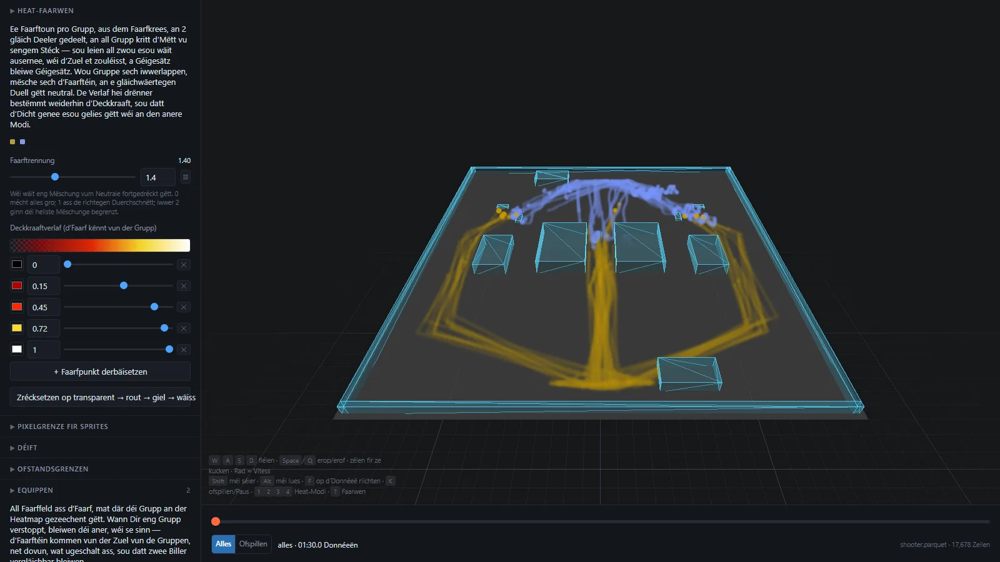

# Equipen-Heat

Equipen-Heat weist, wou all Equipe war, jiddereng a senger eegener Faarf. Wou d'Equipe sech iwwerlappen, mëschen sech d'Faarwen.

**Equipen-Heat** (Taste 3) ass d'Dichtefeld vun [Heat](heat.md), mat jeder [Gruppe](glossary.md) enger eegener Faarftéint. Wou Gruppen sech iwwerlappen, mëschen sech hir Téint; en ausgeglache Duell kënnt neutral eraus. D'Deckkraaft dréit d'Dichte wéi an den anere Modi genau, sou datt d'Bild *wéi vill* an *wiem* gläichzäiteg beäntwert. Et brauch eng Gruppekolonn.

Dat ass net d'[Figuren-Iwwerlagerung](box-replay.md): déi zeechent eng Figur pro Persoun; dëst ass e Hëtzt-Feld, a Faarwen no der selwechter Kolonn.

## Wéi een et benotzt {#how-to-use-it}

1. Dréckt `3` (oder wielt **Equipen-Heat** an der Modusleescht).
2. Maacht **Heat-Faarwen** op. D'Faarfmuster weisen all Gruppe hir Faarf; leet d'Maus iwwer e Muster, fir de Numm vun der Equipe ze gesinn.
3. Wann alles grau ausgesäit, erhéicht **Faarftrennung**.
4. Deselektéiert eng Gruppe an der [Equipelëscht](teams-list.md), fir se erauszehuelen; déi anerer Faarwen bleiwen, wou se waren.

## Steierungen {#controls}

An der Sektioun **Heat-Faarwen**:

| Steierung | Standard | Bedeitung |
|---|---|---|
| Faarfmuster | | D'Faarf vun all Gruppe, fir déi éischt 12 Gruppen, dann *+N méi*. Leet d'Maus drop, fir de Numm vun der Gruppe an d'Faarf ze gesinn. |
| **Faarftrennung** | 1,4 | Wéi wäit eng Mëschung vum Neutrale ewech gedréckt gëtt, 0-4. 0 mécht alles grau; 1 ass den echte Duerchschnëtt; iwwer ongeféier 2 falen déi hellsten Mëschungen aus dem sichtbaren Beräich a ginn pro Kanal begrenzt, wat hir Faarwe verréckt. |
| **Deckkraaftverlaf (d’Faarf kënnt vun der Grupp)** | den Standard-Heat-Verlaf | Hei gëtt nëmmen d'**Alpha** vum Verlaf benotzt: duerchsichteg, wou näischt ass, deckend uewen. Seng Faarwen ginn ignoréiert. |

Eng Gruppe, deren Numm "keng Gruppe" heescht (`0`, eidel, `none`, `unknown`, `null` oder `-1`), gëtt grau gezeechent.

All déi anerer Heat-Steierungen - Form, Sättegung, Reaktioun, Mindestheat, Déift, Ausschneiden - funktionéieren wéi bei [Heat](heat.md).

D'[Equipelëscht](teams-list.md) weist an dësem Modus d'Equipen-Heat-Faarf vun all Gruppe als hiren Faarfmuster. Eng Gruppe verstoppen léisst all anerer Gruppen hir Faarf, wou se waren: d'Faarwen kommen aus der Gesamtzuel vun de Gruppen, net aus deem, wat ageschalt ass, sou datt zwee Biller vergläichbar bleiwen.

## Fir Entwéckler {#for-developers}

### D'Palette {#the-palette}

Aus [`colors.ts`](https://github.com/Holdi601/3DHeat/blob/main/src/render/colors.ts):

- D'Faarwen liewen op der **Oklab**-Faarfebene bei fester Hellegkeet (0,7) an Chroma (0,115), sou datt all Gruppe gläich hell ass an eng rout Gruppe net méi hee ausgesäit wéi eng blo.
- Bei *n* Gruppen gëtt de Faarfkrees a *n* gläich Deeler opgedeelt, an d'Gruppe *i* kritt d'**Mëtt** vun hirem Deel, `(i + 0,5) / n` vun engem Ëmlaf. All zwou Gruppe sinn sou wäit auserneen, wéi d'Zuel erlaabt, a Géigenteeler bleiwen Géigenteeler, egal wéi vill et gëtt.
- Héchstens **16** verschidde Téint ginn benotzt. Mat méi Gruppen ginn d'IDen duerch wiederholt Halbéieren plaz (Bit-umgedréint IDen: 0, ½, ¼, ¾, ⅛, …), sou datt Noper-IDen keng Faarf deelen; Gruppen iwwer 16 musse sech Faarwen deelen.
- Eng Gruppe, deren Numm "keng Gruppe" heescht - `0`, eidel, `none`, `unknown`, `null` oder `-1`, ouni Ënnerscheed vun Gréisst- a Klengbuschtawen - gëtt **neutral grau** gezeechent, amplaz e Stéck vum Krees ze kréien. Nëmmen den éischte sou Numm an der Gruppelëscht gëtt esou behandelt.

D'Standardtrennung ass 1,4 an net 1, well bei 1 eng Mëschung vu fënnef gläich verdeelte Téinten *grau* ass: richteg, awer net liesbar. E bëssen iwwer 1 hält d'Gleichstänn éierlech a mécht zugläich eng 60/40-Opdeelung siichtbar.

### Wéi et funktionéiert {#how-it-works}

De Heat-Zil huet an dësem Modus véier Kanäl. All Sprite addéiert seng Dicht *v* zum éischten Kanal a *v* × d'Oklab-Koordinaten *a* a *b* vun der Gruppe zum zweeten an dritten. Beim Composite ass d'Mëschung vum Pixel den dichtegewichtéierte Mëttelwäert: *a* = G / R, *b* = B / R, skaléiert mat der Faarftrennung an an sRGB ëmgewandelt bei der Hellegkeet vun der Palette. D'Division duerch d'akkumuléiert Dicht hält d'Faarf onofhängeg dovun, wéi vill Daten do sinn; dofir wierken all Dichtsteierungen nëmmen op d'Deckkraaft.

De Véier-Kanal-Zil kascht bei der selwechter Opléisung véierfach de GPU-Späicher wéi de Eenkanal-Heat-Zil.
