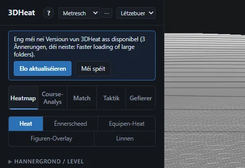

# Updates

De Viewer seet Iech, wann eng méi nei Versioun do ass, a aktualiséiert sech nëmmen, wann Dir jo sot. Ouni Är Äntwert gëtt op Ärem Computer näischt geännert.

## Den Viewer aktualiséieren {#update-the-viewer}

1. **Op der Säit.** Wann eng méi nei Versioun do ass, erschéngt eng Box ënner dem Numm uewen an der Säitelëscht: "Eng méi nei Versioun vun 3DHeat ass disponibel". Klickt op **Elo aktualiséieren**. D'Säit lued sech selwer nei, wann et fäerdeg ass. **Méi spéit** verstoppt d'Box, bis Dir d'Säit neiluet.
2. **Wann et sot, restart.bat ze lafen**, mécht d'Serverfënster zou (dat schwaarzt Fënster, dat `start.bat` opgemaach huet) an doppelklickt op `restart.bat`.
3. **Wann Dir den Viewer startet.** `start.bat` kontrolléiert och. Wann eng méi nei Versioun do ass, fro et **Update now? [Y/N]**. Dréckt `Y`, fir ze aktualiséieren. Dréckt `N`, oder waart 60 Sekonnen ouni Äntwert, fir déi Versioun ze starten, déi Dir hutt.



Eng Kopie mat eegenen Ännerungen gëtt Iech ni automatesch aktualiséiert; d'Box seet nëmmen, datt en Update waart, a seet, Dir sollt Är Ännerungen commiten oder stashen an dann `git pull` lafen loossen. Eng Kopie, déi net mat git installéiert gouf (zum Beispill eng Zip-Datei), weist guer näischt.

Wéi d'Kontroll funktionéiert, Schrëtt fir Schrëtt:

```
Säit ---(no 4 s, dann all 6 h)---> Dev-Server ---> git fetch
   hannendrun?  nee  -> näischt gëtt gewisen
                jo   -> eegen Ännerungen oder Commiten?  jo  -> nëmmen Bescheed soen
                                                         nee -> [Elo aktualiséieren] -> git pull
                                                                -> nei lueden, oder "run restart.bat"
```

## D'Sécherheetsreegelen {#the-safety-rules}

- **Nëmmen Fast-Forward** (`git pull --ff-only`): e Update mécht ni e Merge, en Rebase oder schreift eppes ëm.
- **Keng lokal Ännerungen**: eng Kopie mat net gespäicherte Ännerungen un verfollegte Dateien (`git status --porcelain --untracked-files=no` ass net eidel) gëtt ni automatesch aktualiséiert - d'Aarbecht vun engem anere gehéiert net an e Update, fir se ze iwwerschreiwen. Si kritt nëmmen d'Mëtteilung, datt e Update waart. Net verfollegt Dateien (Donnéeën, Exporter) zielen net als Ännerungen.
- **Keng lokal Commiten**: eng Kopie mat Commiten, déi de Stroum net huet ("divergéiert"), gëtt net aktualiséiert - en Fast-Forward kann se net bréngen, an Mergen ass fir `git pull` vun Hand. D'Säit an `start.bat` soen dat mat deenselwechten Wierder, an `start.bat` start d'Versioun, déi do ass.
- **Nëmmen vun der Säit selwer**: d'Update-Ufro vum Dev-Server muss en eegene Kapp hunn, an wann de Browser en `Origin` schéckt, muss se vum selwechte Host wéi de Server kommen (ënnendrënner).
- Nëmmen eng git-Kopie mat engem Upstream-Zweig gëtt jeemools aktualiséiert; alles anescht (eng Kopie ouni `.git`, kee git installéiert, en statesche Build) bleift a Rou a seet näischt.

## Wat start.bat mécht {#what-startbat-does}

`start.bat` (doppelklickt drop; d'Fënster ass de Server) mécht dës Schrëtt, an där Rei:

1. Fënnt Node.js - am `PATH`, soss an `%ProgramFiles%\nodejs`, `%ProgramFiles(x86)%\nodejs` oder `%LOCALAPPDATA%\Programs\nodejs` - a bitt un, et mat `winget install -e --id OpenJS.NodeJS.LTS` z'installéieren, wann et feelt (gefrot, Y/N; duerno muss d'Fënster nei opgemaach ginn, sou datt Windows de neie `PATH` gesäit).
2. **Updates**, wann git installéiert ass an den Dossier `.git` huet:
   - `git fetch --quiet` (ouni Netz oder ouni Upstream: iwwersprong, ouni Wuert);
   - zielt `git rev-list --count HEAD..@{u}`; näischt hannendrun: näischt gesot;
   - lokal Ännerungen: "A newer version of 3DHeat is available (N changes), but this copy has local changes, so it is not updated. Commit or stash them, then run git pull." - a se start d'Versioun, déi do ass;
   - eege Commiten (`git rev-list --count @{u}..HEAD` ass net 0): "A newer version of 3DHeat is available (N changes), but this copy has commits of its own that the newest version does not, so it is not updated. Update it with git pull." - a se start d'Versioun, déi do ass;
   - soss "A newer version of 3DHeat is available (N changes)." an d'Fro **Update now? [Y/N]**. `N`, oder keng Äntwert fir 60 Sekonnen, schreift "Not updated; starting the version you have." an start d'Versioun, déi do ass. Bei `Y`: "Updating...", seet, ob `package.json` oder `package-lock.json` sech änneren,
     léisst `git pull --ff-only` lafen (wann dat och da net geet - zum Beispill wéinst dem Netz: "The update did not go through; starting the version you have."), dann `git submodule update --init`
     (d'festgeluechte Werkzeich, kuckt [Dokumentatioun pflegen](maintaining.md#the-tools-under-exporters)), dann `npm install`, wann d'Package-Dateien sech geännert hunn an `node_modules` do ass, an "Updated.".
3. Mécht kee zweeten Server op: wann scho eppes op dem Port **5273** lauschtert, seet et dat a weist op `restart.bat` / `stop.bat`.
4. Beim éischte Lafen (kee `node_modules`) freet et, ier d'Ofhängegkeete geluede ginn (ongeféier 300 MB an `node_modules\`, näischt systemwäit).
5. Start den Dev-Server op `127.0.0.1:5273` (`--strictPort`) an mécht den Browser op, wann e prett ass.

`restart.bat` hält den Server un (am Port) an start `start.bat` nei, also freet et dat selwecht. `stop.bat` hält just un.


## Fir d'Entwéckler {#for-developers}

### Während et leeft: d'Update-Route {#while-it-runs-the-update-route}

De Dev-Server (Vite-Plugin `heat3d-self-update` an `vite.config.ts`) bitt `/__heat3d/update` un. Dat gëtt et nëmmen um Dev-Server - net an engem statesche Build an net bei `vite preview`.

**`GET /__heat3d/update`** seet, ob d'Kopie hannendrun ass:

```json
{ "checkout": true, "upstream": "origin/main", "behind": 3, "ahead": 0, "dirty": false, "latest": "the newest commit's subject" }
```

- `checkout: false`, wann den Dossier keng git-Kopie ass;
- et léisst `git fetch --quiet` **héchstens all 30 Minutten** lafen (Ufroen dertëscht kréien d'Äntwert vum leschte Fetch);
- `behind` / `ahead` aus `git rev-list --count HEAD..@{u}` / `@{u}..HEAD`, `dirty` aus `git status --porcelain --untracked-files=no`, `latest` de Betreff vum neiste Commit vum Upstream;
- ouni Upstream-Zweig: `upstream: null` a `behind: 0`.

**`POST /__heat3d/update/apply`** bréngt d'Kopie op den neiste Stand:

1. Ofgelaf mat `403 { ok: false, reason: "forbidden" }`, ausser d'Ufro huet de Kapp `X-Heat3d-Update: 1`, an wann se e `Origin` mat hat, kënnt dee vum Host vun der Ufro. Eng Site-iwwergräifend Form kann ouni CORS-Virfro keen eegene Kapp schécken, an dat gëtt dësen Server ni.
2. Näischt ze maachen (keng Kopie, kee Upstream, net hannendrun): `{ ok: true, updated: false }`.
3. Lokal Ännerungen: `{ ok: false, reason: "dirty" }`; lokal Commiten: `{ ok: false, reason: "diverged" }`.
4. Soss: notéiert d'Dateien, déi sech änneren (`git diff --name-only HEAD @{u}`), `git pull --ff-only` (2 Minutte Timeout), `git submodule update --init` (e Feeler gëtt ignoréiert), `npm install`, wann `package.json` oder `package-lock.json` sech geännert hunn (15 Minutte Timeout), an äntwert `{ ok: true, updated: true, restart }` - `restart` seet, warum de lafende Server de Stand net kann huelen: `"dependencies"`, wann d'Ofhängegkeete nei installéiert goufen, `"config"`, wann nëmme eng `vite.config`-Datei sech geännert huet, `false`, wann näischt en Neistart brauch.
5. En Git- oder npm-Befehl, dee feelschléit, äntwert `{ ok: false, reason: "<de Feeler, bis 300 Zeechen>" }`.

D'Äntwerte sinn JSON mat `Cache-Control: no-store`. De Server lauschtert nëmmen op `127.0.0.1`, sou datt d'Route vum Netz aus net erreechbar ass.

### D'Notiz op der Säit {#the-notice-in-the-page}

`UpdateBanner`, ënner dem Numm uewen an der Säitelëscht:

- Et freet d'Route **4 Sekonnen** nodeems d'Säit gelueden ass (net an den éischte Sekonnen: d'Säit huet e Datesaz ze lueden an eng GPU ze starten) an nach eemol **all 6 Stonnen**, solang d'Säit oppen ass.
- Et weist **näischt**, wann et keng esou Route gëtt (e statesche Build), den Dossier keng Kopie ass, oder näischt méi nei ass - eng Notiz bei all Start ass eng, déi d'Leit gewinnen ze ignoréieren.
- Hannendrun, ouni lokal Ännerungen: "Eng méi nei Versioun vun 3DHeat ass disponibel (N Ännerungen, déi neiste: <Betreff>)." mat **Elo aktualiséieren** an **Méi spéit** (*Méi spéit* verstoppt se, bis d'Säit nei gelueden ass).
- Hannendrun, mat lokalen Ännerungen: dee selwechte Saz an "Dës Kopie huet lokal Ännerungen, dofir gëtt se net automatesch aktualiséiert; maacht e Commit oder e Stash dovun a start dann git pull." - ouni Knäppchen.
- **Elo aktualiséieren** schéckt un `/apply` ("Gëtt aktualiséiert…"). Dann:
  - "Aktualiséiert. D’Säit gëtt nei gelueden." - a se lued 1,5 s spéider nei (de Server bitt scho déi nei Dateien un);
  - wann d'Ofhängegkeete nei installéiert goufen: "Aktualiséiert. D’Ofhängegkeeten hu geännert: maacht d’Serverfënster zou a start restart.bat, fir ofzeschléissen.";
  - wann nëmmen d'Astellunge vum Server sech geännert hunn: "Aktualiséiert. D’Server-Astellunge hu geännert: maacht d’Serverfënster zou a start restart.bat, fir ofzeschléissen.";
  - näischt méi ze bréngen (`updated: false` - d'Kopie gouf an der Zwëschenzäit bruecht, zum Beispill vun `start.bat`): "Näischt ze aktualiséieren: dës Kopie ass schonn déi neist Versioun." - a keen Neilueden;
  - ofgelehnt: de Saz mat de lokale Ännerungen, oder "Dës Kopie huet eegen Commiten, déi déi neiste Versioun net huet; aktualiséiert se mat git pull.", oder "D’Aktualiséierung huet net geklappt: <Grond>".
