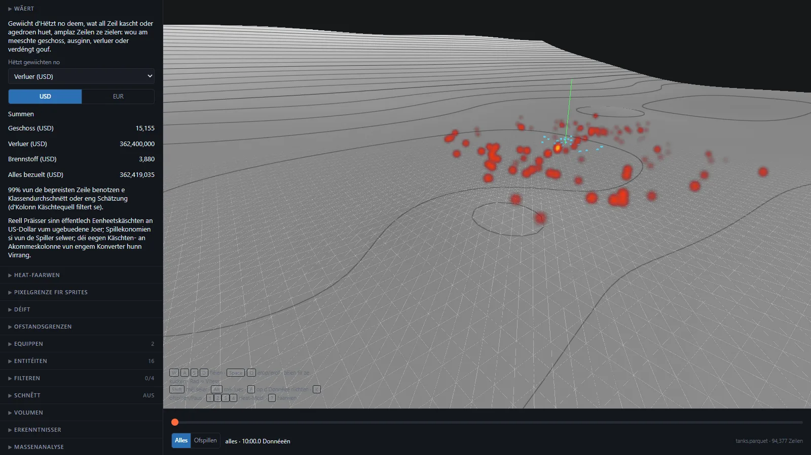

# Wäertgewiichtung

All Schoss, all Munitioun, all verluer Gefier an all Liter Brennstoff huet e Präis. D'Visualisatioun rechent aus, wat all Zeil kascht oder verdéngt huet, a kann d'Heat dorunner gewiichten, sou datt d'Kaart **wou d'Suen higaang ass** weist, anstatt wou d'Zeilen sinn.

## Wéi een et benotzt {#how-to-use-it}

1. Lued Daten mat Eventer (Schoss, Ofschosser, Doudesfäll) an Gefier- oder Waffennimm.
2. Maacht **Wäert** an der Heat-Säitelëscht op.
3. Wielt **Hëtzt gewiichten no**, zum Beispill *Verluer (USD)*. D'Heat addéiert elo de Präis vun all Zeil anstatt 1.
4. Liest **Summen**: d'Zomm vun all Wäertkolonn fir dat, wat gewise gëtt (Filter an d'Zäitfënster gelten).
5. Wann d'Präisser richteg Geld sinn, erschéngt e Schalter **USD / EUR**.

Fir d'Zeilen erëm ze zielen, wielt den eidelen éischte Punkt vum Menü.

## Wat gewiicht ka ginn {#what-can-be-weighed}

D'Wäertkolonnen ginn beim Lueden derbäigesat, eng pro Aart an Währung:

| Aart | Zeilen, op déi se fälle | Wéi se bepreist ass |
|---|---|---|
| **Geschoss** | Schoss an Ofschossen | d'Waff, soss en Duerchschnëtt fir d'Aart Munitioun |
| **Ausginn** | Kafen, Erscheinen | d'Geldkolonnen vum Spiel (zum Beispill d'Kafmenü vun engem Shooter) |
| **Verluer** | Doudesfäll, zerstéiert | d'eegent Gefier, soss de Duerchschnëtt vu senger Klass |
| **Zerstéiert** | Ofschosser | dat Zielgefier |
| **Ugeriichte Schued** | Treffer | en Undeel vum Wäert vum Zil |
| **Brennstoff** | Positiounen | verbrauchte Brennstoff, aus enger Brennstoffkolonn oder geschat aus Klass an Zäit |
| **Alles bezuelt** | | Geschoss + Ausginn + Verluer + Brennstoff |
| **Verdéngt** | Belounungen | d'eege Belounungskolonnen vum Spiel (`earn_…`) |
| **Netto** | | Verdéngt minus bezuelt; gëtt als Heat mat Vorzeechen gewisen (positiv Verlaf, wou méi verdéngt gouf, negativ, wou méi bezuelt gouf) |

D'Kolonnennimm sinn `cost_<Aart>_<Währung>`, `earn_<Währung>` an `net_<Währung>`. E Konverter, dee d'eegen Währung vum Spiel kennt (zum Beispill e Replay-Konverter, dee Spillkreditter schreift), gewënnt géint d'agebaute Präistabellen.

## D'Präistabellen {#the-price-tables}

| Tabell | Währung |
|---|---|
| Militär aus der richteger Welt: Raketen, Bomben, Munitioun, Géigemoossnamen, Fliger, Helikopter, Buedemgefier, Schëffer, Brennstoff | USD (EUR = USD × 0,92, dat fest `EUR_PER_USD` aus [`cost.ts`](https://github.com/Holdi601/3DHeat/blob/main/src/data/cost.ts); et ass kee Live-Kurs) |
| Kafmenüen vun Shootern an Killbelounungen | d'Kreditter vum Spiel |
| Panzer- an Schëffsspiller | d'Kreditter vum Spiel |
| Strategiespiller (méi Ressourcen) | eng Kolonn pro Ressource plus eng gemeinsam |
| Kriegsspiller | Punkten |

Dat Spill gëtt aus den Nimm an den Daten erkannt. Präisser aus der richteger Welt kommen aus ëffentlechen Quelle (Budgetdokumenter, Enzyklopedien) oder si sinn als Schätzungen markéiert; si sinn net inflatiounsbereinegt. D'generéiert Lëscht vun de Tabellen steet op [Wäertabellen](ref-value-tables.md).

## Schätzungen {#estimates}

D'zousätzlech Kategorie-Kolonn **Kostequell** seet, wéi all Zeil bepreist gouf: `table`, `class average`, `estimate` oder `none`. D'Sektioun Wäert weist, wéi vill vun de bepreiste Zeilen Duerchschnëtter oder Schätzunge sinn. Fir nëmmen exakt bepreiste Zeilen ze behalen, deselektéiert *estimate* an *class average* ënner **Kostequell** an [Filtere](filters.md).

## Wou Wäert soss ervirkënnt {#where-else-value-shows}

- [Einsichten](insights.md): d'Fonne *Deier Buedem* an *Verdéngende Buedem*.
- [Opdeelung](breakdown.md): Verdéngt, Verluer a Netto-Suen pro Team, Spiller oder Waff.
- [Volumen](volumes.md): Wäertkolonnen an der Statistik an am Verglach.
