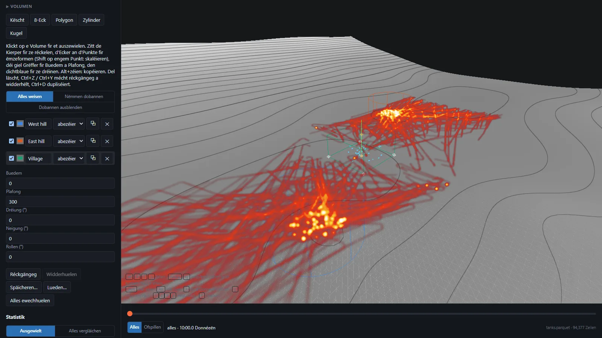
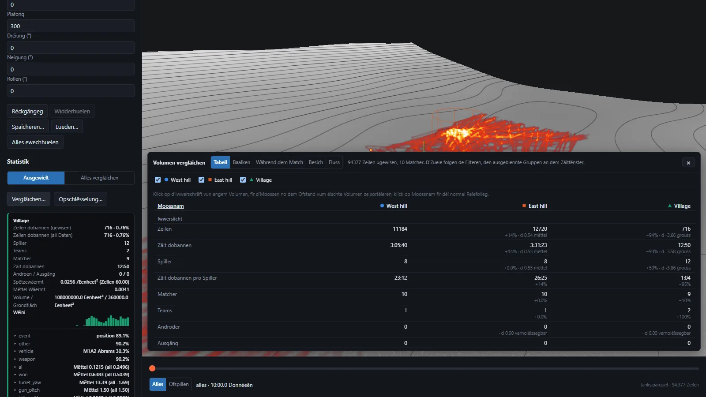
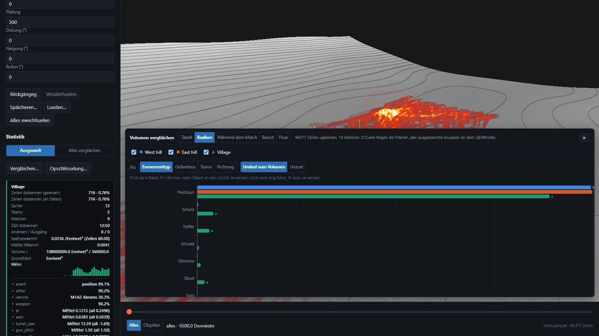

# Volumen a Verglach

E **Volumen** ass eng onsiichtbar Këscht (oder en Zylinder, oder eng Kugel), déi Dir ronderëm eng Plaz zitt, fir ze froen: wat ass hei dra geschitt? Benotzt en, fir Ofschëss bei enger Bréck ze zielen, fir zwee Hiwwelen ze vergläichen oder fir just d'Aktivitéit an engem Gebitt ze weisen.

```
 vu uewen                  Dir zéechent eng Form ->  de Viewer zielt
 +------------+           wat dra ass:
 |   ( A )    |            Zeilen, Spiller, Ofschëss, Zäit ...
 |        [B] |           Vergläicht A mat B, niewenee.
 +------------+
```



Volumen miessen, wat dran geschitt, filteren d'Usiicht op si, exportéieren hir Zeilen, a si kënnen niewenee verglach ginn. Kuckt och de [Glossar](glossary.md) fir Zeil, Persoun a Match.

## Volumen zéechnen {#draw-a-volume}

1. Maacht **Volumen** an der Säitelleescht op.
2. Wielt e Werkzeug a zéechent an der 3D-Usiicht oder op der 2D-Kaart. Buedem a Plafong fänken bei den Daten drënner un. Esc bricht of.
3. Klickt op d'Volumen fir et auszewielen; seng **Statistiken** erscheinen.

| Werkzeug | Wéi ee zéechent |
|---|---|
| **Këscht** | Zitt en Rechteck (Shift: e Quadrat). En Klick setzt eng Standardkëscht. |
| **n-Eck** | Zitt vun der Mëtt aus (Shift hält et regelméisseg). *Eck* setzt n, vun 3 bis 64 (Standard 8, dann steet um Knäppchen **8-Eck**). |
| **Polygon** | Klickt op d'Ecken; zoumaachen mat engem Duebelklick, Enter oder engem Klick op déi éischt Eck. Rück-Taste läscht déi lescht Eck. |
| **Zylinder** | Zitt de Radius. |
| **Kugel** | Zitt de Radius; si läit um Buedem. |

## Änneren {#edit}

- Klickt op e Volumen fir et auszewielen. Zitt op säi Kierper fir et ze réckelen, op d'Ecken fir d'Form z'änneren (Shift op enger Eck skaléiert).
- Déi **giele** Griffe setzen Buedem a Plafong, de **cyanen** Griff dréint et.
- Alt+Zéien kopéiert, Entf läscht, Strg+Z / Strg+Y maachen zréck an nach eng Kéier, Strg+D dupliziert. **Alles ewechhuelen** läscht all Volumen.
- Genee Wäerter: Buedem, Plafong, Dréinen / Neigung / Rollen (Këschten), Radius (Kugele, Zylinder).

All Volumenzeil huet e Kontrollkästchen fir d'Unzeechen, eng Faarf, en Numm, **abezéien** oder **ausschléissen**, Duplizéieren an Läschen. Volumen ginn pro Datesaz am Browser gespäichert, an **Späicheren…** / **Lueden…** schreiwen a liesen eng Datei `volumes.json`.

## D'Usiicht filteren {#filter-the-view}

| Filter | Effekt |
|---|---|
| **All weisen** (Standard) | Volumen miessen nëmmen. |
| **Nëmmen dobannen** | Hëtzt, Replay an [Treffer-Analys](hit-analysis.md) zeechnen nëmmen, wat an de abezéien Volumen ass a bausserhalb vun de ausgeschlossenen. |
| **Dobannen ausblenden** | Dat Géigendeel. |

De GPU-Filter huet bis zu 8 Volumen mat insgesamt 64 Ëmrësspunkten; e "!" markéiert en Volumen, dat driwwer ass. Statistiken an Export zielen et trotzdem.

## Statistiken {#statistics}

De Bereich **Statistiken** follegt de Filteren, dem Zäitfënster an de verstoppte Gruppen. *Gewielt* weist dat gewielte Volumen, *Alles vergläichen* stellt all Volumen niewenee. Et weist:

- **Zeilen dobannen (gewisen)** an **Zeilen dobannen (all Daten)**, **Spiller**, **Teams**, **Matcher**, **Zäit dobannen**, **Androen / Ausgäng**, **Spëtzewäermt**, **Mëttel Wäermt**, **Volume / Grondfläch** an en Histogramm **Wéini**;
- **Gewannquot**, wou d'Daten soen, wien gewonnen huet ([Resultatspalten](data-formats.md#outcome-columns)): vun de Ronne mat engem Spiller dobannen, d'Ronn vun all Spiller eemol gezielt, den Undeel, deen hir Säit gewonnen huet - mat 4 Ronnen zur Quot iwwer alles Gewisent gezunn, wéi d'[Opschlësselung](breakdown.md) et mécht - mat de gewonnenen a gespillte Ronnen an där Gesamtquot;
- pro Kolonn: Kategorien mat **Lift** (Undeel dobannen geteelt duerch den Undeel an allen gewisenen Daten), a Zuelen mat Beräich, Median a den 5.-95.-Perzentilen.

**Statistiken als CSV / JSON** späicheren si. **Daten dobannen exportéieren** schreift d'Zeilen dobannen als CSV oder Parquet (*Nëmmen d'gewisen Zeilen* ass standardméisseg un), ee Volumen oder all, mat enger Kolonn, déi seet, zu welchem Volumen all Zeil gehéiert.

## Volumen vergläichen {#compare-volumes}

Mat zwee oder méi siichtbare Volumen drécken Dir **Vergläichen…**.

1. Zeechent dräi Volumen, zum Beispill Westhiwwel, Osthiwwel a Duerf.
2. Drëckt **Vergläichen…** ënner Statistiken.
3. An **Tabell** liest Dir d'Differenz vun all Wäert zum éischte Volumen.
4. Wiesselt op **Baalken**, fir d'Undeeler als Baalken ze gesinn.



| Usiicht | Weist |
|---|---|
| **Tabell** | Zeilen, Zäit dobannen, Spiller, Matcher, Teams, Androen, Ausgäng, Besich, Besichslängt, Ofschëss, Doudesfäll, Ofschëss pro Doud, Ofschëss pro Minutt, Zäit pro Spiller, Wäertkolonnen; gruppéiert no Evenementer, Gefierklass, Spiller oder KI, Team a Richtung. All Wäert weist seng Differenz zum éischte Volumen an eng Effektgréisst (vernoléssbar, kleng, mëttel, grouss). Klickt op d'Iwwerschrëft vun engem Volumen, fir no Distanz zum éischte ze sortéieren. |
| **Baalken** | Zuelen oder Undeeler no Evenement, Klass, Akteur, Team oder Richtung. Klickt op e Baalken, fir d'Usiicht drop ze filteren. |
| **Während dem Match** | E Diagramm pro Volumen iwwer d'Minutte vum Match: Presenz, Zeilen oder Ofschëss. Klickt, fir dohinner ze sprangen. |
| **Besich** | Box- an Violinplots, wéi laang Besicher daueren (logarithmesch Skala). |
| **Fluss** | Wou d'Spuren nom Verloosse vu jidderem Volumen hi goen: eng Iwwergangsmatrix oder Flussbänner. |



## Tipps {#tips}

- Fangt mat engem Resultat un: an [Erkenntnisser](insights.md) setzt **Volumen hei** en Zylinder ronderëm d'Plaz vum Resultat.
- **Opschlësselung…** mécht d'[Opschlësselung](breakdown.md) fir dat gewielt Volumen op: wiem a wat dobannen am beschte ass.
- [Richtungs-Hëtzt](directional-heat.md) kann d'Richtungen dobannen am gewielte Volumen als Diagramm weisen.
- De [Gefierer-Tab](hit-analysis.md#restrict-to-an-area) benotzt déiselwecht Volumen als Gebitsfilter.
