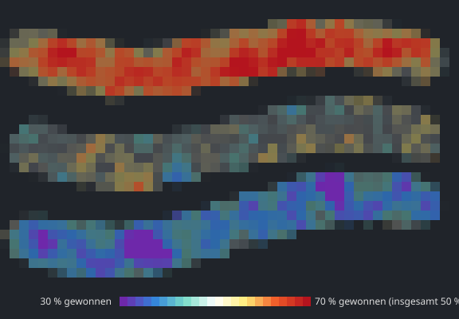

# Gewannquot: wéi dacks eng Plaz, e Wee oder e Spillzuch gewënnt

Wou e Spiller steet, wéi eng Richtung hie geet, wou hie seng Utility werft - a wéi dacks seng Säit duerno d'Ronn gewënnt. D'**Gewannquot-Kaart** fierft all Plaz no dem Undeel vun den Zeilen do, déi zu Ronne gehéieren, déi d'Säit vun der Zeil gewonnen huet, verglach mam Undeel iwwer alles, wat gewise gëtt: waarm, wou en méi héich ass, kal, wou en méi niddereg ass, näischt, wou en gläich ass.

*D'Bild weist erfonnt Daten: dräi Weeër op engem eidele Level, 68 %, 50 % an 33 % vun hiren Zeilen a gewonnene Ronnen.*

Et brauch Daten, déi soen, wien gewonnen huet: d'[Resultatspalten](data-formats.md#outcome-columns) (`won`, `matchWon`, `roundEndReason`). D'Konverter fir CS2 a War Thunder schreiwen se, den Tacview-Konverter fir d'Campagne vun engem DCS-Server ([DCS-Serveren](tacview-acmi.md#dcs-servers-who-won-and-how-each-sortie-ended)); all Fichier kann se hunn.

## Probéiert et {#try-it}

1. Luet Matcher mat enger Resultatspalt a dréckt `2` (**Ënnerscheed**).
2. Dréckt an der **Ënnerscheedsopdeelung** op **Gewannquot pro Ronn** (oder **Gewannquot pro Match**). Dat leet déi gewonne Ronnen op **+** an déi verluere op **−** a schalt de Panel op **Undeel vu +**.
3. Liest d'Faarwen. De Panel seet den Undeel insgesamt: *Insgesamt leien 52,0 % vu 1.200.000 Reien op +.*
4. Grenzt et mat de [Filteren](filters.md) an: eng Säit (T oder CT), een Evenementtyp (*Positioun* fir wou d'Leit stoungen, *Schoss* oder *Start (Rakéit, Bomm)* fir vu wou se geschoss oder geworf hunn), ee Kaf, eng Kaart.

Eng Plaz, déi mat *Positioun*-Zeilen waarm ass, ass eng Plaz, deenen hir Besetzer éischter d'Ronn gewonnen hunn. Mat *Ofschoss*-Zeilen ass et eng Plaz, wou d'Ofschëss, déi do gemaach goufen, zu gewonnene Ronne gefouert hunn.

## D'Astellungen {#the-settings}

| Astellung | Wat se mécht | Standard |
|---|---|---|
| **Ënnerscheed** / **Undeel vu +** | den Ënnerscheed selwer, oder den Undeel vun der +-Säit un den Zeile vu béide Säiten | Ënnerscheed |
| **Voll Faarf bei** | wéi wäit iwwer oder ënner dem Gesamtundeel eng Plaz a voller Faarf gewise gëtt, a Punkten | ± 20 Punkten |
| **Mindestzuel u Reien fir eng Plaz ze faarwen** | eng Plaz mat manner Zeile gëtt net gefierft; si blent vun der Hallschent dovun an | 12 |
| **Zuch zum Gesamtundeel (Reien)** | all Plaz fänkt mat esou ville Zeilen um Gesamtundeel un, sou datt eng Plaz mat 3 Zeilen, all gewonnen, net als 100 % gewise gëtt | 12 |

All dräi wierken op dat fäerdegt Bild: wann Dir se zitt, fänkt d'Akkumulatioun ni nei un.

Den Undeel ass dee vun all Opdeelung, net nëmme vu Gewënn: *Undeel vu +* mat enger Opdeelung no Säit weist, wou d'Ts de gréisseren Deel vun der Präsenz waren, a mat enger Opdeelung no de Fichiere vun zwou Kaarten, wou d'Zeile vun engem Fichier déi vum aneren iwwerwéien.

## Zeilen, net Ronnen {#rows-not-rounds}

D'Kaart zielt Zeilen. E Spiller, deen zwanzeg Sekonnen op enger Plaz steet, bréngt bei all Sample eng Zeil derbäi, all aus enger Ronn; sou sinn d'Beweiser op enger Plaz d'Zeilen no bei hir, net d'Ronnen. Dofir sinn de Minimum an den Zuch an Zeilen, an dofir si se méi grouss wéi dat, wat eng Ronn bréngt.

Fir d'Ronne selwer:

- **[Opschlësselung](breakdown.md)** op engem Punkt, der Usiicht oder engem Volumen: *Siegquote %* zielt d'Ronn vun all Spiller eemol, op déiselwecht Manéier zur Gesamtquot vun der Plaz gezunn (4 Ronnen).
- Statistike vun de **[Volumen](volumes.md)**: *Gewannquot* - d'Ronne mat engem Spiller am Volumen, all eemol, zur Quot iwwer alles Gewisent gezunn, mat den Zuelen.

## Resultatfilteren {#outcome-filters}

De Panel [Filteren](filters.md) weist d'Resultatspalte direkt no de Spalte vum Viewer selwer: **Resultat vun der Ronn** a **Resultat vum Match** (*All*, *Gewonnen*, *Verluer*) a **Wéi d’Ronn opgehalen huet** (Eliminatioun, Bomm explodéiert, Bomm entschäerft, Zäit ofgelaf, Opginn, Onentschidden, Zil, Zonen gehalen, Ticketen verluer, All Gefierer verluer), an der Sprooch vum Viewer.

## Fir Entwéckler {#for-developers}

De Hëtztduerchgang schreift dräi Summen an dat Véier-Kanal-Zil, dat d'Teamhëtzt benotzt: d'Hëtzt `R = Σ|v|`, d'Hëtzt vun der +-Säit `P`, an `S = Σ v²/w`, mat `w` als Gewiicht vum Duerchgang (Samplinggewiicht mol Frame-Gain). De Composite liest den Undeel `P/R` (e kernelgewiichte Mëttelwäert) an d'Zeilen, op deenen e berout, `n = R²/S` (Kish seng effektiv Stéchprouwegréisst), zitt den Undeel zum Gesamtundeel, `p = (n·P/R + m·r0)/(n + m)`, a fierft `p - r0` iwwer d'Spannbreet op de Ënnerscheedsrampen.

`n` deelt all Faktor eraus, deen den Zeilen op engem Pixel gemeinsam ass - de Frame-Gain, d'Samplinggewiicht, d'Flächegewiicht vun engem begrenzte Sprite - sou ass d'Bild bei all Zoom an all Samplingdicht d'selwecht, a Frames vun all k-ter Zeil fléisse bis zum Ganzen zesummen, ouni datt d'Faarwe sprangen. De Gesamtundeel kënnt vun de Säitenzielunge vun der CPU, op Zéngtel vun engem Prozent gehal; näischt gëtt vun der GPU zréckgelies. D'Rechnung an hir Kontrollen: [`render/rateMap.ts`](https://github.com/Holdi601/3DHeat/blob/main/src/render/rateMap.ts) an hiren Test.

Et kascht dat, wat d'Teamhëtzt kascht: dat Véier-Kanal-Zil véierfacht d'Blend-Bandbreet vum Hëtztduerchgang, nëmme soulaang *Undeel vu +* un ass.
