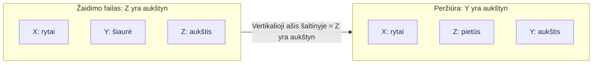

# Ašys, vienetai ir laikas

Žaidimai ir žemėlapiai nesutinka, kuria kryptimi yra viršus, kiek ilgas yra vienetas ar kaip rašomas laikas. Šis puslapis parodo tris nustatymus, kurie padaro, kad jūsų duomenys stovėtų, būtų tinkamo mastelio ir eitų teisinga kryptimi.

Jei jūsų žemėlapis stovi kaip siena, o ne guli kaip grindys, perjunkite **Vertikalioji ašis šaltinyje**.

Su neteisingu **Vertikalioji ašis šaltinyje** žemėlapis stovi kaip siena; su teisingu – guli kaip grindys.

## Pasaulis, kuriame piešia peržiūra {#the-world-the-viewer-draws-in}

Peržiūros pasaulis yra **Y aukštyn**: X ir Z yra žemės plokštuma, Y yra aukštis. Dauguma žaidimų variklių yra **Z aukštyn**: jiems X ir Y yra žemė, o Z – aukštis. Kai kurie varikliai taip pat yra veidrodiniai (kairiarankiai). Susiejimas nusako, kaip failo ašis paversti peržiūros ašimis. (Techniškai peržiūra yra dešiniarankė – three.js konvencija.)

### Viršus {#up-axis}

**Vertikalioji ašis šaltinyje** [Stulpelių priskyrimas](column-mapping.md) skiltyje:

| Nustatymas | Failas (x, y, z) tampa pasauliu (X, Y, Z) |
|---|---|
| *Z yra aukštyn (dauguma žaidimų variklių)* – numatytasis | (x, **z**, **y**): failo Z tampa aukščiu, o failo Y tampa pasaulio Z |
| *Y yra aukštyn (grafikos konvencija)* | (x, y, z) nepakitę |

Z aukštyn duomenims trys masyvai perpavadinami, o ne kopijuojami ([`remapAxesInPlace`](https://github.com/Holdi601/3DHeat/blob/main/src/data/ingest.ts)), o tai sutaupo šimtus megabaitų dideliuose įkėlimuose. Spėjimas daromas pagal imtį: kuris iš Y ir Z stulpelių turi mažesnį sklaidą, tas ir yra aukštyn.

### Apvertimai {#flips}

**Apversti X**, **Apversti Y**, **Apversti Z** keičia *failo* tos pavadinimo ašies ženklą prieš perpavadinimą – todėl, esant Z aukštyn, *Apversti Y* keičia tai, kas tampa pasaulio Z ženklą. Apvertimas pakeičia įkeltus duomenis: [liniuotės](measure.md) rodomos koordinatės, pjūvis ir kameros padėtis yra apvertos.

Norėdami nupiešti veidrodinį pasaulį teisingai **nekeisdami duomenų**, vietoj to naudokite **Kamera ir scena → Apversti pasaulio ašį** ([Kamera](camera.md#invert-world-axis)). Tai geresnis pasirinkimas žaidimams, kurių pasaulis kairiarankis, nes visos rodomos koordinatės lieka paties žaidimo.

### Vieneto mastelis {#unit-scale}

**Vieneto mastelis** padaugina kiekvieną poziciją. *1 (m)* nustato 1, *0,01 (cm→m)* nustato 0,01 (Unreal Engine vienetai yra centimetrai, todėl naudokite 0,01; Source variklio vienetai yra coliai, todėl naudokite 0,0254; nė vienas nėra metrai), o laukelis priima bet kokią reikšmę. Įrašytas 0 ar reikšmė, kuri nėra skaičius, pakeičiamas į 1.

Peržiūra atstumus žymi metrais (spraito spindulys, atrinkimo atstumai, liniuotė, skridimo greitis), o tai tiesa tik tada, kai mastelį pakeistas pasaulio vienetas yra metras. Jei ne, nieko nesugenda; tiesiog žymos rodo „m“ bet kokiam vienetui.

## Laikas {#time}

### Laiko vienetai {#time-units}

Praktinė taisyklė: reikšmės, pavyzdžiui, 17000000000 (dešimt ar daugiau skaitmenų), yra Unix laiko žymos; reikšmės, pavyzdžiui, 0, 0,25, 0,5, yra sekundės nuo pradžios.

| Laiko vienetas (meniu etiketė) | Skaitoma kaip | Rodomas sieninis laikrodis |
|---|---|---|
| *Sekundės (santykinis)* | reikšmė × 1 s | ne |
| *Milisekundės (santykinis)* | reikšmė × 0,001 s | ne |
| *Mikrosekundės (santykinis)* | reikšmė × 10^-6 s | ne |
| *Nanosekundės (santykinis)* | reikšmė × 10^-9 s | ne |
| *Unix laiko žymė (s)* | sekundės nuo 1970-01-01 UTC | taip |
| *Unix laiko žymė (ms)* | milisekundės nuo 1970-01-01 UTC | taip |
| *ISO-8601 datos eilutė* | tekstas, pavyzdžiui, `2026-03-14T18:02:11.250Z`, skaitomas naršyklės `Date.parse` | taip |

Su absoliučiu vienetu (paskutiniais trim) duomenų rinkinys išsaugo ankstyviausios eilutės sieninio laikrodžio momentą, o laiko juosta šalia grojimo žymeklio rodo dabartinį UTC dienos laiką (`HH:MM:SSZ`).

**Parquet `TIMESTAMP` ir `DATE` stulpeliai** dekoduojami į tikrus momentus, todėl jų vieneto nustatymas ignoruojamas, o skydelis tai nurodo. `DATE` stulpelis yra visa diena: visos vienos dienos eilutės turi vieną momentą, o atkūrimas peršoka po dieną, apie ką skydelis įspėja.

**ISO-8601 eilutės veikia tiek CSV, tiek Parquet.** Teksto laiko stulpelis su ISO vienetu išskaidomas po vieną kartą kiekvienai skirtingai eilutei; jei nė viena neišsiskaido, įkėlimas nutrūksta su pranešimu *Susietame laiko stulpelyje nėra išskaidomų ISO-8601 laiko žymų.* – o susiejimas jau atsisako pradėti, jei nė viena imties reikšmė neišsiskaido. Parquet `TIMESTAMP` stulpelis skaitomas kaip laiko žymė, kad ir koks būtų vienetas, o skaitinis Parquet stulpelis su ISO vienetu skaitomas kaip Unix milisekundės. Teksto laiko stulpelis su skaitiniu vienetu atmetamas prieš įkeliant: kiekviena reikšmė būtų skaitoma kaip NaN.

### Kaip laikas saugomas {#how-time-is-stored}

Kol failai sujungiami, laikas yra 64 bitų sekundės, todėl absoliutus epochos laikas išsaugo sekundės dalių detales. Kai visi failai įkelti, ankstyviausias visos atrankos laikas tampa 0, o kiekviena eilutė saugo 32 bitų sekundes nuo jo. 32 bitų slankiojo kablelio skaičius turi 24 bitų mantisę: intervalai iki maždaug pusantros paros išskiriami geriau nei 1/100 s, pusės metų intervalai – maždaug iki sekundės. Eilutė, kurios laikas trūksta arba nėra skaičius, padedama į 0, pradžią.

Eilutės tada surikiuojamos pagal laiką, ir tai daro laiko juostą pigią: laiko langas randamas dviem dvejetainėmis paieškomis (žr. [Imtis ir biudžetai](sampling-and-budgets.md)).

### Praėjęs laikas ir sieninis laikrodis {#elapsed-time-versus-wall-clock}

Laiko stulpelis, pavyzdžiui, `match_time` ar `round_time`, skaičiuoja nuo kiekvienų rungtynių savo pradžios. Jį pasirinkus, kiekvienos rungtynės patenka į bendrą ašį – tai gerai lyginant, kas nutinka 3-iąją kiekvienų rungtynių minutę – ir skydelis tai nurodo. Sieninio laikrodžio stulpelis rodo rungtynes tikra jų įvykių tvarka, persidengiančias ten, kur persidengė.

## Žiūrėjimo kryptis {#look-direction}

Žiūrėjimo kryptis naudojama tik [dėžutės pakartojimui](box-replay.md) (spinduliams iš kiekvienos dėžutės). Ji saugoma kaip du kampai, posūkis ir polinkis, radianais.

- **Posūkio / polinkio stulpeliai** skaitomi tokie, kokie yra, konvertuojami iš laipsnių, kai pasirinktas *Laipsniai*. Jie nekoreguojami pagal vertikalią ašį ar apvertimus.
- **Krypties vektoriaus stulpeliai** eina per tą patį perpavadinimą ir apvertimus kaip ir pozicijos, tada tampa posūkiu = atan2(x, -z) ir polinkiu = atan2(y, √(x² + z²)) pasaulio ašyse, todėl spindulys rodo, kur nukreipta dėžutė, net veidrodinio šaltinio pasaulyje.

Jei posūkio / polinkio stulpeliai po apvertimo, krypties vektoriaus ar koreguotų kampų rodo ne ta kryptimi, pataisa yra ta, kuri nurodyta aukščiau.
