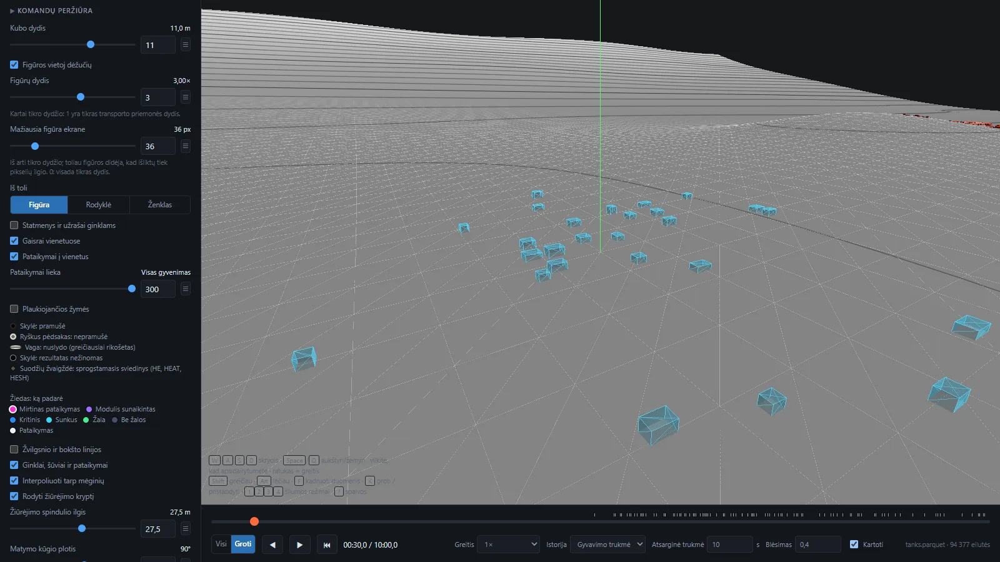

# Figūrų sutapdinimas (dėžučių pakartojimas)

Nedidelis filmas: po vieną figūrą kiekvienam asmeniui, judančią, kai bėga laikas, su pėdsaku už jos.

Režimas vadinamas **Figūrų sutapdinimas** režimų juostoje. Šis puslapis anksčiau vadinosi „dėžučių pakartojimas“, nes iki figūrų atsiradimo kiekvienas asmuo buvo dėžutė; „figūrų pakartojimas“ ir „dėžučių pakartojimas“ reiškia tą patį. **Figūrų sutapdinimas** neturi skaitmeninio klavišo: pasirinkite jį režimų juostoje. Jis piešia vieną figūrą (arba dėžutę) kiekvienam [asmeniui](glossary.md), judančią palei [laiko juostą](timeline.md), su pasirenkamomis žiūrėjimo spinduliais ir pėdsakais. Tai atkūrimas, o ne tankis: *kas kur buvo, kada*. Reikia asmens stulpelio; be laiko stulpelio kiekvienas mėginys piešiamas iš karto.

## Kaip naudoti {#how-to-use-it}

1. Įkelkite duomenis su asmens stulpeliu ir laiko stulpeliu.
2. Pasirinkite **Figūrų sutapdinimas** režimų juostoje.
3. Perjunkite laiko juostą į **Groti** ir paspauskite groti (`K`).
4. Atidarykite **Komandų peržiūra**, kad pakeistumėte **Pėdsako ilgį**, figūros dydį ar žiūrėjimo spindulius.

Šiame režime šiluma nepiešiama, o prisitaikantis spraitų biudžetas neveikia.

Numatytuoju atveju kiekvienas asmuo piešiamas kaip figūra to, kuo jis yra, o ne kaip dėžutė – žr. [Figūros](figures.md), kokią figūrą gauna vienetas, ir [Rungtynių pakartojimas](match-replay.md) dėl žymų, sekimo kameros, matavimo tarp dviejų vienetų ir įvykių sąrašo.

## Skydelis Komandų peržiūra {#the-team-viewer-panel}

Rodomas vietoj šilumos skydelių šiame režime.

| Valdiklis | Numatytoji | Intervalas (vilkimas) | Reikšmė |
|---|---|---|---|
| **Figūros vietoj dėžučių** | įjungta | | Kiekvienas asmuo kaip figūra to, kuo jis yra: pėstininkas, tankas ar orlaivis, kuriuos nurodo duomenys. Tai, apie ką duomenys nieko nesako, lieka dėžute. |
| **Figūros dydis** | 1× | | 1× yra tikrasis dydis. |
| **Mažiausia figūra ekrane** | 36 px | 0 = visada tikrasis dydis | Tikrasis dydis arti; toliau esančios figūros išauga, kad išliktų tiek pikselių ilgio. |
| **Ginklai, šūviai ir pataikymai** | įjungta | | Ginklai skrydžio metu su dūmais, trasavimo linijos, smūgiai, pataikymai ir nužudymai. Iš pataikymo išvestos trasavimo linijos yra brūkšninės. |
| **Kubo dydis** | vieneto dydis arba plotas / 500, įkėlus | 0,05–200 m, logaritminis (5000) | Kiekvienos dėžutės briaunos ilgis. Žr. [vieneto dydis](sessions-persons-groups.md#entity-size). |
| **Interpoliuoti tarp mėginių** | įjungta | | Tarp dviejų to paties asmens mėginių toje pačioje sesijoje dėžutė dedama proporcingai tarp jų. Niekada per sesijos ribą. |
| **Rodyti žiūrėjimo kryptį** | įjungta | | Spindulys nuo kiekvienos dėžutės asmens žiūrėjimo kryptimi (reikia [žiūrėjimo stulpelių](axes-units-and-time.md#look-direction)). |
| **Žiūrėjimo spindulio ilgis** | vieneto dydis × 4, arba plotas / 200, įkėlus | 0,5–500 m, logaritminis (20 000) | Rodoma, kol įjungta žiūrėjimo kryptis. |
| **Pėdsako ilgis** | 8 s | 0–300 s (86 400); 0 = išjungta | Istorijos sekundės, piešiamos už kiekvieno asmens. |
| **Piešti kiekvieną neapdorotą mėginį** | išjungta | | Dėžutė kiekvienam saugomam mėginiui lange, o ne viena interpoliuota dėžutė vienam asmeniui. Imamas poaibis, kad išliktų interaktyvu. |

Skydelio patarimai paaiškina, kad interpoliacija ir pėdsakai jungia mėginius tik vienoje sesijoje ir, kai įkėlime yra [bendri vardai](sessions-persons-groups.md#names-worn-by-several-things-at-once), kiek vardų piešiama kaip pavieniai mėginiai.

## Grojama sesija {#the-session-being-played}

Su sesijos stulpeliu viršutinėje šoninės juostos dalyje esantis pasirinkimas **Sesija** ([Sesijos](sessions-persons-groups.md#the-session-picker)) nusprendžia, kurias rungtynes atkurti. Įkeliant parenkama daugiausiai įvykių turinti. Tik tos sesijos eilutės tampa dėžutėmis ir pėdsakais, o laiko juosta eina per tos sesijos trukmę, o ne per visų duomenų. *Visos sesijos* groja visas sesijas vienu metu, vis tiek niekada nejungdamos mėginių per sesijų ribas.

## Kas ir kada piešiama {#what-is-drawn-when}

Iš [`TrackCursor`](https://github.com/Holdi601/3DHeat/blob/main/src/data/tracks.ts):

**Gyvos dėžutės** (grojimo režimas, neapdoroti mėginiai išjungti). Kiekvienam matomam asmeniui – jo naujausias mėginys lygiai prie grojimo žymeklio ar prieš jį:

- Jei asmuo turi kitą mėginį, jis yra toje pačioje sesijoje ir vardas nėra bendras, dėžutė dedama tarp dviejų mėginių proporcingai laikui, posūkis interpoliuojamas trumpesniu keliu, o polinkis tiesiškai (kai įjungta *Interpoliuoti*).
- Kitu atveju dėžutė lieka prie paskutinio mėginio per laiko juostos **Atsarginę trukmę** (numatyta 10 s), tada išmetama, kad pašalinti žaidėjai neliktų.

**Visas režimas** ignoruoja grojimo žymeklį ir piešia kiekvieną intervale esantį mėginį kaip dėžutę.

**Neapdoroti mėginiai** piešia dėžutę kiekvienam saugomam mėginiui lange: *Intervalas* su *Lango* istorija, kitaip – viską iki grojimo žymeklio. Daugiausia 65 536 dėžutės; su daugiau mėginių piešiamas kiekvienas k-tasis.

**Pėdsakai** (kai pėdsako ilgis didesnis nei 0 ir neapdoroti mėginiai nepiešiami): linija tarp kiekvienos gretimų asmens mėginių poros per paskutines *pėdsako ilgio* sekundes iki grojimo žymeklio, blunkanti nuo 80 % nepermatomumo iki permatomumo su amžiumi. Pėdsakas nutrūksta sesijos pasikeitimo vietoje ir nepiešiamas bendriems vardams. Daugiausia 131 072 viršūnės; su daugiau eilutės praleidžiamos tolygiai.

**Kas matomas:** asmuo paslepiamas, kai jo grupė nepažymėta [Komandų sąraše](teams-list.md) (jo grupė – pirmosios jo eilutės grupė), kai grupės filtras jo neįtraukia arba kai skydelyje [Objektai](entities.md) pasirinkta nėra jo. [Stulpelių filtrai](filters.md) dėžutėms netaikomi.

## Spalvos {#colours}

Vienas spalvų šeimos atspalvis kiekvienai grupei ir vienas tonas kiekvienam nariui, todėl vienu žvilgsniu matote, kurioje pusėje kas yra ([`teamMemberColor`](https://github.com/Holdi601/3DHeat/blob/main/src/render/colors.ts)). Grupių atspalviai ciklu eina per fiksuotą dešimties sąrašą – mėlyna, raudona, žalia, gintarinė, violetinė, žydra, magenta, citrininė, oranžinė, indigo – o grupės nariai pasiskirsto per šviesumą 42–76 % ir sodrumą 90–65 %.

## Pastabos {#notes}

- Figūrų sutapdinimas atkuria savo figūras tik tada, kai kas nors pasikeičia; tuščias kadras perpiešia paskutines.
- Eilutė *Kubai* [statistikos perdangoje](performance-and-stats.md) suskaičiuoja ekrane esančias dėžutes.
- Figūrų sutapdinimas piešiamas toje pačioje scenoje kaip lygis, todėl [lauko gylis](camera.md#depth-of-field) sulieja dėžutes, bet niekada nesulieja šilumos.
