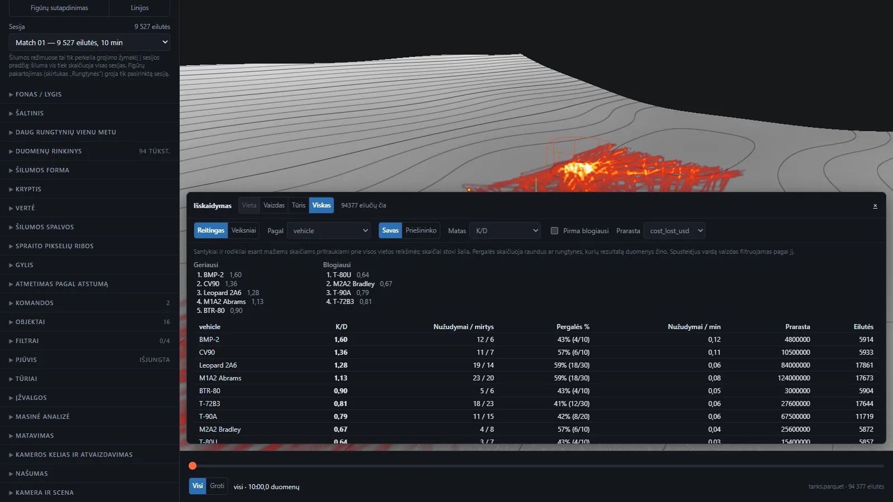
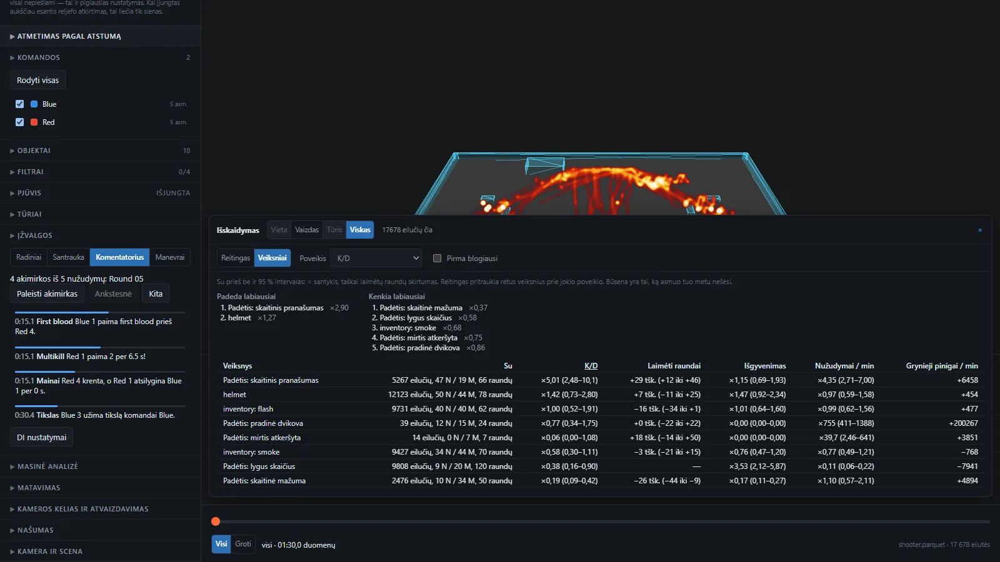

# Išskaidymas: kas ir ką geriausiai daro kur

**Išskaidymas** atsako į vieną klausimą: šioje vietoje, kuri technika, žaidėjas ar ginklas veikia geriausiai? Naudokite jį, kad rastumėte tanką, kuris laimi prie tilto, arba pamatytumėte, ar šalmas tikrai padeda.

Jis suranda, kas vyksta vienoje vietoje (pasirinktame taške, rodinyje, tūryje ar visame rodomame), pagal bet kurią kategoriją, ir matuoja kiekvieną būsenos veiksnį su ir be jo.

## Išbandykite {#try-it}

1. Įkelkite rungtynes su nužudymais ir mirtimis ir atidarykite **Tūriai**.
2. Nubrėžkite tūrį aplink vietą, kuri jums rūpi, ir jį pasirinkite.
3. Paspauskite **Išskaidymas…** skiltyje Statistika.
4. Skiltyje **Pagal** pasirinkite *Technika*, o matą – *K/D* (nužudymai vienai mirčiai).
5. Skaitykite sąrašą, geriausi viršuje. Paspauskite **Pirma blogiausi**, kad apverstumėte. Spustelėkite vardą, kad filtruotumėte rodinį pagal jį; spustelėkite dar kartą, kad atleistumėte.

## Atidaryti {#open-it}

| Iš kur | Sritis, iš kurios pradedama |
|---|---|
| **Išskaidymas…** [Tūriuose](volumes.md) (Statistika) | pasirinktas tūris |
| **Išskaidymas čia** ant pasirinkimo kortelės, spustelėjus tašką | sfera aplink tą tašką (**Spindulys**, numatytoji 3 % duomenų dydžio) |
| **Skirtumo** padalijimo skydelis | rodinys |

Antraštė perjungia sritį: **Vieta**, **Vaizdas** (ką kamera matė paskutinį kartą skaičiuojant; **Skaičiuoti iš naujo** po judėjimo), **Tūris** (pasirinkite vieną) arba **Viskas**. Skaičiuojama fone; būsenos eilutė nurodo, kiek eilučių yra srityje.

## Reitingavimas {#ranking}

Pasirinkite, pagal ką rikiuoti, ir matą:

| Matas | Ką reiškia |
|---|---|
| A, B | eilutės kiekvienoje skirtumo žemėlapio pusėje, padalytos taip, kaip jas skaido šiluma |
| A / B, A - B, A / (A + B) | abu sluoksniai vienas prieš kitą |
| K/D | nužudymai prieš mirtis |
| Laimėta % | raundai (ar rungtynės), kurias laimėjo, kai duomenys nurodo, kas laimėjo |
| Nužudymai / min | nužudymai per minutę, esant judėjimo mėginių tarpams |
| Uždirbta, Prarasta, Grynieji pinigai | `earn_*` ir `cost_*` stulpelių sumos; rinkiklis parenka valiutą |

Nužudymai, mirtys, buvimas, pergalės ir pinigai skaičiuoja kiekvieną rodinyje esančią eilutę toje vietoje, bet kurioje skirtumo pusėje ar nė vienoje.

Santykiai ir dažniai traukiami link visos vietos reikšmės, kai skaičiai maži, todėl 2 nužudymai per 1 gyvenimą neiškyla į viršų. Skaičiai rodomi šalia jų.

Galite rikiuoti pagal grupes, žaidėjus ir rungtynes, bet kurį kategorijos stulpelį (techniką, ginklą, pusę, pirkimo tipą, agentą ar komplektą), bet kurį skaitinį stulpelį intervalais (šarvus, komplekto vertę), ginklo stulpelio **klasę** (šautuvas, snaiperis, SMG, pistoletas...) ir kiek **pagalbinių priemonių** turi sąrašo stulpelis, pavyzdžiui, `inventory`.

**Savas** rikiuoja pagal eilutės pačios reikšmę. **Priešininko** rikiuoja pagal kitos pusės reikšmę: nužudyto ginklas nužudymo atveju, žudiko – mirties atveju (reikia stulpelio `other` / `victim`, kuris juos nurodo).

## Būsena tuo metu {#state-at-the-time}

Eilutės reikšmė yra jos pačios, nebent eilutė nieko neįrašo (įvykio eilutė be įrangos) arba tai mirtis (kurios ginklo stulpelis gali nurodyti žudiko ginklą); tada tai yra reikšmė, kurią tas pats žmogus turėjo anksčiau rungtynių metu.

## Veiksniai: su ir be {#factors-with-against-without}

Perjunkite iš **Reitingavimas** į **Veiksniai**, pasirinkite **Poveikis** ir skaitykite *Padeda labiausiai* ir *Kenkia labiausiai*:

Kiekvieno veiksnio poveikis K/D, laimėtiems raundams, išlikimui (minutės vienai mirčiai), nužudymams per minutę ir grynųjų pinigų per minutę, su 95 % intervalu: santykiai rodomi kaip x, laimėti raundai – kaip taškų skirtumas. Reitingas traukia kiekvieną įvertį link nulinio poveikio pagal jo paties neapibrėžtumą, todėl retas veiksnys, kad pakiltų į viršų, turi turėti aiškų poveikį; rodomas intervalas yra netrauktas.

Duomenys su raundais prideda artimo kontakto **situacijas** ([Artimas kontaktas ir raundai](close-quarters.md)), apskaičiuotas kartą kiekvienam duomenų rinkiniui: *apakintas* (eilutės `state_flashed` arba priešo blyksnis per 15 m per paskutines 3 s), *mirtis atsilyginta*, *atidarymo dvikova* ir *vieno daugiau*, *lygūs skaičiai* arba *vieno mažiau* (eilutės pusės gyvi žaidėjai prieš priešą). Mirtis priskaičiuojama situacijai, kurioje buvo jos auka prieš pat tai.

Viename perėjime išmatuojama daugiausia 256 veiksnių.

## Kūrėjams {#for-developers}

### Mažų imčių traukimas {#pulling-small-samples}

Reitingo reikšmė yra `(n + m*r0) / (d + m)`: `n` ir `d` yra skaičiai, `r0` – visos vietos santykis, o `m` – tos prielaidos svoris.

### Konverterių autoriams: veiksnių stulpelių pavadinimai {#for-converter-authors-naming-factor-columns}

Konverteris prideda veiksnį pavadindamas jo stulpelį:

| Stulpelis | Veiksnys |
|---|---|
| `state_<pavadinimas>` skaičius | įjungtas, kol nėra nulio (`state_scoped`, `state_suppressor`) |
| `state_<pavadinimas>` kategorija | vienas veiksnys kiekvienai reikšmei (`state_ammo` = AP, HE...) |
| `active_<pavadinimas>` | tas pats, skirtas kažkam įjungtam ar neseniai naudotam: gebėjimas, ultimatumas, įrankis, stiprinimas (`active_ult`, `active_stim`) |
| sąrašo stulpelis (`inventory`, `loadout`, `perks`, `abilities`, `attachments`, `modules`, `buffs`, `debuffs`, `upgrades`, arba `state_`/`active_` pavadinimas, besibaigiantis `s`) | vienas veiksnys kiekvienam `a\|b\|c` reikšmės elementui |
| jau įprasti įrangos žymekliai (`helmet`, `defuser`, `armor`, `scoped`, `airborne`, `duck`, `flashed`...) | įjungti, kol nėra nulio |
| `ammoType`, `shellType`, `ammoName` | paskutinis iššautas sviedinys |

Rezultatai: stulpelis `won` su 0/1 (eilutės pusė laimėjo raundą ar rungtynes) ir stulpelis `round` - [rezultato stulpeliai](data-formats.md#outcome-columns); kai faile yra ir `won`, ir `matchWon`, *Pergalės %* skaičiuoja raundus. Pinigai: `earn_<valiuta>` ir `cost_<rūšis>_<valiuta>`; pajamos tik pagal rūšį (`earn_round_cs2`, konverterio tikslios raundo premijos) pakeičia tik tos rūšies pajamas kainos modelyje (`round` apima ir sprogdinimus bei išminavimus), o modelis vis dar apskaičiuoja kitas.

Susiejimas pats įkelia šiuos stulpelius šalia paties failo sąrašo: kiekvieną `state_*`, `active_*`, `won`, `round` ir sąrašo stulpelį, išskyrus tuos, kuriuos Parquet failo statistika rodo turinčius vieną reikšmę visur (kiekvienas įkeltas stulpelis kainuoja 4 baitus eilutei).
