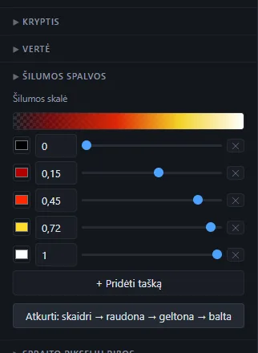

# Spalva ir ekspozicija

Šie valdikliai nusprendžia, kiek šilumos gauna kokią spalvą. **Įsotinimo taškas** – tai šilumos kiekis, kuris laikomas baltai karščiu.

## Greiti sprendimai {#quick-fixes}

- Viskas balta: padidinkite **Įsotinimo tašką** arba paspauskite **Automatinė ekspozicija pagal lauką**.
- Nieko nematyti: sumažinkite **Įsotinimo tašką** arba paspauskite **Automatinė ekspozicija pagal lauką**.
- Matosi tik keli pavieniai taškai: pakelkite **Mažiausią šilumą**.

Visi šio puslapio valdikliai veikia tada, kai šiluma paverčiama spalva, todėl bet kurį iš jų vilkdami vaizdą iš karto perpiešiate ir **niekada neperkraunate kaupimo**.

## Įsotinimo taškas {#saturation-point}

**Įsotinimo taškas** (skyrius Šilumos forma): kaupiamoji šiluma, kuri atitinka spalvų skalės viršų (su *Tiesine* reakcija; kitoms reakcijoms žr. žemiau). Logaritminis slankiklis 0,1–4000, rankenėlę galima vilkti iki 10 000 000, nes kaupiamoji šiluma auga kartu su eilučių skaičiumi. Numatytoji reikšmė – 24; kiekvienos įkėlimo metu pirmiausia nustatomas **analitinis įvertinimas**, o paskui iš paveikslėlio **išmatuojama**.

Šią reikšmę nustatyti neteisingai – tai skirtumas tarp šilumos žemėlapio ir tuščio (ar balto) ekrano, o patikimai ji apskaičiuoti negali: telemetrija susitelkia taip stipriai – gimimo vieta, durys, siaurėjimas – kad smailės ir vidurkio tankio santykis skirtinguose duomenų rinkiniuose ir skirtinguose kameros kampuose skiriasi dešimt kartų.

## Automatinė ekspozicija {#auto-exposure}

**Automatinė ekspozicija pagal lauką** išmatuoja lauką, kurį iš tikrųjų sugeneravo šešėliuoklis. Ji ignoruoja tuščius pikselius, paima apšviestųjų pikselių 98-ąjį procentilį ir padeda jį į 85 % kelio iki įsotinimo taško, todėl viršutinė skalės dalis lieka tikrosioms smailėms.

Skydelyje tada rodoma: *išmatuota X % kadro; 98-asis procentilis R padėtas arti skalės viršaus*. Su *Įsotinančia* reakcija reikšmė, esanti 85 % kelio iki įsotinimo taško, atsiduria maždaug 57 % skalės, o ne 85 %.

Ji taip pat veikia **automatiškai**:

- 8 atvaizduotus kadrus po to, kai įkeliamas duomenų rinkinys;
- 8 kadrus po to, kai pasikeičia [filtrai](filters.md) (filtruojant kiekvieną poziciją iki šimto įvykių, tankis pakinta per kelias eiles);
- 8 kadrus po to, kai perjungiama tarp taškinės šilumos ir [linijų šilumos](line-heat.md) arba keičiami maršrutai, kuriuos piešia linijų šiluma, nes linija vienam mėginiui paliekia daug mažiau šilumos nei spraitas.

Kai nieko neapšviesta, automatinis paleidimas įsotinimo nekeičia; mygtukas grįžta prie analitinio įvertinimo ir praneša: *nėra ką matuoti – naudotas analitinis įvertinimas*.

### Sekti vaizdą {#follow-the-view}

**Sekti vaizdą** (skyrius Šilumos forma, numatyta įjungta) matuoja iš naujo kiekvieną kartą, kai kamera sustoja, todėl regionas, į kurį įskrendate, naudoja visą spalvų skalę, o ne visam žemėlapiui išmatuotą mastelį. Maži pokyčiai ignoruojami, o mastelis slysta, o ne šokinėja. Tai veikia keturiuose šilumos režimuose, bet ne sutapdinimo su figūromis režime.

Išjunkite, jei norite užfiksuoti mastelį ir palyginti vietas viename mastelyje. Vilkdami **Įsotinimo tašką** rankiniu būdu, taip pat jį užfiksuojate.

## Tankio atsakas {#density-response}

**Tankio atsakas** – kaip *k* (šiluma / įsotinimas) atitinka skalę:

| Atsakas | Formulė | Kam naudoti |
|---|---|---|
| **Įsotinantis** (numatytasis) | t = 1 - e^(-k) | Artėja prie skalės viršaus asimptotiškai, taip kaip sudėti permatomi spraitai. Niekas niekada nevirsta į vientisai baltą, todėl tai saugus numatytasis pasirinkimas nepažįstamiems duomenims. |
| **Tiesinė** | t = k | Vienintelis atvaizdavimas, kuriame vienoda spalva reiškia vieningą skaičių. Naudokite dviem duomenų rinkiniams ar dviem laiko intervalams palyginti. |
| **Logaritminė** | t = log₂(1 + 7k) / 3 | Suspaudžia ilgą uodegą, todėl vienas ekstremalus karštas taškas nebenuslopina visko kitko iki skalės apačios. Pakelia retai apgyventas vietas. |

## Mažiausia šiluma {#minimum-heat}

**Mažiausia šiluma** (numatyta išjungta, 0–100 %): kiekvienas pikselis, kuriame yra bet kokios šilumos, pakeliamas bent iki šio skalės taško. Pakelkite ją, o spraito spindulį sumažinkite, kad pamatytumėte, **kur kada nors kažkas įvyko** – pavieniai duomenų taškai tampa aiškiai matomi, o ne tiesiog šiek tiek virš permatomo. Kai vertinate tankį, išjunkite, nes ji sąmoningai nušviečia skalės apačią. Riba (k > 0,0001) tuščius pikselius palieka tuščius.

## Skalės redaktorius {#the-ramp-editor}

Skyriuje **Šilumos spalvos**. Jo užrašas parodo, kam skirta skalė: *Šilumos skalė* režimuose Šiluma ir Linijos, *Teigiama (sudedančios komandos)* režime Skirtumas, *Nepermatomumo skalė (spalvą suteikia grupė)* režime [Komandų šiluma](team-heat.md), kur naudojamas tik jos alfa kanalas.



Viršuje esanti juosta rodo skalės peržiūrą. Žemiau – viena eilutė kiekvienam taškui:

| Dalis | Reikšmė |
|---|---|
| Spalvos pavyzdys | Taško spalva (naršyklės spalvų parinkiklis). |
| Skaičius | Taško padėtis palei skalę, nuo 0 iki 1 (0 = jokios šilumos). |
| Slankiklis | Taško nepermatomumas, 0–100 %. |
| ✕ | Pašalina tašką; išjungta, kai lieka tik du taškai. |

**+ Pridėti tašką** prideda tašką tarp dviejų paskutinių taškų, su paskutinio taško spalva ir nepermatomumu. **Atkurti: skaidri → raudona → geltona → balta** grąžina numatytąją reikšmę.

Taškus galima nurodyti bet kokia tvarka; kai skalė sudaroma, jie surikiuojami. **Alfa** yra tai, kas sumaišo šilumą su scena, todėl numatytosios skalės nulinis galas yra visiškai permatomas.

### Numatytosios skalės {#the-default-ramps}

| Padėtis | Teigiama (Šiluma, Linijos, Skirtumas +) | Neigiama (Skirtumas −) |
|---|---|---|
| 0,00 | juoda, alfa 0 | juoda, alfa 0 |
| 0,15 | rgb(180, 0, 0), alfa 0,55 | rgb(0, 170, 60), alfa 0,55 |
| 0,45 | rgb(255, 40, 0), alfa 0,85 | rgb(0, 190, 200), alfa 0,85 |
| 0,72 | rgb(255, 220, 40), alfa 0,95 | rgb(40, 80, 255), alfa 0,95 |
| 1,00 | balta, alfa 1 | rgb(170, 60, 255), alfa 1 |

## Kol kamera juda {#while-the-camera-moves}

Kai kamera juda, kaupimas kiekvieną kadrą pradedamas iš naujo. Su įjungta **Piešti kiekvieną eilutę kiekviename kadre** (numatyta) kiekvienas judantis kadras vis tiek tikslus; su išjungta judantis kadras rodo vieną imties įvertinimą – ryškesnius, svoriu pamatuotus gumulus – kuris, sustojus, susilieja į sklandesnį tikrąjį vaizdą. Tai normalu; žr. [Kaupimas](accumulation.md).

## Kūrėjams {#for-developers}

### Sudėjimo etapas {#the-composite-pass}

Sukaupus šilumą, kiekvieno pikselio reikšmė paverčiama spalva viename sudėjimo etape ([`COMPOSITE_FS`](https://github.com/Holdi601/3DHeat/blob/main/src/render/webgl2/shaders.ts)). Žingsniai tokie:

```
k = |šiluma| / įsotinimo taškas
t = atsakas(k)                          apribota 0..1
if mažiausia šiluma > 0 and k > 0.0001:  t = mažiausia + (1 - mažiausia) × t
spalva, alfa = skalė(t)                 (neigiama skalė, kai šiluma < 0, tik Skirtumui)
pikselis = mix(scena, spalva, alfa)
```

### Analitinis įvertinimas {#the-analytic-estimate}

**Analitinis įvertinimas** ([`estimateSaturation`](https://github.com/Holdi601/3DHeat/blob/main/src/data/calibrate.ts)) daro prielaidą, kad eilutės pasiskirsto per duomenų X-Z pėdsaką: vidutinė šiluma = eilutės × (π r² / pėdsako plotas) × 1/3 × centro intensyvumas (1/3 yra tiesinio nuolydžio disko vidurkis), padauginta iš prielaidinio smailės ir vidurkio santykio 25, apribota 0,1–1 000 000. Jai pakanka būti maždaug vieno dydžio eilės tikslumo.

### Matavimas {#metering}

[`exposure.ts`](https://github.com/Holdi601/3DHeat/blob/main/src/render/exposure.ts):

1. šilumos tikslas nuskaitomas iš GPU, paimant ne daugiau kaip 40 000 reikšmių;
2. tušti pikseliai (šiluma ≤ 0,0001) atmetami – didžioji šilumos lauko dalis tuščia, o įskaičiavus juos visa būtų per silpnai eksponuota, kaip fotoaparato matuoklis, nukreiptas į juodą foną;
3. apšviestųjų pikselių 98-asis procentilis yra atskaitos taškas;
4. įsotinimo taškas tampa atskaitos / 0,85, todėl atskaitos taškas yra 85 % kelio iki įsotinimo taško, o skalės viršus lieka tikrosioms smailėms.

### Spalvų lentelė {#the-colour-table}

Skalė įdedama į 256 × 2 RGBA lentelę (teigiama skalė pirmoje eilutėje, neigiama – antroje) ([`buildColorLut`](https://github.com/Holdi601/3DHeat/blob/main/src/render/colors.ts)). Spalvos interpoliuojamos tiesinėje šviesoje ir saugomos kaip sRGB; nepermatomumas interpoliuojamas tiesiškai.
