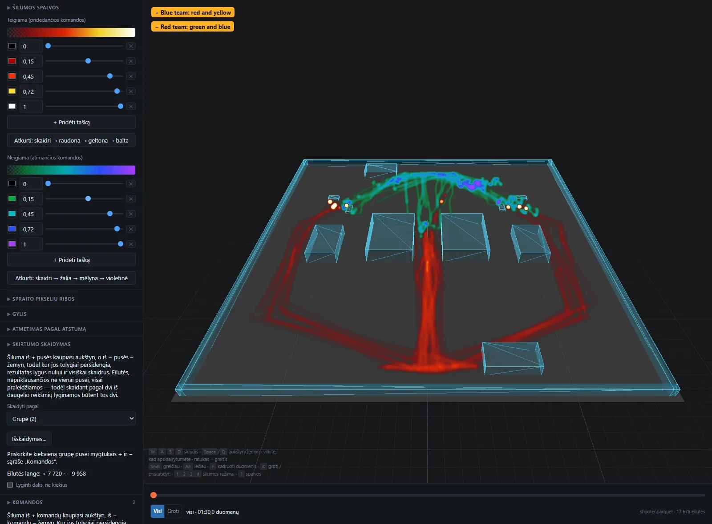

# Skirtumas

Raudona ten, kur komanda A buvo daugiau, žalia-mėlyna ten, kur buvo komanda B, nieko ten, kur jos buvo lygios.

**Skirtumas** (klavišas 2) yra ženklinė šiluma. Vienos populiacijos eilutės prideda šilumą; kitos populiacijos eilutės ją atima. Ten, kur abi
sutampa lygiai, rezultatas yra nulis ir visiškai permatomas; ten, kur viena dominuoja, jis rodomas tos pusės spalvomis - pagal nutylėjimą šiltomis
(permatoma → raudona → geltona → balta) **+** pusei ir vėsiomis (permatoma → žalia → mėlyna → violetinė) **−** pusei.

## Kaip naudoti {#how-to-use-it}

1. Spauskite `2` (arba pasirinkite **Skirtumas** režimų juostoje).
2. Šoninėje juostoje atidarykite **Skirtumo skaidymas**.
3. Pasirinkite, ką **Skaidyti pagal**: dažniausiai *Grupės*.
4. Vieną grupę (ar reikšmę) padėkite ant **+**, kitą - ant **−**.
5. Perskaitykite spalvas: šiltos reiškia + pusę, vėsios - − pusę. Skydelis įspės, jei vienoje pusėje nėra eilučių (žr. [Pranešimai, kuriuos galite matyti](#messages-you-may-see)).

*Kurios* dvi populiacijos - visas klausimas, todėl skaidyti galima pagal bet kurį išsaugotą stulpelį, ne tik pagal grupes. Eilutės, patenkančios
**ne į vieną** pusę, **paliekamos**, o ne skaičiuojamos kaip nuliai: būtent todėl skaidymas per dvi iš daugelio reikšmių palygina tik tas dvi, ir jis
dera su [filtrais](filters.md) - nufiltruokite iki vieno žemėlapio, tada skaidykite pagal versiją.

Režimui reikia dviejų pusių: grupės stulpelio su bent dviem grupėmis arba skaidymo per stulpelį, išsaugotą filtravimui. Duomenims su mažiau nei dviem
grupėmis įkėlimas pradeda nuo stulpelio skaidymo - pirmiausia *Source file* stulpelis, jei įkelta kelių failų, kitu atveju pirmas kategorijų stulpelis su
dviem reikšmėmis, kitu atveju pirmas skaitinis stulpelis su ruožu - todėl *palyginti du įkėlimus* veikia ir duomenims be jokių grupių. Režimas nepasiekiamas
tik duomenims be nieko; taip pat ir tada, kai stulpelio skaidymas nieko nepalieka vienoje pusėje.

## Skirtumo skaidymo skydelis {#the-difference-split-panel}

Rodomas skirtumo režime, po šilumos skydeliais.

**Skaidyti pagal** siūlo:

| Parinktis | Rodoma kaip | Skaidymo taisyklė |
|---|---|---|
| Grupės | *Grupė (N)* (kai yra grupės stulpelis) | Kiekviena grupė ant +, − arba ne vienoje pusėje, nustatoma [Komandų sąraše](teams-list.md) |
| Kategorijų stulpelis | *stulpelis (N reikšmių)* | Reikšmės ant +, − arba ne vienoje pusėje |
| Skaitinis stulpelis | *stulpelis (skaitinis)* | Reikšmių ruožas kiekvienai pusei |
| Kilmės failas | *Source file - palyginti du įkėlimus* (kai įkelta kelis failus) | Failai ant +, − arba ne vienoje pusėje |

Siūlomi tik stulpeliai, pažymėti *Išsaugoti filtravimui* įkeliant.

### Lyginti dalis, ne skaičius {#compare-shares-not-counts}

**Lyginti dalis, ne skaičius** (pagal nutylėjimą išjungta) sveria kiekvieną pusę pagal vieną, padalytą iš jos eilučių skaičiaus, todėl pusė su penkis kartus daugiau
eilučių nelaimi vien skaičiais. Spalva tada rodo, kur kiekviena pusė proporcingai dažnesnė nei kita. Naudokite, kai dviejose pusėse duomenų labai skirtingai,
pavyzdžiui, dvi skirtingo ilgio sesijos.

### Pranešimai, kuriuos galite matyti {#messages-you-may-see}

Skydelis įspėja, kai vaizdas nėra tikras skirtumas:

| Pranešimas | Reikšmė |
|---|---|
| *N + / M −* (arba *N + / M − / K nenaudojama*) | Kiek reikšmių yra kiekvienoje pusėje (ir ne vienoje pusėje). |
| Lange nėra eilutės **+** pusėje | Nubrėžta tik **−** pusė. Perkelkite laiko juostos langą arba pakeiskite skaidymą. |
| Lange nėra eilutės **−** pusėje | Nubrėžta tik **+** pusė. |
| Nei viena reikšmė nepatenka į pusę | Skirtumas nieko nebrėžia. Padėkite bent vieną reikšmę ant **+** arba **−**. |
| *stulpelis* negali būti skaidomas šitaip | Pasirinktas stulpelis netinka skaidymui. Pasirinkite stulpelį iš naujo. |
| Skaidymo stulpelis neatitiko GPU atminties N iš M dalių | Tos eilutės nenubrėžiamos. Padidinkite GPU biudžetą skiltyje Našumas → Išteklių biudžetai arba įkelkite mažiau eilučių. |

### Pagal grupę {#by-group}

Skydelis tik nukreipia į [Komandų sąrašą](teams-list.md), kur kiekviena grupė turi **+** ir **−** mygtukus. Kiekvieno įkėlimo metu pirma grupių pusė
(suapvalinta aukštyn) padedama ant +, likusios - ant −; **Padalyti lygiai** Komandų sąraše daro tą patį dar kartą. Grupė, esanti ne vienoje pusėje, arba paslėpta
savo varnele, nieko neprideda.

### Pagal kategorijų reikšmes {#by-category-values}

| Dalis | Reikšmė |
|---|---|
| `a + / b − / c nenaudojama` | Kiek reikšmių yra kiekvienoje pusėje ir ne vienoje pusėje. |
| **Išvalyti** | Padeda kiekvieną reikšmę į ne vieną pusę. |
| Reikšmių sąrašas | Kiekviena reikšmė su **+** ir **−** mygtuku (spustelėkite aktyvųjį dar kartą, kad jį nuimtumėte nuo tos pusės). Tuščia reikšmė rodoma kaip *(trūksta)*. |
| Ribos pastaba | Rodomos tik pirmosios 200 reikšmių: *Rodomos pirmosios 200 iš N reikšmių. Tokį platų stulpelį geriau pirma susiaurinti filtru arba skaidyti pagal ruožą, jei jo reikšmės surikiuotos.* |

Pasirinkus stulpelį, jo pirmoji reikšmė padedama ant +, antroji - ant −. Kai nė vienoje pusėje nėra reikšmių, skaidymas grįžta prie grupių, o ne rodo tuščią rėmą.
*Source file* veikia taip pat, po vieną reikšmę kiekvienam failui - taip lyginami du eksportai, du bandymų paleidimai ar dvi versijos.

### Pagal ruožą {#by-range}

| Dalis | Reikšmė |
|---|---|
| Užuomina | Stulpelio mažiausia ir didžiausia reikšmė. |
| **Teigiamas ruožas (+)**, **nuo** / **iki** | Eilutės su reikšme šiame ruože, įskaitant abu galus, prideda. |
| **Neigiamas ruožas (−)**, **nuo** / **iki** | Eilutės šiame ruože atima. |
| **Skaidyti per vidurį** | Nustato + į [mažiausia, vidurys] ir − į [vidurys, didžiausia] - tą patį daro ir pasirinkus stulpelį. |

Reikšmė abiejuose ruožuose skaičiuojama kaip +. Ruožai nebūtinai padengia visą stulpelį; reikšmės, nepatenkančios į nė vieną, paliekamos. *Pirmosios dvi minutės prieš paskutines dvi* yra ruožo skaidymas pagal laiko tipo stulpelį.

## Spalvos {#colours}

Skiltyje **Šilumos spalvos** šiame režime rodomi du skalių redaktoriai: **Teigiama (adityvinės komandos)** ir **Neigiama (atimamosios komandos)**, kiekvienas su savo
atstatymo mygtuku (*Atstatyti į permatoma → raudona → geltona → balta*, *Atstatyti į permatoma → žalia → mėlyna → violetinė*). Kompozitas ima grynosios šilumos absoliutinę
vertę per [sodrumo tašką ir atsaką](colour-and-exposure.md), ir pasirenka neigiamą skalę ten, kur grynasis rezultatas mažesnis už nulį. Žr.
[Spalva ir ekspozicija](colour-and-exposure.md#the-ramp-editor).

Naudokite *Linijinį* tankio atsaką, kai svarbus skirtumo dydis: tai vienintelis atsakas, kuriame ta pati spalva reiškia tą patį skaičių.

## Kūrėjams {#for-developers}

Kiekviena eilutė viršūnių šeideryje gauna ženklą +1, -1 arba 0 ([`POINT_HEAT_VS`](https://github.com/Holdi601/3DHeat/blob/main/src/render/webgl2/shaders.ts)); 0 atmeta eilutę prieš
piešiant bet kurį fragmentą.

- Pagal grupę ženklas ateina iš 4 096 įrašų grupių lentelės, indeksuojamos pagal eilutės grupės id (grupės id keliauja ketvirtuoju eilutės pozicijos tekselio kanalu).
- Pagal kategoriją ženklas ateina iš antros 4 096 įrašų lentelės, užpildomos kiekvienai kategorijos reikšmei, o eilutės reikšmė nuskaitoma iš stulpelio filtro tekstūros;
  reikšmė už lentelės ribų atmetama abiejuose realizacijose.
- Pagal ruožą eilutės reikšmė lyginama su abiem ruožais.

Pakeitus skaidymą, kaupimas pradedamas iš naujo.

**Paslėptos grupės lieka paslėptos su bet kokiu skaidymu.** Skaidant pagal stulpelį grupių lentelė nebeturi ženklų; ji laiko 1 rodomai grupei ir 0 paslėptai grupei
([`frameSignTables`](https://github.com/Holdi601/3DHeat/blob/main/src/render/filterTables.ts)), o abi lentelės pasiekia šeiderį kartu - dvi vieno ženklų tekstūros eilutės WebGL2 ir dvi vieno saugojimo buferio pusės WebGPU.
Eilutė nubrėžiama tik tada, kai jos grupė rodoma *ir* jos stulpelio reikšmė yra vienoje pusėje. Taigi grupė, nužymėta [Komandų sąraše](teams-list.md), arba
praleista Rungtynių skirtuko pusės fokusu, nieko neprideda, kaip bepadalintum skirtumą.

