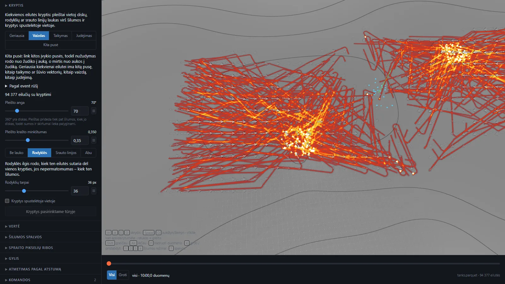

# Krypties šiluma

Paprasta šiluma parodo **kur** vyksta dalykai. Krypties šiluma parodo dar ir **kuria kryptimi**: į kurią pusę žmonės žiūrėjo, taikė, judėjo, arba kur buvo kita kovos pusė.

Įprastas spraitas yra visas diskas (360 laipsnių). Su **Pleišto anga** 70 laipsnių tas pats spraitas tampa siauru pleištu, nukreiptu ta kryptimi, kuria buvo nukreipta eilutė, ir prideda tiek pat bendros šilumos.

## Kaip naudoti {#how-to-use-it}

1. Įkelkite duomenis, kuriuose yra kryptis (žr. [Kas suteikia eilutei kryptį](#what-gives-a-row-a-direction)).
2. Režimų juostoje pasirinkite **Šiluma**, **Skirtumas** arba **Komandų šiluma**.
3. Šoninėje juostoje atidarykite skyrių **Kryptis**.
4. Pasirinkite **šaltinį** (kuria kryptimi naudoti), tada įjunkite piešimą:
   - sumažinkite **Pleišto anga** žemiau 360°, kad kiekviena eilutė būtų piešiama kaip pleištas, nukreiptas jos kryptimi, o ne kaip diskas;
   - pasirinkite **Lauką**, kad virš šilumos būtų piešiamos rodyklės ar srauto linijos;
   - pažymėkite **Kryptys spustelėtoje vietoje** ir spustelėkite šilumą, kad gautumėte tos vietos polinę diagramą.

Būsenos eilutė nurodo, kiek eilučių turi kryptį iš pasirinkto šaltinio.

## Nustatymai {#settings}

| Nustatymas | Numatytoji | Ką daro |
|---|---|---|
| Šaltinis: **Geriausias**, **Vaizdas**, **Taikinys**, **Judėjimas**, **Kita pusė** | Geriausias | Kokią kryptį gauna kiekviena eilutė. *Geriausias* paima, kiekvienai eilutei, kitą pusę, kitaip taikinį, kitaip vaizdą, kitaip judėjimą. |
| **Pagal įvykio rūšį** | kaip aukščiau | Skirtingas šaltinis kiekvienai įvykio rūšiai, pavyzdžiui, *Kita pusė* nužudymams ir *Vaizdas* pozicijoms. Rodoma, kai duomenyse yra įvykio stulpelis su ne daugiau kaip 40 reikšmių. |
| **Pleišto anga** | 360° | 360° yra įprastas diskas (išjungta). Mažesnė reikšmė – siauresnis pleištas. Pleištas prideda tiek šilumos, kiek jo diskas, todėl sumos ir skirtumai lieka palyginami. |
| **Pleišto krašto minkštumas** | 0,35 | 0 – aštrių kraštų pleištas, 1 – minkštas sektorius. |
| **Laukas**: Be lauko, Rodyklės, Srauto linijos, Abu | Be lauko | Rodyklės: rodyklės ilgis rodo, kiek eilutės ten sutaria dėl vienos krypties, jos nepermatomumas – kiek ten šilumos. Rodyklės rodomos tik ten, kur yra šiluma. |
| **Rodyklių tarpai** | 28 px | Atstumas tarp rodyklių ekrane. |
| **Animuoti srauto linijas** | įjungta | Srauto linijos teka, kol įjungta. |
| **Kryptys spustelėtoje vietoje** | išjungta | Spustelėkite šilumą, kad pamatytumėte kryptis toje vietoje (žemiau). |
| **Kryptys pasirinktame tūryje** | | Ta pati diagrama visam, kas yra pasirinktame [tūryje](volumes.md). |

## Polinė diagrama vietoje {#the-polar-chart-at-a-spot}

Įjungus **Kryptys spustelėtoje vietoje**, spustelėkite šilumą. Eilutės arti to taško (per 1,5 spraito spindulio) surenkamos į rožę iš 24 15° dalių:

- **oranžiniai** žiedlapiai: išeinančios kryptys (į kurias nukreiptos eilutės);
- **mėlyni** žiedlapiai: įeinančios kryptys (iš kur jos atėjo);
- žiedlapio **plotas** auga kartu su jo skaičiumi; rodyklė rodo pagrindinę kryptį;
- linijos po diagrama pateikia pagrindinį kampą, kaip stipriai eilutės sutaria (R, nuo 0 iki 1), sklaidą laipsniais ir eilučių skaičių.

0° diagramoje yra viršuje, o tai pasaulio −Z (šiaurė Tacview įrašams). Vieta taip pat pažymėta 3D vaizde rodykle ir žiedu.

## Kas suteikia eilutei kryptį {#what-gives-a-row-a-direction}

| Šaltinis | Ko reikia duomenyse |
|---|---|
| Vaizdas | posūkio stulpelis (susietas kaip žiūrėjimo kryptis): `yaw`, `heading`, `azimuth`, `view_yaw`, `rot_z` |
| Taikinys | skaičių poros, pavyzdžiui, `aim_x`/`aim_y`, `shot_x`/`shot_y`, `fire_x`/`fire_y`, `hit_dir_x`/`hit_dir_y` (neprivalomas `…_z`) |
| Judėjimas | nieko papildomo: žingsnis nuo to paties asmens ankstesnio mėginio (ne daugiau kaip 10 s anksčiau, ta pati sesija) |
| Kita pusė | įvykio stulpelis, nurodantis kitą pusę (`other`, `victim`, `target`, `killer`, `attacker`, `shooter`, `other_player` ...), kurio reikšmės yra asmenų vardai; nužudymas rodo nuo žudiko į auką, mirtis – nuo aukos į žudiką |

## Patarimai {#tips}

- Pleištams reikia tam tikro dydžio ekrane; mažiau nei kelių pikselių jie vėl piešiami kaip diskai.
- Naudokite *Kita pusė* nužudymų eilutėms, kad pamatytumėte, **iš kur** kovos buvo laimėtos, o *Vaizdas* pozicijų eilutėms – **kur žmonės žiūri**.
- Su **Skirtumas** dviejų pusių pleištai nukreipti į savo kryptis, todėl ginčijamos ugnies linijos išsiskiria.
